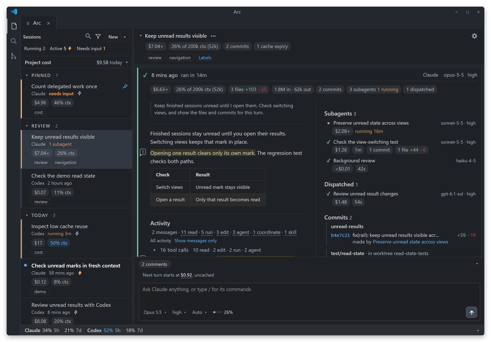
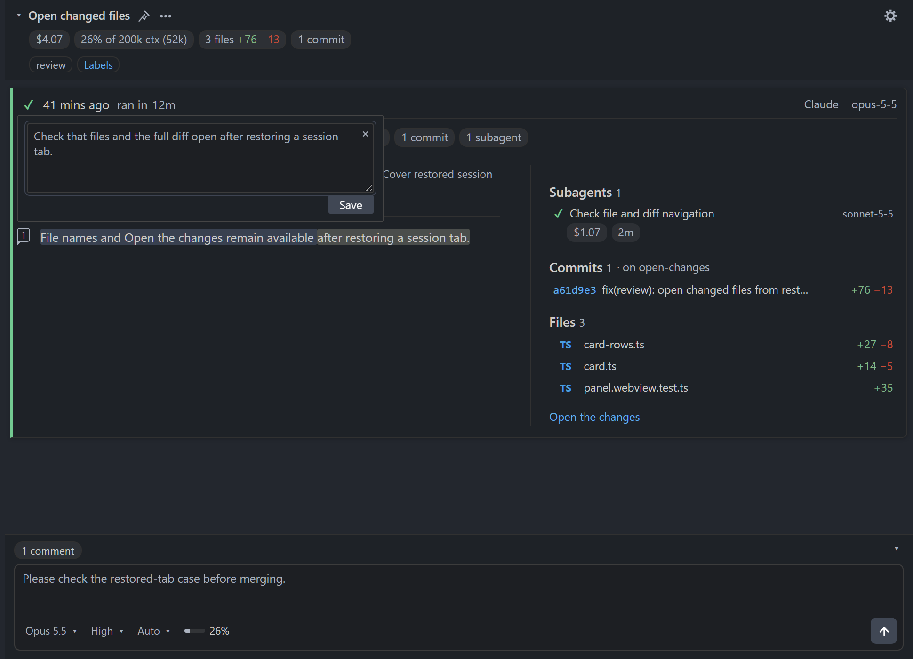
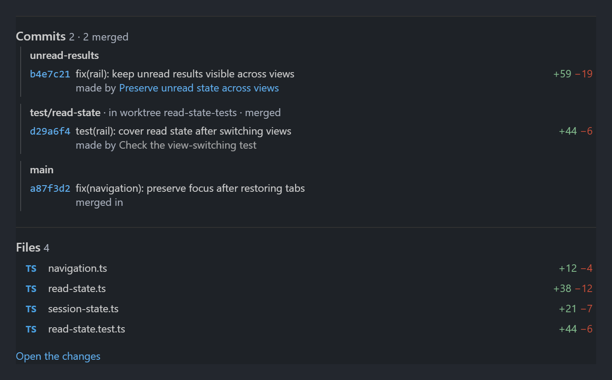
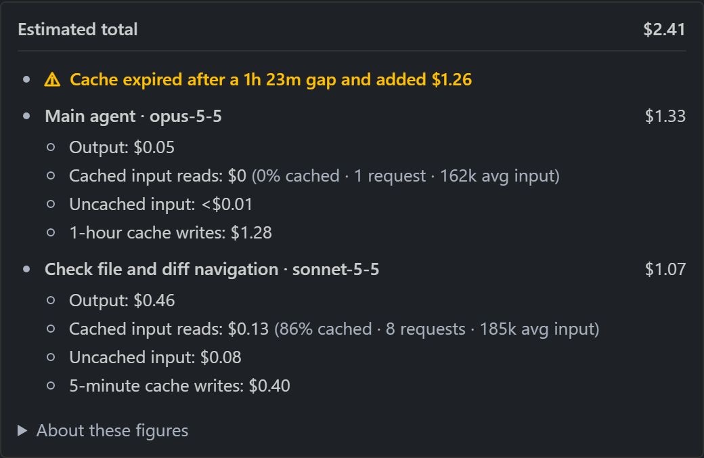
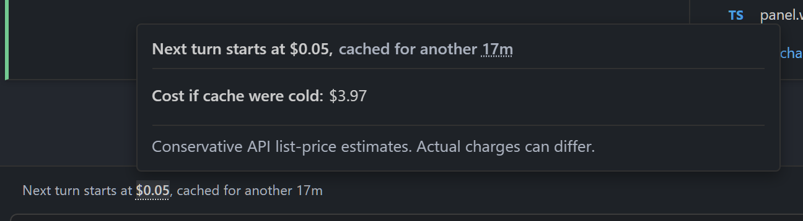
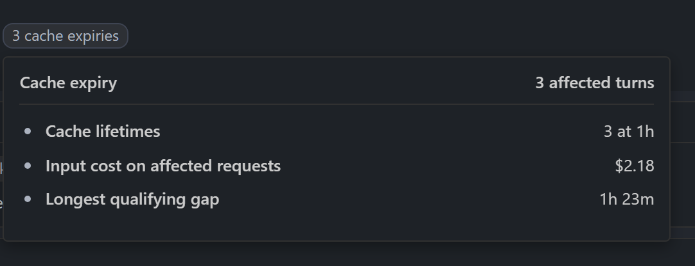
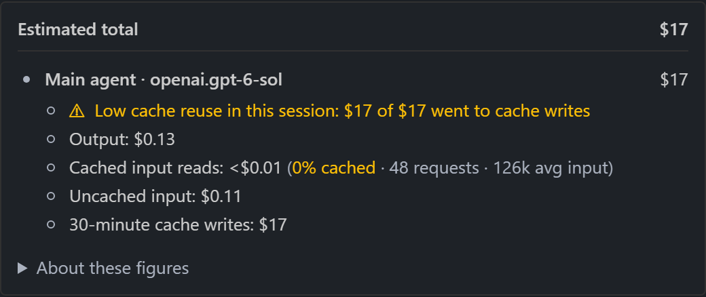
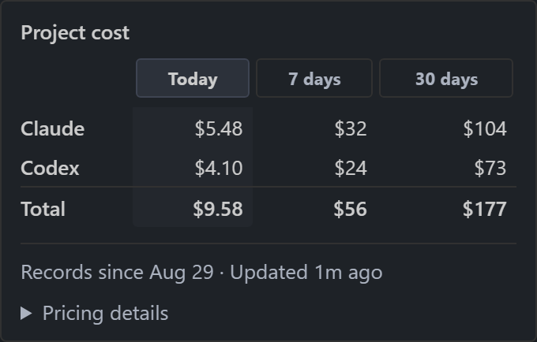
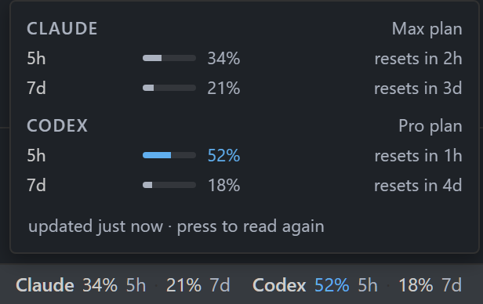

# Arc

Arc is a VS Code extension for running many Claude Code and Codex agents in parallel. It adds what I find missing from both, with one interface for both agents. (_Personal software, experimental_)

[Try the web demo](https://glin.github.io/arc/)

- Keep track of all the agents! Vertical tabs, labels, saved views, filters, and links to subagent sessions.
- Read results, not chat. Each session is a timeline of turns, each showing the final response, file edits, commits, subagents, and cost.
- See what every turn costs, including subagents. Save costs with prompt cache expiry and next-turn starting price hints.
- Stay in VS Code, no prescribed workflow. Use Arc with or without worktrees, or as a viewer for Claude/Codex CLI and desktop sessions.
- Let agents use Arc. Claude can start a Codex session, or the reverse, and the parent turn shows it with its cost. Agents can also label, pin, and archive sessions, and queue their own compaction.

<a href="docs/images/readme-main.webp"></a>

## Install

Requires Node.js 22+ and npm. On Windows, use Git Bash. Install [Claude Code](https://code.claude.com/docs/en/setup), [Codex](https://developers.openai.com/codex/cli/), or both.

```bash
curl -fsSL https://raw.githubusercontent.com/glin/arc/main/install.sh | bash
```

The installer adds Arc to VS Code, sets up the Claude hooks, and installs the [`arc-sessions` skill](#let-agents-use-arc) for the agents it finds. It works with VS Code, VS Code Insiders, Cursor, Positron, and VSCodium. See [CLI installation](cli/README.md#install) for its options and for using `arc` outside VS Code.

Reload VS Code. Use the Arc icon in the editor toolbar or **Arc: Open Arc in Editor** in the Command Palette.

Arc runs the installed `claude` and `codex` with their existing sign-in: a Claude or ChatGPT subscription, or an API key. To sign in:

```bash
claude auth login
codex login
```

### Claude hooks

Both default source installs use matching hooks in managed storage. Existing checkout marketplaces require [one-time recovery](docs/development.md#legacy-checkout-plugin-recovery).

The optional Claude hooks let Arc show full file diffs. Restart Claude to load them. To install them later, run **Arc: Set up Claude hooks** from the Command Palette. To skip them, add `--no-hooks`:

```bash
curl -fsSL https://raw.githubusercontent.com/glin/arc/main/install.sh | bash -s -- --no-hooks
```

### Uninstall

Remove Arc from the VS Code Extensions view. The Claude hooks, the `arc` command, and the session skill stay installed. See [uninstallation](cli/README.md#uninstallation) to remove them.

## Turns, not chat

Each session is a timeline of turn cards, newest first. A card shows the final response next to the files, diffs, commits, subagents, and cost from that turn. Long sessions stay easy to scan.

Select text in a response to comment on it. Arc sends comments to the agent with the next prompt.

<a href="docs/images/readme-comment-editor.webp"></a>

### Files and commits

Review file diffs before the agent commits, and open them in VS Code. Commits open in VS Code and show their branch and worktree when known, and which subagent made them. Arc lists fast-forward merges separately from authored commits.

Full file diffs for Claude need the optional [Claude hooks](#claude-hooks).

<a href="docs/images/readme-files.webp"></a>

## Cost on every turn

Every turn shows its estimated cost. Open it to see the main agent and each subagent separately.

<a href="docs/images/readme-cost.webp"></a>

Above the prompt box, Arc shows the next turn's starting price with a warm or cold cache, and the remaining cache time.

<a href="docs/images/readme-next-turn.webp"></a>

When a cache expires between turns, the cost detail shows the extra cost of resending the context.

<a href="docs/images/readme-cache-expiry.webp"></a>

Arc warns when a session reuses little of its cache.

<a href="docs/images/readme-cache.webp"></a>

Project cost shows Claude and Codex totals for today, 7 days, and 30 days. The usage bar shows each agent's plan limits and reset times.

<a href="docs/images/readme-project-cost.webp"></a> <a href="docs/images/readme-usage.webp"></a>

Costs are estimates from published list prices for Claude and GPT models, direct or on Amazon Bedrock. They are not a subscription bill. [`arc cost`](docs/cli.md#read-a-cost-report) gives the same estimates from saved transcripts.

## Many agents at once

Claude and Codex sessions share one session list, one timeline, and one prompt box.

- See which sessions are running, unread, or waiting for input.
- Pin, label, and archive sessions. Build saved views from labels.
- Save model setups with agent, model, effort, and permissions per project.
- Use `/skill` in Codex the same way as in Claude.
- Keep unsent drafts across session switches.

Arc also shows Claude and Codex sessions started in a terminal or desktop app, from the open project and its git worktrees.

Session links in agent responses open in Arc. Export a session and its linked sessions as one HTML file to share.

## Let agents use Arc

Either agent can start Claude Code or Codex sessions from a shell command. The dispatched session appears in Arc's session list, and its parent turn shows it with its cost. The name on the parent turn opens that session.

The [`arc-sessions` skill](docs/arc-sessions.md) lets agents start sessions in Arc, read their results, and send follow-ups. Agents can also label, pin, and archive sessions, queue a compaction of their own session for after the turn, and estimate costs with `arc cost`.

Arc supplies native session skill discovery for supported sessions it starts. [Automatic availability](docs/arc-sessions.md#automatic-native-availability) describes compatibility and manual installation.

```text
Use Arc to summarize the sessions labelled Review in this window.
Read their completed turns.
Report results, blockers, and decisions needing my input.
```

```text
Claude, use Arc to start a Codex session reviewing this branch.
Name it Branch review, apply Review, and pin it.
Read its result and summarize its findings.
```

See [Dispatch and message agents](cli/README.md#dispatch-and-message-agents) for the command.

```text
After saving the handoff,
request compaction of this session after your response.
```

### Hand off to a fresh session

An agent can pass a saved handoff to a fresh Claude Code or Codex session.

```text
Save the task, decisions, and remaining work in a handoff.
Use Arc to start a fresh Codex session with that handoff.
```

Your prompts and skills control when to hand off. Arc does not automatically start a successor when context fills.

## Limitations

Arc only supports Claude Code and Codex for now, and doesn't support every feature of either. In a running Claude session, `/remote-control` and `/rc` turn Claude Remote Control on or off. Arc does not support prompts or permission answers from a connected browser or phone client.

Pricing for other providers, such as OpenRouter and Google Vertex AI, is not supported.
