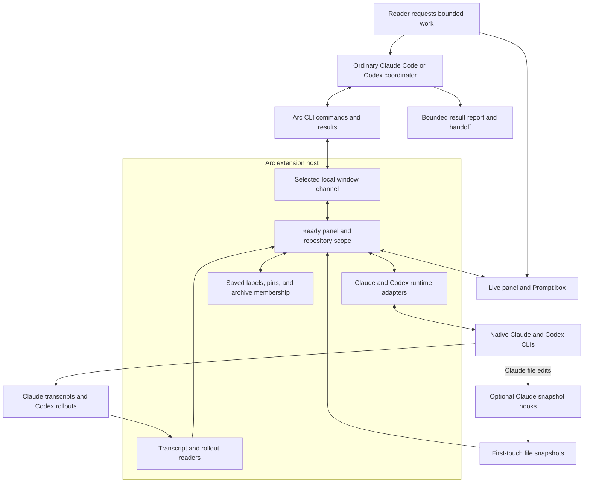

# Arc sessions for agents

The `arc-sessions` skill lets a Claude Code or Codex agent start, inspect, and organize requested work through a running Arc window. The reader reviews those sessions in the panel and continues them through the Prompt box.

## The four components

| Component | Job | Installation |
| --- | --- | --- |
| Arc extension | Displays sessions and connects to agent CLIs. Includes `arc` launchers for panel-started agents. | Source installer or an available VSIX. |
| Standalone Arc CLI | Makes `arc` and `arc-status` available to ordinary shell commands. | Local npm tarball from the [CLI build instructions](../cli/README.md#build-from-source). |
| `arc-sessions` skill | Gives an agent instructions for bounded session work through the CLI. | Reader installs or links the skill separately. |
| `arc-hooks` Claude plugin | Captures first-touch file snapshots for Claude file diffs. | Source installer or Claude plugin marketplace. |

The skill source is [`cli/skills/arc-sessions/SKILL.md`](../cli/skills/arc-sessions/SKILL.md). The standalone CLI package includes it under `skills/arc-sessions/SKILL.md`. The VSIX and Claude plugin do not include the skill.

Bundled files are part of an artifact. An installed skill exists in an agent's skill directory. A release requires publication of the corresponding artifact. None of these states establishes the others.

## Install the parts you need

`install.sh` builds and installs the editor extension. It also sets up the optional Claude plugin unless passed `--no-hooks`. A local source installation uses the checkout's code. A remote source installation resolves the selected ref before downloading it.

A VSIX installs the extension. The separate release downloader requires published VSIX and checksum assets. Claude marketplace installation selects `arc-hooks`, not the CLI or session skill. [Development setup](development.md#dependencies) owns local plugin commands. Session commands use Arc's local window channel without requiring Claude hooks. Codex records come from its rollouts.

Arc has no editor command named **Arc: Install CLI**. To update the standalone CLI, build a current source checkout and install its tarball. [CLI installation](../cli/README.md#install) owns the commands and Node requirements. npm publication is deferred, so a registry `latest` install is not an available release path.

The reader chooses which agents receive the skill. [Manual skill installation](../cli/README.md#session-skill) provides Windows junction and macOS/Linux link commands. Claude Code uses `~/.claude/skills/arc-sessions`. Codex uses `~/.agents/skills/arc-sessions`. A source link reads the linked checkout's instructions. Restart the agent session after installation.

The third-party [Vercel skills CLI](https://github.com/vercel-labs/skills#readme) also supports local paths, named skills, and both agents. From an Arc checkout, these commands list the skill, then install it:

```sh
npx skills add ./cli/skills --list
npx skills add ./cli/skills --skill arc-sessions --global --agent claude-code --agent codex
```

These are documented installer forms, not a tested Arc installation route. Use the explicit `cli/skills` directory because the repository nests the skill beneath `cli`. Repository-root discovery requires `--full-depth`. `npx skills` installs skill files. It does not install the Arc CLI, extension, or Claude plugin.

Arc does not automatically install the session skill or inject its instructions into agent prompts. The agent discovers installed skills through its native skill directories. Both providers list skill metadata and load the full instructions when the skill activates. Explicit invocation uses `/arc-sessions` in Claude Code or `$arc-sessions` in Codex. The agent also selects relevant skills from their descriptions, subject to provider configuration. [Claude skill guidance](https://code.claude.com/docs/en/skills) and [Codex skill guidance](https://learn.chatgpt.com/docs/build-skills) own discovery, selection, and context-loading behavior.

Ordinary `claude -p` loads the same configured context as an interactive session, including available skills unless disabled. By default, `--bare` skips automatic skill discovery. [Claude programmatic guidance](https://code.claude.com/docs/en/headless) owns bare-mode exceptions. Context use depends on listed metadata and activated instructions. Loading the skill does not authorize session starts or create an automatic workflow. The agent must receive a request authorizing the work it starts.

An ordinary CLI session can coordinate work when its shell finds `arc` and the intended Arc window is ready. The extension supplies its own launcher environment to panel-started agents. [Agent runtime](agent-protocols.md#runtime-shape) owns that environment.

## A bounded coordinator run

A coordinator is an ordinary agent session given an explicit session-management task. The skill supplies instructions rather than a scheduler or separate coordinator process.



For a small two-provider run, choose offered low-cost setups and launch one Claude session and one Codex session. Python and shell coordinators both invoke the same CLI. Use `--untagged` for reader-requested work and `--arc-dispatch` for its parent-session receipt. Use `--agent-run` for delegated work instead. [Session management](cli.md#session-management) owns command arguments, delivery outcomes, archive rules, and uncertain-launch handling.

Read each result before describing it. Recorded model and effort establish execution settings, while a requested setup only establishes what the caller selected. Keep a session available for reader continuation when that is part of the task.

Personal `ship` and `dispatch` skills define their own implementation and review workflows. Arc does not package them. The session skill does not automatically review changes, send corrections, rotate coordinator context, or supervise workers continuously. There is no `arc send` command. The reader sends follow-up prompts through the panel.

## Manual check

Start with read-only commands. Open Arc in the intended repository and keep the panel visible.

```sh
arc --version
arc windows --json
arc setups --window WINDOW_ID
arc sessions --window WINDOW_ID --json
arc session SESSION_ID --turns 2 --window WINDOW_ID --json
arc pin SESSION_ID --dry-run --window WINDOW_ID
```

Replace `WINDOW_ID` with the selected window's `hostId`. Confirm `scopeReady` and `panelReady` before proceeding. Replace `SESSION_ID` with a listed session. If the list is empty, skip the session read and pin dry run. Reads leave reader attention unchanged, and the pin dry run writes no state. Preserve incomplete or unknown results when reporting the check.

An optional launch check sends paid agent requests and requires reader authorization. Choose the cheapest suitable offered settings for one Claude session and one Codex session. In `arc setups`, reusable rows appear in `primary`, `inherited`, `pinned`, and `recent`. Each row supplies a `key` and a `profile.agent`. Use a row for the intended provider, and exclude pinned rows whose `available` is false.

A provider without a reusable row still has explicit choices in `agents`. Select its `value`, then a model's `models[].value`, that model's `efforts[].value`, and the provider's `permissions[].value`. Model choices are values, not setup keys. A fresh project has no guaranteed reusable row for either provider. If `modelsPending` is true or no model is offered, wait for catalog loading and read setups again.

Create the prompt file below in PowerShell. Replace `WINDOW_ID` with the selected window's `hostId`. This writes regular UTF-8 without a byte-order mark, including on PowerShell 5.1.

```powershell
$arcWindow = 'WINDOW_ID'
$arcPrompt = [System.IO.Path]::GetTempFileName()
$arcEncoding = New-Object System.Text.UTF8Encoding($false)
[System.IO.File]::WriteAllText($arcPrompt, 'Reply with Ready. Do not use tools or change files.', $arcEncoding)
```

For each provider, use one launch route. With returned keys, replace the key placeholders below:

```powershell
arc start --window $arcWindow --setup 'CLAUDE_SETUP_KEY' --prompt-file $arcPrompt --untagged --name 'Claude session check' --arc-dispatch
arc start --window $arcWindow --setup 'CODEX_SETUP_KEY' --prompt-file $arcPrompt --untagged --name 'Codex session check' --arc-dispatch
```

Without a returned key, replace the placeholders below with that provider's offered values. If a selected model, effort, or permission value is empty, omit its corresponding flag to retain the provider default. Do not combine `--setup` with explicit settings.

```powershell
arc start --window $arcWindow --provider claude --model 'CLAUDE_MODEL_VALUE' --effort 'CLAUDE_EFFORT_VALUE' --permissions 'CLAUDE_PERMISSION_VALUE' --prompt-file $arcPrompt --untagged --name 'Claude session check' --arc-dispatch
arc start --window $arcWindow --provider codex --model 'CODEX_MODEL_VALUE' --effort 'CODEX_EFFORT_VALUE' --permissions 'CODEX_PERMISSION_VALUE' --prompt-file $arcPrompt --untagged --name 'Codex session check' --arc-dispatch
```

Record both accepted session IDs. Inspect each session with the read commands above and confirm its response and recorded provider settings. If delivery is unknown, stop that launch check and preserve its request ID. Do not start a replacement.

To check curation, use the commands below only on the check sessions. Replace `SESSION_ID` with the chosen check session.

```sh
arc label add SESSION_ID --label Session-check --dry-run --window WINDOW_ID
arc label add SESSION_ID --label Session-check --window WINDOW_ID
arc pin SESSION_ID --window WINDOW_ID
arc unpin SESSION_ID --window WINDOW_ID
```

Archiving is a separate reader decision. To archive the completed Claude check session, confirm its identity and authorize removal from the active session list. If it remains unread, use the force option:

```sh
arc archive CLAUDE_SESSION_ID --force --window WINDOW_ID
```

Hidden or unavailable attention refuses archive. Leave the Codex session unarchived and send a follow-up through its Prompt box to check reader continuation. No launch check requires automatic cleanup of session state.

## Cache expiry and handoff

Arc reports context and prompt-cache evidence. The skill does not manage cache expiry, send keepalive prompts, compact sessions, or create durable handoffs automatically. [Lowering agent costs](lowering-agent-costs.md) owns continuation and handoff decisions.

A coordinator's handoff must retain the selected window, accepted session IDs, results, uncertain request IDs, and remaining reader decisions. Window reload changes the activation, so re-discover the window before new work. Saved session records and CLI reads do not restore a coordinator's own context.
