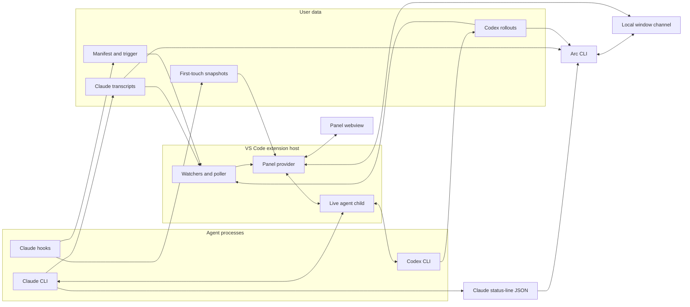

# Architecture

Use this map to find the owner of a change. The topic guides hold behavior, and [`design-goals.md`](design-goals.md) holds product intent.

## Reading guide

| Change | Guide |
| --- | --- |
| Panel visual treatments and interaction patterns | [`ui-design.md`](ui-design.md) |
| Transcripts, cards, diffs, context, cost, and refresh | [`timeline.md`](timeline.md) |
| Accepted outcomes, live subagents, and session-list status | [`timeline.md`](timeline.md#card-sources) and `timelinestate.ts` |
| Comments and text selection | [`comments.md`](comments.md) |
| Session list, search, menus, and editor navigation | [`rail-and-navigation.md`](rail-and-navigation.md) |
| Prompts, queue, controls, and account usage | [`composer.md`](composer.md) |
| Child processes, resume, and agent protocols | [`agent-protocols.md`](agent-protocols.md) |
| CLI commands, arguments, and output | [`cli.md`](cli.md) |
| Setup, tests, and performance capture | [`development.md`](development.md) |

## System shape

Arc reads completed work from files, including sessions started in a terminal or another editor window. A child process carries live prompts, questions, and controls.



The extension never writes a file the agent changed. Hooks write only under the snapshot store. The panel opens files and diffs through VS Code. The CLI reads Claude status-line JSON from stdin or one session's Claude or Codex records from disk. Window discovery asks running extension hosts through their local channels.

## Data sources

`install.sh` detects complete source beside the script, then in the working directory, or resolves a GitHub ref and downloads its exact SHA. Remote source, dependencies, and the VSIX live in an installer-owned temporary directory that cleanup removes. Local builds use `npm install` to update existing dependencies. Temporary downloaded builds use `npm ci` for a clean installation. A local marketplace selects its relative plugin in place. The hosted catalog selects the plugin independently of `--repo` and `--ref`. `scripts/package-claude-plugin.js` produces the plugin ZIP, digest, and hosted catalog for the candidate workflow. [Installation](../README.md#try-it) owns source setup and hook options.

The startup panel shell supplies no saved-filter catalog. The session list retains restored view folds until the host supplies the saved-filter catalog and views.

The installer's current-editor detection reads `product.json` beside the bundled Git askpass script identified by `VSCODE_GIT_ASKPASS_MAIN`. Windows user and system installations also supply content-addressed askpass copies outside the installation. For those copies, readable `VSCODE_GIT_ASKPASS_NODE` anchors metadata lookup in its installation's flat resources or immediate ten-hexadecimal version folders. Matching product identities across those folders select the outer installation's CLI. Conflicting identities leave detection unavailable. Bundled askpass scripts in version folders use the executable path to resolve the outer installation. `TERM_PROGRAM=vscode` alone does not distinguish editor products. A supplied `VSCODE_GIT_ASKPASS_NODE` must identify a readable executable in the same installation and is never executed. Missing or unsupported identity data leaves current-editor detection unavailable. The selected CLI belongs to that installation, including macOS products whose launcher is named `code`.

`scripts/capture-panel-diagnostics.js` collects local performance evidence outside the extension data flow. Windows delegates to the PowerShell collector, while Linux and macOS read system process and memory sources. The platform boundary excludes Windows graphics and logon counters from Unix captures. [Performance capture](development.md#performance-capture) owns the capture order, output formats, and measurement limits.

Panel capture scripts reuse the state setup in `extension/scripts/panel-shots.ts`. Its default writer clears the target before setup and writes lossless WebP. A supplied writer receives the target unchanged and controls file admission and replacement.

The portable review runner in `evals/agent-review/run.mjs` reads tracked case fixtures and current checkout instructions. It writes external workspaces, Codex execution records, adjudications, and reports for development comparisons. `portable/cohort.mjs` checks production exports, assigned inputs, qualification receipts, and final coverage separately. Its opt-in audited instruction bundle preserves default capture behavior. [The cohort guide](../evals/agent-review/cohorts/README.md) owns qualification and preparation commands. On Windows, `portable/live.mjs` selects the elevated native sandbox backend and checks read access and write denial before a paid launch. The frozen continuation command uses `portable/resume.mjs` to reconstruct unstarted cells from retained inputs and combine preserved adjudication with new decisions. Its Windows job host contains each paid attempt and terminates descendants when the host or its identified runner exits. Shared continuation ownership uses filesystem identity and prevents concurrent launches across output directories. Fatal condition stops persist beside that ownership and require matching completion evidence before another launch. Each derived execution must match its durable claim, terminal receipt, and final receipt. The historical importer in `evals/agent-review/cli.mjs` reads registered Arc commit objects into a separate bare cache. The developer recipe in `evals/agent-review/rebuild-corpus.mjs` rebuilds production exports from historical commits and a frozen instruction snapshot. These development tools sit outside the extension data flow. Their local workspaces do not certify semantic leakage or host access isolation.

| Source | Location | What it establishes |
| --- | --- | --- |
| Static Arc demo and main README image | `extension/scripts/readme-fixture.ts` through `web-demo.ts` | `web-demo-shell.ts` and `web-demo-shell.css` own the decorative editor frame shared by the exported site and main README capture. The panel remains in the page document because its session list and popovers mount directly under the body and use viewport coordinates. Invented session records for a sample site that uses the panel bundle without starting the extension host or reading agent records. Production decoders read provider-response snapshots in `extension/scripts/demo-catalog/`. `demo-catalog-check.ts` compares installed CLI catalogs and base and model-specific defaults without sending prompts. Its `--refresh` option replaces those snapshots. Codex snapshots preserve omitted and null model and effort settings through `codexwire.ts`, so each model retains its configured default. Other configuration fields are excluded. Its `--cwd` option selects the launch folder, whose settings affect catalog aliases and applied defaults. `ARC_CLAUDE_PATH` and `ARC_CODEX_PATH` select CLI executables. Offline export does not establish snapshot freshness. `web-demo-host.ts` classifies every panel request and normalizes sample context detail through production contracts. `web-demo-adapter.js` answers supported requests in page memory. Its comment store uses the production normalizer and mutation rules across session navigation. `web-demo-menu.ts` stands in for the editor's context menu there and in the README captures |
| Offline review evidence | `evals/agent-review/cases/` and a separate bare evidence cache | Source commits, partial review keys, and exported review conditions for the development tool only |
| Portable review fixtures | `evals/agent-review/portable/cases/`, `evals/agent-review/fixtures/`, `evals/agent-review/cohorts/`, and captured checkout instructions | Candidate source, qualification checks, frozen keys, coverage targets, and instruction hashes for local exploratory comparisons |
| Claude context summary | `get_context_usage` with `detail: summary` on the selected connected child | Estimated content categories, occupied tokens, accounting window, free space, and compaction reserve from one response |
| Codex retained context | The selected rollout's newest complete replacement history or opening, plus subsequent response items and request usage | Locally estimated text categories, retained checkpoint tool text, and an explicit unattributed remainder, without attaching to a saved session |
| Claude status-line JSON | CLI stdin | Current model, effort, context size and use, prompt-cache state and expiry, and session cost metadata |
| CLI transcript target | `arc-status cost` path or session id | Windowed request usage and list-price cost for one session and its children |
| Window registry | `${ARC_HOME:-~/.arc}/hosts/<host-id>.json` | Activation identity, process id, workspace folders, repository scope readiness, panel readiness and visibility, protocol version, channel address, and authentication token |
| Claude snapshots | `~/.arc/snapshots/<session_id>/` | File content before the session first changed it, plus the files that still differ |
| Claude transcripts | `${CLAUDE_CONFIG_DIR:-~/.claude}/projects/<cwd-slug>/<session_id>.jsonl` | Prompts, responses, tool activity, usage, model attachments that name the context window, commits, subagent commits and subagent file changes, recorded edits, shell-command file changes inside a git repository, paired Bash dispatch receipts, durable process-invocation ends, background command launches, their end records and their stop calls, and session names from `custom-title` and `ai-title` records |
| Claude child transcripts | `<transcript directory>/<parent_session_id>/subagents/agent-<agent_id>.jsonl`, and `agent-<agent_id>.jsonl` beside a child transcript for the subagents that child launched | A subagent's own usage, the commits it wrote, the files it changed with their line counts, its own tool and failed-call counts by name, when it started and ended, and whether its record reaches the end |
| Claude subagent meta files | `agent-<agent_id>.meta.json` beside each child transcript | Which subagent launched a nested subagent, through `parentAgentId`. The launch call in `toolUseId` locates a child's transcript for its row's cost and effort before child discovery lists that child |
| Claude saved title file | `<transcript directory>/<session_id>/custom-title.json` | Whether Claude Code saved a session rename. Only a rename reads it, at most 4 KiB |
| Claude `init` skill list | The `skills` array on the child's own `init` system message | Which of a Claude session's published slash commands the Prompt box highlights as an inspectable skill |
| Claude skill files | `<project>/.claude/skills/<name>/SKILL.md`, then `${CLAUDE_CONFIG_DIR:-~/.claude}/skills/<name>/SKILL.md` | The definition path a Claude skill mark and its popover show, the project folder winning over the reader's own |
| Codex live skill catalog | `skills/list` on a connected app-server child, refreshed after `skills/changed` | The complete Codex command and skill list the Prompt box offers for that child's working directory |
| Codex rollouts | `${CODEX_HOME:-~/.codex}/sessions/YYYY/MM/DD/*.jsonl` | The Codex form of the same turn record, including recent compaction request usage and shell-command dispatch receipts from each command's own stdout |
| Claude print results in Codex commands | The completed `CommandExecution` inside its parent Codex rollout | Shell-child ownership, recorded model usage, duration, session identity, and list-price cost |
| Agent child stdio | Process owned by the current extension host | Temporary live narration and activity before the disk record catches up, and the live session's busy state and turn endings |
| Claude attribution selection | Editor environment or `.env` in the child's working directory | The local request attribution selection described in [Agent launch commands](agent-protocols.md#claude-attribution-selection) |
| Panel launch record | VS Code workspace state, beside the saved panel state | Which sessions the reader started from this panel |
| Codex session index | `~/.codex/session_index.jsonl` | Thread names, which may arrive after a rollout stops changing |
| Local git repository | The folder a command changed, and each open workspace folder | Registered worktree roots, commit details whose output printed none, and fast-forward landings from the head log |
| Browser saved panel state | VS Code webview state | The latest five exact workspace prompt submissions, saved synchronously before dispatch and reconciled with workspace recovery |
| VS Code workspace state | Extension-managed storage | Exact submitted prompt recovery, saved panel state, reader-started parent relationships and session list filters, queued submissions with delivery ownership and reset barriers, file descriptors, normalized account usage and live reset windows, and the last-reported Claude skill list for each working directory |
| Bounded usage history | `~/.arc/usage/bounded-v1/` | Admitted Claude and Codex account limit readings in thirty fixed UTC-day slots |
| Legacy usage history | `~/.arc/usage/readings.jsonl` | Preserved experimental readings, outside the bounded store's quota |
| Applied CLI defaults | Prompt-free Claude `get_settings` and Codex `config/read`, `model/list`, and `configRequirements/read` | Applied model and effort for the launch folder and committed model. Codex 0.159.2 and 0.160.0 support these reads. Other versions report unavailable defaults. The host rejects obsolete configuration replies |
| Project setups (`arc.projectSetups.v1:`) | VS Code global state, keyed by canonical project identity | Reader-local pinned setups and accepted recent setups for one repository or non-Git folder |
| Legacy pinned setups (`arc.pinnedSetups`) | VS Code global state | Initial pins copied once into each new project entry, retaining their IDs and order |
| Project spend index | `~/.arc/cache/<workspace-key>/project-spend` | Recorded usage buckets, supplemental Claude accounting, resumable reconciliation, lifetime session-cost and primary-turn facts, and incremental parser state for one normalized workspace identity |
| Derived session cache | `~/.arc/cache/<workspace-key>/derived-session-cache.json` | Rebuildable session titles, activity, run classification, outcome, and bounded context facts for one normalized workspace identity |
| Codex opening records | `~/.arc/cache/codex-openings.json` | The opening record of every Codex rollout on the machine, which places each rollout in a workspace. Every workspace and window reads and writes the one file |
| Prompt asset staging | Extension global storage | Generated-id copies of files attached to unsent, locally queued, or in-flight prompts |
| Local filesystem | The selected session's recorded working directory | Immediate path-completion candidates for the Prompt box |

Codex retained-context reads admit copied metadata only through the opening's declared fork ancestry. Tool pairs retain separate function, custom-tool, and client-search identities. Local-shell calls use function outputs. Server search outputs require no local call.

Stopped Codex display-model recovery scans backward from the accepted forward boundary in cancellable slices. Recovery retains at most 256 KiB per record and skips oversized non-model bodies. Opening-matched settings establish identity before the first task. Unproved model identity or ownership leaves the display identity absent. Exact native ownership confirmation admits a retained context model in source order. Completed recovery, including absence, is cached for that file revision. Replacement, truncation, and rewrites restart recovery. Worker replies carry recovery bytes and continuation state. The selected-window continuation resumes pending recovery even when its accepted content remains current. Optional Codex display recovery does not delay attachment handoffs. Display identity stays separate from parser billing state and retained-context facts.

The report for a turn comes from its transcript or rollout. A current-file diff may use a snapshot when the live file still differs from that snapshot. A per-turn diff never reads its after side from the live file because later work may already have changed it.

A folderless window allocates a unique cache identity without creating a directory. Its first cache write publishes ownership before data. Ownership spans panel tab closure and reopening. Terminal provider disposal closes write admission, flushes synchronous cache writers, then publishes release. Resumed partition writes allocate a fresh generation and path.

Every folderless write checks that the current ownership bytes match its registered owner. Missing, unreadable, oversized, or replaced ownership blocks admission and release publication. These synchronous path checks do not prevent external path replacement during a write.

Written folderless partitions remain on Windows, macOS, and Linux. Node exposes pathname deletion without an operation that binds every ancestor and removed directory to validated identities. Linux boot differences remain uncertain without independent same-machine evidence. Windows also lacks complete reparse-tag inspection, and Windows and macOS lack precise process-lifetime inspection here. Folderless reclamation therefore performs zero filesystem operations and no process inspection. Unwritten activations leave no partition on every platform. Prompt drafts and assets retain their separate storage lifetimes.

Closed Claude subagents reopen only when a user or assistant timestamp exceeds their close by more than one second. File writes and system bookkeeping never establish resumed work. On a changed version, the host scans disjoint 256 KiB chunks backward and reconstructs split records to find the maximum work timestamp. Read buffers hold a chunk and its unfinished record. The host caches absent timestamps too. An unchanged closed child costs no transcript read.

The line filter in `transcript.ts` that keeps ordinary tool results out of JSON parsing must admit a result marked `toolEndsTurn`. A dropped result leaves a subagent session running, then stopped, and never done.

Direct child activity is only a temporary overlay on the newest turn. Stable protocol ids let the transcript copy replace it. Work started in another window or terminal still comes from the transcript because this host does not own that process.

Hosts record bounded usage history asynchronously and preserve duplicate readings. Each slot permits 4 MiB of compressed payload and 8 KiB of metadata, temporary, and lock bytes. A fixed format file keeps protocol-created logical content below 128 MiB. This limit excludes filesystem allocation and files added by external actors. The raw allowance is 64 MiB per UTC day. Retained dates are today and the preceding twenty-nine UTC dates. Project cost uses local calendar dates.

Each host admits at most 256 KiB of queued and in-flight raw readings into one drain. Each gzip batch contains at most 64 KiB. One compressor and compressed result add bounded memory overhead. Busy, full, invalid, or failed recording leaves current account figures and their workspace persistence available.

Exclusive slot ownership spans payload writes, sync, close, and committed-prefix metadata publication. It requires a filesystem that honors exclusive creation. Unexplained payload tails, metadata temporaries, unsupported files, and failed publication or close preserve bytes and block admission. Locks receive no age takeover. Verified expired generations are replaced under ownership using the current UTC date. Closed editors and blocked slots retain physical expired bytes.

Terminal host shutdown closes recording admission synchronously and waits for active work to settle. Unowned preparation starts no further filesystem operation after closure, except closing acquired handles. Owned slot operations finish while retaining their lock. Closing a panel tab leaves recording active. Hosts running the legacy recorder append legacy history until they stop. The bounded recorder leaves that file unchanged. Historical analysis has no shipped command or panel surface.

Two windows that write setups in the same project at the same moment can lose one change. Separate projects use separate storage keys. Each host serializes pin and recent changes together. A window reads another window's pins on its next pin change or refresh. Browser setup actions carry displayed project ownership, so messages from an obsolete menu cannot use another project's row IDs. A pin request for a recent row carries its displayed values, so a shifted history position cannot pin another setup.

Project identity uses the canonical common Git directory, shared by a checkout, its registered worktrees, and opened subdirectories. A non-Git folder uses its canonical folder path. Identity failures retain a successful identity and otherwise leave setup storage unavailable. A folderless window has no reusable setup entry. Project initialization saves copied legacy pins and empty recent history together. Existing entries never import again, including empty or invalid entries. Browser readiness retries setup loading and combines concurrent reads for the same launch folder. A workspace change starts a separate read and rejects obsolete results. Legacy setup data stays unchanged.

The usage payloads name the plan but no account or organization. Readings from different accounts can therefore mix when those accounts use the same machine.

### Snapshot model

The `arc-hooks` Claude Code plugin owns one PreToolUse and Stop pair. The installer reads Claude marketplace ownership before building the extension or installing it in any editor. An existing `arc` marketplace from another source stops installation and reports its source and the expected directory or HTTPS catalog. Directory ownership compares canonical paths, including Git Bash drive paths and Windows case differences. Resolve that ownership manually or pass `--no-hooks` to preserve the existing Claude setup. After an editor installation succeeds, the installer registers the selected source and installs, updates, and enables `arc-hooks@arc` at user scope. It checks marketplace ownership again before changing plugins. Hosted hooks require Claude Code 2.1.224 or later. Claude owns its archive downloads and installed plugin cache. Downloaded temporary source never becomes a registered marketplace. The bundled commands resolve through `${CLAUDE_PLUGIN_ROOT}` in the local plugin directory or Claude's archive cache. Plugin failure preserves legacy hooks and leaves a successful editor installation usable, with a nonzero installer result. After plugin success, local installation removes direct Arc entries naming that checkout's legacy hook paths. Remote installation does not infer legacy paths from temporary source. `--no-hooks` skips plugin setup and legacy cleanup. Migration reads `${CLAUDE_CONFIG_DIR:-~/.claude}/settings.json` and `${CODEX_HOME:-~/.codex}/hooks.json`. It leaves unrelated, uncertain, malformed, or symlinked settings unchanged. The installer does not install a Codex plugin.

On Windows, a Codex CLI session on the shared background server keeps its loaded hook definitions after the hook file changes. Reopening the CLI on that session does not reload them. Exit the affected CLI and resume with `codex resume --no-daemon <session-id>`, or restart the background server after other sessions stop.

`plugins/arc-hooks/scripts/pretooluse-snapshot.cjs` stores the file before the session first edits it. A created file gets an empty baseline. The baseline does not advance between turns.

`plugins/arc-hooks/scripts/stop-manifest.cjs` rewrites `manifest.json` for sessions with snapshot history, then updates `trigger` even when their files no longer differ. Read-only sessions and ignored paths create no store without that history. Session-local index entries, published changes, baseline filenames, and pending transaction names establish history without reading baseline content. Turn attribution always comes from the transcript. Without a snapshot trigger, transcript polling still supplies the panel.

On activation, the extension removes snapshot session folders whose trigger is older than 30 days. If no trigger exists, it uses the folder timestamp.

First-touch updates and Stop publication queue per session. Stop holds the index lock through transaction recovery, file comparison, manifest replacement, and trigger renewal. A baseline and its new-file fact publish together when their transaction directory takes its stable hash name. Recovery leaves temporary transaction directories untouched. Missing indexes recover paths and new-file facts only from published transactions. A hashed baseline alone retains original bytes until a later touch supplies its path, without reconstructing its lost new-file fact. Index, manifest, and trigger readers see either the old file or the complete replacement. Windows EPERM failures during replacement receive at most ten attempts, with twenty milliseconds between attempts. Terminal failures preserve the old file.

The store contains:

```text
baseline/<sha1(abspath)>   first-touch content
index.json                 hash-to-path entries and the session cwd
manifest.json              files that currently differ from the baseline
trigger                    watcher signal
```

Identified Claude context replies have a 2 MiB frame limit and a five-second read deadline. Reordered envelopes receive a complete-frame check before parsing. The framing buffer and unrelated stdout accumulate without a bound.

## Component map

The first column is checked against the shipped extension directory by `architecture.test.ts`.

| File | Job | Imports `vscode`? |
| --- | --- | --- |
| `extension.ts` | Activation, local window channel lifetime, watcher registration, commands, editor integration, and the agent host | yes |
| `configwatch.ts` | Non-recursive applied-defaults configuration watches for queried folders and their ancestors, with directory checks and watch lifecycle | no |
| `identity.ts` | Arc product, extension, command, storage, environment, and package identifiers, plus the saved-state keys and the multi-root spend workspace path | no |
| `projectsetups.ts` | Canonical setup project identity, project-entry normalization, one-time legacy pin import, and serialized pin and accepted-profile persistence | no |
| `sessiondetails.ts` | Narrows a card list to the session the panel is showing | no |
| `panelhost.ts` | Extension-host side of the panel webview, window state publication, per-host readiness, durable initial catalog demand, staged loading, accepted progressive reader state, startup counters and sparse history, reader metadata read intent, and reader-started parent ownership, and context-detail acceptance | yes |
| `timelinestate.ts` | Combines accepted tail, lifetime, and parsed outcomes, assembles child write and work times and live child IDs, caches child work by file version, projects session-list status and counts, and exposes the card's carried-subagent count | no |
| `timelinecheck.ts` | Reads raw Claude work and close evidence independently, checks timeline consistency, and assembles read-only project sweeps through the shared timeline state and card projections | no |
| `progressiveworker.ts` | Typed worker requests, cancellation, discovery checkpoints and quantum deltas, transport counters, revision and generation acceptance, and host-lifetime commit evidence reservations | no |
| `selectedsource.ts` | Selected descendant transport | no |
| `progressiveworker-entry.ts` | Worker execution of metadata, one protected live metadata recovery, bounded Claude relationship quanta, recursive catalog closure, Codex dispatch discovery, and source-local dispatched figures, incremental readers, and semantic page adapters | no |
| `tones.ts` | Measures every colour panel.css draws a word in, against the grounds it sits on and against the other status tones | no |
| `webview/panel.css` | Panel styles served into the webview | not TypeScript |
| `webview/panel.ts` | Typed page-lifetime owner composition, cross-owner coordination, exhaustive host-message dispatch, and production message boundary | no |
| `webview/payload-contracts.ts` | Complete browser-safe card and session list-row contracts shared by protocol parsing and renderers | no |
| `webview/card.ts` | Preact renderer for complete turn-card contents, the body order each Timeline layout draws, card-local disclosure and Activity-filter state, raw-tool detail anchors, card actions, in-place clock fields, and subscriptions to read and comment owners | no |
| `webview/card-rows.ts` | Preact file, child-session and commit rows, the commit groups a record of more than one branch or repository draws, the maker name that opens a subagent's session, the turn-diff press, the record list a chip popover mounts and the card body draws under a section heading, the child filter behind a child-session figure's record, which takes the maker line off a row it opens under that same child and names the child's branch on the record's heading when the child's rows hold one group, and the arrow keys that cross a row's figures | no |
| `webview/choice-picker.ts` | Shared select-only combobox with tentative selection, non-tabbable options, keyboard navigation, and owned popup dismissal | no |
| `webview/chrome.ts` | Preact renderer for the compact controls and the New session menu, with its setup list, custom fields and field pin, composing the compact Project cost face | no |
| `webview/clock.ts` | The panel's one-second tick, its subscriptions, and the in-place rewording of every age and duration outside the session list | no |
| `webview/composer-controls.ts` | Preact owner for usage, Prompt box picker controls, permissions, MCP menus, context-detail demand, and their page-lifetime popover state | no |
| `webview/composer-presentation.ts` | Typed owner for Prompt box body mounts, slots, next-turn presentation, shared-clock updates, footer measurement, box floor, session list-relative placement, and transient divider gesture hysteresis | no |
| `webview/composer.ts` | Preact Prompt box owner for the stable shell, live prompt text field, native-menu selection highlight, inline skill and Claude-command detail controls, host-activation focus recovery, drafts, submitted-prompt recall, editing history, completion, the page-level send chord, and later-owner slots | no |
| `webview/attachments.ts` | Preact owner for Prompt box attachment chips, browser file reads, staging tokens, paste and drop handling, attachment and submission-refusal notices, and both removable Prompt box chips and non-removable transient-card chips | no |
| `webview/sessiondetails.ts` | Body-mounted non-modal session dialog opened by the native session context menu, including copy actions, focus return, and viewport placement | no |
| `webview/dom.ts` | Authoritative browser DOM lookups, shared editable-target checks, float placement, accessibility wiring, and selected DOM conversion to Markdown | no |
| `webview/hints.ts` | Page-lifetime delayed and keyboard hint service, body tooltip placement, the drawn body an anchor names with `data-hint-body` and its redraw port, and hint cleanup when anchors leave | no |
| `webview/history-control.ts` | Typed owner for empty and archived timeline presentation, semantic footer reuse, older-history requests, and viewport prefetch | no |
| `webview/host.ts` | Private VS Code API closure, host posting, and browser state ports | no |
| `webview/layout-dialog.ts` | Page-lifetime Timeline layout dialog: its radio rows, the gear that holds it expanded, placement under that gear as the panel resizes and scrolls, arrow keys, closing on Escape, an outside press, Tab past its rows or focus moving outside, and the `setLayout` post | no |
| `webview/inline-text.ts` | Wrapper-free literal spaces between explicitly supplied textual siblings | no |
| `webview/bootstrap.ts` | Sole browser bootstrap, owner of global startup side effects, and sender of browser readiness after owners mount | no |
| `webview/development-state.ts` | Development reload choice, browser-state preference, and render-driven scroll restoration | no |
| `webview/development.ts` | Vite browser entry that patches CSS and reloads one panel lifetime for component updates | no |
| `webview/main.ts` | Packaged browser entry | no |
| `webview/native-menu.ts` | Shared three-dot artwork and native context-menu dispatch for session and saved-view headings | no |
| `webview/navigation.ts` | Timeline-scoped roving key and focus listeners, shared supplementary movement decisions, membership of the timeline walk, mouse history navigation, and back-to-top behavior | no |
| `webview/page-style.ts` | Page-lifetime owner for dynamic icon-font rules | no |
| `webview/comments.ts` | Page-lifetime comment state, selection and editor surfaces, annotations, popovers, native turn-menu contexts, and comment interaction deferral | no |
| `webview/projectspend.ts` | Preact renderer and page-lifetime state owner for both Project cost faces, its dialog focus and dismissal, measured placement, selection deferral, indexing status timing, and update age | no |
| `webview/queue-live.ts` | Preact owner for queued submissions and live cards, including keyed ordering, queue and live disclosures, scoped actions, and selected-live draw debt | no |
| `webview/requests.ts` | Preact owner for agent requests, request-local answers and disclosure state, announcements, focus continuation, and nested scroll identity | no |
| `webview/read-state.ts` | Page-lifetime read keys, session watermarks, subscriptions, bulk read notifications and saves, and host state updates | no |
| `webview/stat-detail.ts` | Page-lifetime stat-detail popover in one instance per element id, the tie between an outer instance and one drawn over it, its read-only tooltip and interactive dialog forms, compact raw-tool and skills layouts, the file, subagent and commit record layouts, the hover grace that bridges a chip to its popover, card-chip effects, pinned anchors, size reset and placement, the keyboard route into and out of a body-mounted popover, selection-deferred detail updates, hidden-anchor cleanup, and the temporary next-turn compatibility connection | no |
| `webview/stat-chip.ts` | Browser-safe interactive card and session chips, static session list and subagent-row figures with the popover a figure's record opens, the figure line `RailStats` that a session list card and a compact row's hover both draw, and diff-pair rendering | no |
| `webview/summary.ts` | Shared Markdown actions with effect cleanup, plus mounted response disclosure identity, open state, and focus restoration | no |
| `webview/search.ts` | Preact owner for the pending content-search query, the reply it accepts, and the results list with its scoped wording | no |
| `webview/session-state.ts` | Saved open, selected, archived, pinned, read, session list, and comment state assembly plus native session-menu context | no |
| `webview/rail-hover.ts` | DOM builder for the card a compact session list row shows in the hint box, from the lines `railHoverLines` in `view/rail.ts` words and the figure line `RailStats` draws | no |
| `webview/rail.ts` | Preact renderer and page-lifetime owner for native session group headings and lists, ordinary Tab access, supplementary keyboard movement and identity-based focus recovery, session list rows, the registration and redraw of the compact row's hover card, buckets, query completion, the session list header's action row, counted filter buttons, text box and New split, the sticky Project cost mount between the session list controls and session list under a session list that stays the scroll owner, saved-view naming that holds counts and cache information, protects the typed name from saved-filter and payload updates and saves the query and sort captured when naming starts, the View menu with its grouping, its sort, its row density, its bucket toggles and its label chips, saved-filter, label, and session rename editors, temporary query folds separate from saved ordinary folds, responsive visibility, selection deferral, and keyboard and pointer sash resizing with a saved preferred width and bounded effective width | no |
| `webview/session-rename.ts` | Session rename editor form, and the rule that lets only the answer to the waiting request change it | no |
| `webview/protocol.ts` | The message contract both sides read: one union and one parser for each direction, and a dispatcher that names every message | no |
| `webview/retained-visibility.ts` | Retained-page opacity, revision and observation generations, viewport observation, resize invalidation, paint-boundary release, and retained focus | no |
| `panelvisibility.ts` | Per-panel visibility revisions and lifetime cleanup | no |
| `webview/state.ts` | Saved panel state shape, submitted-prompt identity and ordering, reconciliation, synchronous browser protection, and writes to the host memento | no |
| `webview/timeline-renderer.ts` | Preact owner for ordered session sections, semantic headings and their read-driven native context, heading figures and label chips, mounted heading metadata updates, bulk disclosure read coordination, the press that opens a reader-started or delegated parent session, the heading's pin and layout gear, sticky heading offset, keyed turn-card parents and Activity publication, selection deferral, reading position, and active-card fallback | no |
| `webview/tsconfig.json` | Browser TypeScript project with browser platform libraries | not TypeScript |
| `panelbundle.ts` | Builds the compact browser program and stylesheet for the host build and page fixture | no |
| `paneldevelopment.ts` | Validates the loopback development origin and component updates, then builds production or development panel HTML and CSP | no |
| `paneltext.ts` | Replaces named panel tokens with values prepared by tested modules | no |
| `payload.ts` | Shapes the render, selection, and session list messages the extension posts, and weighs a message by field, by session list row, and by repeated long string | no |
| `richtext.ts` | Safe block and noninteractive inline Markdown, validated disclosure structure, host-only content references, local picture rules, and fallback text | no |
| `uris.ts` | Read-only URI schemes used by diff editors | yes |
| `config.ts` | Reads and writes extension settings through `vscode` | yes |
| `store.ts` | Snapshot manifests, path matching, current-file comparison, expiry, lazy cache partition ownership, and conservative folderless retention | no |
| `agentpaths.ts` | Resolves the Claude Code and Codex homes from their process environment and home-directory fallbacks | no |
| `claudeskillpath.ts` | Finds a Claude skill's `SKILL.md` in the session's project skills folder, then the reader's Claude skills folder | no |
| `transcript.ts` | Shared transcript byte windows, Claude records, resumable parent-owned relationship reduction, and shell receipt validation | no |
| `readmeter.ts` | Counts the bytes and distinct files that synchronous transcript reads return while one measurement window is open | no |
| `codex.ts` | Reads Codex rollouts into shared values, indexes descendant ownership by semantic catalog revision for turn cost and revision keys, and scans shell launches with a resumable cursor, and reads dispatched figures with native descendants, and keeps retained-context estimates separate from billed usage | no |
| `codexcontext.ts` | Bounded revisioned retained-context reads, text attribution, request reconciliation, and unsupported-history refusal for Codex | no |
| `gitcommits.ts` | Reads a turn's commits and fast-forward landings back from the repository, with the repository each is in and the branch each landing merged | no |
| `repositoryscope.ts` | Refreshes registered Git worktree roots for session discovery | no |
| `parserstate.ts` | Clones resumable parser state without losing hidden associations, counts live retained payload, carries hidden associations as plain snapshots, and supplies shared scan budgets | no |
| `history.ts` | Exact-revision history cursors, semantic pages, transactional forward checkpoints, and opt-in metadata recovery slices with live source reduction and resumable payload accounting | no |
| `oversizedrecord.ts` | Incremental byte reducer that cuts the bulky strings and compaction history of one oversized record while metadata recovery reads it | no |
| `claudehistory.ts` | Claude semantic-page and forward-checkpoint adapter, with resumable revisioned model-attachment recovery | no |
| `codexhistory.ts` | Codex semantic-page and forward-checkpoint adapter, bounded display-model recovery, and bounded raw parent/child commit ownership coverage | no |
| `historypages.ts` | Per-session older-history pages, completed turns displaced from an accepted selected window, their retention budget, and end-of-list control | no |
| `turnview.ts` | Saved panel state, parse budgets, list selection, empty states, and re-exports | no |
| `turncard.ts` | Reduces a turn to the card the panel draws, merging each child's recorded files and commits into the card's own rows with the child's session, naming each commit's repository and branch, and re-exports shared card-menu projections | no |
| `turncomments.ts` | Normalizes, stores, and emits comments, then re-exports shared comment rules | no |
| `turnread.ts` | Owns unread counts, retained-tail decisions, and current records for each session, then re-exports shared read rules | no |
| `turnrail.ts` | Host session rows and ordering, the session that started each dispatched or subagent row, and re-exports of shared session list projections | no |
| `turnsearch.ts` | Host turn-content search and snippets and re-exports shared session-query rules and projections | no |
| `turnformat.ts` | Formats host-only time, duration, size, tokens, and model names and re-exports shared relative-time rules | no |
| `turnlabels.ts` | Session-label storage, membership, counts, abandoned-draft cleanup, and editor rows and re-exports shared label rules | no |
| `turnplaces.ts` | The trail of sessions the reader visited, and the walk back and forward along it | no |
| `turnfixtures.ts` | Shared test fixtures. Shipped code must not import it | no |
| `panelfixture.ts` | The real page and a full render payload for browser tests and the screenshot script | no |
| `temproot.ts` | Scratch directories for tests under one root per test file, removed when the file's suite ends. Shipped code must not import it | no |
| `patchview.ts` | Builds both sides of a per-turn file diff from recorded edits | no |
| `fileicons.ts` | Chooses a fallback file-type badge | no |
| `icontheme.ts` | Resolves the active file-icon theme and its font or image resources | no |
| `pricing.ts` | Shared model and provider resolution, recorded route classes, retained request-band quotes, promotion metadata, fallback windows, required sourced cache policies, and cost estimates | no |
| `projectspend.ts` | Incremental transcript usage index, linked-result deduplication, lifetime session costs and turn counts, what each dispatched session adds to the turn cards of the sessions above it, ordered cache-expiry and compaction derivation, the history-limit offer decision, project-cost windows, retention, and display values | no |
| `sessioncost.ts` | Resolves transcript sources and descendants. Recognizes native records during usage scans. Reconciles recorded Codex usage and reports windowed cost, model subtotals, failures, tool attribution, and cache-expiry evidence. Direct source reads skip catalogs and descendants. | no |
| `sessionrequests.ts` | Per-activation window identity, private registry publication, authenticated bounded JSON-lines requests, live window discovery, target selection, and channel cleanup | no |
| `sessionreads.ts` | Bounded programmatic session listings and independent transcript reads with scope and source revision checks | no |
| `windowpipe.ts` | Host-lifetime Windows pipe bridge, connected-server identity checks, and bounded stdio | no |
| `windowpipe-source.ts` | Native Windows pipe access rules and overlapped transport source | no |
| `claudecoststate.ts` | Captures cumulative Claude accounting snapshots, reconciles native child usage under bounded background budgets, and allocates supplemental lifetime and Project cost | no |
| `projectspendstate.ts` | Runtime validation for persisted project-spend records and resumable parser checkpoints | no |
| `derivedcache.ts` | Validates and atomically stores session metadata, complete relationship facts, and pending discovery checkpoints, and holds metadata figures until their facts change | no |
| `codexopenings.ts` | Versions, validates, and merges the machine's stored Codex opening records under a lock | no |
| `sessionnames.ts` | Holds the one name each Claude session draws on every surface, and ranks its sources | no |
| `sessionrename.ts` | Cleans a session name before either agent renames it, confirms a Claude rename from its saved title file, and builds the rename editor's opening message and the answer every rename request gets | no |
| `atomicfile.ts` | Replaces a stored file through a named temporary, and sweeps the temporaries an abandoned writer left | no |
| `scheduler.ts` | Bounded trailing scheduling and pending watcher-event aggregation | no |
| `performancediagnostics.ts` | Redacted performance-snapshot projection, the file a capture is written to, message budgets, and monotonic host and panel counters | no |
| `diagnosticslog.ts` | Per-host JSON-line diagnostics log: file naming, instance identity, size cap, directory prune, startup thresholds, and bounded asynchronous startup history independent of detailed logging | no |
| `sessionloadingline.ts` | Decides what the session-list loading line publishes, holds it hidden for the scope roots that completed the list, and writes each change of the line to the diagnostics log under fixed line budgets | no |
| `agentspend.ts` | Reads and caches child-transcript usage grouped by model, shares aggregate refresh bands, and defines the verified child-session target lookup boundary | no |
| `childartifacts.ts` | Reduces a child's recorded files and commits to one record per file, with its line counts, and to distinct commit ids, with completeness and the child revision. Counts the child's tool calls and failed calls by tool name, keeps when its turns started and ended, and counts its turns where it ran more than one | no |
| `settings.ts` | Setting names, defaults, and compatibility aliases | no |
| `activitydetail.ts` | Shared activity subject policies and safe tool-input presentation | no |
| `agentwire.ts` | Shared asks, answers, events, settings, and turn outcomes | no |
| `commandcatalog.ts` | Merges complete agent command catalogs, rejects superseded idle reads, and skips unchanged Prompt box payloads | no |
| `promptassets.ts` | Prompt asset limits, descriptor normalization, staging paths, integrity validation, and staged-copy lifecycle | no |
| `domain/context-detail.ts` | Separate native Claude and local Codex context normalization, bounded partition checks, category shares, aggregate-compatible demand reuse, and stale-demand release | no |
| `contextframe.ts` | Claude context envelope identification and transport budgets | no |
| `webview/context-detail.ts` | Semantic context categories, decorative chart, mismatch table, measurement disclosure, and Compact action. `webview/stat-detail.ts` retains disclosure state through refreshes and places the popover after disclosure toggles | no |
| `claudewire.ts` | Claude stream-json and control-channel adapter | no |
| `codexwire.ts` | Codex app-server JSON-RPC adapter | no |
| `codexreply.ts` | Codex async-question ids and the reply envelope that answers them | no |
| `agenthost.ts` | Child ownership, packaged CLI environment and window targeting, launch environment and Claude attribution selection, line framing, lifecycle, accepted-turn identity, control-read scheduling, explicit usage attempt ownership, and session state after model changes | no |
| `composerview.ts` | Prompt box, agent-request, and new-session view data, bounded question Markdown reuse, wording, settings, queue behavior, answers, prompt assembly, completion rows, and the walk back through earlier prompts | no |
| `domain/ask-answer.ts` | Browser-safe completion and answer assembly rules for agent questions | no |
| `domain/claude-skills.ts` | Browser-safe Claude skill-highlight decision, the per-working-directory skill-list cache reducer, and the safe-folder-name check the host skill-path lookup runs first | no |
| `domain/commit-sha.ts` | Browser-safe commit identity: two recorded shas name one commit when either is the prefix of the other, and the lower-case hex pattern that tells a commit hash from a ref name | no |
| `domain/composer-editing.ts` | Browser-safe prompt-history key decisions, the platform send chord, completion token parsing, and command matching | no |
| `pathcompletion.ts` | Host-safe immediate directory resolution, filtering, ordering, and completion bounds | no |
| `domain/labels.ts` | Browser-safe label identity, name ceiling, typed-name warning, and label-count wording rules | no |
| `domain/model-identity.ts` | Model id comparison shared by transcript turns and the Prompt box: window suffix, snapshot date, Bedrock prefix, and deployment suffix | no |
| `domain/link-path.ts` | Browser-safe local-path versus URI-scheme classification | no |
| `domain/prompt-assets.ts` | Browser-safe prompt attachment count and byte limits | no |
| `domain/prompt-text.ts` | Browser-safe individual text limit shared by drafts, queued submissions, and submitted prompt recovery | no |
| `domain/read.ts` | Browser-safe turn keys, read predicates, the count of new turns in each session, the retained read-key limit, and whether a saved read state moved one session alone | no |
| `domain/rail-filters.ts` | Browser-safe saved session list filter records, normalization, live-filter identity, the lens words a lens press writes, the migration of older stored lenses into those words, naming, and query-term toggles | no |
| `domain/rail-sort.ts` | Browser-safe session list sort values, normalization, and display names | no |
| `domain/resume.ts` | Browser-safe terminal resume command for each supported agent, and the session identities that may not become one | no |
| `domain/session-query.ts` | Browser-safe session-query grammar, quoting, caret tokens, cost, cache-expiry, status and caller-answered cache terms, matching, and content-search eligibility | no |
| `domain/session-setups.ts` | Browser-safe pinned setup records, value checks, and recent setup limits | no |
| `domain/text.ts` | Browser-safe line shortening and the one cleaning every typed name goes through | no |
| `domain/views.ts` | Browser-safe saved-view record, name rules, ceilings, cost- and cache-expiry-query acceptance, live status-view acceptance, and normalization | no |
| `view/card-menu.ts` | Browser-safe turn-menu sections and context projections | no |
| `view/card-presentation.ts` | Browser-safe status glyphs, card identity, context-band class projection, the repository-work label the commits chip draws and the figures the Commits heading draws, the commit-sha comparison, and the grouping of commit rows by branch within a repository that the popover heading and the panel both read | no |
| `view/card-words.ts` | Browser-safe card and control wording, including prompt box visibility and height names, shared by typed panel owners | no |
| `view/comments.ts` | Browser-safe comment contracts, names, grouping, and quote anchor matching | no |
| `view/composer-editing.ts` | Browser-safe prompt-history announcements | no |
| `view/composer-size.ts` | Browser-safe prompt floor clamping, keyboard movement, and line counts | no |
| `view/cost.ts` | Browser-safe money wording for a cost estimate | no |
| `domain/model-catalog.ts` | Browser-safe model and effort catalog types | no |
| `view/model-picks.ts` | Model and effort reading labels, open-option default annotations, and saved-value transitions | no |
| `view/launcher.ts` | Browser-safe launcher contracts and the custom setup's accessible names for Create draft and the field pin | no |
| `view/projectspend.ts` | Browser-safe Project cost display contracts, projections, ordering, and indexing timing | no |
| `view/rail.ts` | Browser-safe session list preferred width, effective viewport bounds, keyboard resize decisions, group-list identities, bucket, section, grouping, sort, density, time-slot, count, label-chip count, archived-note, cache-mark, figure, drawn-row, row-id, and clock-tick projections, and the pin glyph the session list card and the session heading share, with the pencil glyph beside it | no |
| `view/session-query.ts` | Browser-safe label suggestions, unknown search-area wording, and the cost and cache-expiry invalid-value notes | no |
| `view/stat-detail.ts` | Browser-safe cost-line suffix shared by host and panel renderers, carrying the cached-input share and request scale, the one rule for which halves of a line count appear, and the fields a subagent row's figure carries over the wire | no |
| `view/timeline-layout.ts` | Browser-safe Timeline layout values, defaults, dialog wording, the normalizer for a hand-typed setting, and the save that words a refused write for the reader | no |
| `view/time.ts` | Browser-safe relative-time ladder with compact and verbose recency formatters, including `formatRelativeShort` for a compact session list row, the cache-span figure, and the duration formatter | no |
| `view/tokens.ts` | Browser-safe compact token-count formatter shared by host and panel renderers | no |
| `view/usage.ts` | Browser-safe display contracts for collapsed and expanded usage figures | no |
| `usageview.ts` | Normalizes reported account limits and prepares usage-bar rows | no |
| `usagerecord.ts` | Bounds normalized account-reading admission and asynchronously publishes committed gzip prefixes under exclusive daily-slot ownership | no |
| `mcpview.ts` | Normalizes reported MCP server state and available actions | no |

Rail metadata, local membership changes, and label-editor transitions update mounted headings without full timeline draws or card fingerprints. The session list owns the shared responsive boundary and reports filterability separately from payload-dependent visibility. Boundary changes update mounted heading Labels, while visibility changes reconcile history footers. Heading first paint reads filterability before session list payload adoption. Construction reports precede the heading and history owners. Heading disclosure, turn-count, and native-context calculations still scan card lists. Local heading changes preserve their keyboard stop and normalize the shared walk only when controls or their stop change. Removing a focused pin moves focus to a surviving control in that heading. Removing a focused label moves focus to that heading's Labels action. Full timeline draws own their final normalization. A held replacement retains its drawn figures until release, while native context and editor state remain current. History footers reuse nodes while their complete control state and visible archive count match. An archived-session action changing visibility preserves the unchanged history control and its focus. Prefetch observes the drawn footer, so a held replacement does not move its request to a pending control.

Session headings subscribe to read changes, then reconcile their native context and Preact revision. Immediate reconciliation includes read marks that precede mounting. Read-key eviction preserves saved disclosures independently.

Single-card Activity delivery indexes the current cards and publishes through the affected keyed mount. Only that card receives a content fingerprint. Each mount compares full-render content with its last published fingerprint. Successful publication updates the mounted heading's card reference when body availability changes, keeping bulk disclosure and accessibility current. Selection holds its newest snapshot until release. A retry for held cards permits Activity publication to mounted, unheld cards. A replacement view supersedes queued updates for the outgoing view. Activity received for the replacement waits with it and updates its matching card on release. Full timeline draws retain ownership of structural and layout changes.

Turn cards install their read subscription before a layout effect marks an expanded card read. Restored open cards then update their styling, tooltip, and native menu context together.

Dispatched Codex revision keys use the launched thread ID because the native-child catalog does not index root rollouts. Usage, artifacts, counts, uncertainty, and refresh dependencies share one verified native traversal. Open descendants keep the figures partial until their records settle. Bounded person scans retain incomplete lines and retract prompts identified as copied by delayed context. Foreign metadata revokes the current completion candidate until a fresh owned start. A replacement cursor measures continuation from its new offset. Artifact source revisions do not advance rendered figure revisions.

Codex generic cache writes use the `cacheWrite30m` pricing category without recording a lifetime. `sessioncost.ts` uses the model and provider's documented lifetime for expiry evidence. An unknown lifetime leaves the adjacent request pair unavailable. Claude's explicit five-minute and one-hour writes retain their recorded lifetimes.

`resolveModelPricing` resolves supported billing identities and recorded inference evidence. Ordinary model names establish no provider. Aggregated cost consumers pass retained request bands to `quoteUsage`. They never reconstruct a request size from a band. Codex parser and derived-cache generations advance when recorded route classes change. A usage total holds request bands only while they cover every request in it. A turn that mixes a banded model with an unbanded one drops the total's bands, and its usage parts price each request.

Codex cost reconciliation uses reducer-owned turn scope, source order, billing `thread_id`, cumulative thread and turn counters, and matching cumulative snapshots. Billing `session_id` can name the root parent. It does not establish the source identity. Explicitly foreign-thread bills remain uncertainty evidence and contribute no local known subtotal. Missing billing `thread_id` retains scoped pricing with unknown ownership. The scan retains cumulative-only snapshots and matches delayed evidence before applying report windows. It filters adjacent duplicate snapshots and retains repeated counters after intervening snapshot or billing progress. A response keeps its first billing timestamp through repairs. Each accepted cumulative revision retains its arrival position. Provisional snapshot matches require cumulative progression within the inferred segment. Rejected associations leave billing identity available for later snapshots. Final matching consumes anchors within classified segments. Only arriving cumulative fields advance billing evidence. Conflicting complete revisions remove its price. Coverage defects have separate time intervals. Compaction and unresolved counter resets start unknown intervals without invalidating earlier reconciled segments. Snapshot resets start new segments. An independently reconciled explicit baseline closes earlier open uncertainty in source order. A tied restart leaves its timestamp uncertain without extending uncertainty into later windows. Trusted anchors belong to the current segment. Counter jumps affect the interval after the preceding trusted anchor through the revealing anchor. Equal or backward clocks include ambiguous anchor boundaries. A backward restart includes both clocks and the interval between them. Incomplete metadata lines supply no coverage boundary.

Codex subagent rows carry an enumerable start time through worker windows, history pages, and retained refreshes. The child's catalog start clock takes precedence over the parent's spawn clock. Structural rows use the child's start clock without a spawn step. Running rows use this time for elapsed runtime. Activity pairing IDs remain hidden on reply turns and retain their separate checkpoint contract.

Claude supplemental accounting reads transcript `cost-state` counters and frozen native source revisions after ordinary spend indexing. `claudecoststate.ts` retains at most 256 snapshots and 32 raw model keys. The complete session source catalog supplies verified native file edges for accounting owners and their exact descendants. Source revisions and saved discovery generations include this ownership evidence. Descendant accounting publishes before its ancestor. Child replay retains every accepted request identity or withholds the comparison. Its 16 MiB allowance uses conservative retained-payload charges, not physical heap measurements. Admission counts saved state, active history, pending buffers, completed contributions, and serialization copies. Variable-size charges follow the parser's admission rule, including nested attachments. Ignored progress and ordinary tool-result lines receive fixed charges. Saved checkpoints use the same payload allowance. Restoration scans yield under the shared time budget. Exclusive reducer checkpoints retain references without copying prior request history. Reader slices use the shared byte and time budgets. A synchronous record parse cannot yield. Saved progress resumes the active child and retains completed child contributions. Publication requires complete matching dependencies, including the native source list and child accounting identities. Views read published supplements without transcript reads. An overflow withholds the supplement and records its reason in diagnostics.

## Module boundaries

Claude CLI manual compaction can record a plain command before its boundary, then a wrapped duplicate and user-form stdout. The stdout names the duplicate as its parent. Any command the CLI answers by itself can record its answer in this user form. That record has no `subtype` field, so a line filter for the `local_command` subtype misses it. Newest-turn discovery passes over such a command. It reads the tail too, because the answer can lie past the tail's start. The Claude session reducer tracks prompt arrivals separately because retained queued prompts have a size limit. [Claude turn boundaries](timeline.md#shared-turn-model) owns command withdrawal. Claude Code can write a compaction that the session then abandons. The first typed prompt or new billed request after it names a record from before the compaction as its parent. The usage reducer then revokes that compaction, and the estimated request behind its summary stays billed, also when the boundary arrives after the revocation. Missing or unknown parents keep the compaction. Own-spend reads skip revocation, because they count cost alone. Claude Code can also replay a stretch of a transcript with the same record ids, so the usage reducer counts each compaction boundary and summary id once. A replayed answer or prompt neither decides a compaction nor joins the ids a later prompt can name. The timeline reader lists every summary it reads. The cache-expiry scan holds facts only for compactions a request has reached. Its ledger also lists a fact for each trailing compaction, which the scan rebuilds from its carry on each slice, because a later slice can revoke the compaction. The ledger saves the reached facts that trailing facts push out of its list, so a restored scan holds every reached fact.

Subagent row names contain absolutely positioned accessible text. The clipped name establishes its positioning box so hidden suffixes cannot widen the page.

The editor boundary is `extension.ts`, `panelhost.ts`, `uris.ts`, and `config.ts`. Other production modules avoid `vscode`, so tests can import their decisions directly. `extension/src/imports.test.ts` enforces package direction and runtime cycles.

The extension build packages the CLI and both shell launchers. VSIX packaging marks the extensionless launcher executable on POSIX, including archives built on Windows. It patches the archive named by VSCE's successful packaging output.

`extension.ts` owns the window channel lifetime. Channel creation or publication failure leaves panel activation available. `panelhost.ts` publishes window state after restoring saved provider state, without parsing sessions for discovery. Repository scope initializes independently of panel visibility. Panel readiness means an attached browser has completed startup. Panel visibility separately identifies active watching. Independent windows on the same folders retain distinct activation identities. Folderless windows publish empty folder lists.

Session requests use the provider's accepted catalog under the current repository scope. Requests never enumerate transcripts or advance panel discovery. Retained sources with a recorded working directory outside the scope are excluded. Missing catalogs return incomplete listings and refuse detailed reads. Listing completeness requires accepted discovery at matching source revisions, active observation, and no pending discovery, watcher events, or refresh. Hidden observations remain incomplete and metadata stays stale. Programmatic status uses accepted outcomes and native activity without starting child transcript scans. Hosted requests and running state remain available for known scoped IDs independently of metadata freshness and panel visibility. Claude and Codex catalog stats retain exact decimal device and inode identifiers beside their revision. One bigint filesystem observation supplies identity, safe byte size, and fractional modification time. Worker messages and caches preserve those identifiers. Claude stored and parsed names use them to distinguish delayed reads from replacement. Hosted publication binds a scoped source to a busy AgentSession instance and preserves that ownership through idle. Matching supported identity admits nonshrinking growth before binding. Missing or unsupported identity requires the exact accepted revision. Supplied identity conflicts and failed stats refuse binding. Catalog revalidation preserves supplied accepted identity. Conflicting current identity refuses binding until authoritative discovery. The first exit freezes its source revision. A listing admits native closure only while the current catalog and file identity match that frozen revision. Available metadata must match the current source. Older reader windows retain independent freshness and must match physical identity. A rewrite preserving size, modification time, device, and inode remains undetected. A replacement instance revokes the prior witness, including when it starts idle. Authoritative catalog removal and provider disposal remove process-local witnesses. Missing or changed sources withhold that closure. Admitted native or recorded process closure preserves completion despite retained child and background history. Hidden attention remains unknown. Missing live evidence leaves running and child status unknown. Terminal status establishes neither reader review nor archive eligibility. Requester names supply attribution alone. `sessionreads.ts` checks the source's recorded working directory and file revision before parsing. It checks scope and revision again afterward. Its separate read windows never replace selected-session caches or update reader watermarks, selection, drafts, tab ownership, or runtime capabilities. The channel checks the complete serialized reply, including window metadata, and explicitly refuses responses exceeding its allowance. [CLI session commands](cli.md#sessions) own arguments, limits, and response fields.

`sessionrequests.ts` uses Windows named pipes and Unix sockets on macOS and Linux. Socket paths of 104 bytes or more use a short private directory under the host's temporary root, then `/tmp` if necessary. Its directory name derives from the Arc home, and its socket filename contains the host identity. Clients validate this published address independently of their temporary environment. Registry directories use mode 0700 and entries use mode 0600 on POSIX. Clients challenge server knowledge of the registry token before sending a request. Every request carries that token, including ping. Replies must match the registered host identity and process id. Refusal, timeout, and uncertain process state retain registration and socket ownership. Discovery removes a registration only after confirmed process death, address validation, and an unchanged-byte check. Only the owning host removes its socket and fallback directory. Invalid registrations supply no cleanup targets. Filesystem path replacement during cleanup remains outside these pathname checks.

`windowpipe.ts` runs the packaged Windows bridge beside the extension and CLI bundles. Source tests compile it with the Windows Framework compiler in an owner-only temporary directory. `scripts/windowpipe-build.mjs --refresh` updates the executable and its source and binary hashes on Windows. Source hashes normalize CRLF to LF. Both builds check those hashes before copying the executable. One bridge process serves the Node host and exits when its stdin closes. Bridge startup failure leaves the channel unavailable. Windows registrations include its process id as `transportPid`. Every pipe instance rejects remote clients and denies Network access. The pipe grants its owner and SYSTEM full access. Local `CodexSandboxOffline` and `CodexSandboxOnline` accounts receive duplex access without pipe-instance creation rights. On the connected handle, clients check the server process id, its host parent, and the pipe owner before sending anything. Discovery requires that owner to match the registration file owner. Direct ping checks use the registered host process owner. Overlapped reads and writes preserve duplex operation. Operations retain native handles and buffers until completion after cancellation. Busy client opens retry within the request deadline. A client disconnect before acceptance closes its instance while the listener continues. Native admission, per-connection output, and bridge stdio have fixed limits.

Discovery iterates at most 1,024 directory entries plus one coverage check, admits 256 valid hosts, and pings eight hosts concurrently. Invalid entries consume directory work, without consuming the host allowance. Unvisited entries or uncertain host responses mark discovery incomplete. Publication replaces one registration without scanning the shared directory for leftover atomic temporaries. Its current temporary closes with the write. An identical state publication restores a missing registration.

`panelhost.ts` supplies accepted reads, child write times, process exits, and the observation clock to `timelinestate.ts`. Dispatched rows and Git commit recovery stay in the host. `turncard.ts` owns the carried-subagent count that `timelinestate.ts` exports, keeping card rendering independent of session-list assembly.

`extension/scripts/check-timeline.ts` reads project Claude transcripts and child file timestamps on request. `timelinecheck.ts` drops later timestamped records and supplies clamped write times to the production derivation. The production work reader excludes work after the observation time. Independent raw evidence supplies only the checks. Current filesystem timestamps cannot reconstruct historical write times. Unknown background identity, missing work timestamps, and incomplete evidence produce unknown results. An incomplete admitted source remains counted when no applicable turn was readable. Raw parent process ends exempt preceding child work from the resumed-running check. Later child work retains that check. The figure and session-list checks compare outputs of one derivation. They do not establish independent truth. Codex, dispatched rows, and commit counts are outside the sweep.

`payload.ts` shapes host-to-panel render messages. The panel runs in another process, so a host import cannot supply browser code. Shared rules live in browser-safe `domain/` and `view/` modules. Host-only decisions travel as data over `webview/protocol.ts`.

`recordedChoice` in `view/model-picks.ts` resolves a model id to one catalog row. It serves the applied default before the first turn. It also serves the model a finished turn recorded, for the prompt box controls, the next-turn price, and a new session's inherited setup. A row with a resolved model matches on model identity, which ignores the window and a Bedrock prefix. An undated id matches any snapshot of its model. A model attachment and an applied default name their window. The resolver prefers the row with the same window, then accepts a row with the same identity in any window. A reply's API id names no window, so it resolves only when one model answers. Several rows with one identity resolve to the row the model menu shows. Without an identity match, a `claude-` alias matches on identity before a short alias such as `opus` matches as a substring. A short alias on a row with a resolved model matches only when that model adds a deployment suffix, such as `-v1:0`, to the id. No rule depends on a model version.

`defaultIdentity` first checks the applied default for an exact catalog identity. Otherwise it projects the default onto the row `recordedChoice` finds, so a model reads the same label before and after its first turn. Omitted choices use that row's label and efforts. A value that adds a window to a listed value, such as `opus[1m]`, reads as that row in the prompt box, the launcher, and setup checks. A new session inherits such a value when its recorded window differs from the matched row's window. Per-model defaults and switch values keep exact resolution.

`turnCost` in `turncard.ts` prices the parsed turn alone. A card adds dispatched sessions through `turnCardCost`. The session heading reads lifetime usage independently through `sessionSpendPartsBySession`. That projection excludes incomplete buckets because their saved metadata cannot establish complete usage or safe ownership. Separate coverage flags reach the formatter without reopening sources and suppress cache-write warnings for affected scopes.

`turncard.ts` compares dispatched contribution prints for drawn cards. Ledger completion, hydration, source changes, pending-source changes, and discovery readiness redraw affected cards without reading transcripts or refreshing the catalog. The host sends those cards together through the `activity` message. Its single-card form updates mounted card content. Its list form replaces each matching card and draws the timeline once, retaining focus and selected text. A list draw supersedes held single-card updates with the current cards.

The root `turn*.ts` modules own the host projections by subject. New imports name that owner rather than the compatibility re-export in `turnview.ts`. `turnfixtures.ts` is test support and cannot enter production imports.

`panelbundle.ts` builds the browser program from `webview/main.ts`. `webview/bootstrap.ts` mounts page-lifetime owners and acquires the VS Code API once. The package build and browser fixture use the same panel script. The packaged script and stylesheet are inline. [`development.md`](development.md#live-panel-development) describes the separate Vite path.

`progressiveworker.ts` carries cancellable parsing and discovery requests. `panelhost.ts` accepts their revisioned answers, admits handoff reads through retained-history ownership, and composes session list and timeline payloads. It retains accepted metadata name changes until every ready visible host accepts a complete render. Later read failures and cancellations preserve that demand. Hidden hosts receive a forced refresh when they become visible. The browser keeps stable session and turn nodes while their content changes. [`timeline.md`](timeline.md#cache-ownership) owns read budgets, checkpoints, and refresh rules.

A selected session opens once the published catalog lists it. A session absent from that catalog waits for ordinary discovery. Locally started drafts and accepted sessions retain their host-owned state until their records appear. Imported children receive no local awaiting-session ownership. `selectedsource.ts` filters descendant dependencies for selected windows. The host checks the originating selection and repository scope again before accepting a window. Selection changes cancel obsolete reads. Source changes retry through ordinary revision and append recovery. Completed response blocks carry native message identity and replace their streamed copy on the temporary turn card. Accepted submission identity binds response text and terminal outcomes to their prompts. Pending prompt delivery retains events for its native destination until the receipt establishes adoption or continuation. Failed delivery and provider disposal clear those events. Unresolved ownership expires after five minutes. Codex native turn IDs map to those accepted submissions. Completed, interrupted, and failed responses remain readable until recorded replacement. Clearing a session keeps terminal responses and their replacement ownership in the source session.

Codex commit navigation uses successful child command JSON and literal worktree creation commands from the verified direct parent. `codexhistory.ts` classifies both raw streams and rejects conflicting ownership operations through the commit and evidence commands. It retains mutations before relationships arrive and checks worktree and backing repository continuity. Completed file changes and successful patch results supply written and moved paths in both streams. Shell inspection retains operation targets and output destinations together. Each source retains at most 256 operation facts and 33 combined relationships, commit identities, and output pairs. Command intervals use the source opening clock, separately from the adjusted replay boundary. Exact child bills resolve retained facts for their original occurrence, including closed turns. Unresolved or evicted ownership leaves scanner coverage incomplete. Creation must finish before the matched commit command starts. Missing or inconsistent command intervals refuse navigation. `progressiveworker-entry.ts` retains one parent cursor and one active child cursor. `panelhost.ts` reserves at most 1 MiB per request and 64 MiB per physical source revision before dispatch. These reservations survive cancellation and worker replacement without refunds. Complete replies require both source revisions and complete classified coverage. Reply identities distinguish commit occurrences across the current window and retained history. Parent-only changes invalidate navigation independently of child spend. `RepositoryCommits` checks the full object identity in the admitted surviving owner candidates. Unproved rows remain readable text.

Each ready panel receives revisioned visibility messages, including its current visibility at readiness. A hidden retained page stays transparent until current viewport observation and the existing paint callback complete. Actual geometry changes invalidate older observations and callbacks. Release requires full intersection and an observed rectangle matching the current rectangle, without a minimum viewport size. A fresh observer owns each observation generation. The page stays blank during this boundary and preserves its document, reading state, and original inline opacity. It restores eligible retained focus only while the document has focus and its active element remains the body or document root. Newer focus, pointer, click, and keyboard actions cancel pending restoration. Activity within the focused control retains that control for the next host blur. Activity elsewhere clears remembered focus. Restoration preserves the current text-selection direction and input selection. Without IntersectionObserver, release uses the paint callback alone. Disposal disconnects the observer, removes its focus listeners, and removes its inert transparent viewport element. Session labels use an index over authoritative session list rows, rebuilt when those rows change.

Draft initialization registers a reader-started parent before its selected-only refresh. That refresh builds the first selected row synchronously from the held catalog. Later persistence and focus messages do not rebuild its parent projection.

A Codex opening envelope can follow a direct session's or verified native spawn's first genuine turn. Shared opening-clock helpers apply the source rules in [Timeline](timeline.md#project-cost). Rounded native starts retain bounded context and usage until an exact child bill confirms ownership. Completed Claude print usage shares that queue. Spend and forward checkpoints preserve that evidence. History and dispatch readers admit the confirming bill. Persisted opening, derived figure, spend, forward checkpoint, and dispatch generations invalidate those saved classifications together.

The first visible, ready panel requests workspace model catalogs independently of history loading. A restored selection retains its owner request until its row arrives. An MCP-only owner request skips the catalog child. Pending catalogs leave stored setups startable. Loaded or failed catalogs restore missing-value checks. A draft profile change retires each distinct provisional child unless that child accepted its first prompt. Acceptance uses the child's agent and draft key. The host keeps that acceptance through later save or adoption failures.

`transcript.ts` statically inspects literal Bash and PowerShell scripts for printed commit eligibility and repository candidates. Unknown targets and exhausted inspection keep commits unresolved. `gitcommits.ts` resolves complete candidates through exact object reads and common Git directory identities. Competing objects, independent repositories, and inconclusive reads keep the hash unavailable for navigation. Printed commit identities and candidate evidence travel with the ordinary turn payload.

`codex.ts` owns `CODEX_TITLE_BYTES`, the 1 MiB rollout head bound for fallback names. The reader excludes an incomplete trailing record. A first prompt whose complete record exceeds that window supplies no fallback name. Injected context and image blocks supply no title text. `progressiveworker.ts` uses the same bound to charge title reads alongside metadata tail reads. `derivedcache.ts` versions saved title entries, so a title-reading rule change invalidates unchanged entries through its cache generation. Codex opening records retain their independent generation.

Metadata cache reuse compares source size and modification time before requesting worker reads. A replacement preserving both values remains undetected there. The standalone starts reader returns empty incomplete answers for both failure and window exhaustion. Neither answer establishes metadata coverage. Claude starts requests include classification work and preserve oversized first admission. The nominal pass allowance does not bound all existing classification reads.

The shared shell receipt lexer reads balanced bare parenthesized arguments as opaque words and computes their boundaries once per command segment. Prefixed expressions keep their existing command boundary. Expression contents cannot supply the outer launch's opt-in. Launch discovery masks comments and PowerShell escaped parentheses before reading command boundaries. Bash parameter expansions, brace words, and continued words keep literal hashes. Bash backtick delimiters bound inner comments and heredoc traversal before outer launch discovery. Arithmetic grouping keeps its enclosing arithmetic frame. Parameter defaults and conditional operands mask literal text while nested substitutions read their own script. Bash recognizes conditional patterns after unquoted brace openers, negation, and timing prefixes. Timing prefixes include `time`, `time -p`, `time --`, and `time -p --`. Argument continuation rejects ambiguous backtick quotes and preserves Bash quote boundaries. Other shell readers retain their shared quote masking. Claude receipt readers accept Bash tools and use their declared Bash grammar. Codex completed `CommandExecution` records also supply shell receipts. Their recorded Bash, PowerShell, or pwsh invocation establishes grammar only when its script matches the selected command text. The command text prefers one `parsed_cmd` entry and otherwise accepts a raw command string. Unknown grammar links only launches whose kinds and source positions agree under Bash and PowerShell interpretation. Conflicting interpretations hide legitimate ambiguous child links. Bash syntax requiring the extglob option cannot own receipts because records establish no enabling option. `CLAUDE_CHILD_REFERENCE_PARSER_VERSION` invalidates both agents' reference entries when shared shell rules change. This includes complete and visited-EOF Codex entries whose parent files no longer grow. Derived title and Codex opening generations remain independent.

Applied defaults use a separate cache for each working directory, configuration revision, and committed model. `configwatch.ts` watches each queried folder and each of its ancestors for its `.claude` and `.codex` directories. Inside each of those directories that exists, an inner watch covers `settings*.json` or `config.toml`. A directory that appears later gets its inner watch from the create event on its folder, or from a change event when a new check finds the directory. On Windows and macOS, the editor matches these directory names without case, so an event spelled `.Claude` also adds the inner watch. The agent user directories have their own watches on the same files. VS Code watches the base of a pattern recursively when the pattern holds `/` or `**`. Each of these patterns names direct children of its base, so every watch covers one folder. On macOS, VS Code skips a non-recursive watch under `/Volumes/` and reports no failure. A working directory on a second volume outside every workspace folder therefore gets no configuration invalidation. Unused folder watches and their inner watches are disposed, and only Arc executable path settings invalidate defaults through editor configuration events. Claude metadata children omit effort overrides. Codex metadata reads use app-server defaults and do not apply TUI-only managed model defaults. A missing metadata answer keeps omitted launch values valid. Visible model rows combine aliases without changing the raw catalog used for pricing and model attachments.

Submitted prompt recovery joins browser and workspace copies by immutable attempt identity before retaining the newest five. Host receipts preserve submission order. Confirmed delivery destinations survive stale browser imports. Keyboard recall uses that destination, or the source before confirmation, and resolves provisional adoption within the page. Active walks retain submission identities for later ownership checks. Routing and agent acceptance remain separate. Panel restoration imports submitted text before replacement disposes a tab. Failed storage publishes the retained text and retains both incoming and previous tabs. Recovery never dispatches agent work.

Queue edits and live prompt recovery advance host draft ownership before replacing text. Live recovery advances beyond both current typing and any pending submission. Adoption carries that ownership to the accepted session. Suspended submissions reserve their text, comments, and files against queue swaps. Later drafts remain independent of those submissions. A host draft replacement also cancels pending rename restoration. Delayed rename registration respects current draft ownership. Submission continuations refresh running and live control state while keeping captured prompt inputs.

Claude discovery freezes source targets and retains acknowledged reducer state in the host's derived cache. The host retains the frozen epoch header and spend-source snapshot. Each completed Claude quantum sends its source entry, scheduler state, and completion changes. The first acknowledgment supplies a missing epoch header. Later acknowledgments reuse it without copying the catalog or cumulative completion list. A new epoch, or a saved epoch the worker did not hold, starts with every unchanged finished source complete. A finished source has the same identity and revision as its saved entry, and it either completed or is a Codex rollout read to its end. A follow-up or reload pass therefore reads only changed or unfinished sources, and its count starts at the unchanged finished total. The host assembles the restart checkpoint through completion additions and removals. Scope, parser, epoch, source generation, and sequence identify compatible progress. Pending answers carry no catalog rows or figures. The worker rebuilds recursive reachability from accepted references before publishing a complete replacement. Dispatched enrichment retries preserve valid ownership and mark retained spend partial.

Relationship cursor limits are soft. One protected Claude source retains oversized records and unmatched launches across quanta, cache pressure, and restarts. JSON parsing of one oversized record cannot yield. Opening and boundary evidence detect supported resets. Same-inode edits outside that evidence remain unsupported.

A selection received before the workspace catalog supplies only selected-session data. Its empty workspace fields leave quick-filter counts unavailable. The first full render establishes catalog availability for later selection and session-list updates. Forget State retains that availability because it retains the workspace catalog.

Startup history lives under the Arc home directory's `startup` folder. Each host writes sparse summaries for panel opening, the pending deadline, selected text, background metadata completion, and closure while pending. Records include host and panel clocks, stage timestamps, cache reuse reasons and generations, build identity, accepted discovery read charges, and worker transport counters. Discovery read charges keep relationship scan bytes in `readBytes`. Parent file checks have a check count and wall time. Subagent transcript head reads and dispatched spend rereads each have a file count, bytes, and wall time. Dispatched spend also counts the sessions visited and the sessions reread. JSON sizes are content proxies measured only with detailed logging enabled. Memory samples cover the extension-host process, including other extensions and workers. The sampled startup maximum and process-lifetime maximum remain separate. Startup stages and outcomes stop after background metadata completion. Missing selected text remains unavailable. Sampling stops at completion or sixty interval samples. History keeps twenty prior matching files and one current host file, subject to concurrent writers and deletion failures. Project cost hydration runs separately.

The production build writes `dist/build-identity.json` beside its bundle. It records the extension version, source commit, dirty state, input digest, and bundle digest. Commit and dirty state are null when Arc lacks its own Git metadata or Git cannot read it. An enclosing repository supplies no source identity. The input digest covers host, browser, worker, and CLI sources, the package manifest, and build configuration. Watch startup removes the manifest. Startup reads it asynchronously and accepts identity only when its digest matches the bundle. Missing or mismatched manifests remain explicitly unavailable. The isolated measurement runner requires frozen source and cache roots, sanitizes copied reader state, and blocks agent connections before activation. Store seeding excludes diagnostics and startup history. The runner accepts diagnostics carrying its unique launch identity and pins the source revision before building. Its input hashes and measurement overlay identify comparisons independently of routine startup history.

The isolated selection measurement overlay adds correlation identifiers to browser, host, and worker messages in its disposable build. Its filesystem wrappers affect only that editor and its worker. Node's file readers invoke wrapped descriptor operations, so nested traces must not be summed as independent bytes. CDP reads the owned profile's endpoint and drives the real webview. Shipping bundles contain no selection trace module. [Performance capture](development.md#performance-capture) owns this runner's evidence and limits.

Question Markdown preparation caps combined request text at 64 KiB before parsing. Larger requests retain complete escaped text. Its process-local cache retains at most 16 entries and 1 MiB of source keys and rendered content. Answer identity remains outside that cache.

Disclosure structure is scanned before marked lexing because tight bodies become raw HTML tokens. The scanner excludes literal regions and bounds nesting. Marked supplies list and blockquote boundaries. Their stripped lines map back to original source positions before literal masking. Block fragments share reference definitions before inline lexing. Each renderer call keeps its own configuration. Mounted Summary components capture state before replacing HTML, using headings and ancestry to identify unchanged disclosures. Enhancement creates descendant controls before retained focus is restored. Repeated sibling headings receive no inherited state.

`repositoryscope.ts` reads the registered worktrees of each open folder with `git worktree list --porcelain -z`. A scope read starts a Git read when 15 seconds have passed since the last one. A failed Git read keeps that folder's prior roots. The first answer for the open folders applies at once. After it, an answer that adds roots applies at once. Git can briefly list fewer worktrees than the repository has, so an answer that removes roots keeps them and asks Git again after 5 seconds. A later answer applies the removal of each held root that it also removes. It holds each root that it newly removes until the next answer. An answer that lists held roots again discards their removal. A failed read of one folder neither applies nor discards the held roots that folder stores. Each folder keeps its raw Git answer. Removal confirmation and failed-read retention read those answers and the scope's unfiltered roots, so a nested root also needs two answers that omit it. The published roots then leave out a registered worktree that lies inside another published root, because session membership already admits its sessions. Open folders always stay. Containment runs from a root toward its ancestors only, so an opened subfolder keeps its enclosing repository root. Containment uses `isInside`, which compares drive paths and every path on Windows without case. A nested worktree therefore moves no scope revision, releases no loading hold, and cancels no selection. A nested root becomes a published root once the root that contains it leaves the scope. The answers of the other folders still decide the rest. While a failed read keeps roots held, the scope asks Git again after 5 seconds, at most three times in a row, and after that waits for the 15-second interval. A held removal itself announces no scope change. An addition in the same answer still announces one.

The panel shows a quiet session-list loading line. The line follows the session list alone. A selected session whose newest turn still loads shows that in its timeline, and the line ignores it. The line never shows a read failure. The session list is complete when its published catalog was built from a complete discovery reply under the current repository scope roots. A follow-up pass that a complete reply asks for, because a source changed during the read, does not keep the list loading. A complete reply that lands in a refresh that publishes no catalog completes the next catalog published under the same roots, when the reply answered every session in it. A catalog listed again with a session the reply never answered stays loading, and the host runs discovery again. A catalog reused after an incomplete pass keeps the completion it had. A repository scope change clears it, so roots that return to an earlier scope need a new complete reply. Names, metadata, turn starts, and recovery reads continue after completion and never keep the list loading, so a session that an agent keeps writing cannot hold the line up. A row still waiting for its name shows a short id and can move once its name arrives. A failed metadata, turn start, enrichment, or recovery read writes `sessionReadFailed` to the diagnostics log once for each file and kind of read, until a read of that kind succeeds or the workspace folders change. A read that its refresh cancelled writes nothing. The session keeps its prior facts. Project cost hydration and running agents remain separate. Render and progress messages share the lifecycle generation. Completion rejects delayed progress from its generation. Only a discovery failure or a failed catalog refresh is a work failure. A work failure hides the line for its generation, and before the first render it also clears the startup placeholder. The host marks every later status of a failed generation failed, so before the first completion the line returns with the next refresh generation. Progress uses the generation string as its lifecycle epoch, independently from the discovery checkpoint epoch. Every pending render and loading post repeats the source count of the latest accepted discovery checkpoint, including a checkpoint whose own progress post the throttle skipped, so the counter stays on screen between generations. A newer checkpoint replaces it, and a checkpoint counted under other repository scope roots is ignored. The session list status ends the count once for every panel, and a workspace folder change also drops it. One panel's pending newest turns never change it.

The first completion of the session list holds the loading line hidden for the repository scope roots that completed it. Only a list that is complete under the roots its authoritative catalog was listed under starts the hold, so a selection render that lists an earlier scope's catalog never starts it. Every refresh generation after that keeps the hold. While the line holds, the host posts no discovery progress. A pending render, selection, or loading post keeps its own state and carries `held`, and the panel hides the line for a held post. A held post never counts as completion, so the panel's `completeRender` acknowledgement and the startup history's `background-complete` wait for a complete post. Later live appends, new sessions, discovery continuations, work failures, and newest-turn reads keep running unchanged and never show the line. A workspace folder change releases the hold. A repository scope change releases it only when the new roots add one outside the held scope. Removing roots needs no new loading, so the reload under the smaller scope keeps the line hidden. A later completion under a smaller scope leaves the held roots unchanged, because every held root completed under the hold. A root that returns after its removal therefore stays held. A new extension host starts without a hold. Roots that change on another path hold nothing until a list listed under them completes. Before the first completion, every post reports its own pending state, so the line never claims completion early.

The loading line and the repository scope write to the diagnostics log whether or not `arc.diagnostics.log` is on. `sessionLoadingLine` records each change of the line between shown and hidden, with the generation, the post that changed it, and the source count. A shown line also names its blocking reason: `failure`, `catalog missing`, `discovery pending`, or `newest turn loading`. A post from a complete discovery reply that asks for no further pass names `discovery complete`. `sessionLoadingHeld` and `sessionLoadingReleased` record the hold and its release. `sessionLoadingKept` records a repository scope change that keeps the hold, with the held scope and the new one. `sessionLoadingWithheld` records background work that the hold keeps off the line. `sessionLoadingBlocked` records what keeps a shown line up. Both write once each time the blocking reason of one post path changes, and count that path's repeats in between. Every record carries the number of scope roots and a short hash of their key. `repositoryScopeDecision` records what the repository scope did with one Git answer: `accepted`, `held for confirmation`, `confirmed`, `discarded`, or `held after failed reads` for the answer that ends the quick rechecks. A removal of only nested roots that leaves the published roots unchanged keeps its hold and recheck and records no decision. It names the old, new, and answered root counts, where the answered roots leave out nested worktrees as the published roots do, at most five added and removed roots with their full counts, the held roots that a successful Git read lists again, the combined Git output length, and the old, new, and answered scope hashes. Its hashes use the same key as the loading line records. Changes of the line, holds, kept holds, and releases share one fixed line budget per host. Withheld lines, blocking reasons, and scope decisions each have their own budget, so none of them silences a later change of the line. The last line of each budget carries `limitReached`.
