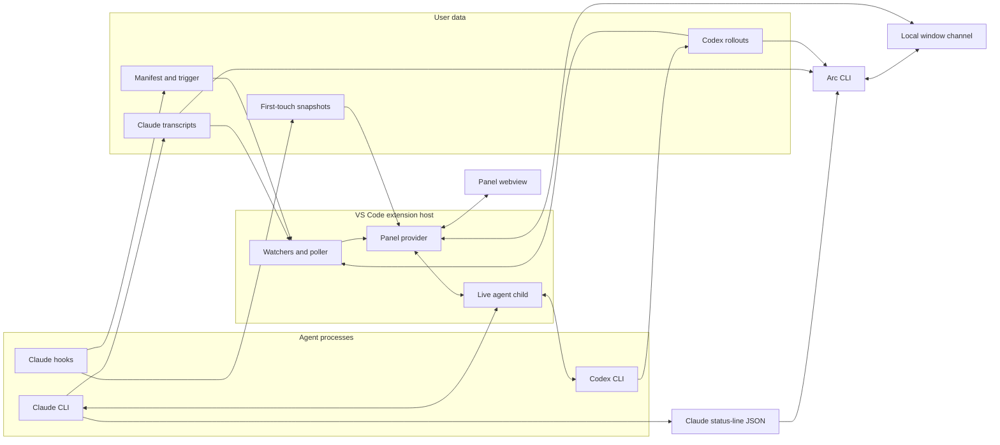

# Architecture

Use this map to find the owner of a change. The topic guides hold behavior, and [`design-goals.md`](design-goals.md) holds product intent.

## Reading guide

| Change | Guide |
| --- | --- |
| Panel visual treatments and interaction patterns | [`ui-design.md`](ui-design.md) |
| Transcripts, cards, diffs, context, cost, and refresh | [`timeline.md`](timeline.md) |
| Accepted outcomes, live subagents, and session-list status | [`timeline.md`](timeline.md#card-sources) and `timelinestate.ts` |
| Comments and text selection | [`comments.md`](comments.md) |
| Session list, search, menus, and editor navigation | [`rail-and-navigation.md`](rail-and-navigation.md) |
| Prompts, queue, controls, and account usage | [`composer.md`](composer.md) |
| Child processes, resume, and agent protocols | [`agent-protocols.md`](agent-protocols.md) |
| CLI commands and examples | [`cli.md`](cli.md) |
| CLI output contracts and limits | [`cli-reference.md`](cli-reference.md) |
| Agent session-management guidance and skill installation | [`arc-sessions.md`](arc-sessions.md) and [`arc-sessions` skill](../cli/skills/arc-sessions/SKILL.md) |
| Portable saved-session viewer and static assets | [`export-session.md`](export-session.md) |
| Setup, tests, and performance capture | [`development.md`](development.md) |

`scripts/isolated-editor.mjs` installs candidate and disposable probe VSIX files into its isolated profile through the selected editor CLI. It pins the selected scratch directory to its physical path before creating run paths and discovering abandoned runs. macOS profile sockets require short scratch paths and run identifiers. It retains isolated registration manifests, editor logs, and process receipts before removal. It reads the installed Windows `bin/code.cmd` as data to select its matching CLI. Windows `mkdtemp` calls use namespace paths for long run directories. [Isolated extension host](development.md#isolated-extension-host) owns supported layouts and launch directories.

Question recovery stores captured question payloads, dispositions, settled identity barriers, and immutable activation leases beneath the workspace partition. The webview retains its origin across restored tabs. Recovery reads only captured identities and uses separate transcript cursors. Each waiting publication checks ownership once, and each source scan indexes captured tool identities. One synchronous question publication reuses source lookups by provider and exact raw session identity, including missing sources. Later publications and answer-time checks resolve sources again. Store snapshots and ownership checks remain independent of source lookup reuse. Unknown attempts remain outstanding. Claims remain exclusive across windows, and unresolved questions never enter age or history eviction.

`cli/src/collect.ts` follows production listing pages and optionally reads turns through the selected window channel. It retains raw observations separately from usable row references and turn outcomes. [Collection output](cli-reference.md#collection) owns recovery, admission limits, and the absence of physical source continuity guarantees.

`scripts/test-default.mjs` runs static checks and direct units sequentially. `scripts/test-unit.mjs` partitions root, extension, and CLI units. `scripts/test-integration.mjs` runs the complete external-boundary categories. `scripts/test-classification.js` identifies admitted expensive tests and their repetition budgets. [Verification](development.md#verification) owns test commands and category coverage.

## System shape

Arc reads completed work from files, including sessions started in a terminal or another editor window. A child process carries live prompts, questions, and controls.



The extension never writes a file the agent changed. Hooks write only under the snapshot store. The panel opens files and diffs through VS Code. Video response links use the operating system's default application. The CLI reads Claude status-line JSON from stdin or one session's Claude or Codex records from disk. Window discovery asks running extension hosts through their local channels.

## Data sources

`terminalownership.ts` reads parent edges and creation identities through the shared Windows bridge, Linux `/proc/<pid>/stat`, or macOS `ps`. `extension.ts` supplies current public terminal membership, workspace trust, and local-host admission. `sessionrequests.ts` collects ancestry once for integrated callers without an explicit selector. Authenticated ownership inquiries require one conclusive matching window. Handler admission rechecks current membership and caller/root creation identities. Explicit selectors bypass automatic ownership. A scoped Windows bridge lease spans resolution and exchange. Pending process queries retain the bridge independently and settle on cancellation, timeout, or failure. For Windows MSYS callers, the running shell image locates its adjacent `ps.exe`. The MSYS parser accepts an optional I, O, or S state column before the PID. Two bounded MSYS snapshots supply consistent logical parent edges across missing native parents. The bridge checks mapped native creation identities and parent age. Other ancestry stops at missing older processes without crossing missing edges. Linux start ticks and macOS one-second start times cannot distinguish reuse within their timestamp precision. These observations establish routing origin, not authorization against other local processes.

Standalone native session publication reuses `dispatchreceipts.ts` accepted identity and replacement checks. `cli/src/standalone.ts` reads provider frames or the launch-bound Claude registry entry. Claude print also accepts a new native user record matching its session hint, physical directory, and submitted prompt. Private receipts retain the accepted source identity, pinned directory, physical working directory, opening length, and digest. Final stdout reports require accepted binding. Publication checks retained startup evidence against one coherent source revision. Source revision changes restart validation within the observation's original deadline and cumulative read allowance. Unsettled sources keep reports pending. Observed source replacement remains refused across observations. Preexisting, redirected, replaced, or conflicting startup evidence supplies no early identity. `cli/src/run.ts` prints the existing marker after JSON when requested. Existing transcript relationship discovery carries reader ownership and original-source cost attribution. A background job ID supplies management authority for that launch alone. It supplies no transcript identity or process termination authority. A separate launch-owned capture reads Claude native log snapshots under an exclusive output claim. Each drain reads bounded slices from its durable source position. Native terminal evidence ends capture after its remaining bytes drain. An exhausted drain leaves capture unavailable and retains its byte positions and private output for recovery. Registry disappearance supplies no exit evidence.

Standalone launches resolve explicit configuration selectors against the launch directory before admission. An absent Claude selector stays absent, while receipts retain absolute transcript roots. Claude background launches without selector evidence retain saved reports but refuse native management, registry recovery, and native capture. Post-start observation publication retries transient replacement errors within the finite observation deadline. Launch admission bounds the complete serialized receipt before reserving its directory. Native observations retain argument and command-line digests alongside the original process identity. Observation admission checks the complete saved bytes and status metadata before publication. Status projects launch identity without repeating configuration. Its metadata reserves space for one maximally admitted event and consumption digests.

Dispatch launches reserve private directories under `${ARC_HOME:-~/.arc}/dispatch` before starting workers. Each receipt retains its activation, requester, policy, prompt digest, and completion route. Accepted native turn identity binds the owning submission. Binding retains prepared file identity before publishing the accepted turn. A missing root witness recovers only matching binding bytes and identity. Immutable events retain private Markdown report paths and report digests. Output aliases copy reports and supply no authoritative bytes. Refresh reads the launch-private current report through its retained physical identity. Claims and dispositions bind one exact event. Receipts supply no usage or billing evidence. Standalone log capture retains private output and requested aliases separately from result observation. Capture checkpoints retain private byte positions and each requested log's physical file identity across resumed observations. Capture writes use a separate receipt lock and reload committed channel positions before appending. Recovery preserves another launch's alias. Captures without an alias witness resume private output only. Private stdout, stderr, combined diagnostics, native Claude logs, and frozen responses remain distinct. Saved response reads reuse the provider reducers and bounded forward recovery through the accepted scoped catalog. Raw JSON records retain complete text through 49 MiB before metadata reduction. Recovery caps each source's conservative retained-payload charge at 512 MiB and retains at most 32 source entries. Frozen UTF-8 reports have a separate eight MiB limit. Claude agreement compares the complete final response and its message identity. Codex agreement requires the exact native turn. Missing evidence remains pending. Receipt errors retain observations for retry without changing accepted prompt delivery. Hosted waits use the local channel and end at their deadline or disconnect without changing the worker. Event indexes retain bounded segments without a total launch or event count limit. Status pages omit disposition text and native ending evidence. Exact-event reads retain both. Immutable write-lock successors serialize ordinary writes and dead-owner recovery. Successor and release files retain ownership history. Live or uncertain owners retain their write lock. Filesystem identity checks detect observed replacement and redirection. They provide no protection against concurrent metadata-preserving rewrites.

`sessioncoverage.ts` decides whether a source is present, absent, or unknown under one domain, repository scope, and accepted revision. Physical enumeration and admitted membership carry separate evidence. Enumeration covers visited directories within each provider's supported depth. Unvisited child directories retain unknown absence until separate evidence qualifies them. Unread directories, failed candidates, and unavailable admission retain unknown membership. A missing provider root establishes an empty physical enumeration. Published rows supply no absence proof. Known same-ID collisions revoke recorded-source delivery before catalog publication. The host retains competing sources across incomplete walks until qualified current openings or relevant pathname absence resolve them. Collision paths use bounded opening reads whose descriptor and pathname revisions agree. Scope and coverage revision bind each observation. Qualified recovery replaces affected positive opening metadata and invalidates the affected held Codex stat. Qualified hidden Codex openings reserve physical competition independently of displayed membership. Hidden same-ID sources and hidden changed IDs that collide with visible sources retain quarantine. Cached metadata alone cannot resolve replacement, scope exclusion, or the surviving identity. Hosted Stop and question answers retain their process callbacks. The host retains omitted accepted sources during incomplete enumeration and blocks their source-bound delivery through prompt recovery. Proven absence removes derived caches, history, navigation, and exit evidence. Drafts, queued submissions, aliases, comments, and pending recovery remain recoverable. Deferred compaction waits for unknown membership and cancels on proven absence. Relationship discovery still completes before the host accepts new session membership.

The host publishes scoped catalog identities with discovery coverage, scope, and revision to session query consumers. Live filters, saved views, and content search resolve prefixes before narrowing their pools. Discovery admission suspends prefixes until accepted catalog metadata establishes completion. Complete enumeration preserves accepted coverage when scoped source membership stays unchanged. Uncertain enumeration and changed membership suspend prefixes, and explicit content search requests ordinary discovery. Coverage-only changes invalidate compiled resolution while preserving the reusable identity index. Content search re-evaluates retained entries when identity context changes. Explicit searches read transcript content. The local channel negotiates shorthand semantics before transporting filter or listing queries.

`install.sh` detects complete source beside the script, then in the working directory, or resolves a GitHub ref and downloads its exact SHA. Remote source, dependencies, and the VSIX live in an installer-owned temporary directory that cleanup removes. Both source routes use `npm ci` without rewriting package manifests or lockfiles. A manifest and lockfile mismatch refuses installation before the build. A local marketplace selects its relative plugin in place. Downloaded source invokes its built `setup.cjs --snapshots` helper for matching immutable plugin storage. The helper runs from the caller's folder so project settings and scoped plugin ownership apply. An explicit `--marketplace-url` selects the plugin independently of `--repo` and `--ref`. `scripts/package-claude-plugin.js` produces the plugin ZIP, digest, and hosted catalog for the candidate workflow. [Development setup](development.md#dependencies) owns source setup options. [Installation](../README.md#install) owns hook options.

The startup panel shell supplies no saved-filter catalog. The session list retains restored view folds until the host supplies the saved-filter catalog and views.

The installer's current-editor detection reads `product.json` beside the bundled Git askpass script identified by `VSCODE_GIT_ASKPASS_MAIN`. Windows user and system installations also supply content-addressed askpass copies outside the installation. For those copies, readable `VSCODE_GIT_ASKPASS_NODE` anchors metadata lookup in its installation's flat resources or immediate ten-hexadecimal version folders. Matching product identities across those folders select the outer installation's CLI. Conflicting identities leave detection unavailable. Bundled askpass scripts in version folders use the executable path to resolve the outer installation. `TERM_PROGRAM=vscode` alone does not distinguish editor products. A supplied `VSCODE_GIT_ASKPASS_NODE` must identify a readable executable in the same installation and is never executed. Missing or unsupported identity data leaves current-editor detection unavailable. The selected CLI belongs to that installation, including macOS products whose launcher is named `code`.

`scripts/capture-panel-diagnostics.js` collects local performance evidence outside the extension data flow. Windows delegates to the PowerShell collector, while Linux and macOS read system process and memory sources. The platform boundary excludes Windows graphics and logon counters from Unix captures. [Performance capture](development.md#performance-capture) owns the capture order, output formats, and measurement limits.

`diagnosticslog.ts` writes content-free host health snapshots and recent lifecycle events under `${ARC_HOME:-~/.arc}/logs/health-<provider-id>.*`. `registerPanel` starts recording before provider construction. Provider disposal records clean termination after shutdown work returns. Each activation retains its own PID, provider identity, hashed workspace and embedded build identity. Five-second snapshots retain settled discovery charges, checkpoint position and sequence, generation status, and up to eight pending worker requests with their ages. `discoveryObservation` separately retains the latest accepted request's cumulative charges, host request sequence, generation, checkpoint sequence, and age since receipt. It survives request failure until another accepted charged reply replaces it. Its charges overlap settled totals after successful completion and must not be added to them. Obsolete or invalid acknowledgements replace neither the checkpoint nor this observation. The named session reader worker retains bounded error name, code, exit code, thread identity, and pending work through the always-on diagnostic log. Deliberate cancellation and disposal report no crash. RSS includes every extension and worker in the host process. Heap and external memory describe the extension-host thread. Discovery replies carry worker heap and external memory from completed quantum boundaries. Each memory observation retains thread and request identity and elapsed time since host receipt. A new worker starts without a memory observation. These snapshots do not identify allocation sites. Unknown termination covers interrupted processes and incomplete diagnostic writes. It does not establish a crash. [Host health evidence](development.md#host-health-evidence) owns capture steps, limits and interpretation.

Delegated Codex spend counters distinguish aggregate starts and completions, relationship invalidations, incompatible consumed-source invalidations, current-source revision restarts, parser advancements, and waits behind another root. Relationship changes take precedence when both invalidation causes apply. Parser advancements count generator steps, including source finalization. Current-source restarts also count revision rejection after finalization. Discovery observations retain request counters, and settled discovery totals sum them across replies.

Panel capture scripts reuse the state setup in `extension/scripts/panel-shots.ts`. Its default writer checks file admission before clearing the target or setting up the page, then writes lossless WebP. A supplied writer receives the target unchanged and controls file admission and replacement. The screenshot command selects the full fixture matrix or the checkout-local bounded capture adapter. [Panel screenshots](development.md#panel-screenshots) owns command syntax, destination admission, and adapter availability.

The portable review runner in `evals/agent-review/run.mjs` reads tracked case fixtures and current checkout instructions. It writes external workspaces, Codex execution records, adjudications, and reports for development comparisons. `portable/cohort.mjs` checks production exports, assigned inputs, qualification receipts, and final coverage separately. Its opt-in audited instruction bundle preserves default capture behavior. [The cohort guide](../evals/agent-review/cohorts/README.md) owns qualification and preparation commands. On Windows, `portable/live.mjs` selects the elevated native sandbox backend and checks read access and write denial before a paid launch. The frozen continuation command uses `portable/resume.mjs` to reconstruct unstarted cells from retained inputs and combine preserved adjudication with new decisions. Its Windows job host contains each paid attempt and terminates descendants when the host or its identified runner exits. Shared continuation ownership uses filesystem identity and prevents concurrent launches across output directories. Fatal condition stops persist beside that ownership and require matching completion evidence before another launch. Each derived execution must match its durable claim, terminal receipt, and final receipt. The historical importer in `evals/agent-review/cli.mjs` reads registered Arc commit objects into a separate bare cache. The developer recipe in `evals/agent-review/rebuild-corpus.mjs` rebuilds production exports from historical commits and a frozen instruction snapshot. These development tools sit outside the extension data flow. Their local workspaces do not certify semantic leakage or host access isolation.

| Source | Location | What it establishes |
| --- | --- | --- |
| Static Arc demo and main README image | `extension/scripts/readme-fixture.ts` through `web-demo.ts` | `view/static-shell.ts` and `webview/static-shell.css` own the decorative editor frame shared by the exported site and main README capture. The panel remains in the page document because its session list and popovers mount directly under the body and use viewport coordinates. Invented session records for a sample site that uses the panel bundle without starting the extension host or reading agent records. Production decoders read provider-response snapshots in `extension/scripts/demo-catalog/`. `demo-catalog-check.ts` compares installed CLI catalogs and base and model-specific defaults without sending prompts. Its `--refresh` option replaces those snapshots. Codex snapshots preserve omitted and null model and effort settings through `codexwire.ts`, so each model retains its configured default. Other configuration fields are excluded. Its `--cwd` option selects the launch folder, whose settings affect catalog aliases and applied defaults. The check launches Claude without the user settings file or model and effort variables, so those personal choices stay out of the snapshots. `ARC_CLAUDE_PATH` and `ARC_CODEX_PATH` select CLI executables. Offline export does not establish snapshot freshness. `web-demo-host.ts` classifies every panel request and normalizes sample context detail through production contracts. `web-demo-adapter.js` answers supported requests in page memory. `web-demo-export.ts` builds each invented outgoing session graph with the production export projection and renderer. The saved-session menu downloads its prebuilt HTML with the production stylesheet embedded. `exports.json` names the admitted downloads. The static-site checker checks their decoded data blocks and reachable session graphs. The adapter's comment store uses the production normalizer and mutation rules across session navigation. The adapter's navigation trail uses `turnplaces.ts` for session visits and Back and Forward. The demo admits response links only when `domain/session-link.ts` recognizes a sample session. File and external links remain inert. Demo and export keyboard shortcuts use `webview/navigation.ts`. `webview/static-menu.ts` stands in for the editor's context menu there and in the README captures |
| Offline review evidence | `evals/agent-review/cases/` and a separate bare evidence cache | Source commits, partial review keys, and exported review conditions for the development tool only |
| Saved session capture | Configured Claude project directories, Codex rollout directories, and caller-supplied reader-started links and saved reader-parent identities | Verified identities across working directories and the outgoing relationships of the selected saved session. Unreachable text bodies stay outside the capture |
| Portable review fixtures | `evals/agent-review/portable/cases/`, `evals/agent-review/fixtures/`, `evals/agent-review/cohorts/`, and captured checkout instructions | Candidate source, qualification checks, frozen keys, coverage targets, and instruction hashes for local exploratory comparisons |
| Codex account capability | Non-refreshing `account/read` on the selected app-server process | `account.type: amazonBedrock` excludes subscription usage. Missing accounts, unknown types, and discovery failures establish no exclusion |
| Claude context summary | `get_context_usage` with `detail: summary` on the selected connected child | Estimated content categories, optional message partitions, occupied tokens, accounting window, free space, and compaction reserve from one response |
| Codex retained context | The selected rollout's newest complete replacement history or opening, plus subsequent response items and request usage | Locally estimated text categories, retained checkpoint tool text, and an explicit unattributed remainder, without attaching to a saved session |
| Claude status-line JSON | CLI stdin | Current model, effort, context size and use, prompt-cache state and expiry, and session cost metadata |
| CLI transcript target | `arc cost` path or session id | Windowed request usage and list-price cost for one session and its children |
| Window registry | `${ARC_HOME:-~/.arc}/hosts/<host-id>.json` | Activation identity, process id, workspace folders, repository scope readiness, panel readiness and visibility, protocol version, accepted request capabilities, channel address, and authentication token |
| Claude snapshots | `~/.arc/snapshots/<session_id>/` | File content before the session first changed it, plus the files that still differ |
| Claude transcripts | `${CLAUDE_CONFIG_DIR:-~/.claude}/projects/<cwd-slug>/<session_id>.jsonl` | Prompts, responses, tool activity, usage, model attachments that name the context window, commits, subagent commits and subagent file changes, recorded edits, shell-command file changes inside a git repository, paired Bash dispatch receipts, durable process-invocation ends, background command launches, their end records and their stop calls, and session names from `custom-title` and `ai-title` records |
| Claude child transcripts | `<transcript directory>/<parent_session_id>/subagents/agent-<agent_id>.jsonl`, and `agent-<agent_id>.jsonl` beside a child transcript for the subagents that child launched | A subagent's own usage and output speed, the commits it wrote, the files it changed with their line counts, its own tool and failed-call counts by name, when it started and ended, and whether its record reaches the end |
| Claude subagent meta files | `agent-<agent_id>.meta.json` beside each child transcript | Which subagent launched a nested subagent, through `parentAgentId`. The launch call in `toolUseId` locates a child's transcript for its row's cost and effort before child discovery lists that child |
| Claude saved title file | `<transcript directory>/<session_id>/custom-title.json` | Whether Claude Code saved a session rename. Only a rename reads it, at most 4 KiB |
| Claude `init` skill list | The `skills` array on the child's own `init` system message | Which of a Claude session's published slash commands the Prompt box highlights as an inspectable skill |
| Claude skill files | `<project>/.claude/skills/<name>/SKILL.md`, then `${CLAUDE_CONFIG_DIR:-~/.claude}/skills/<name>/SKILL.md` | The definition path a Claude skill mark and its popover show, the project folder winning over the reader's own |
| Codex live skill catalog | `skills/list` on a connected app-server child, refreshed after `skills/changed` | The complete Codex command and skill list the Prompt box offers for that child's working directory |
| Codex rollouts | `${CODEX_HOME:-~/.codex}/sessions/YYYY/MM/DD/*.jsonl` | The Codex form of the same turn record, including recent compaction request usage and shell-command dispatch receipts from each command's string `stdout`, or `aggregated_output` otherwise |
| Claude print results in Codex commands | The completed `CommandExecution` inside its parent Codex rollout | Shell-child ownership, recorded model usage, duration, session identity, and list-price cost |
| Agent child stdio | Process owned by the current extension host | Temporary live narration and activity before the disk record catches up, and the live session's busy state and turn endings |
| Claude main-response stream events | The connected child's identified `message_start`, terminal `message_delta`, and `message_stop` | Actual output tokens and observed response time for one unambiguous submitted prompt. Workspace state retains bounded measurements by session and response identity |
| Claude attribution selection | Editor environment or `.env` in the child's working directory | The local request attribution selection described in [Agent launch commands](agent-protocols.md#claude-attribution-selection) |
| Panel launch record | VS Code workspace state, beside the saved panel state | Which sessions the reader started from this panel |
| Codex session index | `~/.codex/session_index.jsonl` | Thread names, which may arrive after a rollout stops changing |
| Local git repository | The folder a command changed, and each open workspace folder | Registered worktree roots, commit details whose output printed none, and fast-forward landings from the head log |
| Browser saved panel state | VS Code webview state | The latest five exact workspace prompt submissions, saved synchronously before dispatch and reconciled with workspace recovery |
| VS Code workspace state | Extension-managed storage | Exact submitted prompt recovery, saved panel state, reader-started parent relationships and session list filters, queued submissions with delivery ownership and reset barriers, file descriptors, normalized account usage and live reset windows, and the last-reported Claude skill list for each working directory |
| Saved continuations | Workspace storage `continuations` | Exact agent-authored next-turn instructions, original source and assignment authority, native compaction generations, and separate delivery outcomes under one recovery lease |
| Hosted launch restrictions | `${ARC_HOME:-~/.arc}/launch-policies` | Immutable restrictions shared across windows, indexed by hashed session identity, plus one exclusive pending restricted clear or Codex fork |
| Bounded usage history | `~/.arc/usage/bounded-v1/` | Admitted Claude and Codex account limit readings in thirty fixed UTC-day slots |
| Legacy usage history | `~/.arc/usage/readings.jsonl` | Preserved experimental readings, outside the bounded store's quota |
| Applied CLI defaults | Prompt-free Claude `get_settings` and Codex `config/read`, `model/list`, and `configRequirements/read` | Applied model and effort for the launch folder and committed model. Arc reads Codex defaults from Codex 0.159.2 and later, outside the refused version ranges in `codexwire.ts`. The version comes from the first `product/version` token of the server user agent. A missing or unreadable version and a malformed configuration or policy reply report unavailable defaults. The host rejects obsolete configuration replies |
| Saved model readings (`arc.savedDefaults.v1:`, `arc.savedModelCatalog.v1:`) | VS Code global state | The last applied defaults answer for each agent, folder, and committed model value, one key per reading, keeping the 64 newest. Each agent's last model catalog with the CLI path that answered it. They draw the Model and Effort fields until a fresh read answers |
| Project setups (`arc.projectSetups.v1:`) | VS Code global state, keyed by canonical project identity | Reader-local pinned setups and accepted recent setups for one repository or non-Git folder |
| Legacy pinned setups (`arc.pinnedSetups`) | VS Code global state | Initial pins copied once into each new project entry, retaining their IDs and order |
| Project spend index | `~/.arc/cache/<workspace-key>/project-spend` | Recorded usage buckets, supplemental Claude accounting, resumable reconciliation, lifetime session-cost and primary-turn facts, and incremental parser state for one normalized workspace identity |
| Derived session cache | `~/.arc/cache/<workspace-key>/derived-session-cache.json` | Rebuildable session titles, activity, run classification, outcome, and bounded context facts for one normalized workspace identity |
| Codex opening records | `~/.arc/cache/codex-openings.json` | The opening record of every Codex rollout on the machine, which places each rollout in a workspace. Every workspace and window reads and writes the one file |
| Prompt asset staging | Extension global storage | Generated-id copies of files attached to unsent, locally queued, or in-flight prompts |
| Local filesystem | The selected session's recorded working directory | Immediate path-completion candidates for the Prompt box, and the file or folder kind of each dropped or added item |
| Editor drag and Explorer menu | The `dataTransfer` of a drop on the Prompt box, and the resource arguments of `Add to Arc` | File URIs that become path text in the draft or image attachments staged from disk |

Restricted clear and Codex fork create `launch-policies/pending-clear.json` at the transport's pre-write boundary. Exclusive creation admits one restricted successor operation per Arc home. Positive refusal before attempted input cancels only that attempt's matching reservation while its child remains current and live. Attempted input with an unknown outcome retains the marker. A generic Codex RPC error retains refusal because it supplies no proof of noncreation. While the marker exists, continuation without saved permissions refuses across windows and restarts. Ordinary live events and permission inspection read saved policies without applying continuation admission. Held children retain their immutable policy. Saved-policy sessions and fresh launches retain their own permissions. Confirmation requires the owning child's token and instance, a successor distinct from the source, and identical saved policies. Claude's `init` confirms the successor. Codex's session event confirms after saving the successor policy. An intermediate Claude reset identity does not release admission. Policy-save or confirmation failure retains the marker without expiry. A later Claude `init` from the same child retries saving and confirmation. Successful Claude recovery replays that child's deferred ownership move through the panel's existing session transition. Child exit discards the deferred move and local confirmation authority while preserving durable refusal. Ended children cannot confirm through stale output or a replacement using the same host key.

After child loss, resume the saved source with its exact immutable policy through existing input behavior, or start a fresh session. Saving the source's exact policy under a successor's identity permits that successor's own continuation. It does not release refusal for unrelated identities without saved policies. The retained marker blocks those continuations and further restricted clears or Codex forks without a timeout takeover. Child exit removes the live token, so later identity or non-delivery evidence cannot confirm that operation. Transcript absence and file timestamps do not establish non-delivery. Ordinary saved-policy lookup reads one bounded file. Continuation admission checks the marker only when no saved policy exists, without scanning other sessions.

Codex retained-context reads admit copied metadata only through the opening's declared fork ancestry. Tool pairs retain separate function, custom-tool, and client-search identities. Local-shell calls use function outputs. Server search outputs require no local call.

Stopped Codex display-model recovery scans backward from the accepted forward boundary in cancellable slices. Recovery retains at most 256 KiB per record and skips oversized non-model bodies. Opening-matched settings establish identity before the first task. Unproved model identity or ownership leaves the display identity absent. Exact native ownership confirmation admits a retained context model in source order. Completed recovery, including absence, is cached for that file revision. Replacement, truncation, and rewrites restart recovery. Worker replies carry recovery bytes and continuation state. The selected-window continuation resumes pending recovery even when its accepted content remains current. Optional Codex display recovery does not delay attachment handoffs. Display identity stays separate from parser billing state and retained-context facts.

The report for a turn comes from its transcript or rollout. A current-file diff may use a snapshot when the live file still differs from that snapshot. A per-turn diff never reads its after side from the live file because later work may already have changed it.

Usage detail shows qualified output tokens per second beneath Output. The figure divides their actual output tokens, including reasoning, by their summed measured seconds. Claude measures observed stream time and retains exact response identities for transcript joins. Unreadable stream frames invalidate pending timing. Recorded turns retain submitted-prompt ownership until completion, independently of temporary live cards. A Claude turn without observed stream time takes its speed from transcript request records. Each response joins the `api-request` record that its `requestRef` names. The interval runs from the request's send time to the response's last content block, so it includes the wait for the first response event. A response without a request record, such as one from a CLI that writes none, supplies no speed. A rate from the live join replaces the request interval for the whole turn. Filtered history reads keep only the type, id, and send time of each request record. Codex measures serial native response completions, advancing each start past the previous response's blocking local tool outputs. Later compaction classifications remove their named response contributions while preserving qualified work. Each clock retains at most 512 qualified contributions. Its interval includes request preparation, hooks, and MCP preparation. Codex omits first responses and intervals across missing boundaries, copied work, compactions, steering, or model changes. Interrupted turns supply no measurement. Codex child usage carries summed direct-source intervals and their qualified model. Nested usage does not enter those intervals. Mixed or unverified measured identity omits child measurement. A Claude subagent or dispatched session takes its speed from its own transcript's request records, by the rule for Claude turns. Its row sums the measured turns of that transcript alone, so nested subagents add no time. Turns measured on two models omit the row's speed. A reader-started Claude row in an export shows no speed.

A folderless window allocates a unique cache identity without creating a directory. Its first cache write publishes ownership before data. Ownership spans panel tab closure and reopening. Terminal provider disposal closes write admission, flushes synchronous cache writers, then publishes release. Resumed partition writes allocate a fresh generation and path.

Every folderless write checks that the current ownership bytes match its registered owner. Missing, unreadable, oversized, or replaced ownership blocks admission and release publication. These synchronous path checks do not prevent external path replacement during a write.

Written folderless partitions remain on Windows, macOS, and Linux. Node exposes pathname deletion without an operation that binds every ancestor and removed directory to validated identities. Linux boot differences remain uncertain without independent same-machine evidence. Windows also lacks complete reparse-tag inspection, and Windows and macOS lack precise process-lifetime inspection here. Folderless reclamation therefore performs zero filesystem operations and no process inspection. Unwritten activations leave no partition on every platform. Prompt drafts and assets retain their separate storage lifetimes.

Closed Claude subagents reopen only when a user or assistant timestamp exceeds their close by more than one second. File writes and system bookkeeping never establish resumed work. On a changed version, the host scans disjoint 256 KiB chunks backward and reconstructs split records to find the maximum work timestamp. Read buffers hold a chunk and its unfinished record. The host caches absent timestamps too. An unchanged closed child costs no transcript read.

The line filter in `transcript.ts` that keeps ordinary tool results out of JSON parsing must admit a result marked `toolEndsTurn`. A dropped result leaves a subagent session running, then stopped, and never done.

Claude advisor tokens appear only in `usage.iterations`, as `advisor_message` entries that name their own `model`. The top-level usage fields count the executor's passes only. Their cache-write split can name only the first pass's writes when a response has several passes. Summed executor usage measures billing volume, not one request input. Request events retain pass bands, first-pass usage, and final-pass context separately from that volume. Pricing and boundary readers use these facts through aggregation, saved checkpoints, and exports.

Direct child activity is only a temporary overlay on the newest turn. Stable protocol ids let the transcript copy replace it. Work started in another window or terminal still comes from the transcript because this host does not own that process.

Hosts record bounded usage history asynchronously and preserve duplicate readings. Each slot permits 4 MiB of compressed payload and 8 KiB of metadata, temporary, and lock bytes. A fixed format file keeps protocol-created logical content below 128 MiB. This limit excludes filesystem allocation and files added by external actors. The raw allowance is 64 MiB per UTC day. Retained dates are today and the preceding twenty-nine UTC dates. Project cost uses local calendar dates.

Each host admits at most 256 KiB of queued and in-flight raw readings into one drain. Each gzip batch contains at most 64 KiB. One compressor and compressed result add bounded memory overhead. Busy, full, invalid, or failed recording leaves current account figures and their workspace persistence available.

Exclusive slot ownership spans payload writes, sync, close, and committed-prefix metadata publication. It requires a filesystem that honors exclusive creation. Unexplained payload tails, metadata temporaries, unsupported files, and failed publication or close preserve bytes and block admission. Locks receive no age takeover. Verified expired generations are replaced under ownership using the current UTC date. Closed editors and blocked slots retain physical expired bytes.

Terminal host shutdown closes recording admission synchronously and waits for active work to settle. Unowned preparation starts no further filesystem operation after closure, except closing acquired handles. Owned slot operations finish while retaining their lock. Closing a panel tab leaves recording active. Hosts running the legacy recorder append legacy history until they stop. The bounded recorder leaves that file unchanged. Historical analysis has no shipped command or panel surface.

Two windows that write setups in the same project at the same moment can lose one change. Separate projects use separate storage keys. Each host serializes pin and recent changes together. A window reads another window's pins on its next pin change or refresh. Browser setup actions carry displayed project ownership, so messages from an obsolete menu cannot use another project's row IDs. A pin request for a recent row carries its displayed values, so a shifted history position cannot pin another setup.

Project identity uses the canonical common Git directory, shared by a checkout, its registered worktrees, and opened subdirectories. A non-Git folder uses its canonical folder path. Identity failures retain a successful identity and otherwise leave setup storage unavailable. A folderless window has no reusable setup entry. Project initialization saves copied legacy pins and empty recent history together. Existing entries never import again, including empty or invalid entries. Browser readiness retries setup loading and combines concurrent reads for the same launch folder. A workspace change starts a separate read and rejects obsolete results. Legacy setup data stays unchanged.

The usage payloads name the plan but no account or organization. Readings from different accounts can therefore mix when those accounts use the same machine.

Claude's `rate_limits_available: false` becomes an unavailable result, separate from an empty or failed answer. Fresh and hosted children preserve this result through account-read completion.

### Bundled tools

`extension/esbuild.mjs` builds the CLI, source setup entry and extension from one source state. `extension/scripts/bundled-tools.mjs` copies the plugin, CLI, Windows pipe helper, canonical session skill directory and licenses. It generates private launcher templates into `dist/tools`. `dist/build-identity.json` retains the existing export-viewer hashes and adds every tool file's digest, source identity, runtime minimum and supported platforms. Canonical skill files also enter the build input digest. Content identity distinguishes packages with repeated version strings. Digests establish consistency, not publisher authentication.

`bundledtools.ts` admits the absolute software root and refuses redirected ancestors. Unix roots require the current user's ownership. The store claims its `tools` directory through `ownership.json`. Windows claim staging uses a namespace path for creation and retains canonical paths for ownership. Failed claim publication removes only its unchanged staging directory and matching ownership file. Unfamiliar contents remain. It validates complete immutable releases before publication and retains a `release.json` beside their files. `tools/active.json` selects only the source-installed standalone CLI release and absolute external Node runtime. Editor-private preparation selects no shared active release. The `arc` and `arc.cmd` launchers locate that selection independently of caller `ARC_HOME`. CLI data retains its normal environment. Previous releases remain on disk.

Command publication records prior and requested bytes before replacing launchers. A settled failure restores the prior selection when storage permits. Explicit retry reads retained operation evidence and refuses unfamiliar bytes. Configuration publication records ownership before creating its folder and registration before copying its release. Catalog and configuration-release writes reject redirected destination ancestors. Incomplete native selection requires user scope, the owned marketplace source, the recorded requested path and matching payload bytes. Snapshot runtime admission refuses a project executable that shadows external Node on PATH.

Each canonical Claude home has a separate `tools/claude/<configuration-id>/marketplace`. Its catalog selects a contained immutable plugin copy. `registration.json` retains user scope, requested content, observed source path, operation identity and completion state. Native path and byte checks precede completion. Failed settled updates restore the prior owned catalog while retaining incomplete operation evidence. Plugin operations never select the shared CLI release. Retained files do not establish running Claude session behavior.

`toolownership.ts` acquires the software lock before the Claude home lock. Plugin setup holds both through native mutations and completion. Wrapped errors retain both locks when descendant settlement remains uncertain. CLI-only setup acquires only software ownership. No timeout transfers a lock. These locks coordinate Arc writers and do not exclude unrelated filesystem editors.

`claudeplugin.ts` freezes the project, configuration home and launch environment for each consented operation. Passive offers suppress prompts for an enabled plugin. Explicit requests compare owned scope, path and bytes before the enabled-state exits. Optional hook setup retains its consent and dismissal identity. `extension.ts` refuses Claude hook setup on remote hosts. `TerminalTools` in `toolpath.ts` clears the whole nonpersistent terminal collection before admission and after disposal or preparation failure. Trusted admission freezes the execution host's software root and workspace identity. Generation checks reject obsolete preparation. Preparation waits for previous work to settle before taking software ownership again. Private preparation validates matching published releases without software write ownership. Publication waits for software ownership without blocking panel activation. Notifications and periodic condition checks detect completed publication or released ownership. A thirty-second deadline ends contention without taking over a retained lock. Disposal cancels the wait. Development hosts explicitly select the watch build's local commands. Production hosts require the complete package identity. New terminals receive appended PATH and the editor runtime, without `ARC_WINDOW`. Child selection checks current admission and supplies the current window separately. Reading selection never cancels preparation. Applied-defaults reads wait for current preparation without delaying panel activation. Admission recovery invalidates cached defaults. Stale or disposed requests start no child. Refused or failed defaults reads publish unavailable metadata. Pending preparation asks the reader to retry session launch. Admission failure reports the rejected path. Failed preparation reports its cause, including the retained software lock path when contention expires. Both failures ask the reader to resolve the problem and reload the window. [Installation](../README.md#install) owns prerequisites and removal.

### Snapshot model

The `arc-hooks` Claude Code plugin owns one PreToolUse and Stop pair. Local and explicit hosted installation read marketplace ownership before building or installing the extension. An existing `arc` marketplace from another source stops that route. Directory ownership compares canonical paths, including Git Bash drive paths and Windows case differences. Resolve ownership manually or pass `--no-hooks` to preserve the existing Claude setup. After editor installation succeeds, these routes install, update, and enable `arc-hooks@arc` at user scope. They check ownership again before changing plugins. Explicit hosted hooks require Claude Code 2.1.224 or later. Claude owns archive downloads and its installed plugin cache. Downloaded source instead invokes the bundled setup helper after editor installation. Its ownership, disabled-plugin refusal, runtime requirements, and immutable storage follow [Bundled tools](#bundled-tools). Temporary source never becomes a registered marketplace. Hook commands resolve through `${CLAUDE_PLUGIN_ROOT}`. Plugin failure preserves legacy hooks and leaves a successful editor installation usable, with a nonzero installer result. After plugin success, local installation removes direct Arc entries naming that checkout's legacy hook paths. Remote installation does not infer legacy paths from temporary source. `--no-hooks` skips plugin setup and legacy cleanup. Migration reads `${CLAUDE_CONFIG_DIR:-~/.claude}/settings.json` and `${CODEX_HOME:-~/.codex}/hooks.json`. It leaves unrelated, uncertain, malformed, or symlinked settings unchanged. The installer does not install a Codex plugin.

On Windows, a Codex CLI session on the shared background server keeps its loaded hook definitions after the hook file changes. Reopening the CLI on that session does not reload them. Exit the affected CLI and resume with `codex resume --no-daemon <session-id>`, or restart the background server after other sessions stop.

`plugins/arc-hooks/scripts/pretooluse-snapshot.cjs` stores the file before the session first edits it. A created file gets an empty baseline. The baseline does not advance between turns.

`plugins/arc-hooks/scripts/stop-manifest.cjs` rewrites `manifest.json` for sessions with snapshot history, then updates `trigger` even when their files no longer differ. Read-only sessions and ignored paths create no store without that history. Session-local index entries, published changes, baseline filenames, and pending transaction names establish history without reading baseline content. Turn attribution always comes from the transcript. Without a snapshot trigger, transcript polling still supplies the panel.

On activation, the extension removes snapshot session folders whose trigger is older than 30 days. If no trigger exists, it uses the folder timestamp.

First-touch updates and Stop publication queue per session. Stop holds the index lock through transaction recovery, file comparison, manifest replacement, and trigger renewal. A baseline and its new-file fact publish together when their transaction directory takes its stable hash name. Recovery leaves temporary transaction directories untouched. Missing indexes recover paths and new-file facts only from published transactions. A hashed baseline alone retains original bytes until a later touch supplies its path, without reconstructing its lost new-file fact. Index, manifest, and trigger readers see either the old file or the complete replacement. Windows EPERM failures during replacement receive at most ten attempts, with twenty milliseconds between attempts. Terminal failures preserve the old file.

The store contains:

```text
baseline/<sha1(abspath)>   first-touch content
index.json                 hash-to-path entries and the session cwd
manifest.json              files that currently differ from the baseline
trigger                    watcher signal
```

Identified Claude context replies have a 2 MiB frame limit and a five-second read deadline. Reordered envelopes receive a complete-frame check before parsing. The framing buffer and unrelated stdout accumulate without a bound.

## Component map

The first column is checked against the shipped extension directory by `architecture.test.ts`.

| File | Job | Imports `vscode`? |
| --- | --- | --- |
| `bundledtools.ts` | Package validation, admitted software roots, immutable release publication, configuration catalogs, completion and installed command activation | no |
| `bundledsetup.ts` | Source-build entry for the shared command and snapshot installer | no |
| `toolownership.ts` | Canonical paths, redirected ancestor admission, exclusive setup ownership and wrapped uncertainty | no |
| `toolpath.ts` | Private terminal environment lifetime, PATH admission and current child CLI selection | no |
| `claudeplugin.ts` | Consented Claude plugin detection, local source admission, bounded subprocess lifetime, scope and byte checks, and configuration ownership | no |
| `extension.ts` | Activation, local window channel lifetime, watcher registration, commands, editor integration, and the agent host | yes |
| `configwatch.ts` | Non-recursive applied-defaults configuration watches for queried folders and their ancestors, with directory checks and watch lifecycle | no |
| `identity.ts` | Re-exports product identifiers and owns measurement environment names, saved-state keys, and the multi-root spend workspace path | no |
| `projectsetups.ts` | Canonical setup project identity, project-entry normalization, one-time legacy pin import, and serialized pin and accepted-profile persistence | no |
| `sessiondetails.ts` | Narrows a card list to the session the panel is showing | no |
| `panelhost.ts` | Extension-host side of the panel webview, window state publication, per-host readiness, durable initial catalog demand, staged loading, accepted progressive reader state, startup counters and sparse history, reader metadata read intent, and reader-started parent ownership, and context-detail acceptance | yes |
| `timelinestate.ts` | Combines accepted tail, lifetime, and parsed outcomes, assembles child write and work times and live child IDs, caches child work by file version, projects session-list status and counts, and exposes the card's carried-subagent count | no |
| `timelinecheck.ts` | Reads raw Claude work and close evidence independently, checks timeline consistency, and assembles read-only project sweeps through the shared timeline state and card projections | no |
| `progressiveworker.ts` | Typed worker requests, cancellation, bounded pending-work, window read lifecycle and failure observations, discovery checkpoints and quantum deltas, transport counters, revision and generation acceptance, and host-lifetime commit evidence reservations. Completed Codex dispatched-source parses survive worker replacement in a host cache capped at 200 entries and 32 MiB of serialized payload. | no |
| `selectedsource.ts` | Selected descendant transport | no |
| `progressiveworker-entry.ts` | Worker execution of metadata, one protected live metadata recovery, bounded provider relationship quanta and worker heap observations, serialized discovery admission, recursive catalog closure, Codex dispatch discovery, and source-local dispatched figures, incremental readers, semantic page adapters, and window read start signals with bounded lifecycle and overlap measurements | no |
| `tones.ts` | Measures text contrast against backgrounds and color differences between status tones in panel.css | no |
| `webview/panel.css` | Panel styles served into the webview | not TypeScript |
| `webview/panel.ts` | Typed page-lifetime owner composition, cross-owner coordination, exhaustive host-message dispatch, and production message boundary | no |
| `webview/payload-contracts.ts` | Complete browser-safe card and session list-row contracts shared by protocol parsing and renderers | no |
| `webview/card.ts` | Preact renderer for complete turn-card contents, the body order each Timeline layout draws, card-local disclosure and Activity-filter state, raw-tool detail anchors, card actions, in-place clock fields, and subscriptions to read and comment owners | no |
| `webview/card-rows.ts` | Preact file, child-session, and commit rows. Groups commits by branch and repository. The maker name opens the subagent's session, and the turn-diff action opens its diff. Shares record lists between chip popovers and card sections. Filters child-session records and omits the maker line when its row appears under that child. Names the child's branch on the record heading when its rows form one group. Handles arrow-key movement across row figures | no |
| `webview/choice-picker.ts` | Shared select-only combobox with tentative selection, non-tabbable options, keyboard navigation, and owned popup dismissal | no |
| `webview/chrome.ts` | Preact renderer for the compact controls and the New session menu, with its setup list, custom fields and field pin, composing the compact Project cost face | no |
| `webview/clock.ts` | The panel's one-second tick, subscriptions, and in-place age and duration updates outside the session list | no |
| `webview/composer-controls.ts` | Preact owner for usage, Prompt box picker controls, permissions, MCP menus, context-detail demand, and their page-lifetime popover state | no |
| `webview/composer-presentation.ts` | Typed owner for Prompt box body mounts, slots, next-turn presentation, shared-clock updates, footer measurement, box floor, session list-relative placement, and transient divider gesture hysteresis | no |
| `webview/composer.ts` | Preact Prompt box owner for the stable shell, live prompt text field, native-menu selection highlight, inline skill and Claude-command detail controls, host-activation focus recovery, drafts, submitted-prompt recall, editing history, completion, the page-level send chord, and later-owner slots | no |
| `webview/attachments.ts` | Preact owner for Prompt box attachment chips, browser file reads, staging tokens, paste and drop handling including editor URI drags posted to the host, attachment and submission-refusal notices, and both removable Prompt box chips and non-removable transient-card chips | no |
| `webview/sessiondetails.ts` | Body-mounted non-modal session dialog opened by the native session context menu, including copy actions, focus return, and viewport placement | no |
| `webview/dom.ts` | Authoritative browser DOM lookups, shared editable-target checks, float placement, accessibility wiring, and selected DOM conversion to Markdown | no |
| `webview/hints.ts` | Page-lifetime delayed and keyboard hint service, body tooltip placement, the drawn body an anchor names with `data-hint-body` and its redraw port, and hint cleanup when anchors leave | no |
| `webview/history-control.ts` | Typed owner for empty and archived timeline presentation, semantic footer reuse, older-history requests, and viewport prefetch | no |
| `webview/host.ts` | Private VS Code API closure, host posting, and browser state ports | no |
| `webview/layout-dialog.ts` | Page-lifetime Timeline layout dialog: its radio rows, the gear that holds it expanded, placement under that gear as the panel resizes and scrolls, arrow keys, closing on Escape, an outside press, Tab past its rows or focus moving outside, and the `setLayout` post | no |
| `webview/inline-text.ts` | Wrapper-free literal spaces between explicitly supplied textual siblings | no |
| `webview/bootstrap.ts` | Sole browser bootstrap, owner of global startup side effects, and sender of browser readiness after owners mount | no |
| `webview/development-state.ts` | Development reload choice, browser-state preference, and render-driven scroll restoration | no |
| `webview/development.ts` | Vite browser entry that patches CSS and reloads one panel lifetime for component updates | no |
| `webview/main.ts` | Packaged browser entry | no |
| `webview/native-menu.ts` | Shared three-dot artwork and native context-menu dispatch for session and saved-view headings | no |
| `webview/navigation.ts` | Timeline-scoped roving key and focus listeners, shared supplementary movement decisions, membership of the timeline walk, mouse history navigation, and back-to-top behavior | no |
| `webview/page-style.ts` | Page-lifetime owner for dynamic icon-font rules | no |
| `webview/comments.ts` | Page-lifetime comment state, selection and editor surfaces, annotations, popovers, native turn-menu contexts, and comment interaction deferral | no |
| `webview/projectspend.ts` | Preact renderer and page-lifetime state owner for both Project cost faces, its dialog focus and dismissal, measured placement, selection deferral, indexing status timing, and update age | no |
| `webview/queue-live.ts` | Preact owner for queued submissions and live cards, including keyed ordering, queue and live disclosures, scoped actions, and selected-live draw debt | no |
| `webview/requests.ts` | Preact owner for agent requests, request-local answers and disclosure state, announcements, focus continuation, and nested scroll identity | no |
| `webview/read-state.ts` | Page-lifetime read keys, session watermarks, subscriptions, bulk read notifications and saves, and host state updates | no |
| `webview/stat-detail.ts` | Page-lifetime stat-detail popover in one instance per element id, the tie between an outer instance and one drawn over it, its read-only tooltip and interactive dialog forms, compact raw-tool and skills layouts, the file, subagent and commit record layouts, the notes disclosure and its one open state for the panel, the hover grace that bridges a chip to its popover, card-chip effects, pinned anchors, size reset and placement, the keyboard route into and out of a body-mounted popover, selection-deferred detail updates, hidden-anchor cleanup, and the temporary next-turn compatibility connection | no |
| `webview/stat-chip.ts` | Browser-safe interactive card and session chips, static session list and subagent-row figures with the popover a figure's record opens, the figure line `RailStats` that a session list card and a compact row's hover both draw, and diff-pair rendering | no |
| `webview/summary.ts` | Shared Markdown actions with effect cleanup, plus mounted response disclosure identity, open state, and focus restoration | no |
| `webview/search.ts` | Preact owner for the pending content-search query, the reply it accepts, and the results list with its scoped wording | no |
| `webview/session-state.ts` | Saved open, selected, archived, pinned, read, session list, and comment state assembly plus native session-menu context | no |
| `webview/rail-hover.ts` | Builds the hint card for a compact session list row. Uses `railHoverLines` in `view/rail.ts` for text and `RailStats` for figures | no |
| `webview/rail.ts` | Preact renderer and page-lifetime owner for native session group headings and lists, ordinary Tab access, supplementary keyboard movement and identity-based focus recovery, session list rows, the registration and redraw of the compact row's hover card, buckets, query completion, the session list header's action row, counted filter buttons, text box and New split, the sticky Project cost mount between the session list controls and session list under a session list that stays the scroll owner, saved-view naming that holds counts and cache information, protects the typed name from saved-filter and payload updates and saves the query and sort captured when naming starts, the View menu with its grouping, its sort, its row density, its bucket toggles and its label chips, saved-filter, label, and session rename editors, temporary query folds separate from saved ordinary folds, responsive visibility, selection deferral, and keyboard and pointer sash resizing with a saved preferred width and bounded effective width | no |
| `webview/session-rename.ts` | Session rename editor form, and the rule that lets only the answer to the waiting request change it | no |
| `webview/text-field.ts` | Single-line text box with its clear cross. The label find box, the View menu find box, the saved filter name box, the view name box, the session rename box, and the secret answer box in `webview/requests.ts` use it. The rail filter box draws its own input | no |
| `webview/protocol.ts` | The message contract both sides read: one union and one parser for each direction, and a dispatcher that names every message | no |
| `webview/row-deltas.ts` | Session row deltas in render and session list messages: row prints and order edits for each panel on the host, held rows and revision checks in the panel | no |
| `webview/retained-visibility.ts` | Retained-page opacity, revision and observation generations, viewport observation, resize invalidation, paint-boundary release, and retained focus | no |
| `panelvisibility.ts` | Per-panel visibility revisions and lifetime cleanup | no |
| `webview/state.ts` | Saved panel state shape, submitted-prompt identity and ordering, reconciliation, synchronous browser protection, local reset saves, and writes to the host memento | no |
| `webview/timeline-renderer.ts` | Preact owner for ordered session sections, semantic headings and their read-driven native context, heading figures and label chips, mounted heading metadata updates, bulk disclosure read coordination, the press that opens a reader-started or delegated parent session, the heading's pin and layout gear, sticky heading offset, keyed turn-card parents and Activity publication, selection deferral, reading position, and active-card fallback | no |
| `webview/tsconfig.json` | Browser TypeScript project with browser platform libraries | not TypeScript |
| `panelbundle.ts` | Builds the compact browser program and stylesheet for the host build and page fixture | no |
| `paneldevelopment.ts` | Validates the loopback development origin and component updates, then builds production or development panel HTML and CSP | no |
| `paneltext.ts` | Replaces named panel tokens with values prepared by tested modules | no |
| `payload.ts` | Shapes the render, selection, and session list messages the extension posts, and weighs a message by field, by session list row, and by repeated long string | no |
| `richtext.ts` | Safe block and noninteractive inline Markdown, named response session anchors, literal file citations, validated disclosure structure, host-only content references, local picture rules, and fallback text | no |
| `uris.ts` | Read-only URI schemes used by diff editors | yes |
| `config.ts` | Reads and writes extension settings through `vscode` | yes |
| `store.ts` | Snapshot manifests, path matching, current-file comparison, expiry, lazy cache partition ownership, and conservative folderless retention | no |
| `agentpaths.ts` | Resolves the Claude Code and Codex homes from their process environment and home-directory fallbacks | no |
| `claudeskillpath.ts` | Finds a Claude skill's `SKILL.md` in the session's project skills folder, then the reader's Claude skills folder | no |
| `transcript.ts` | Shared transcript byte windows, Claude records, consumed-prefix evidence and read accounting, resumable parent-owned relationship reduction, shell receipt validation, local link candidates for opening and copying paths, and local HTML, Markdown, and video classification | no |
| `readmeter.ts` | Counts the bytes and distinct files that synchronous transcript reads return while one measurement window is open | no |
| `codex.ts` | Reads Codex rollouts into shared values, indexes descendant ownership by semantic catalog revision for turn cost and revision keys, and scans shell launches with a resumable cursor, and reads dispatched figures with native descendants through resumable source quanta and one retained aggregate fold, and keeps retained-context estimates separate from billed usage | no |
| `outputrate.ts` | Qualified response clocks, bounded content-free response measurements, per-turn measurements and qualified model identity, and native Codex response boundaries with blocking local tool outputs | no |
| `codexcontext.ts` | Bounded revisioned retained-context reads, text attribution, request reconciliation, and unsupported-history refusal for Codex | no |
| `gitcommits.ts` | Reads a turn's commits and fast-forward landings back from the repository, with the repository each is in and the branch each landing merged | no |
| `sessioncoverage.ts` | Binds physical enumeration and admitted membership evidence to scope and revision, and decides source presence | no |
| `repositoryscope.ts` | Refreshes registered Git worktree roots for session discovery and checks the real destination of explicit launch folders | no |
| `parserstate.ts` | Clones resumable parser state without losing hidden associations, counts live retained payload, captures and restores hidden activity fields for checkpoints and worker transport, and supplies shared scan budgets | no |
| `history.ts` | Exact-revision history cursors, semantic pages, transactional forward checkpoints, and opt-in metadata recovery slices with live source reduction and resumable payload accounting | no |
| `exportlimits.ts` | Admission limits and typed failures for explicit saved-session captures | no |
| `exportdata.ts` | Workspace-independent source identities, reachable session relationships, complete semantic pages, provider-owned saved names, allowlisted numeric facts, and graph revision checks | no |
| `exportsite.ts` | Bounded card, full-text and numeric projection through production builders, inert Markdown and relative script assets | no |
| `sessionexport.ts` | Saved-source admission, native export sequence through injected ports, packaged asset projection and completion outcomes | no |
| `exportassets.ts` | Reads packaged static viewer assets from the installed extension directory | no |
| `exportwriter.ts` | Generated assets, page spools, exclusive directory publication, cancellation, and ownership-checked cleanup | no |
| `oversizedrecord.ts` | Incremental byte reducer that cuts the bulky strings and compaction history of one oversized record while metadata recovery reads it | no |
| `claudehistory.ts` | Claude semantic-page and forward-checkpoint adapter, with resumable revisioned model-attachment recovery | no |
| `codexhistory.ts` | Codex semantic-page and forward-checkpoint adapter, bounded display-model recovery, and bounded raw parent/child commit ownership coverage | no |
| `historypages.ts` | Per-session older-history pages, completed turns displaced from an accepted selected window, their retention budget, and end-of-list control | no |
| `turnview.ts` | Saved panel state, parse budgets, list selection, empty states, and re-exports | no |
| `turncard.ts` | Reduces a turn to the card the panel draws, merging each child's recorded files and commits into the card's own rows with the child's session, naming each commit's repository and branch, and re-exports shared card-menu projections | no |
| `turncomments.ts` | Normalizes, stores, and emits comments, then re-exports shared comment rules | no |
| `turnread.ts` | Owns unread counts, completed identity mapping admission, retained-tail decisions, and current records for each session, then re-exports shared read rules | no |
| `turnrail.ts` | Host session rows and ordering, the session that started each dispatched or subagent row, and re-exports of shared session list projections | no |
| `turnsearch.ts` | Host turn-content search and snippets using full scoped catalog identity resolution and re-exports shared session-query rules and projections | no |
| `turnformat.ts` | Formats host-only time, duration, size, tokens, and model names and re-exports shared relative-time rules | no |
| `turnlabels.ts` | Session-label storage, membership, counts, abandoned-draft cleanup, and editor rows and re-exports shared label rules | no |
| `turnplaces.ts` | The trail of sessions the reader visited, and the walk back and forward along it | no |
| `turnfixtures.ts` | Shared test fixtures. Shipped code must not import it | no |
| `panelfixture.ts` | The real page and a full render payload for browser tests and the screenshot script | no |
| `temproot.ts` | Scratch directories for tests under one root per test file, removed when the file's suite ends. Shipped code must not import it | no |
| `patchview.ts` | Builds both sides of a per-turn file diff from recorded edits | no |
| `fileicons.ts` | Chooses a fallback file-type badge | no |
| `icontheme.ts` | Resolves the active file-icon theme and its font or image resources | no |
| `pricing.ts` | Shared model and provider resolution, recorded route classes, retained request-band quotes, promotion metadata, fallback windows, required sourced cache policies, and cost estimates | no |
| `clauderepeated.ts` | Recognizes Claude repeated records, and owns the per-file repeated-record map that the project cost index saves and publishes to windowed readers | no |
| `projectspend.ts` | Incremental transcript usage index, linked-result deduplication, lifetime session costs and turn counts, what each dispatched session adds to the turn cards of the sessions above it, ordered cache-expiry and compaction derivation, the history-limit offer decision, project-cost windows, retention, and display values | no |
| `sessioncost.ts` | Resolves transcript sources and descendants. Recognizes native records during usage scans. Reconciles recorded Codex usage and reports windowed cost, model subtotals, failures, tool attribution, and cache-expiry evidence. Direct source reads skip catalogs and descendants. | no |
| `cacheexpirysummary.ts` | Combines independently classified cache-expiry source summaries for the index and CLI | no |
| `childcacheexpiry.ts` | Attributes native child return clocks across a card batch, preserving recorded history and reusing source-revision prices | no |
| `sessionfilter.ts` | Ordered panel filter assignments and confirmed resets, operation deadlines, cancellation, and persistence ordering | no |
| `sessionrequests.ts` | Per-activation window identity, private registry publication, authenticated bounded JSON-lines requests, live window discovery, observed access diagnostics, target selection, query capability, connection cancellation, and channel cleanup | no |
| `sessionreads.ts` | Paged programmatic session listings with signed cursors, independent transcript reads, and bounded exact source identity mappings | no |
| `sessionwrites.ts` | Session-write schema with scoped launch folders and read-only options, activation-bound request retention, archive refusal decisions, and guarded follow-up ownership, admission, and panel wiring | no |
| `dispatchreceipts.ts` | Launch-private receipts, immutable report events, authoritative file identity checks, retained claims, durable consumption dispositions, standalone capture checkpoints, and log alias publication | no |
| `dispatchhost.ts` | Exact hosted submission observation, native ending and saved-response agreement, and finite lifecycle waits | no |
| `terminalownership.ts` | Bounded process ancestry, current terminal membership comparison, and independent process identity checks | no |
| `windowpipe.ts` | Host-lifetime Windows pipe bridge, shared native executable resolution, connected-server identity checks, and bounded stdio | no |
| `windowpipe-source.ts` | Native Windows pipe access rules, overlapped transport source, and separate read-only ancestry query | no |
| `claudecoststate.ts` | Captures cumulative Claude accounting snapshots, reconciles native child usage under bounded background budgets, and allocates supplemental lifetime and Project cost | no |
| `projectspendstate.ts` | Runtime validation for persisted project-spend records and resumable parser checkpoints | no |
| `derivedcache.ts` | Validates and atomically stores session metadata, complete relationship facts, and pending discovery checkpoints, and holds metadata figures until their facts change | no |
| `codexopenings.ts` | Versions, validates, and merges the machine's stored Codex opening records under a lock | no |
| `sessionnames.ts` | Holds the one name each Claude session draws on every surface, ranks its sources, and releases withdrawn command names | no |
| `sessionrename.ts` | Cleans a session name before either agent renames it, confirms a Claude rename from its saved title file, and builds the rename editor's opening message and the answer every rename request gets | no |
| `atomicfile.ts` | Replaces a stored file through a named temporary, and sweeps the temporaries an abandoned writer left | no |
| `scheduler.ts` | Bounded trailing scheduling, aggregation of pending watcher events and of the transcripts a live-activity fallback names, and the targeted or broad wake decision | no |
| `performancediagnostics.ts` | Redacted performance-snapshot projection, the file a capture is written to, message budgets, and monotonic host and panel counters | no |
| `diagnosticslog.ts` | Per-host JSON-line diagnostics, startup thresholds, asynchronous startup history, and bounded durable host health, lifecycle and action evidence independent of detailed logging | no |
| `sessionloadingline.ts` | Decides what the session-list loading line publishes, holds it hidden for the scope roots that completed the list, and writes each change of the line to the diagnostics log under fixed line budgets | no |
| `agentspend.ts` | Reads and caches child-transcript usage and direct-source measurements with measured model identity, shares aggregate refresh bands, and defines the verified child-session target lookup boundary | no |
| `childartifacts.ts` | Reduces a child's recorded files and commits to one record per file, with its line counts, and to distinct commit ids, with completeness and the child revision. Counts the child's tool calls and failed calls by tool name, keeps when its turns started and ended, and counts its turns where it ran more than one | no |
| `settings.ts` | Setting names, defaults, and compatibility aliases | no |
| `activitydetail.ts` | Shared activity subject policies and safe tool-input presentation | no |
| `agentwire.ts` | Shared asks, answers, events, settings, and turn outcomes | no |
| `commandcatalog.ts` | Merges complete agent command catalogs, rejects superseded idle reads, and skips unchanged Prompt box payloads | no |
| `promptassets.ts` | Prompt asset limits, descriptor normalization, media-type decisions including the plain-text check for unlisted extensions, staging paths, integrity validation, and staged-copy lifecycle | no |
| `droppeduris.ts` | Drag type reading, `file:` URI to path conversion, path text in the path-completion format, image routing, and the `Add to Arc` argument shape | no |
| `domain/context-detail.ts` | Separate native Claude and local Codex context normalization, bounded category and optional Claude message partition checks, category shares, aggregate-compatible demand reuse, and stale-demand release | no |
| `contextframe.ts` | Claude context envelope identification and transport budgets | no |
| `webview/export-host.ts` | Local host for captured pages, bounded decoding, navigation and read-only capabilities | no |
| `webview/static-menu.ts` | Static editor-menu stand-in shared by the demo and captured pages | no |
| `webview/static-page.css` | Shared static-page header and theme picker styles | no |
| `webview/static-shell.css` | Shared decorative editor frame and viewport placement | no |
| `webview/static-menu.css` | Shared static editor-menu styles | no |
| `view/static-shell.ts` | Shared decorative editor frame markup | no |
| `view/static-page.ts` | Shared static-page body, header and session-list width | no |
| `webview/export-model.ts` | Static viewer contracts and exhaustive capability policy | no |
| `view/static-themes.ts` | Dark Modern, Light Modern and One Dark Pro Darker colors shared by static pages and browser fixtures | no |
| `webview/context-detail.ts` | Semantic context categories, decorative chart, optional Messages disclosure, mismatch table, measurement disclosure, and Compact action. `webview/stat-detail.ts` retains disclosure state through refreshes and places the popover after disclosure toggles | no |
| `claudewire.ts` | Claude stream-json and control-channel adapter | no |
| `compactrequest.ts` | Digest-bound self-compaction commands, reader assignments, separate continuation observations, durable admission ports, exact-child guarded delivery, and native completion evidence | no |
| `compactstore.ts` | Workspace continuation receipts, exclusive immutable recovery leases, bounded storage, pure status reads, and ended-owner evidence | no |
| `codexwire.ts` | Codex app-server JSON-RPC adapter, ordered cancellable prompt preparation, and child-local skill discovery authority for native prompt attachments | no |
| `codexreply.ts` | Codex async-question ids and the reply envelope that answers them | no |
| `questionrecovery.ts` | Durable captured questions, exclusive origin leases, local dispositions, admission, and contextual answer construction | no |
| `questionrecords.ts` | Bounded exact-source reconciliation for captured question identities, with independent read cursors | no |
| `launchpolicystore.ts` | Shared authoritative session restrictions, bounded per-session reads, atomic policy writes, and exclusive durable clear admission | no |
| `launchpolicy.ts` | Immutable read-only launch policy, exact MCP read tools, Claude tool and git restrictions, model permission-mode eligibility, and standalone model aliases. Codex provider selection reads the top-level `model_provider` in `CODEX_HOME/config.toml` or `~/.codex/config.toml` | no |
| `agenthost.ts` | Child ownership, packaged CLI environment and window targeting, launch environment, immutable read-only permissions and Claude attribution selection, line framing, lifecycle, durable question capture and restoration, accepted-turn identity, control-read scheduling, explicit usage attempt ownership, and session state after model changes | no |
| `composerview.ts` | Prompt box, agent-request, and new-session view data, bounded question Markdown reuse, wording, settings, queue behavior, answers, prompt assembly, completion rows, and the walk back through earlier prompts | no |
| `domain/ask-answer.ts` | Browser-safe completion and answer assembly rules for agent questions | no |
| `domain/claude-skills.ts` | Browser-safe Claude skill-highlight decision, the per-working-directory skill-list cache reducer, and the safe-folder-name check the host skill-path lookup runs first | no |
| `domain/commit-sha.ts` | Browser-safe commit identity: two recorded shas name one commit when either is the prefix of the other, and the lower-case hex pattern that tells a commit hash from a ref name | no |
| `domain/composer-editing.ts` | Browser-safe prompt-history key decisions, the platform send chord, completion token parsing, and command matching | no |
| `pathcompletion.ts` | Host-safe immediate directory resolution, filtering, ordering, and completion bounds | no |
| `domain/labels.ts` | Browser-safe label identity, name ceiling, typed-name warning, label-count wording rules, and the choice of the row Tab applies | no |
| `domain/model-identity.ts` | Model id comparison shared by transcript turns and the Prompt box: window suffix, snapshot date, Bedrock prefix, and deployment suffix | no |
| `domain/version.ts` | Release version parsing and semantic-version ordering for the Claude snapshot setup floor and the Codex applied-defaults floor | no |
| `domain/link-path.ts` | Browser-safe local-path versus URI-scheme classification | no |
| `domain/file-citation.ts` | Bounded assistant-directive grammar, source masking, and native literal file destination admission | no |
| `domain/prompt-assets.ts` | Browser-safe prompt attachment count and byte limits and the shared drag type list | no |
| `domain/prompt-text.ts` | Browser-safe individual text limit shared by drafts, queued submissions, and submitted prompt recovery | no |
| `domain/read.ts` | Browser-safe turn keys, read predicates, unread counts, retained read limits, complete agent acknowledgment identities, ordered persistence contracts, and single-session read-state comparisons | no |
| `domain/rail-filters.ts` | Browser-safe saved session list filter records, normalization, live-filter identity, the lens words a lens press writes, the migration of older stored lenses into those words, naming, and query-term toggles | no |
| `domain/rail-sort.ts` | Browser-safe session list sort values, normalization, and display names | no |
| `domain/resume.ts` | Browser-safe terminal resume command for each supported agent, and the session identities that may not become one | no |
| `domain/identity.ts` | Browser-safe product, extension, storage, package, and scheme identifiers, re-exported by `identity.ts` | no |
| `domain/session-link.ts` | Browser-safe response session link parsing and formatting, native context masks, exact target resolution, and pending target admission | no |
| `domain/session-query.ts` | Browser-safe session-query grammar, quoting, caret tokens, native session identity alternatives, catalog-backed prefix resolution and capability requirements, metadata-only listing predicates, cost, cache-expiry, status and caller-answered cache terms, matching, and content-search eligibility | no |
| `domain/session-setups.ts` | Browser-safe pinned setup records, value checks, and recent setup limits | no |
| `domain/export-model.ts` | Browser-safe captured session contracts | no |
| `domain/export-limits.ts` | Capture and static viewer admission limits | no |
| `domain/places.ts` | Bounded local session navigation, shared through `turnplaces.ts` | no |
| `domain/text.ts` | Browser-safe line shortening and shared normalization for every typed name | no |
| `domain/views.ts` | Browser-safe saved-view record, name rules, label-derived name suggestions, ceilings, cost- and cache-expiry-query acceptance, live status-view acceptance, and normalization | no |
| `view/card-menu.ts` | Browser-safe turn-menu sections and context projections | no |
| `view/card-presentation.ts` | Browser-safe status glyphs, card identity, context-band class projection, the repository-work label the commits chip draws and the figures the Commits heading draws, the commit-sha comparison, and the grouping of commit rows by branch within a repository that the popover heading and the panel both read | no |
| `view/card-words.ts` | Browser-safe card and control wording, including prompt box visibility and height names, shared by typed panel owners | no |
| `view/comments.ts` | Browser-safe comment contracts, names, grouping, and quote anchor matching | no |
| `view/composer-editing.ts` | Browser-safe prompt-history announcements | no |
| `view/composer-size.ts` | Browser-safe prompt floor clamping, keyboard movement, and line counts | no |
| `view/cost.ts` | Browser-safe money wording for a cost estimate | no |
| `domain/model-catalog.ts` | Browser-safe model and effort catalog types | no |
| `view/model-picks.ts` | Model and effort reading labels, open-option default annotations, and saved-value transitions | no |
| `view/launcher.ts` | Browser-safe launcher contracts, compact CLI setup projection from exact supported launch choices, and accessible names for Create draft and the field pin | no |
| `view/projectspend.ts` | Browser-safe Project cost display contracts, projections, ordering, and indexing timing | no |
| `view/rail.ts` | Browser-safe session list preferred width, effective viewport bounds, keyboard resize decisions, group-list identities, bucket, section, grouping, sort, density, time-slot, count, label-chip count, cache-mark, figure, drawn-row, row-id, and clock-tick projections, and the pin glyph the session list card and the session heading share, with the pencil glyph beside it | no |
| `view/session-query.ts` | Browser-safe label suggestions, unknown search-area wording, identity resolution notes, and the cost and cache-expiry invalid-value notes | no |
| `view/stat-detail.ts` | Browser-safe cost-line suffix shared by host and panel renderers, including cached-input share and request scale. Selects which line-count figures appear. Defines the subagent-row figures sent over the wire | no |
| `view/export-facts.ts` | Browser-safe readable labels and exact captured values with shared figure formatting | no |
| `view/timeline-layout.ts` | Browser-safe Timeline layout values, defaults, dialog wording, normalization of hand-typed settings, and save-refusal messages | no |
| `view/time.ts` | Browser-safe relative-time ladder with compact and verbose recency formatters, including `formatRelativeShort` for a compact session list row, the cache-span figure, and the duration formatter | no |
| `view/tokens.ts` | Browser-safe compact token-count formatter shared by host and panel renderers | no |
| `view/usage.ts` | Browser-safe display contracts for collapsed and expanded usage figures | no |
| `usageview.ts` | Normalizes reported account limits, owns current-process admission and retained account exclusion, and prepares usage-bar rows | no |
| `usagerecord.ts` | Bounds normalized account-reading admission and asynchronously publishes committed gzip prefixes under exclusive daily-slot ownership | no |
| `mcpview.ts` | Normalizes reported MCP server state and available actions | no |

`webview/rail.ts` retains each mounted session occurrence while its serialized row values, callback outputs, editor state, environment, and displayed clock values stay equal. Removed occurrences release their retained props. Each draw still compares every mounted row. Reuse reduces row construction without establishing lower CPU use or latency.

Rail metadata, local membership changes, and label-editor transitions update mounted headings without full timeline draws or card fingerprints. The session list owns the shared responsive boundary and reports filterability separately from payload-dependent visibility. Boundary changes update mounted heading Labels. Heading first paint reads filterability before session list payload adoption. Construction reports precede the heading owner. Heading disclosure, turn-count, and native-context calculations still scan card lists. Local heading changes preserve their keyboard stop and normalize the shared walk only when controls or their stop change. Removing a focused pin moves focus to a surviving control in that heading. Removing a focused label moves focus to that heading's Labels action. Full timeline draws own their final normalization. A held replacement retains its drawn figures until release, while native context and editor state remain current. History footers reuse nodes while their complete control state matches. Prefetch observes the drawn footer, so a held replacement does not move its request to a pending control.

Session headings subscribe to read changes, then reconcile their native context and Preact revision. Immediate reconciliation includes read marks that precede mounting. Read-key eviction preserves saved disclosures independently.

Single-card Activity delivery indexes the current cards and publishes through the affected keyed mount. Only that card receives a content fingerprint. Each mount compares full-render content with its last published fingerprint. Successful publication updates the mounted heading's card reference when body availability changes, keeping bulk disclosure and accessibility current. Selection holds its newest snapshot until release. A retry for held cards permits Activity publication to mounted, unheld cards. A replacement view supersedes queued updates for the outgoing view. Activity received for the replacement waits with it and updates its matching card on release. Full timeline draws retain ownership of structural and layout changes.

Turn cards install their read subscription before a layout effect marks an expanded card read. Restored open cards then update their styling, tooltip, and native menu context together.

Dispatched Codex revision keys use the launched thread ID because the native-child catalog does not index root rollouts. Usage, artifacts, counts, uncertainty, and refresh dependencies share one verified native traversal. Open descendants keep the figures partial until their records settle. Bounded person scans retain incomplete lines and retract prompts identified as copied by delayed context. Foreign metadata revokes the current completion candidate until a fresh owned start. A replacement cursor measures continuation from its new offset. Artifact source revisions do not advance rendered figure revisions.

The cache-expiry scan in `projectspend.ts` measures a return after a compaction from the compaction, not from the request before it. A Claude compaction reaches the scan on the estimated request its reducer emits. A Codex `compacted` record supplies recorded usage identified by its response ID. Following settings resolve its billing identity. Until then, its usage remains unpriced and its total stays incomplete. The Codex reducer hands its boundaries to the ordered scan through `takeCompactionSignals` after each line. The saved carry keeps the request and the compaction it is measured from apart, because a later record can revoke the compaction. Codex checkpoints retain bounded response-to-usage joins and request events for compaction corrections. A matching ordinary request is removed before the compaction request enters its billing bucket. Each confirmed response association consumes one snapshot. Compaction associations retain anonymous evidence separately from provisional ordinary requests. A later snapshot replaces its provisional request under the same response key. Explicit compaction snapshots supply no ordinary usage. Distinct ordinary response IDs retain separate requests with equal counters. Missing snapshot identity leaves the ordinary request count and priced total partial. Claude linked-result request counts remain uncertain without qualifying their recorded dollar totals. Settings preserve missing-identity compaction coverage as unpriced. Claude checkpoints retain the pending estimate until the first following request sizes the shared prefix. The parser generation and derived-cache version invalidate older accounting facts. A revocation emits no event, so the spend scan passes the reducer's compaction count to the cache-expiry scan after each line. [Parsing and attribution constraints](timeline.md#parsing-and-attribution-constraints) owns what the scan counts.

The project-spend index reads a source in slices with a byte budget, so a slice can stop inside a line. An incomplete record keeps the bytes of that unfinished line once, as base64 in `pendingBytes`, and leaves `trailing` empty. Every reader of `trailing` checks `complete` first. A record that holds more than `PROJECT_SPEND_HELD_LINE_BYTES` of one line returns to the front of the index queue. The slice that ends that line stops at its end, and the file then goes to the back of the queue. When another record of the index takes a long line, every other record that holds one releases its bytes and reads that line again later. So at most one record of the index holds such a line. A held line stays in the extension host heap until its record releases it or the line ends, so this bound keeps long held lines from adding up across records. The ledger save holds one record text at a time and writes the texts in batches through `writeFileStreamAtomically`, because the ledger file can exceed 100 MB.

A main Claude cache-expiry return carries a visible-turn id that counts prompts across its transcript. A timeline tail cannot match that ordinal. The card matches the request key against its opening response id. A main Codex return matches its turn id. Native child returns retain source identity and request clocks. `childcacheexpiry.ts` attributes them across each card batch. Recorded child activity survives quiet expiry and host exit. Accepted process ends and later prompts cap attribution. Returns after a timed child closure require recorded work and return clocks beyond the shared closure margin. Source-revision prices serve session figures and cards. `panelhost.ts` redraws cards when their warning evidence changes, beside the dispatched-cost redraw.

Codex generic cache writes use the `cacheWrite30m` pricing category without recording a lifetime. `sessioncost.ts` uses the model and provider's documented lifetime for expiry evidence. An unknown lifetime leaves the adjacent request pair unavailable. Claude's explicit five-minute and one-hour writes retain their recorded lifetimes. Mixed executor tiers infer the first writer's lifetime when it records zero reads and every later executor pass reads its full prefix. Every writing pass must name a single tier. Token counts establish this inference, not cache identity. An unknown writing lifetime clears preceding lifetime from context and compaction state. Read-only responses retain preceding lifetime. Both expiry readers consume this response fact, including explicit unknown lifetime.

`resolveModelPricing` resolves supported billing identities and recorded inference evidence. Ordinary model names establish no provider. Aggregated cost consumers pass retained request bands to `quoteUsage`. They never reconstruct a request size from a band. Codex parser and derived-cache generations advance when recorded route classes change. A usage total holds request bands only while they cover every request in it. A turn that mixes a banded model with an unbanded one drops the total's bands, and its usage parts price each request.

Codex cost reconciliation uses reducer-owned turn scope, source order, billing `thread_id`, cumulative thread and turn counters, and matching cumulative snapshots. Billing `session_id` can name the root parent. It does not establish the source identity. Explicitly foreign-thread bills remain uncertainty evidence and contribute no local known subtotal. Missing billing `thread_id` retains scoped pricing with unknown ownership. The scan retains cumulative-only snapshots and matches delayed evidence before applying report windows. It filters adjacent duplicate snapshots and retains repeated counters after intervening snapshot or billing progress. A response keeps its first billing timestamp through repairs. Each accepted cumulative revision retains its arrival position. Provisional snapshot matches require cumulative progression within the inferred segment. Rejected associations leave billing identity available for later snapshots. Final matching consumes anchors within classified segments. Only arriving cumulative fields advance billing evidence. Conflicting complete revisions remove its price. Coverage defects have separate time intervals. Each interval records a cause, and a source summary reports the start and cause of its earliest intersecting interval of any kind. In the recorded Codex versions, `token_count.total_token_usage` excludes compaction requests while `token_usage_record.thread_token_usage` includes them. This is observed behavior, not a documented format. A compaction therefore starts no segment when its named response has a complete bill from the source thread, the compacted record's copy of that bill agrees with it in every field the copy carries, and the next snapshot repeats the total before that bill with zero request counters. Every later snapshot total gains that bill's usage, and that next snapshot becomes the compaction bill's snapshot. A snapshot reset removes the offsets gained before it from later snapshot totals and from later compaction checks. Other compactions and unresolved counter resets start unknown intervals without invalidating earlier reconciled segments. Snapshot resets start new segments. An independently reconciled explicit baseline closes earlier open uncertainty in source order. A tied restart leaves its timestamp uncertain without extending uncertainty into later windows. Trusted anchors belong to the current segment. Counter jumps affect the interval after the preceding trusted anchor through the revealing anchor. Equal or backward clocks include ambiguous anchor boundaries. A backward restart includes both clocks and the interval between them. Incomplete metadata lines supply no coverage boundary.

Codex subagent rows carry an enumerable start time through worker windows, history pages, and retained refreshes. The child's catalog start clock takes precedence over the parent's spawn clock. Structural rows use the child's start clock without a spawn step. Running rows use this time for elapsed runtime. Codex commentary pairing retains one reducer-owned candidate across snapshots. Parser-state, forward-checkpoint, and derived-cache versions invalidate older saved Activity.

The context-setting Claude request retains its own effort and Bedrock message identity independently of turn effort and regional pricing. Retained parser snapshots preserve both fields. Derived session caches admit absent historical fields as unknown. The next-turn basis reads that request to price effort changes without scanning transcript history.

Claude supplemental accounting reads transcript `cost-state` counters and frozen native source revisions after ordinary spend indexing. `claudecoststate.ts` retains at most 256 snapshots and 32 raw model keys. The complete session source catalog supplies verified native file edges for accounting owners and their exact descendants. Source revisions and saved discovery generations include this ownership evidence. Descendant accounting publishes before its ancestor. Child replay retains every accepted request identity or withholds the comparison. Its 16 MiB allowance uses conservative retained-payload charges, not physical heap measurements. Admission counts saved state, active history, pending buffers, completed contributions, and serialization copies. Variable-size charges follow the parser's admission rule, including nested attachments. Ignored progress and ordinary tool-result lines receive fixed charges. Saved checkpoints use the same payload allowance. Restoration scans yield under the shared time budget. Exclusive reducer checkpoints retain references without copying prior request history. Reader slices use the shared byte and time budgets. A slice that starts past its deadline still makes one admission step. When admission is complete, the slice also makes one read, one buffered line, or one child completion. A spent byte budget stops a slice before any step. A dependency that is incomplete or lacks published child accounting stops the slice before its read. A slice parses buffered complete lines before it reads another chunk, so the pending buffer holds at most one chunk and one partial record. A synchronous record parse cannot yield. Saved progress resumes the active child and retains completed child contributions. Publication requires complete matching dependencies, including the native source list and child accounting identities. Views read published supplements without transcript reads. An overflow withholds the supplement and records its reason in diagnostics.

File citations use a typed literal destination through response links and native copy actions. Native absolute files open after a reader press, including outside workspace folders. Ordinary Markdown links use local path candidates and optional line selection. Citation filenames retain percent signs and location-like suffixes. The directive scanner shares a four-code-unit allowance per source code unit across candidates and quotation modes. A source-order walk uses Marked tokenizers and mapped container positions to consume existing protection before eligible directives. Closing delimiters inside protected candidate text retain their Markdown meaning. HTML tokenizer state survives paragraph and container boundaries. Eligible directives consume their complete enclosing extent before Markdown splits tables or matches emphasis. Each admitted candidate uses one scanner call under the shared allowance. Container traversal follows summed container lengths outside that allowance. Malformed and incomplete enclosing candidates keep nested citations literal. The inline tokenizer adds the mask delimiter to Marked's text boundaries, preserving its URL and email rules. This rule depends on Marked's exposed breaks grammar. The reference tokenizer accepts its runtime link registry despite an array declaration. Source ranges exclude protected code, links, images, definitions, tags, and comments from masking. Disclosure parsing uses its narrower block and code ranges. Nonactionable masks restore escaped original source after rendering. Inert export identifies citations with full paths and no local actions. Transcript text stays unchanged.

## Module boundaries

Accepted selected windows publish current turn facts before commit repository discovery waits. Repository hydration rechecks the selected source. A changed source resumes selected reading without another refresh trigger. Incomplete repository evidence clears commit navigation before publication. The owning panel's transport state retains the successfully accepted window and commit rows. Completion retries an undelivered current window even when commit rows stay unchanged. Enrichment compares indexed visible cards with those rows through the shared commit-only projection. A failed independent post leaves enrichment pending.

Rendering updates retained history recency in place. Child-spend reapplication to retained pages accepts replies only while the same history state remains current. Page replacement and eviction change that identity. `refreshAgentFacts` accepts cached-window replies only while the same cache entry remains current.

Preact removes the focused usage refresh button when busy status replaces it. The removal emits focusout with no destination during rendering. Redrawing inside that event can retain stale busy content. The usage popover ignores null focus destinations and redundant focus entry. An outside press clears both hovered and pinned state, independently of focus events.

The local window channel accepts session starts and curation from authenticated local clients. `panelhost.ts` resolves runtime setups through the existing launcher and starts an independent draft without selecting it. Successful prompt delivery identifies the session before metadata persistence. Initial-save failures retain that identity. Rejected delivery leaves the prompt available for recovery. Membership rollback follows session adoption and restores only targets without a newer membership action. Independent initial pins survive rejected saves. Explicit agent-run classification lives in bounded workspace state alongside reader-started ownership. Preference saves and confirmed resets preserve both launch classifications. Curation uses the provider's label and membership owners and awaits saves. Initial pin persistence uses the same per-session pending-save owner as membership actions. An unchanged membership action awaits that owner without replacing it. Without a pending owner, it saves current membership and awaits persistence, including retries after rejected initial saves. Initial metadata failure retains live launch state and rejects waiting curation acknowledgments. Archive admission reads fresh scoped status at apply time. Running, needs-input, and completed unread sessions require force. So do sessions with hidden attention, stale or unparsed facts, or unknown run status. A run status of subagents or background refuses archive even with force. Archive membership keeps the current turn and open asks. [Child ownership and shutdown](agent-protocols.md#child-ownership-and-shutdown) owns when retirement ends the process. Unarchive changes membership alone. Existing host messages synchronize label editors and panel tabs.

`SessionReadObservations` signs completed identities only after final delivered projection pruning. The production panel provider checks fresh independent source facts before signing and before ordered mutation. Receipt preflight and ordered reduction each reuse source facts within their own phase. `WindowChannel` advertises `sessionRead` with its guarded read receiver. `HostReadPersistence` owns every panel-state write and serializes explicit reader actions, agent acknowledgments, preference saves, storage settlement, and publication. Ordinary reader events use its bounded barrier without lifetime result bindings. Each browser document creates its identity. The host challenges readiness against the current shell before admitting that document. Browser events arrive in consecutive sequence order. Gaps refuse without consuming a sequence, and queue overflow leaves the refused event eligible. Admission replies report event consumption, separate from storage outcomes. The browser retains at most 256 queued payloads and sends one event until admission. Refused events and lost replies retry the same frozen identity. Page disposal ends those retries. Consumed duplicates never mutate again. Replacement documents, replacement shells, and closed hosts reject previous page events. Already-admitted intent survives document replacement. Ordinary preference resets and source invalidations also use this admission route. Retained APIs keep their exact outcome bindings. Failed storage preserves accepted state. Unknown storage blocks later saves. Browser tabs receive the accepted read revision and validated agent keys after storage, including hidden ready tabs. Readiness supplies current state to restored and replacement documents. Cold restoration resolves one retained source per event-loop turn. Unchanged restoration reuses validated sources and avoids read mutations. Each aggregate projection checks a shared source once. Source projection updates retain the accepted read revision. Browser tabs accept those updates only when reader state stays equal. Automatic marks wait for accepted reader evidence or their pending submission. Explicit turn-read permits fresh intent after consumption without accepted evidence. Session-unread closes its cards and saves disclosure before dispatch. Complete exact identity mappings alone subtract agent acknowledgments from counts. Agent acknowledgments never establish reader boundaries or complete older history. Guarded-send observations and directing-reader revisions keep their separate owners.

`sessionwrites.ts` retains at most 256 shared write results per activation for starts, curation, and guarded sends. It separately admits at most 256 distinct guarded request IDs during that activation. Each guarded admission reserves lifetime capacity before its handler runs, including in-flight requests and accepted, unknown, or refused outcomes. No admission returns capacity. A guarded send that refuses before input moves to a separate refusal table, leaving the shared result allowance available for starts and curation. IDs include the window activation, and matching payload retries observe the retained outcome before either capacity check. Conflicting payloads refuse writes. Exhausted capacity rejects new IDs before their handlers run and retains no new binding. Neither table evicts admitted IDs. Disconnects leave accepted work running. A new activation refuses old IDs with an unknown outcome. The CLI never retries automatically. Write exchanges allow 120 seconds while partial input retains its one-second deadline. [Session write contracts](cli-reference.md#session-writes) define request IDs and outcomes.

Guarded follow-ups reach the panel host through three ports that `extension.ts` assigns from the activation's `GuardedSends`. A channel start passes its request ID and requester to `onSendDraftPrompt`, which records ownership with the started child. A session read passes its checked facts to `guardedObservation`, and the panel keeps them. Signing requires the exact started child in `AgentHost`, with the same session ID and no exit. Removal during retirement withholds observations before disposal completes. A replacement with the same session ID cannot sign for the started child. At admission, `guardedTargetFacts` reports the scope, the exact source revision, queues, pending submissions and controls, and rail status. Status derivation uses the target's outcome, live state, timestamps, commands, and matching Claude children through the shared timeline functions. Unrelated closed-child work reads stay outside admission. It reports the newest turn of the latest read only when that read saw the same source revision. `extension.ts` counts a deferred self-compaction that waits for the session as a pending control. The panel calls `onReaderInput` when directing input arrives before the panel knows whether it accepts it. A reader submission calls it before prompt retention, and a setting pick calls it before `onPicked`. The panel calls `onReaderDirected` after it accepts directing reader input and before it queues or delivers it. Both ports make observations stale. Only `onReaderDirected` clears the block that an unknown delivery left, so a rejected input or a setting pick never clears it. `interveneOnReaderInput` wraps the directing callbacks and only makes observations stale. A permission pick makes observations of every live session of its agent stale. A guarded write registers its submission with `CompactHost`, as ordinary delivery does. Its delivery port classifies the attempted child's receipt reason for recognized writer conflicts, including after retirement or reader input clears its error. That conflict permanently blocks guarded input to the worker during the activation without changing the receipt's unknown outcome.

`compactrequest.ts` keeps deferred assignments outside ordinary queued prompts. Each admitted assignment freezes the reader submission, native turn, child generation, and window activation. Admission needs the live requesting tool call and a session with no asks and no queued reader input. Readiness names why a payload has no live call: the window has not seen the command, the command ran in the background, its turn has no reader submission, the reader acted after the call, the reader assignment already admitted a compaction, the request ID was already used, or an invalidation withdrew the call. Only the first reason can still change, so the CLI polls only while it holds. One reader assignment admits one compaction across its own turn and every turn that work it launched or adopted wakes. An activation admits each request ID once, also after its record expires. Each session turn holds at most one pending assignment. Delivery checks eligibility after acquiring the retained child and inside the provider write callback. Claude and Codex wires emit native evidence separately from Activity. Evidence after submission reaches only the operation whose submission generation it names. Each adapter emits a submission event right after the write callback, and that event names the generation of the operation the callback created. The window channel sends self-compaction requests to one `CompactHost` for each window activation, never to the panel's session request handler. The panel reports each reader send, queue change, queued prompt delivery, Stop, compact, answer and setting pick before its own handler awaits anything. A permission pick reports every live session of its agent. Every report cancels unsubmitted assignments. Every report except an answer also advances the session's reader revision, because an answer can approve the requesting command itself. A ready repository scope cancels unsubmitted assignments whose retained session directory lies outside its roots, including while every panel is hidden. The panel retains known session directories across workspace-folder catalog invalidation until an authoritative catalog replaces them. Ready scopes remove confirmed departures from this retained set. Unknown directories wait for session rows. Delivery waits for the next full refresh of those rows under the ready scope. Each such refresh also cancels assignments whose session the panel no longer holds. An assignment waits until the requesting tool and its exact turn succeed and the panel holds the final response. The response card holds it, or the recorded turn holds it once the selected window has reconciled the card to that turn. A turn Claude starts by itself has no card. Its final response counts once a read of the session's recorded turns holds a turn whose final response has the response ID of that text. The panel makes that read also for a session that no panel shows. Until then a successful turn end leaves that assignment waiting for its deadline. A failed turn end fails it. Delivery then runs when the child is idle, ready and free of asks, queued prompts and clears. Delivery also waits while an earlier compaction request of the child has no answer and its late turn has not ended, so that late turn has one owner. The end of that turn or an exact late RPC refusal for an unbound request drains the session. A refusal after a bound turn starts preserves that turn's delivery barrier and leaves its outcome unknown. Native compaction ownership retains busy state and Stop independently of RPC settlement and request attribution. Unattributable Codex compaction turns keep delivery waiting, as described in [Agent protocols](agent-protocols.md#shared-vocabulary). Until then the assignment waits for its deadline. It holds an activity lease on the exact retained child and never reopens a session. Deferred work never enters the persisted prompt queue, the write request book or the panel's compact action. `AgentSession` names the submission that owns a native event only when one accepted turn owns it. Claude events need exactly one open turn and no prompt in preparation. When no Arc turn is open or in preparation, the first root tool event, launch or `result` after a `result` opens an owner for a turn Claude starts by itself. The next `result`, idle report, accepted Stop or child exit closes it. A reader prompt that opens or joins a turn retires it, so later events follow the reader turn. Subagent text never opens it. `CompactHost` records each root background launch with the submission of its turn: a `Bash`, `Agent` or `Task` call with `run_in_background`, or an `async_launched` result. A launch that no single turn owns takes the latest reader submission that Claude read in its child. A reader prompt to Claude carries a fresh client UUID, and Claude replays the prompt with that UUID when it reads it. The replay with that UUID, in the root scope and in the session the wire follows, is the prompt's receipt. That session must be the session the wire knew at the write, when the wire knew one. A guarded prompt's receipt also needs its exact text, and it stays pending after the guarded attempt settles. On the receipt, `promptAsReader` reports the prompt, and its submission adopts every launch of the child whose notice has not arrived. Claude writes the replay after any output it wrote before it read the prompt, so a `result` or idle report of earlier work reaches Arc first. A prompt without a receipt adopts nothing. The Claude wire keeps a bounded set of pending receipts and drops them when the child closes, a Stop cancels queued prompts, or the session changes from a known session. A follow-up, a continuation, or a Codex prompt adopts nothing. Claude reports finished work as a `task_notification` system message that names the launching tool call and its run. A notice that arrives inside a running turn belongs to that turn and releases its launch. When the turn has no owner yet, as before its first root tool event, the notice waits until that turn's `result`. A notice that arrives while no turn runs waits for the turn Claude starts next. That turn binds to the one submission that covers the launches every waiting notice names. It binds nothing when no notice waits, when a notice names a launch that no reader instruction covers or a launch that capacity dropped, or when the notices name different submissions. A launch stays uncovered when its first source, an unbound turn or a child where Claude has read no reader prompt, has no reader instruction and Claude reads no reader prompt before its notice. A launch whose tool reports an error is released. The woken turn's `result` names the notice it answered in `origin`, by run for a task notice and by subagent for a hand-back. A `result` whose origin names no waiting notice of the bound submission fails the bound assignment. Every `result` releases every waiting notice. An accepted Stop retains that submission and its native generation for a qualified interrupted dispatch ending. Dispatch ownership stays separate from panel response ownership. Idle or Stop-ending expiry clears the retained identity. Codex events need the turn ID the child accepted. A Codex root event that arrives before the turn start answer waits for that answer, as response events do.

Claude CLI manual compaction can record a plain command before its boundary, then a wrapped duplicate and user-form stdout. The stdout names the duplicate as its parent. Any command the CLI answers by itself can record its answer in this user form. That record has no `subtype` field, so a line filter for the `local_command` subtype misses it. Newest-turn discovery passes over such a command. It reads the tail too, because the answer can lie past the tail's start. The Claude session reducer tracks prompt arrivals separately because retained queued prompts have a size limit. [Claude turn boundaries](timeline.md#shared-turn-model) owns command withdrawal. [Session discovery](timeline.md#session-discovery) owns command admission and fallback naming. Claude Code can write a compaction that the session then abandons. The first typed prompt or new billed request after it names a record from before the compaction as its parent. [Claude preserved segments](timeline.md#claude-preserved-segments) owns the kept shape whose first prompt also names such a record. The usage reducer then revokes that compaction, and the estimated request behind its summary stays billed, also when the boundary arrives after the revocation. Missing or unknown parents keep the compaction. Own-spend reads skip revocation, because they count cost alone. Claude Code can also append repeated records with the same record ids. [Claude repeated records](timeline.md#claude-repeated-records) owns how readers recognize them and which readers skip them. The timeline reader lists every summary it reads. The cache-expiry scan holds facts only for compactions a request has reached. Its ledger also lists a fact for each trailing compaction, which the scan rebuilds from its carry on each slice, because a later slice can revoke the compaction. The ledger saves the reached facts that trailing facts push out of its list, so a restored scan holds every reached fact.

Subagent row names contain absolutely positioned accessible text. The clipped name establishes its positioning box so hidden suffixes cannot widen the page.

`transcript.ts` supplies the host's unresolved-work reducer. Root Claude launch results and identified terminal task notifications update it through `claudewire.ts`. Accepted matching session metadata adds holds through `panelhost.ts` and `extension.ts`. [Child ownership and shutdown](agent-protocols.md#child-ownership-and-shutdown) owns background retention and retirement.

The editor boundary is `extension.ts`, `panelhost.ts`, `uris.ts`, and `config.ts`. Other production modules avoid `vscode`, so tests can import their decisions directly. `extension/src/imports.test.ts` enforces package direction and runtime cycles.

`cli/src/commands.ts` owns admitted command identities and required help data. `sessions.ts` renders readable listings and turns, and passes explicit JSON replies through. `cost.ts` renders readable cost summaries and omits invariant explanatory notes from CLI JSON. `main.ts` dispatches those identities and renders help before stdin or window access. Missing help data refuses command admission.

`cli/src/run.ts` admits explicit standalone launches and checks attended terminal support before reserving receipts or spawning. Attended Codex uses interactive arguments and inherited terminal input and output. Its exit supplies no final response evidence. Writable attended Claude opens native attach only after its background launch binding exists. Terminal failures retain that launch and its result. Terminal scripts carry the selected receipt root and non-secret launch selectors into existing terminal environments. `standalone.ts` owns provider framing, finite observation, background registry reads, terminal selection, and resumed observation. Foreground process identity uses Windows process creation and command data, Linux boot identity and process start ticks, or macOS process start and command data. Unavailable process identity remains null. Shell launchers and Codex runtime launchers retain separate observation identities and establish no native worker handoff. Background launcher identity supplies no worker ownership. The receipt owner binds successful Claude background acknowledgments separately from transcript session UUIDs. Native logs, attach, and stop consume that immutable launch binding through the original executable, working directory, and saved non-secret launch selectors. Detached processes write output through inherited files independently of the supervisor and editor. Requested print logs use a separate run-owned capture process. It starts the provider and forwards the native PID and close event to the finite supervisor. It drains output in bounded slices after native close. `output-owner.json` retains capture ownership, state, and source failures. Before native close, print capture contention uses time since the last successful flush and a finite wait allowance. After close, alias delivery and receipt lock contention share a fixed drain deadline and finite wait allowance. Final observation retries charge each channel's original read allowance before writing captured bytes. Source failure ends capture while the provider retains its inherited files. Log reads retain one bounded frame and read chunk without limiting aggregate output. Each foreground observation bounds scan bytes and yields between chunks within its deadline. Versioned scan checkpoints retain completed frames, bounded pending bytes, and file identity. Saved-position admission checks device, inode, and minimum size for recognized checkpoint versions before restoring frames. Missing, replaced, or truncated output supplies no new report. These checks establish no prefix integrity or historical truncate-and-regrow detection. Older checkpoint versions remain readable. Unknown versions restart scanning from the original output. Checkpoints encode at most one 49 MiB pending frame as base64. Their JSON allowance also covers an eight MiB report and retained native message identities. Checkpoint serialization and frame parsing have no hard latency bound. Ordinary appends continue within one cumulative read allowance and deadline. Snapshot EOF alone does not establish work exhaustion. Unavailable process lookup permits retry. A changed command does not establish a changed process lifetime. Private stdout and stderr files retain all producer output and have no total size limit. Observation deadlines preserve captured exit evidence and otherwise retain unknown worker exit. Registry disappearance supplies no native success evidence. Standalone callbacks require proven daemon parent authority and remain unavailable.

`cli/src/skills.ts` owns explicit personal skill copying, replacement, removal, cancellation, and destination ownership. Its control folder sits beside the discovery root and binds physical directory identities, operation tokens, complete file digests, and settled seals. Uncertain operations retain matching locks for manual recovery. Resources finish before exclusive completed-file publication exposes `SKILL.md`. `skillfiles.ts` selects only the executing artifact's payload layout and resolves physical temporary roots without write admission. The source installer invokes the matching compiled CLI after editor installation and awaits child exit before deleting downloaded source. [Skill installation](arc-sessions.md#install-the-parts-you-need) owns destination, conflict, and recovery behavior.

The extension build packages the CLI and both shell launchers. VSIX packaging marks the extensionless launcher executable on POSIX, including archives built on Windows. It patches the archive named by VSCE's successful packaging output.

`extension.ts` owns the window channel lifetime. Channel creation or publication failure leaves panel activation available. `panelhost.ts` publishes window state after restoring saved provider state, without parsing sessions for discovery. Repository scope initializes independently of panel visibility. Panel readiness means an attached browser has completed startup. Panel visibility separately identifies active watching. Independent windows on the same folders retain distinct activation identities. Folderless windows publish empty folder lists.

`sessionreads.ts` resolves restored agent acknowledgments independently of selected-session caches. Exact mappings bind provider, session, canonical physical path, device, inode, scope, size, modification time, and change time. Source changes invalidate mappings, including append growth. Unavailable sources and incomplete identity coverage supply no projected agent keys. Complete mappings require unique completed prompt identities and turn timestamps. A bounded delivered reply does not establish complete history. Source resolution reads at most 8 MiB in chunks of at most 256 KiB. It retains at most 32 sources and 2000 turn identities in total. Larger sources and excess identities retain uncertain coverage. Revision checks establish observed agreement, not an atomic filesystem snapshot. Metadata-preserving concurrent rewrites remain undetected.

Session requests use the provider's accepted catalog under the current repository scope. Requests never enumerate transcripts or advance panel discovery. Retained sources with a recorded working directory outside the scope are excluded. Missing catalogs return a first page with unavailable coverage and refuse cursors and detailed reads. Listing coverage requires accepted discovery of the same catalog members, every accepted source in scope, and no pending discovery. Members compare by file, device, and inode, so transcript appends keep coverage. Listing freshness requires active observation, no watcher events or refresh, and current revisions for the served rows. Hidden observations remain stale. Listing pages sort sources by a key hashed from provider, session ID, and file. Each cursor is signed with a secret that the provider instance creates, so a reload expires it. A cursor carries a digest of the device and inode of every source up to its last key, so the host keeps no state for each caller. The provider caches the sorted keys, their serialized prefix tuples, and the discovery comparison by catalog array identity and scope roots. Row projection and unread counts run only for sources that a page can serve. Query predicates check catalog identity and reader metadata before agent-run freshness. Only agent-run predicates stat surviving sources before paging. Served rows receive independent revision checks. The internal archive read filters by session ID before paging and matches its row by source key. Programmatic status uses accepted outcomes and native activity without starting child transcript scans. Hosted requests and running state remain available for known scoped IDs independently of metadata freshness and panel visibility. Claude, Claude child transcript, and Codex catalog stats retain exact decimal device and inode identifiers beside their revision. A source without both identifiers clears listing coverage on its own page when more pages follow. One bigint filesystem observation supplies identity, safe byte size, and fractional modification time. Worker messages and caches preserve those identifiers. Claude stored and parsed names use them to distinguish delayed reads from replacement. Hosted publication binds a scoped source to a busy AgentSession instance and preserves that ownership through idle. Matching supported identity admits nonshrinking growth before binding. Missing or unsupported identity requires the exact accepted revision. Supplied identity conflicts and failed stats refuse binding. Catalog revalidation preserves supplied accepted identity. Conflicting current identity refuses binding until authoritative discovery. The first exit freezes its source revision. A listing admits native closure only while the current catalog and file identity match that frozen revision. Available metadata must match the current source. Older reader windows retain independent freshness and must match physical identity. A rewrite preserving size, modification time, device, and inode remains undetected. A replacement instance revokes the prior witness, including when it starts idle. Authoritative catalog removal and provider disposal remove process-local witnesses. Missing or changed sources withhold that closure. Admitted native or recorded process closure preserves completion despite retained child and background history. Hidden attention remains unknown. An unfinished turn without live running evidence or a process end reports unknown until one hour after its last assistant activity, and then it reports stopped. A turn without a readable end time stays unknown. Programmatic status never reads child transcripts, so it cannot see a closed child resume. [CLI run status](cli-reference.md#run-status-and-attention) defines the status that retained child and background records produce. Terminal status establishes neither reader review nor archive eligibility. Requester names supply attribution alone. `sessionreads.ts` checks the source's recorded working directory and file revision before parsing. It checks scope and revision again afterward. Its separate read windows never replace selected-session caches or update reader watermarks, selection, drafts, tab ownership, or runtime capabilities. The channel checks the complete serialized reply, including window metadata, and explicitly refuses responses exceeding its allowance. [CLI session output](cli-reference.md#sessions) owns limits and response fields.

`sessionrequests.ts` uses Windows named pipes and Unix sockets on macOS and Linux. Socket paths of 104 bytes or more use a short private directory under the host's temporary root, then `/tmp` if necessary. Its directory name derives from the Arc home, and its socket filename contains the host identity. Clients validate this published address independently of their temporary environment. Registry directories use mode 0700 and entries use mode 0600 on POSIX. Clients challenge server knowledge of the registry token before sending a request. Every request carries that token, including ping. Replies must match the registered host identity and process id. Refusal, timeout, and uncertain process state retain registration and socket ownership. Discovery removes a registration only after confirmed process death, address validation, and an unchanged-byte check. Only the owning host removes its socket and fallback directory. Invalid registrations supply no cleanup targets. Filesystem path replacement during cleanup remains outside these pathname checks. Panel filter requests reveal the existing editor panel and replace its query through the session list owner. Correlated browser saves await serialized preference persistence. Each queued save retains its browser query and copies current host-owned fields when storage starts. Later host pin actions preserve their group expansion while later browser fold choices remain effective. Confirmed resets admit their preference snapshot to storage at confirmation, replace older queued snapshots, and reserve their position before later filter applications. Reset storage and browser publication finish before those applications begin. Reset cancels earlier admitted requests without releasing started storage barriers. Browser reset saves update their local copy without echoing cleared preferences to the host. Correlated saves check cancellation and the application-based deadline immediately before storage starts. An expired started save retains its ordering barrier until storage settles. The request parser refuses unknown keys, so the CLI sends `requesterProvider` only to a window whose registration lists that capability.

Node transport failures and channel cleanup write bounded `windowTransport` warnings through the panel provider's diagnostics log, including when detailed logging is disabled. Events retain fixed reasons, numeric stream and ownership state, exit code, signal, and classified error codes. Registration removal reports its ownership outcome and failed operation. Records exclude stream contents, request payloads, credentials, paths, and raw errors. Diagnostic failure leaves transport behavior unchanged.

`windowpipe.ts` runs the packaged Windows bridge beside the extension and CLI bundles. Source tests compile it with the Windows Framework compiler in an owner-only temporary directory. `scripts/windowpipe-build.mjs --refresh` updates the executable and its source and binary hashes on Windows. Source hashes normalize CRLF to LF. Both builds check those hashes before copying the executable. One bridge process serves the Node host and exits when its stdin closes. The channel replaces failed transports within the same activation and retains accepted writes and their results. Replacement retires the failed listener and its connections while preserving other bridge owners. An unused helper closes before replacement starts. Listener disposal cancels public startup immediately and waits for the native listen outcome before retirement. Shared-helper retirement orders close commands before a rejected-connect acknowledgement. First-instance admission prevents listening while an old pipe instance survives cancellation. Recovery makes three replacement attempts after delays of 100, 500, and 2000 milliseconds. Thirty continuously listening seconds reset that allowance. Disposal and exhaustion cancel recovery and remove only the owned registration. Windows registrations publish `transportPid` after the matching listen acknowledgement. Every pipe instance rejects remote clients and denies Network access. The pipe grants its owner and SYSTEM full access. Local `CodexSandboxOffline` and `CodexSandboxOnline` accounts receive duplex access without pipe-instance creation rights. On the connected handle, clients check the server process id, its host parent, and the pipe owner before sending anything. Discovery requires that owner to match the registration file owner. Direct ping checks use the registered host process owner. Overlapped reads and writes preserve duplex operation. Operations retain native handles and buffers until completion after cancellation. Busy client opens retry within the request deadline. A client disconnect before acceptance closes its instance while the listener continues. Native admission, per-connection output, and bridge stdio have fixed limits.

For Windows launcher paths of 260 characters or more, `toolpath.ts` asks the packaged bridge for an existing short path. It checks the directory's physical identity and canonical path before publishing that spelling in terminal PATH and Arc-child environments. Ownership, release metadata, and locks retain canonical paths. An unavailable or excessive short path refuses command preparation. This avoids PowerShell adding a long launcher path before its command arguments.

Discovery iterates at most 1,024 directory entries plus one coverage check, admits 256 valid hosts, and pings eight hosts concurrently. Invalid entries consume directory work, without consuming the host allowance. Unvisited entries or uncertain host responses mark discovery incomplete. Publication replaces one registration without scanning the shared directory for leftover atomic temporaries. Its current temporary closes with the write. An identical state publication restores a missing registration.

`panelhost.ts` supplies accepted reads, child write times, process exits, and the observation clock to `timelinestate.ts`. Dispatched rows and Git commit recovery stay in the host. `turncard.ts` owns the carried-subagent count that `timelinestate.ts` exports, keeping card rendering independent of session-list assembly.

`extension/scripts/check-timeline.ts` reads project Claude transcripts and child file timestamps on request. `timelinecheck.ts` drops later timestamped records and supplies clamped write times to the production derivation. The production work reader excludes work after the observation time. Independent raw evidence supplies only the checks. Current filesystem timestamps cannot reconstruct historical write times. Unknown background identity, missing work timestamps, and incomplete evidence produce unknown results. An incomplete admitted source remains counted when no applicable turn was readable. Raw parent process ends exempt preceding child work from the resumed-running check. Later child work retains that check. The figure and session-list checks compare outputs of one derivation. They do not establish independent truth. Codex, dispatched rows, and commit counts are outside the sweep.

`payload.ts` shapes host-to-panel render messages. The panel runs in another process, so a host import cannot supply browser code. Shared rules live in browser-safe `domain/` and `view/` modules. Host-only decisions travel as data over `webview/protocol.ts`.

`recordedChoice` in `view/model-picks.ts` resolves a model id to one catalog row. It serves the applied default before the first turn. It also serves the model a finished turn recorded, for the prompt box controls, the next-turn price, and a new session's inherited setup. A row with a resolved model matches on model identity, which ignores the window and a Bedrock prefix. An undated id matches any snapshot of its model. A model attachment and an applied default name their window. The resolver prefers the row with the same window, then accepts a row with the same identity in any window. A reply's API id names no window, so it resolves only when one model answers. Several rows with one identity resolve to the row the model menu shows. Without an identity match, a `claude-` alias matches on identity before a short alias such as `opus` matches as a substring. A short alias on a row with a resolved model matches only when that model adds a deployment suffix, such as `-v1:0`, to the id. No rule depends on a model version.

`defaultIdentity` first checks the applied default for an exact catalog identity. Otherwise it projects the default onto the row `recordedChoice` finds, so a model reads the same label before and after its first turn. Omitted choices use that row's label and efforts. A value that adds a window to a listed value, such as `opus[1m]`, reads as that row in the prompt box, the launcher, and setup checks. A new session inherits such a value when its recorded window differs from the matched row's window. Per-model defaults and switch values keep exact resolution.

`turnCost` in `turncard.ts` prices the parsed turn alone. A card adds dispatched sessions through `turnCardCost`. The session heading reads lifetime usage independently through `sessionSpendPartsBySession`. That projection excludes incomplete buckets because their saved metadata cannot establish complete usage or safe ownership. Separate coverage flags reach the formatter without reopening sources and suppress cache-write warnings for affected scopes.

`exportdata.ts` captures completed and unfinished semantic pages at one graph revision. The host snapshots archive and retained launch membership before native export choices. Capture maps admitted provider and parent identities to artifact keys and keeps that snapshot through retries. Provider classifiers consume the numeric read to classify agent runs and reader participation. Retained launch ownership and provider evidence pass through reader overrides. A dispatch relationship supplies no run evidence. Claude classification uses production metadata rules for short sources and whole-file scan rules for larger sources. Both static render phases retain archive membership, including the selected root. Capture leaves out the byte ranges of Claude repeated records. Explicit relationship capture hashes the bytes supplied to parsing and keeps admitted fragments in capture-owned cursors. Capture history reuses validated byte ranges within its raw page allowance and reuses structural child lifecycle readings within the frozen graph. Source digests, opening identities, child metadata, and directory listings establish the final publication revision. Inventory metadata reads use bounded concurrency. Only admitted Claude sessions read working-directory text. The Codex thread-name index supplies saved names beside rollout-derived fallback titles. Participating name sources remain frozen until publication. Structural Codex parent metadata includes background reviews in the capture. The production parser places a child on its parent turn when the opening time identifies one. Unrelated body appends preserve inventory identity. Incomplete Codex terminal framing stops capture without publication. A changed graph restarts capture and projection once. Claude prompt capture removes known provider scaffolding and preserves the admitted body's markup and whitespace. `exportsite.ts` projects each spooled page through production card and compaction builders. Its explicit allowlist carries inert message HTML, normal Activity commands and structured figure records. A separate pass over spooled pages retains child figures without message bodies. Linked child rows use captured recorded usage and shared child-row builders. Recorded error and interruption retain terminal precedence. Lifetime cost-state supplements stay in session headings. A dispatched contribution belongs to its first chronological launch across spooled pages. Opaque normalized file identities distinguish files during cross-session aggregation and child record selection. Display paths retain project-relative spelling. Omitted file identities qualify child artifacts separately from missing line counts. Activity partitions ordered commands with advancing cursors. The export session list omits quick filters through the read-only capability. Session cost detail projects captured usage parts through the shared cost builder, retaining coverage and compaction estimates. Capture splits validated request-band totals into separate cost parts within the existing format. Captured total and role amounts supply both structured and plain-text detail. Unavailable category prices retain their qualifications without changing captured amounts. Missing prices retain their pricing qualification. Captured usage and relationship coverage qualify affected delegated scopes. Native tool-launch scopes need no captured child session. Existing child sessions supply their own usage coverage. Unattributed missing usage qualifies every retained scope it can affect. The writer saves encoded card blocks incrementally inside HTML. `webview/export-host.ts` decodes a bounded selected page range and supplies the production panel with a shared catalog. Browser history retains session, page range and contextual turn identity. Parent-heading requests identify contextual navigation separately from session-list selection. The panel's interaction owners disable source changes, comments, prompt submission, attachments, saved-view editing and recursive export. Its clock stays at capture time. [`export-session.md`](export-session.md) owns admission and decoded-page limits.

`DetailRowList` prioritizes a child row's explicit file and commit collections. Ordinary native rows without those collections use parent rows. Dispatched rows without them use empty collections. Explicit empty collections remain authoritative.

Export cost parts retain linked command attribution in their existing invocation scope. Session and turn projections restore that attribution independently of request-count uncertainty. The optional `compactionUsage` field identifies recorded compaction usage separately from `estimated` compaction usage. Its absence preserves ordinary usage classification.

`exportwriter.ts` keeps generated assets in an exclusive staging directory beside the destination. Private page spools use a separate system temporary directory and are removed before publication. Publication renames staging into an exclusive reservation's `site` directory. Cleanup checks owned filesystem identities and never follows directory links. Temporary filesystem locks receive bounded retries.

`turncard.ts` compares dispatched contribution prints for drawn cards. Ledger completion, hydration, source changes, pending-source changes, and discovery readiness redraw affected cards without reading transcripts or refreshing the catalog. The host sends those cards together through the `activity` message. Its single-card form updates mounted card content. Its list form replaces each matching card and draws the timeline once, retaining focus and selected text. A list draw supersedes held single-card updates with the current cards.

The root `turn*.ts` modules own the host projections by subject. New imports name that owner rather than the compatibility re-export in `turnview.ts`. `turnfixtures.ts` is test support and cannot enter production imports.

`panelbundle.ts` builds the browser program from `webview/main.ts`. `webview/bootstrap.ts` mounts page-lifetime owners and acquires the VS Code API once. The package build and browser fixture use the same panel script. The packaged panel script and stylesheet are inline. The build also writes the static viewer script and stylesheet under `dist`. Installed exports read those packaged assets without loading source or esbuild. Their source inputs and output digests participate in build identity. [`development.md`](development.md#live-panel-development) describes the separate Vite path.

`progressiveworker.ts` carries cancellable parsing and discovery requests. `panelhost.ts` accepts their revisioned answers, admits handoff reads through retained-history ownership, and composes session list and timeline payloads. It retains accepted metadata name changes until VS Code delivers a render to every ready visible host. Later read failures and cancellations preserve that demand. Hidden hosts receive a forced refresh when they become visible. The browser keeps stable session and turn nodes while their content changes. [`timeline.md`](timeline.md#cache-ownership) owns read budgets, checkpoints, and refresh rules.

Worker replies carry exact Activity detail and call associations beside structured-cloned turns. Retained-page requests carry the same fields into the worker before child refresh. `parserstate.ts` captures step `fullDetail`, step `id`, and agent `toolUseId` without changing parser-owned turns. Both transport receivers restore non-enumerable fields. Codex detail remains writable and configurable. Claude detail and both providers' identifiers remain read-only and non-configurable. Parser checkpoints retain byte ranges separately.

Render and session list messages carry session rows as deltas, so one session's update posts that session's rows and not every listed session. The host still builds and prints every row for each message. Its `RowDeltaSender` for each panel keeps a 64-bit print of each posted row in `sessions` and `rail` and of each `stats` entry. A delta carries the rows and `stats` entries whose print changed, an order edit when an order moved, and the ids that left `stats`. Fields outside those three lists, such as `hidden`, `pinnedTop`, `labels`, `views` and `railFilters`, travel complete in every message. A delta names its revision and the revision it extends. A snapshot names its revision, extends none, and carries complete lists. A render also names the revision its `sessions` extend, because session list messages leave `sessions` out. Revisions come from one counter in the extension host, so a panel never receives one revision twice. The panel's `RowDeltaReceiver` rebuilds the complete lists before any handler reads the message. The panel drops a delta in four cases. Its base differs from the held revision. Its `sessions` extend a revision other than the one that left the held session rows. An order edit keeps more ids from the start and end than the held order holds. An id in the rebuilt order has neither a changed row nor a held row. The rebuilt list omits a changed row whose id is not in the rebuilt order. The panel then posts one `rowsGap`, keeps its drawn rows, and drops later deltas until a snapshot arrives. The host forgets that panel's rows and posts a render again from the catalog it holds. The host sends a snapshot as its first message to a loaded page and after `rowsGap`. It also sends one after a post that VS Code does not deliver, or that finds the panel not ready. A change in the local day, the repository scope roots or the catalog folders also sends a snapshot. A list that repeats an id sends a snapshot, and so does the message after it. A message posts complete when its `sessions` or `rail` are not rows keyed by a string id, or its `stats` is not a record. The next message is then a snapshot. A row's age text changes when its count of minutes, hours, days, weeks, months or years moves. A message therefore resends the rows whose count moved since the previous message. Selection messages are not deltas. They replace rows in the panel's drawn lists only. The next render replaces all three drawn lists, and the next session list message replaces the drawn `rail` and `stats`.

Pending discovery applies the cursor retention limit to both its reply and the worker's held entries. Unfinished Claude cursors retain unmatched launches and record fragments above the soft budget. A partial reply does not release worker memory by itself.

Named response links use `arc-session:` and navigate inside the invoking panel. Resolution uses the current scoped authoritative catalog and hosted pending starts. Provider collisions refuse navigation. Missing catalog publication reports loading unless a unique scoped pending start resolves. Successful navigation releases only that panel's clear redirect for the destination. Invalid links leave selection and redirects unchanged. Pending starts remain hosted until the current scoped authoritative catalog admits their provider and raw session ID. Exported response links render inert labels.

A selected session opens once the published catalog lists it. A session absent from that catalog waits for ordinary discovery. Locally started drafts and accepted sessions retain their host-owned state until their records appear. Imported children receive no local awaiting-session ownership. `selectedsource.ts` filters descendant dependencies for selected windows. The host checks the originating selection and repository scope again before accepting a window. Selection changes cancel obsolete reads. Source changes retry through ordinary revision and append recovery. Completed response blocks carry native message identity and replace their streamed copy on the temporary turn card. Accepted submission identity binds response text and terminal outcomes to their prompts. Pending prompt delivery retains events for its native destination until the receipt establishes adoption or continuation. Failed delivery and provider disposal clear those events. Unresolved ownership expires after five minutes. Codex native turn IDs map to those accepted submissions. Completed, interrupted, and failed responses remain readable until recorded replacement. Clearing a session keeps terminal responses and their replacement ownership in the source session.

Codex commit navigation uses successful child command JSON and literal worktree creation commands from the verified direct parent. `codexhistory.ts` classifies both raw streams and rejects conflicting ownership operations through the commit and evidence commands. It retains mutations before relationships arrive and checks worktree and backing repository continuity. Completed file changes and successful patch results supply written and moved paths in both streams. Shell inspection retains operation targets and output destinations together. Each source retains at most 256 operation facts and 33 combined relationships, commit identities, and output pairs. Command intervals use the source opening clock, separately from the adjusted replay boundary. Exact child bills resolve retained facts for their original occurrence, including closed turns. Unresolved or evicted ownership leaves scanner coverage incomplete. Creation must finish before the matched commit command starts. Missing or inconsistent command intervals refuse navigation. `progressiveworker-entry.ts` retains one parent cursor and at most 8 child cursors, one for each child and parent pair, and evicts the least recently used. A child cursor resumes only for the token of its last pending reply on the same child revision. `panelhost.ts` reserves at most 1 MiB per request and 64 MiB per physical source revision before dispatch. An accepted pending, complete, or exhausted reply replaces its reservation with the bytes the worker read. Stale, cancelled, rejected, and lost replies keep the full reservation, so a worker that stops mid-read still spends it. Requests that share a parent or child revision reserve one at a time, so no admission counts the outstanding admission of another request. An aborted request frees both revisions while its worker can still be reading, and it keeps its full reservation. A resumed scan whose reservation cannot fund its head and anchor checks ends exhausted. Complete replies require both source revisions and complete classified coverage. Reply identities distinguish commit occurrences across the current window and retained history. Parent-only changes invalidate navigation independently of child spend. `RepositoryCommits` checks the full object identity in the admitted surviving owner candidates. Unproved rows remain readable text.

Each ready panel receives revisioned visibility messages, including its current visibility at readiness. A hidden retained page stays transparent until current viewport observation and the existing paint callback complete. Actual geometry changes invalidate older observations and callbacks. Release requires full intersection and an observed rectangle matching the current rectangle, without a minimum viewport size. A fresh observer owns each observation generation. The page stays blank during this boundary and preserves its document, reading state, and original inline opacity. It restores eligible retained focus only while the document has focus and its active element remains the body or document root. Newer focus, pointer, click, and keyboard actions cancel pending restoration. Activity within the focused control retains that control for the next host blur. Activity elsewhere clears remembered focus. Restoration preserves the current text-selection direction and input selection. Without IntersectionObserver, release uses the paint callback alone. Disposal disconnects the observer, removes its focus listeners, and removes its inert transparent viewport element. Session labels use an index over authoritative session list rows, rebuilt when those rows change.

Draft initialization registers a reader-started parent before its selected-only refresh. That refresh builds the first selected row synchronously from the held catalog. Later persistence and focus messages do not rebuild its parent projection.

A Codex opening envelope can follow a direct session's or verified native spawn's first genuine turn. Shared opening-clock helpers apply the source rules in [Timeline](timeline.md#project-cost). Rounded native starts retain bounded context and usage until an exact child bill confirms ownership. Completed Claude print usage shares that queue. Spend and forward checkpoints preserve that evidence. History and dispatch readers admit the confirming bill. Persisted opening, derived figure, spend, forward checkpoint, and dispatch generations invalidate those saved classifications together.

Codex bounded person scans and full dispatched spend reads share opening and interactive resume evidence. Process-local cursors associate interactive metadata with retained prompt-turn evidence, including turns without prompts. Delayed copied dates retract both kinds of evidence across appends. Metadata outside a turn retains independent qualification. [Card sources](timeline.md#card-sources) owns the classification rules.

The first visible, ready panel requests workspace model catalogs independently of history loading. A restored selection retains its owner request until its row arrives. An MCP-only owner request skips the catalog child. Pending catalogs leave stored setups startable. A catalog saved by an earlier run for the same CLI path draws the fields and offers its rows, but stays pending until this run's first catalog read answers. A loaded catalog restores missing-value checks. A failed read restores them only when no saved catalog stands in. A draft profile change retires each distinct provisional child unless that child accepted its first prompt. Acceptance uses the child's agent and draft key. The host keeps that acceptance through later save or adoption failures.

`transcript.ts` statically inspects literal Bash and PowerShell scripts for printed commit eligibility and repository candidates. Unknown targets and exhausted inspection keep commits unresolved. `gitcommits.ts` resolves complete candidates through exact object reads and common Git directory identities. Competing objects, independent repositories, and inconclusive reads keep the hash unavailable for navigation. Printed commit identities and candidate evidence travel with the ordinary turn payload.

`codex.ts` owns `CODEX_TITLE_BYTES`, the 1 MiB rollout head bound for fallback names. The reader excludes an incomplete trailing record. A first prompt whose complete record exceeds that window supplies no fallback name. Injected context and image blocks supply no title text. `progressiveworker.ts` uses the same bound to charge title reads alongside metadata tail reads. `derivedcache.ts` versions saved title entries, so a title-reading rule change invalidates unchanged entries through its cache generation. Codex opening records retain their independent generation.

A cold refresh owns its Codex enumeration and passes it explicitly to that call's initial walked catalog assembly. Unresolved scope and held-catalog returns discard that enumeration. The refresh also discards it if no visible, ready panel remains after the cold pass. Later calls obtain their own traversal evidence.

Catalog refresh checks held source identities with at most 32 asynchronous stats at once. Targeted refresh validates reported paths, and catalog reuse validates the selected source. The asynchronous check covers remaining held parents, held Claude children, and Codex sources. Full walks supply current parent identities and check held Claude children and Codex sources asynchronously. Missing or replaced sources trigger another walk and relationship discovery before publication. Session listing requests use accepted identities and check served-row size and modification time for freshness. A carried discovery reply proves listing coverage only for matching source membership and physical identities. Workspace folder changes release the retained session page index.

Metadata cache reuse compares source size and modification time before requesting worker reads. A replacement preserving both values remains undetected there. The standalone starts reader returns empty incomplete answers for both failure and window exhaustion. Neither answer establishes metadata coverage. Claude starts requests include classification work and preserve oversized first admission. The nominal pass allowance does not bound all existing classification reads.

The shared shell receipt lexer reads balanced bare parenthesized arguments as opaque words and computes their boundaries once per command segment. Prefixed expressions keep their existing command boundary. Expression contents cannot supply the outer launch's opt-in. Launch discovery masks comments and PowerShell escaped parentheses before reading command boundaries. Bash parameter expansions, brace words, and continued words keep literal hashes. Bash backtick delimiters bound inner comments and heredoc traversal before outer launch discovery. Arithmetic grouping keeps its enclosing arithmetic frame. Parameter defaults and conditional operands mask literal text while nested substitutions read their own script. Bash recognizes conditional patterns after unquoted brace openers, negation, and timing prefixes. Timing prefixes include `time`, `time -p`, `time --`, and `time -p --`. Argument continuation rejects ambiguous backtick quotes and preserves Bash quote boundaries. Other shell readers retain their shared quote masking. Claude receipt readers accept Bash tools and use their declared Bash grammar. Codex completed `CommandExecution` records also supply shell receipts. Their recorded Bash, PowerShell, or pwsh invocation establishes grammar only when its script matches the selected command text. The command text prefers one `parsed_cmd` entry and otherwise accepts a raw command string. Unknown grammar links only launches whose kinds and source positions agree under Bash and PowerShell interpretation. Conflicting interpretations hide legitimate ambiguous child links. Bash syntax requiring the extglob option cannot own receipts because records establish no enabling option. `CLAUDE_CHILD_REFERENCE_PARSER_VERSION` invalidates both agents' reference entries when shared shell rules change. This includes complete and visited-EOF Codex entries whose parent files no longer grow. Derived title and Codex opening generations remain independent.

Applied defaults use one key for each agent, working directory, and committed model value. `defaultsKey` in `configwatch.ts` builds it for the saved readings, the panel lookup, publication, and request deduplication. Windows path rules compare the folder without case. Requests also carry the configuration revision. A key the panel does not hold draws its saved reading, when one exists, and starts one fresh read. A fresh answer replaces the drawn value and the saved reading, including an unavailable answer. An invalidation keeps every held value drawn. The next lookup of a held key starts one fresh read for it. A saved reading can be stale after a change that no watch sees, such as an environment variable. Until the fresh answer arrives, the `(default)` row marks the old default. Choosing that row stores an omitted override, and the CLI then applies its real default. `configwatch.ts` watches each queried folder and each of its ancestors for its `.claude` and `.codex` directories. Inside each of those directories that exists, an inner watch covers `settings*.json` or `config.toml`. A directory that appears later gets its inner watch from the create event on its folder, or from a change event when a new check finds the directory. On Windows and macOS, the editor matches these directory names without case, so an event spelled `.Claude` also adds the inner watch. The agent user directories have their own watches on the same files. VS Code watches the base of a pattern recursively when the pattern holds `/` or `**`. Each of these patterns names direct children of its base, so every watch covers one folder. On macOS, VS Code skips a non-recursive watch under `/Volumes/` and reports no failure. A working directory on a second volume outside every workspace folder therefore gets no configuration invalidation. Unused folder watches and their inner watches are disposed, and only Arc executable path settings invalidate defaults through editor configuration events. Claude metadata children omit effort overrides. Codex metadata reads use app-server defaults and do not apply TUI-only managed model defaults. A missing metadata answer keeps omitted launch values valid. Visible model rows combine aliases without changing the raw catalog used for pricing and model attachments.

Submitted prompt recovery joins browser and workspace copies by immutable attempt identity before retaining the newest five. Host receipts preserve submission order. Confirmed delivery destinations survive stale browser imports. Keyboard recall uses that destination, or the source before confirmation, and resolves provisional adoption within the page. Active walks retain submission identities for later ownership checks. Routing and agent acceptance remain separate. Panel restoration imports submitted text before replacement disposes a tab. Failed storage publishes the retained text and retains both incoming and previous tabs. Recovery never dispatches agent work.

Queue edits and live prompt recovery advance host draft ownership before replacing text. Live recovery advances beyond both current typing and any pending submission. Adoption carries that ownership to the accepted session. Suspended submissions reserve their text, comments, and files against queue swaps. Later drafts remain independent of those submissions. A host draft replacement also cancels pending rename restoration. Delayed rename registration respects current draft ownership. Submission continuations refresh running and live control state while keeping captured prompt inputs.

Relationship discovery freezes source targets and retains acknowledged reducer state in the host's derived cache. The host retains the frozen epoch header and spend-source snapshot. Each charged quantum of either provider sends its source entry, scheduler state, and completion changes. Zero-byte changes enter the next acknowledgment or final checkpoint. The first acknowledgment supplies a missing epoch header. Later acknowledgments reuse it without copying the catalog or cumulative completion list. A new epoch starts with every unchanged finished source complete. Restored completions require current-worker admission when their sources become reachable. A source completed in the held epoch keeps its captured cut. Relationship admission leaves completed sources unchanged until the next epoch. Later writes enter normal refresh after publication. Finished sources require matching parser, session, classification, identity, revision, and accepted evidence, with no pending comparison. Their consumed offset equals the current size. Claude sources retain incomplete trailing fragments for later appends. Codex sources finish at qualified EOF even when terminal framing leaves their own completeness false. Eviction retains the small evidence header and finished flags while dropping heavy cursor state. Unchanged finished sources then require no relationship reads. Changed evicted sources rebuild from byte zero. The host assembles restart checkpoints through completion additions and removals. Scope, parser, epoch, source generation, and sequence identify compatible progress. Pending answers carry no catalog rows or figures. A pending Claude source withholds the complete reply for every session. Scanned Codex sources permit complete replies while pending validation or parsing, with their own completeness flags false and continuation work requested. Each epoch retains scoped child metadata and resolves ownership collisions on every recursive walk. Changed unfinished sources invalidate their child metadata. The worker rebuilds recursive reachability from qualified references before publishing a complete replacement. Dispatched enrichment retries preserve valid ownership and mark retained spend partial.

Panel relationship cursor limits are soft. One protected Claude source retains oversized records and unmatched launches across quanta, cache pressure, and restarts. A protected child keeps parsing priority while pending parent validation hides its ownership edge. Protection ends when the child is missing, completes, or reaches its qualified parsing target. Finished evidence headers remain above the soft allowance when necessary for unchanged reuse. JSON parsing of one oversized record cannot yield. A Codex scan that skips an oversized record retains incomplete coverage through later appends and EOF. The shared relationship parser generation invalidates cached coverage from earlier framing rules.

Explicit capture policies add bounded framing to both semantic history adapters and relationship scanners. Capture history retains recorded submissions, commentary bodies, and assistant text blocks, including the unfinished first turn. Text entries carry physical source order. Raw turn and page budgets include omitted tool records. Capture scanners reject record and relationship overflow. Codex capture scans use exact duplicate identities and report unresolved ownership separately from traversal. Codex capture policies do not enter the panel's saved relationship cache. The panel's saved cursors keep their independent copy and fragment limits. The Codex opening reader retains its independent metadata bound.

Both relationship scanners retain SHA-256 chain evidence over 4 KiB blocks and one unfinished tail from the bytes supplied to parsing. Changed source stamps require resumable comparison of the entire consumed prefix before append parsing resumes. Stamps include exact modification and change times, physical identity, and byte size. Bounded scans check descriptor and path stamps at reader creation, after each read, and before acceptance. Unknown validity clears current completeness while older display facts retain their accepted revision. Complete replies publish compatible pending Codex sources' retained dispatch references and their dispatched figures, including sources beyond the request allowance. These references include dispatches parsed from newly appended bytes, minus retracted dispatches, while the source entry remains incomplete. Dispatch references add no recursive ownership edge. Mismatches, replacement, truncation, and incompatible terminal extensions retire dependent facts and advance the source generation. A mismatch ends the attempt without an immediate retry.

Claude relationship quanta receive at most 1 MiB, and Codex quanta receive the remaining request allowance. Both providers share a 16 KiB reserve, a 256 KiB read ceiling, and a 15 ms cooperative slice. A slice makes its first validation, replay, or parsing read even when it starts past its deadline, so every slice advances. The one-byte read that checks what follows a terminal record does not count as that read. Validation consumes the provider allowance minus the reserve. Validation reads block-aligned buffers and checks the deadline between hash blocks. Unhashed bytes from an expired slice are charged and reread on resume. Every returned byte, including replay and abandoned reads, enters the request meter. Additional serialized evidence is limited to 16 KiB per source and enters the existing cursor allowance. Discovery admits one active request and one latest waiter. Cancelling active discovery preserves an unaborted waiter. Each request permits eight quanta that read bytes or reach the deadline, within 8 MiB, and sends at most ten replies. Admission shares one parent stat between its reachability walk and source checks. Publication checks unfinished sources separately. Selected reads remain independent. Worker scans yield between validation, replay, and parsing reads. Synchronous unbounded Codex session-cost scans read through the size captured at opening despite subsequent growth.

A changed revision requires O(consumed prefix) validation reads. A changed large source needs multiple requests before it qualifies. Hash chaining bounds retained evidence, and chunking bounds individual reads. Neither bounds total validation work. Source stamps and collision-resistant evidence establish observed agreement, not an atomic filesystem snapshot. Metadata-preserving concurrent rewrites can evade these checks or produce mixed observations. An unreached same-size Codex rewrite retains dispatch references with an incomplete entry until comparison runs. Continuous rewriting or faster appends than validation can prevent qualification. Stable input permits eventual completion when scheduling and parser limits allow it. Synchronous reads, record parsing, cursor copying, and serialization have no hard latency bound.

A selection received before the workspace catalog supplies only selected-session data. Its empty workspace fields leave quick-filter counts unavailable. The first full render establishes catalog availability for later selection and session-list updates. Forget State retains that availability because it retains the workspace catalog.

Detailed export diagnostics report physical bytes by phase, repeated positioned reads, cursor copies, source-change retries and elapsed time through the shared read meter. Reports omit source paths and recorded text.

Startup history lives under the Arc home directory's `startup` folder. Each host writes sparse summaries for panel opening, the pending deadline, selected text, background metadata completion, and closure while pending. Records include host and panel clocks, stage timestamps, cache reuse reasons and generations, build identity, accepted discovery read charges, and worker transport counters. Discovery read charges keep relationship scan bytes in `readBytes`. Parent file checks have a check count and wall time. Subagent transcript head reads and dispatched spend rereads each have a file count, bytes, and wall time. Dispatched spend also counts the sessions visited and the sessions reread. JSON sizes are content proxies measured only with detailed logging enabled. Memory samples cover the extension-host process, including other extensions and workers. The sampled startup maximum and process-lifetime maximum remain separate. Startup stages and outcomes stop after background metadata completion. Missing selected text remains unavailable. Sampling stops at completion or sixty interval samples. History keeps twenty prior matching files and one current host file, subject to concurrent writers and deletion failures. Project cost hydration runs separately.

The production build writes `dist/build-identity.json` beside its bundle. It records the extension version, source commit, dirty state, input digest, and bundle digest. `scripts/source-identity.mjs` supplies one source identity snapshot to the standalone CLI and each production extension build. The extension reuses its snapshot for the host, bundled CLI, bundled tools, and identity file. Its physical source root must contain its own Git metadata. An enclosing repository supplies no source identity. `ARC_SOURCE_COMMIT` accepts a full forty-character hexadecimal archive revision with unknown dirty state. A checkout remains authoritative and rejects a conflicting override. Invalid overrides fail the build. The source installer passes its resolved archive revision to the downloaded build and clears inherited overrides for local builds. Without Git or an archive revision, commit and dirty state remain null. The input digest covers host, browser, worker, and CLI sources, the package manifest, and build configuration, including the source identity helper. Watch startup removes the manifest. Startup reads it asynchronously and accepts identity only when its digest matches the bundle. Missing or mismatched manifests remain explicitly unavailable. The isolated measurement runner requires frozen source and cache roots, sanitizes copied reader state, and blocks agent connections before activation. Store seeding excludes diagnostics and startup history. The runner accepts diagnostics carrying its unique launch identity and pins the source revision before building. Its input hashes and measurement overlay identify comparisons independently of routine startup history.

The isolated selection measurement overlay adds correlation identifiers to browser, host, and worker messages in its disposable build. Its filesystem wrappers affect only that editor and its worker. Node's file readers invoke wrapped descriptor operations, so nested traces must not be summed as independent bytes. CDP reads the owned profile's endpoint and drives the real webview. Shipping bundles contain no selection trace module. [Performance capture](development.md#performance-capture) owns this runner's evidence and limits.

Question Markdown preparation caps combined request text at 64 KiB before parsing. Larger requests retain complete escaped text. Its process-local cache retains at most 16 entries and 1 MiB of source keys and rendered content. Answer identity remains outside that cache.

Disclosure structure is scanned before marked lexing because tight bodies become raw HTML tokens. The scanner excludes literal regions and bounds nesting. Marked supplies list and blockquote boundaries. The scanner expands leading tabs before identifying containers. Stripped lines and expanded tabs map back to original source positions before literal masking. Block fragments share reference definitions before inline lexing. Each renderer call keeps its own configuration. Mounted Summary components capture state before replacing HTML, using headings and ancestry to identify unchanged disclosures. Enhancement creates descendant controls before retained focus is restored. Repeated sibling headings receive no inherited state.

Collapsed headlines opt into session anchors through the inline renderer. Ordinary links and disclosure headings retain only link text. Headline extraction uses the Markdown literal parser to retain code-block context inside lists and blockquotes. Code-block examples remain literal. Headline HTML uses the response enhancement lifecycle for session navigation and native context masking.

`repositoryscope.ts` reads the registered worktrees of each open folder with `git worktree list --porcelain -z`. A scope read starts a Git read when 15 seconds have passed since the last one. A failed Git read keeps that folder's prior roots. The first answer for the open folders applies at once. After it, an answer that adds roots applies at once. Git can briefly list fewer worktrees than the repository has, so an answer that removes roots keeps them and asks Git again after 5 seconds. A later answer applies the removal of each held root that it also removes. It holds each root that it newly removes until the next answer. An answer that lists held roots again discards their removal. A failed read of one folder neither applies nor discards the held roots that folder stores. Each folder keeps its raw Git answer. Removal confirmation and failed-read retention read those answers and the scope's unfiltered roots, so a nested root also needs two answers that omit it. The published roots then leave out a registered worktree that lies inside another published root, because session membership already admits its sessions. Open folders always stay. Containment runs from a root toward its ancestors only, so an opened subfolder keeps its enclosing repository root. Containment uses `isInside`, which compares drive paths and every path on Windows without case. A nested worktree therefore moves no scope revision, releases no loading hold, and cancels no selection. A nested root becomes a published root once the root that contains it leaves the scope. The answers of the other folders still decide the rest. While a failed read keeps roots held, the scope asks Git again after 5 seconds, at most three times in a row, and after that waits for the 15-second interval. A held removal itself announces no scope change. An addition in the same answer still announces one.

The panel shows a quiet session-list loading line. The line follows the session list alone. A selected session whose newest turn still loads shows that in its timeline, and the line ignores it. The line never shows a read failure. The session list is complete when its published catalog was built from a complete discovery reply under the current repository scope roots. A follow-up pass that a complete reply asks for, because a source changed during the read, does not keep the list loading. A complete reply that lands in a refresh that publishes no catalog completes the next catalog published under the same roots, when the reply answered every session in it. A catalog listed again with a session the reply never answered stays loading, and the host runs discovery again. A catalog reused after an incomplete pass keeps the completion it had. A repository scope change clears it, so roots that return to an earlier scope need a new complete reply. Names, metadata, turn starts, and recovery reads continue after completion and never keep the list loading, so a session that an agent keeps writing cannot hold the line up. A row still waiting for its name shows a short id and can move once its name arrives. A failed metadata, turn start, enrichment, or recovery read writes `sessionReadFailed` to the diagnostics log once for each file and kind of read, until a read of that kind succeeds or the workspace folders change. A read that its refresh cancelled writes nothing. The session keeps its prior facts. Project cost hydration and running agents remain separate. Render and progress messages share the lifecycle generation. Completion rejects delayed progress from its generation. Only a discovery failure or a failed catalog refresh is a work failure. A work failure hides the line for its generation, and before the first render it also clears the startup placeholder. The host marks every later status of a failed generation failed, so before the first completion the line returns with the next refresh generation. Progress uses the generation string as its lifecycle epoch, independently from the discovery checkpoint epoch. Every pending render and loading post repeats the source count of the latest accepted discovery checkpoint, including a checkpoint whose own progress post the throttle skipped, so the counter stays on screen between generations. A newer checkpoint replaces it, and a checkpoint counted under other repository scope roots is ignored. The session list status ends the count once for every panel, and a workspace folder change also drops it. One panel's pending newest turns never change it.

The first completion of the session list holds the loading line hidden for the repository scope roots that completed it. Only a list that is complete under the roots its authoritative catalog was listed under starts the hold, so a selection render that lists an earlier scope's catalog never starts it. Every refresh generation after that keeps the hold. While the line holds, the host posts no discovery progress. A pending render, selection, or loading post keeps its own state and carries `held`, and the panel hides the line for a held post. A held post never counts as completion, so the panel's `completeRender` acknowledgement and the startup history's `background-complete` wait for a complete post. Later live appends, new sessions, discovery continuations, work failures, and newest-turn reads keep running unchanged and never show the line. A workspace folder change releases the hold. A repository scope change releases it only when the new roots add one outside the held scope. Removing roots needs no new loading, so the reload under the smaller scope keeps the line hidden. A later completion under a smaller scope leaves the held roots unchanged, because every held root completed under the hold. A root that returns after its removal therefore stays held. A new extension host starts without a hold. Roots that change on another path hold nothing until a list listed under them completes. Before the first completion, every post reports its own pending state, so the line never claims completion early.

The loading line and the repository scope write to the diagnostics log whether or not `arc.diagnostics.log` is on. `sessionLoadingLine` records each change of the line between shown and hidden, with the generation, the post that changed it, and the source count. A shown line also names its blocking reason: `failure`, `catalog missing`, `discovery pending`, or `newest turn loading`. A post from a complete discovery reply that asks for no further pass names `discovery complete`. `sessionLoadingHeld` and `sessionLoadingReleased` record the hold and its release. `sessionLoadingKept` records a repository scope change that keeps the hold, with the held scope and the new one. `sessionLoadingWithheld` records background work that the hold keeps off the line. `sessionLoadingBlocked` records what keeps a shown line up. Both write once each time the blocking reason of one post path changes, and count that path's repeats in between. Every record carries the number of scope roots and a short hash of their key. `repositoryScopeDecision` records what the repository scope did with one Git answer: `accepted`, `held for confirmation`, `confirmed`, `discarded`, or `held after failed reads` for the answer that ends the quick rechecks. A removal of only nested roots that leaves the published roots unchanged keeps its hold and recheck and records no decision. It names the old, new, and answered root counts, where the answered roots leave out nested worktrees as the published roots do, at most five added and removed roots with their full counts, the held roots that a successful Git read lists again, the combined Git output length, and the old, new, and answered scope hashes. Its hashes use the same key as the loading line records. Changes of the line, holds, kept holds, and releases share one fixed line budget per host. Withheld lines, blocking reasons, and scope decisions each have their own budget, so none of them silences a later change of the line. The last line of each budget carries `limitReached`.

Continuation leases publish complete fsynced staging files through exclusive hard links. Unsupported hard links refuse writes. Unknown or malformed authoritative leases block ownership. Nonholders read receipts but execute no work. The holder cleans expired receipts under count and byte bounds. Unfinished or unfamiliar files refuse admission. Status exposes saved text only through current exact-source authority. Pathname identity checks supply no sandbox against external concurrent replacement.
