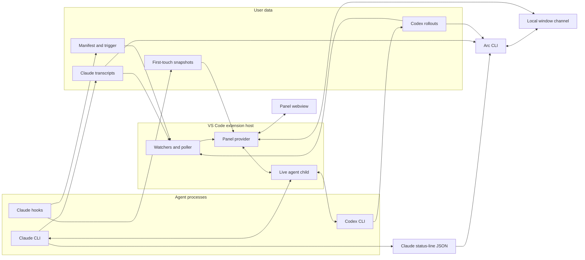

# Architecture

Use this map to find the owner of a change. The topic guides hold behavior, and [`design-goals.md`](design-goals.md) holds product intent.

## Reading guide

| Change | Guide |
| --- | --- |
| Panel visual treatments and interaction patterns | [`ui-design.md`](ui-design.md) |
| Transcripts, cards, diffs, context, cost, and refresh | [`timeline.md`](timeline.md) |
| Accepted outcomes, live subagents, and session-list status | [`timeline.md`](timeline.md#card-sources) and `timelinestate.ts` |
| Comments and text selection | [`comments.md`](comments.md) |
| Session list, search, menus, and editor navigation | [`rail-and-navigation.md`](rail-and-navigation.md) |
| Prompts, queue, controls, and account usage | [`composer.md`](composer.md) |
| Child processes, resume, and agent protocols | [`agent-protocols.md`](agent-protocols.md) |
| CLI commands and examples | [`cli.md`](cli.md) |
| CLI output contracts and limits | [`cli-reference.md`](cli-reference.md) |
| Agent session-management guidance and skill installation | [`arc-sessions.md`](arc-sessions.md) and [`arc-sessions` skill](../cli/skills/arc-sessions/SKILL.md) |
| Portable saved-session viewer and static assets | [`export-session.md`](export-session.md) |
| Setup, tests, and performance capture | [`development.md`](development.md) |

## System shape

Arc reads completed work from files, including sessions started in a terminal or another editor window. A child process carries live prompts, questions, and controls.



The extension never writes a file the agent changed. Hooks write only under the snapshot store. The panel opens files and diffs through VS Code. Video response links use the operating system's default application. The CLI reads Claude status-line JSON from stdin or one session's Claude or Codex records from disk. Window discovery asks running extension hosts through their local channels.

## Data sources

`terminalownership.ts` reads parent edges and creation identities through the shared Windows bridge, Linux `/proc/<pid>/stat`, or macOS `ps`. `extension.ts` supplies current public terminal membership, workspace trust, and local-host admission. `sessionrequests.ts` collects ancestry once for integrated callers without an explicit selector. Authenticated ownership inquiries require one conclusive matching window. Handler admission rechecks current membership and caller/root creation identities. Explicit selectors bypass automatic ownership. A scoped Windows bridge lease spans resolution and exchange. Pending process queries retain the bridge independently and settle on cancellation, timeout, or failure. For Windows MSYS callers, the running shell image locates its adjacent `ps.exe`. The MSYS parser accepts an optional I, O, or S state column before the PID. Two bounded MSYS snapshots supply consistent logical parent edges across missing native parents. The bridge checks mapped native creation identities and parent age. Other ancestry stops at missing older processes without crossing missing edges. Linux start ticks and macOS one-second start times cannot distinguish reuse within their timestamp precision. These observations establish routing origin, not authorization against other local processes.

| Source | Location | What it establishes |
| --- | --- | --- |
| Static Arc demo and main README image | `extension/scripts/readme-fixture.ts` through `web-demo.ts` | `view/static-shell.ts` and `webview/static-shell.css` own the decorative editor frame shared by the exported site and main README capture. The panel remains in the page document because its session list and popovers mount directly under the body and use viewport coordinates. Invented session records for a sample site that uses the panel bundle without starting the extension host or reading agent records. Production decoders read provider-response snapshots in `extension/scripts/demo-catalog/`. `demo-catalog-check.ts` compares installed CLI catalogs and base and model-specific defaults without sending prompts. Its `--refresh` option replaces those snapshots. Codex snapshots preserve omitted and null model and effort settings through `codexwire.ts`, so each model retains its configured default. Other configuration fields are excluded. Its `--cwd` option selects the launch folder, whose Claude project and local settings affect catalog aliases and applied defaults. The check launches Claude without the user settings file or model and effort variables, so those personal choices stay out of the snapshots. The check launches Codex in a private temporary home that holds only a copy of the signed-in account file. The account still selects the catalog, and personal settings stay out of the snapshots. The home has no trust entry, so Codex ignores the project settings of the launch folder. `ARC_CLAUDE_PATH` and `ARC_CODEX_PATH` select CLI executables. Offline export does not establish snapshot freshness. `web-demo-host.ts` classifies every panel request and normalizes sample context detail through production contracts. `web-demo-adapter.js` answers supported requests in page memory. `web-demo-export.ts` builds each invented outgoing session graph with the production export projection and renderer. The saved-session menu downloads its prebuilt HTML with the production stylesheet embedded. `exports.json` names the admitted downloads. The static-site checker checks their decoded data blocks and reachable session graphs. The adapter's comment store uses the production normalizer and mutation rules across session navigation. The adapter's navigation trail uses `turnplaces.ts` for session visits and Back and Forward. The demo admits response links only when `domain/session-link.ts` recognizes a sample session. File and external links remain inert. Demo and export keyboard shortcuts use `webview/navigation.ts`. `webview/static-menu.ts` stands in for the editor's context menu there and in the README captures |
| Offline review evidence | `evals/agent-review/cases/` and a separate bare evidence cache | Source commits, partial review keys, and exported review conditions for the development tool only |
| Saved session capture | Configured Claude project directories, Codex rollout directories, and caller-supplied reader-started links and saved reader-parent identities | Verified identities across working directories and the outgoing relationships of the selected saved session. Unreachable text bodies stay outside the capture |
| Portable review fixtures | `evals/agent-review/portable/cases/`, `evals/agent-review/fixtures/`, `evals/agent-review/cohorts/`, and captured checkout instructions | Candidate source, qualification checks, frozen keys, coverage targets, and instruction hashes for local exploratory comparisons |
| Codex account capability | Non-refreshing `account/read` on the selected app-server process | `account.type: amazonBedrock` excludes subscription usage. Missing accounts, unknown types, and discovery failures establish no exclusion |
| Claude context summary | `get_context_usage` with `detail: summary` on the selected connected child | Estimated content categories, optional message partitions, occupied tokens, accounting window, free space, and compaction reserve from one response |
| Codex retained context | The selected rollout's newest complete replacement history or opening, plus subsequent response items and request usage | Locally estimated text categories, retained checkpoint tool text, and an explicit unattributed remainder, without attaching to a saved session |
| Claude status-line JSON | CLI stdin | Current model, effort, context size and use, prompt-cache state and expiry, and session cost metadata |
| CLI transcript target | `arc cost` path or session id | Windowed request usage and list-price cost for one session and its children |
| Window registry | `${ARC_HOME:-~/.arc}/hosts/<host-id>.json` | Activation identity, process id, workspace folders, repository scope readiness, panel readiness and visibility, protocol version, accepted request capabilities, channel address, and authentication token |
| Claude snapshots | `~/.arc/snapshots/<session_id>/` | File content before the session first changed it, plus the files that still differ |
| Claude transcripts | `${CLAUDE_CONFIG_DIR:-~/.claude}/projects/<cwd-slug>/<session_id>.jsonl` | Prompts, responses, tool activity, usage, model attachments that name the context window, commits, subagent commits and subagent file changes, subagent results that entered context, including hand-back reports in queued `attachment` records and meta `user` records, recorded edits, shell-command file changes inside a git repository, paired Bash dispatch receipts, durable process-invocation ends, background command launches, their end records and their stop calls, and session names from `custom-title` and `ai-title` records |
| Claude child transcripts | `<transcript directory>/<parent_session_id>/subagents/agent-<agent_id>.jsonl`, and `agent-<agent_id>.jsonl` beside a child transcript for the subagents that child launched | A subagent's own usage and output speed, the commits it wrote, the files it changed with their line counts, its own tool and failed-call counts by name, when it started and ended, and whether its record reaches the end |
| Claude subagent meta files | `agent-<agent_id>.meta.json` beside each child transcript | Which subagent launched a nested subagent, through `parentAgentId`. The launch call in `toolUseId` locates a child's transcript for its row's cost and effort before child discovery lists that child |
| Claude saved title file | `<transcript directory>/<session_id>/custom-title.json` | Whether Claude Code saved a session rename. Only a rename reads it, at most 4 KiB |
| Claude `init` skill list | The `skills` array on the child's own `init` system message | Which of a Claude session's published slash commands the Prompt box highlights as an inspectable skill |
| Claude skill files | `<project>/.claude/skills/<name>/SKILL.md`, then `${CLAUDE_CONFIG_DIR:-~/.claude}/skills/<name>/SKILL.md` | The definition path a Claude skill mark and its popover show, the project folder winning over the reader's own |
| Codex live skill catalog | `skills/list` on a connected app-server child, refreshed after `skills/changed` | The complete Codex command and skill list the Prompt box offers for that child's working directory |
| Codex rollouts | `${CODEX_HOME:-~/.codex}/sessions/YYYY/MM/DD/*.jsonl` | The Codex form of the same turn record, including recent compaction request usage, subagent results from completed notifications and final answers, and shell-command dispatch receipts from each command's string `stdout`, or `aggregated_output` otherwise |
| Claude print results in Codex commands | The completed `CommandExecution` inside its parent Codex rollout | Shell-child ownership, recorded model usage, duration, session identity, and list-price cost |
| Agent child stdio | Process owned by the current extension host | Temporary live narration and activity before the disk record catches up, and the live session's busy state and turn endings |
| Claude main-response stream events | The connected child's identified `message_start`, terminal `message_delta`, and `message_stop` | Actual output tokens and observed response time for one unambiguous submitted prompt. Workspace state retains bounded measurements by session and response identity |
| Claude attribution selection | Editor environment or `.env` in the child's working directory | The local request attribution selection described in [Agent launch commands](agent-protocols.md#claude-attribution-selection) |
| Panel launch record | VS Code workspace state, beside the saved panel state | Which sessions the reader started from this panel |
| Codex session index | `~/.codex/session_index.jsonl` | Thread names, which may arrive after a rollout stops changing |
| Local git repository | The folder a command changed, and each open workspace folder | Registered worktree roots, commit details whose output printed none, and fast-forward landings from the head log |
| Browser saved panel state | VS Code webview state | The latest five exact workspace prompt submissions, saved synchronously before dispatch and reconciled with workspace recovery |
| VS Code workspace state | Extension-managed storage | Exact submitted prompt recovery, saved panel state, reader-started parent relationships and session list filters, queued submissions with delivery ownership and reset barriers, file descriptors, normalized account usage and live reset windows, and the last-reported Claude skill list for each working directory |
| Saved continuations | Workspace storage `continuations` | Exact agent-authored next-turn instructions, original source and assignment authority, native compaction generations, and separate delivery outcomes under one recovery lease |
| Hosted launch restrictions | `${ARC_HOME:-~/.arc}/launch-policies` | Immutable restrictions shared across windows, indexed by hashed session identity, plus one exclusive pending restricted clear or Codex fork |
| Bounded usage history | `~/.arc/usage/bounded-v1/` | Admitted Claude and Codex account limit readings in thirty fixed UTC-day slots |
| Legacy usage history | `~/.arc/usage/readings.jsonl` | Preserved experimental readings, outside the bounded store's quota |
| Applied CLI defaults | Prompt-free Claude `get_settings` and Codex `config/read`, `model/list`, and `configRequirements/read` | Applied model and effort for the launch folder and committed model. Arc reads Codex defaults from Codex 0.159.2 and later, outside the refused version ranges in `codexwire.ts`. The version comes from the first `product/version` token of the server user agent. A missing or unreadable version and a malformed configuration or policy reply report unavailable defaults. The host rejects obsolete configuration replies |
| Saved model readings (`arc.savedDefaults.v1:`, `arc.savedModelCatalog.v1:`) | VS Code global state | The last applied defaults answer for each agent, folder, and committed model value, one key per reading, keeping the 64 newest. Each agent's last model catalog with the CLI path that answered it. They draw the Model and Effort fields until a fresh read answers |
| Project setups (`arc.projectSetups.v1:`) | VS Code global state, keyed by canonical project identity | Reader-local pinned setups and accepted recent setups for one repository or non-Git folder |
| Legacy pinned setups (`arc.pinnedSetups`) | VS Code global state | Initial pins copied once into each new project entry, retaining their IDs and order |
| Project spend index | `~/.arc/cache/<workspace-key>/project-spend` | Recorded usage buckets, supplemental Claude accounting, resumable reconciliation, lifetime session-cost and primary-turn facts, and incremental parser state for one normalized workspace identity |
| Derived session cache | `~/.arc/cache/<workspace-key>/derived-session-cache-v1.json` | Rebuildable session titles, activity, run classification, outcome, and bounded context facts for one normalized workspace identity |
| Codex opening records | `~/.arc/cache/codex-openings.json` | The opening record of every Codex rollout on the machine, which places each rollout in a workspace. Every workspace and window reads and writes the one file |
| Prompt asset staging | Extension global storage | Generated-id copies of files attached to unsent, locally queued, or in-flight prompts |
| Local filesystem | The selected session's recorded working directory | Immediate path-completion candidates for the Prompt box, and the file or folder kind of each dropped or added item |
| Editor drag and Explorer menu | The `dataTransfer` of a drop on the Prompt box, and the resource arguments of `Add to Arc` | File URIs that become path text in the draft or image attachments staged from disk |

Hosts record bounded usage history asynchronously and preserve duplicate readings. Each slot permits 4 MiB of compressed payload and 8 KiB of metadata, temporary, and lock bytes. A fixed format file keeps protocol-created logical content below 128 MiB. This limit excludes filesystem allocation and files added by external actors. The raw allowance is 64 MiB per UTC day. Retained dates are today and the preceding twenty-nine UTC dates. Project cost uses local calendar dates.

Each host admits at most 256 KiB of queued and in-flight raw readings into one drain. Each gzip batch contains at most 64 KiB. One compressor and compressed result add bounded memory overhead. Busy, full, invalid, or failed recording leaves current account figures and their workspace persistence available.

Exclusive slot ownership spans payload writes, sync, close, and committed-prefix metadata publication. It requires a filesystem that honors exclusive creation. Unexplained payload tails, metadata temporaries, unsupported files, and failed publication or close preserve bytes and block admission. Locks receive no age takeover. Verified expired generations are replaced under ownership using the current UTC date. Closed editors and blocked slots retain physical expired bytes.

Terminal host shutdown closes recording admission synchronously and waits for active work to settle. Unowned preparation starts no further filesystem operation after closure, except closing acquired handles. Owned slot operations finish while retaining their lock. Closing a panel tab leaves recording active. Hosts running the legacy recorder append legacy history until they stop. The bounded recorder leaves that file unchanged. Historical analysis has no shipped command or panel surface.

The usage payloads name the plan but no account or organization. Readings from different accounts can therefore mix when those accounts use the same machine.

### Bundled tools

### Snapshot model

On activation, the extension removes snapshot session folders whose trigger is older than 30 days. If no trigger exists, it uses the folder timestamp.

The store contains:

```text
baseline/<sha1(abspath)>   first-touch content
index.json                 hash-to-path entries and the session cwd
manifest.json              files that currently differ from the baseline
trigger                    watcher signal
```

## Component map

The exhaustive [component table](components.md) names each extension source component and its job.

### Project cost integrity scheduling

## Module boundaries

The local window channel accepts session starts and curation from authenticated local clients. `panelhost.ts` resolves runtime setups through the existing launcher and starts an independent draft without selecting it. Successful prompt delivery identifies the session before metadata persistence. Initial-save failures retain that identity. Rejected delivery leaves the prompt available for recovery. Membership rollback follows session adoption and restores only targets without a newer membership action. Independent initial pins survive rejected saves. Explicit agent-run classification lives in bounded workspace state alongside reader-started ownership. A requested cache lifetime lives only on the start draft. Processes launched from that draft set it, and a later resume through the session plan does not. Preference saves and confirmed resets preserve both launch classifications. Curation uses the provider's label and membership owners and awaits saves. Initial pin persistence uses the same per-session pending-save owner as membership actions. An unchanged membership action awaits that owner without replacing it. Without a pending owner, it saves current membership and awaits persistence, including retries after rejected initial saves. Initial metadata failure retains live launch state and rejects waiting curation acknowledgments. Archive admission reads fresh scoped status at apply time. Running, needs-input, and completed unread sessions require force. So do sessions with hidden attention, stale or unparsed facts, or unknown run status. A run status of subagents or background refuses archive even with force. Archive membership keeps the current turn and open asks. [Child ownership and shutdown](agent-protocols.md#child-ownership-and-shutdown) owns when retirement ends the process. Unarchive changes membership alone. Existing host messages synchronize label editors and panel tabs.

`SessionReadObservations` signs completed identities only after final delivered projection pruning. The production panel provider checks fresh independent source facts before signing and before ordered mutation. Receipt preflight and ordered reduction each reuse source facts within their own phase. `WindowChannel` advertises `sessionRead` with its guarded read receiver. `HostReadPersistence` owns every panel-state write and serializes explicit reader actions, agent acknowledgments, preference saves, storage settlement, and publication. Ordinary reader events use its bounded barrier without lifetime result bindings. Each browser document creates its identity. The host challenges readiness against the current shell before admitting that document. Browser events arrive in consecutive sequence order. Gaps refuse without consuming a sequence, and queue overflow leaves the refused event eligible. Admission replies report event consumption, separate from storage outcomes. The browser retains at most 256 queued payloads and sends one event until admission. Refused events and lost replies retry the same frozen identity. Page disposal ends those retries. Consumed duplicates never mutate again. Replacement documents, replacement shells, and closed hosts reject previous page events. Already-admitted intent survives document replacement. Ordinary preference resets and source invalidations also use this admission route. Retained APIs keep their exact outcome bindings. Failed storage preserves accepted state. Unknown storage blocks later saves. Browser tabs receive the accepted read revision and validated agent keys after storage, including hidden ready tabs. Readiness supplies current state to restored and replacement documents. Cold restoration resolves one retained source per event-loop turn. Unchanged restoration reuses validated sources and avoids read mutations. Each aggregate projection checks a shared source once. Source projection updates retain the accepted read revision. Browser tabs accept those updates only when reader state stays equal. Automatic marks wait for accepted reader evidence or their pending submission. Explicit turn-read permits fresh intent after consumption without accepted evidence. Session-unread closes its cards and saves disclosure before dispatch. Complete exact identity mappings alone subtract agent acknowledgments from counts. Agent acknowledgments never establish reader boundaries or complete older history. Guarded-send observations and directing-reader revisions keep their separate owners.

`sessionwrites.ts` retains at most 256 shared write results per activation for starts, curation, and guarded sends. It separately admits at most 256 distinct guarded request IDs during that activation. Each guarded admission reserves lifetime capacity before its handler runs, including in-flight requests and accepted, unknown, or refused outcomes. No admission returns capacity. A guarded send that refuses before input moves to a separate refusal table, leaving the shared result allowance available for starts and curation. IDs include the window activation, and matching payload retries observe the retained outcome before either capacity check. Conflicting payloads refuse writes. Exhausted capacity rejects new IDs before their handlers run and retains no new binding. Neither table evicts admitted IDs. Disconnects leave accepted work running. A new activation refuses old IDs with an unknown outcome. The CLI never retries automatically. Write exchanges allow 120 seconds while partial input retains its one-second deadline. [Session write contracts](cli-reference.md#session-writes) define request IDs and outcomes.

Guarded follow-ups reach the panel host through three ports that `extension.ts` assigns from the activation's `GuardedSends`. A channel start passes its request ID and requester to `onSendDraftPrompt`, which records ownership with the started child. A session read passes its checked facts to `guardedObservation`, and the panel keeps them. Signing requires the exact started child in `AgentHost`, with the same session ID and no exit. Removal during retirement withholds observations before disposal completes. A replacement with the same session ID cannot sign for the started child. At admission, `guardedTargetFacts` reports the scope, the exact source revision, queues, pending submissions and controls, and rail status. Status derivation uses the target's outcome, live state, timestamps, commands, and matching Claude children through the shared timeline functions. Unrelated closed-child work reads stay outside admission. It reports the newest turn of the latest read only when that read saw the same source revision. `extension.ts` counts a deferred self-compaction that waits for the session as a pending control. The panel calls `onReaderInput` when directing input arrives before the panel knows whether it accepts it. A reader submission calls it before prompt retention, and a setting pick calls it before `onPicked`. The panel calls `onReaderDirected` after it accepts directing reader input and before it queues or delivers it. Both ports make observations stale. Only `onReaderDirected` clears the block that an unknown delivery left, so a rejected input or a setting pick never clears it. `interveneOnReaderInput` wraps the directing callbacks and only makes observations stale. A permission pick makes observations of every live session of its agent stale. A guarded write registers its submission with `CompactHost`, as ordinary delivery does. Its delivery port classifies the attempted child's receipt reason for recognized writer conflicts, including after retirement or reader input clears its error. That conflict permanently blocks guarded input to the worker during the activation without changing the receipt's unknown outcome.

The editor boundary is `extension.ts`, `panelhost.ts`, `uris.ts`, and `config.ts`. Other production modules avoid `vscode`, so tests can import their decisions directly. `extension/src/imports.test.ts` enforces package direction and runtime cycles.

`extension.ts` owns the window channel lifetime. Channel creation or publication failure leaves panel activation available. `panelhost.ts` publishes window state after restoring saved provider state, without parsing sessions for discovery. Repository scope initializes independently of panel visibility. Panel readiness means an attached browser has completed startup. Panel visibility separately identifies active watching. Independent windows on the same folders retain distinct activation identities. Folderless windows publish empty folder lists.

`sessionreads.ts` resolves restored agent acknowledgments independently of selected-session caches. Exact mappings bind provider, session, canonical physical path, device, inode, scope, size, modification time, and change time. Source changes invalidate mappings, including append growth. Unavailable sources and incomplete identity coverage supply no projected agent keys. Complete mappings require unique completed prompt identities and turn timestamps. A bounded delivered reply does not establish complete history. Source resolution reads at most 8 MiB in chunks of at most 256 KiB. It retains at most 32 sources and 2000 turn identities in total. Larger sources and excess identities retain uncertain coverage. Revision checks establish observed agreement, not an atomic filesystem snapshot. Metadata-preserving concurrent rewrites remain undetected.

Session requests use the provider's accepted catalog under the current repository scope. Requests never enumerate transcripts or advance panel discovery. Retained sources with a recorded working directory outside the scope are excluded. Missing catalogs return a first page with unavailable coverage and refuse cursors and detailed reads. Listing coverage requires accepted discovery of the same catalog members, every accepted source in scope, and no pending discovery. Members compare by file, device, and inode, so transcript appends keep coverage. Listing freshness requires active observation, no watcher events or refresh, and current revisions for the served rows. Hidden observations remain stale. Listing pages sort sources by a key hashed from provider, session ID, and file. Each cursor is signed with a secret that the provider instance creates, so a reload expires it. A cursor carries a digest of the device and inode of every source up to its last key, so the host keeps no state for each caller. The provider caches the sorted keys, their serialized prefix tuples, and the discovery comparison by catalog array identity and scope roots. Row projection and unread counts run only for sources that a page can serve. Query predicates check catalog identity and reader metadata before agent-run freshness. Only agent-run predicates stat surviving sources before paging. Served rows receive independent revision checks. The internal archive read filters by session ID before paging and matches its row by source key. Programmatic status uses accepted outcomes and native activity without starting child transcript scans. Hosted requests and running state remain available for known scoped IDs independently of metadata freshness and panel visibility. Claude, Claude child transcript, and Codex catalog stats retain exact decimal device and inode identifiers beside their revision. A source without both identifiers clears listing coverage on its own page when more pages follow. One bigint filesystem observation supplies identity, safe byte size, and fractional modification time. Worker messages and caches preserve those identifiers. Claude stored and parsed names use them to distinguish delayed reads from replacement. Hosted publication binds a scoped source to a busy AgentSession instance and preserves that ownership through idle. Matching supported identity admits nonshrinking growth before binding. Missing or unsupported identity requires the exact accepted revision. Supplied identity conflicts and failed stats refuse binding. Catalog revalidation preserves supplied accepted identity. Conflicting current identity refuses binding until authoritative discovery. The first exit freezes its source revision. A listing admits native closure only while the current catalog and file identity match that frozen revision. Available metadata must match the current source. Older reader windows retain independent freshness and must match physical identity. A rewrite preserving size, modification time, device, and inode remains undetected. A replacement instance revokes the prior witness, including when it starts idle. Authoritative catalog removal and provider disposal remove process-local witnesses. Missing or changed sources withhold that closure. Admitted native or recorded process closure preserves completion despite retained child and background history. Hidden attention remains unknown. An unfinished turn without live running evidence or a process end reports unknown until one hour after its last assistant activity, and then it reports stopped. A turn without a readable end time stays unknown. Programmatic status never reads child transcripts, so it cannot see a closed child resume. [CLI run status](cli-reference.md#run-status-and-attention) defines the status that retained child and background records produce. Terminal status establishes neither reader review nor archive eligibility. Requester names supply attribution alone. `sessionreads.ts` qualifies only the selected accepted source before parsing. Descriptor and pathname revisions must agree on its current opening. Matching physical identity permits nonshrinking growth. The opening must retain its session identity and recorded working directory within scope. Unknown membership and retained same-ID competition refuse delivery and acknowledgment. Qualification reads at most one opening within the existing byte allowance and refuses completion past one second. Synchronous filesystem operations have no hard latency bound. The qualified revision binds parsing, observations, and acknowledgments. Scope and exact revision checks run before parsing and afterward. Qualification changes no catalog or discovery state. Its separate read windows never replace selected-session caches or update reader watermarks, selection, drafts, tab ownership, or runtime capabilities. The channel checks the complete serialized reply, including window metadata, and explicitly refuses responses exceeding its allowance. [CLI session output](cli-reference.md#sessions) owns limits and response fields.

`sessionrequests.ts` uses Windows named pipes and Unix sockets on macOS and Linux. Socket paths of 104 bytes or more use a short private directory under the host's temporary root, then `/tmp` if necessary. Its directory name derives from the Arc home, and its socket filename contains the host identity. Clients validate this published address independently of their temporary environment. Registry directories use mode 0700 and entries use mode 0600 on POSIX. Clients challenge server knowledge of the registry token before sending a request. Every request carries that token, including ping. Replies must match the registered host identity and process id. Refusal, timeout, and uncertain process state retain registration and socket ownership. Discovery removes a registration only after confirmed process death, address validation, and an unchanged-byte check. Only the owning host removes its socket and fallback directory. Invalid registrations supply no cleanup targets. Filesystem path replacement during cleanup remains outside these pathname checks. Panel filter requests reveal the existing editor panel and replace its query through the session list owner. Correlated browser saves await serialized preference persistence. Each queued save retains its browser query and copies current host-owned fields when storage starts. Later host pin actions preserve their group expansion while later browser fold choices remain effective. Confirmed resets admit their preference snapshot to storage at confirmation, replace older queued snapshots, and reserve their position before later filter applications. Reset storage and browser publication finish before those applications begin. Reset cancels earlier admitted requests without releasing started storage barriers. Browser reset saves update their local copy without echoing cleared preferences to the host. Correlated saves check cancellation and the application-based deadline immediately before storage starts. An expired started save retains its ordering barrier until storage settles. The request parser refuses unknown keys, so the CLI sends `requesterProvider` only to a window whose registration lists that capability.

Node transport failures and channel cleanup write bounded `windowTransport` warnings through the panel provider's diagnostics log, including when detailed logging is disabled. Events retain fixed reasons, numeric stream and ownership state, exit code, signal, and classified error codes. Registration removal reports its ownership outcome and failed operation. Records exclude stream contents, request payloads, credentials, paths, and raw errors. Diagnostic failure leaves transport behavior unchanged.

`windowpipe.ts` runs the packaged Windows bridge beside the extension and CLI bundles. Source tests compile it with the Windows Framework compiler in an owner-only temporary directory. `scripts/windowpipe-build.mjs --refresh` updates the executable and its source and binary hashes on Windows. Source hashes normalize CRLF to LF. Both builds check those hashes before copying the executable. One bridge process serves the Node host and exits when its stdin closes. The channel replaces failed transports within the same activation and retains accepted writes and their results. Replacement retires the failed listener and its connections while preserving other bridge owners. An unused helper closes before replacement starts. Listener disposal cancels public startup immediately and waits for the native listen outcome before retirement. Shared-helper retirement orders close commands before a rejected-connect acknowledgement. First-instance admission prevents listening while an old pipe instance survives cancellation. Recovery makes three replacement attempts after delays of 100, 500, and 2000 milliseconds. Thirty continuously listening seconds reset that allowance. Disposal and exhaustion cancel recovery and remove only the owned registration. Windows registrations publish `transportPid` after the matching listen acknowledgement. Every pipe instance rejects remote clients and denies Network access. The pipe grants its owner and SYSTEM full access. Local `CodexSandboxOffline` and `CodexSandboxOnline` accounts receive duplex access without pipe-instance creation rights. On the connected handle, clients check the server process id, its host parent, and the pipe owner before sending anything. Discovery requires that owner to match the registration file owner. Direct ping checks use the registered host process owner. Overlapped reads and writes preserve duplex operation. Operations retain native handles and buffers until completion after cancellation. Busy client opens retry within the request deadline. A client disconnect before acceptance closes its instance while the listener continues. Native admission, per-connection output, and bridge stdio have fixed limits.

Discovery iterates at most 1,024 directory entries plus one coverage check, admits 256 valid hosts, and pings eight hosts concurrently. Invalid entries consume directory work, without consuming the host allowance. Unvisited entries or uncertain host responses mark discovery incomplete. Publication replaces one registration without scanning the shared directory for leftover atomic temporaries. Its current temporary closes with the write. An identical state publication restores a missing registration.

`payload.ts` shapes host-to-panel render messages. The panel runs in another process, so a host import cannot supply browser code. Shared rules live in browser-safe `domain/` and `view/` modules. Host-only decisions travel as data over `webview/protocol.ts`.

The root `turn*.ts` modules own the host projections by subject. New imports name that owner rather than the compatibility re-export in `turnview.ts`. `turnfixtures.ts` is test support and cannot enter production imports.
