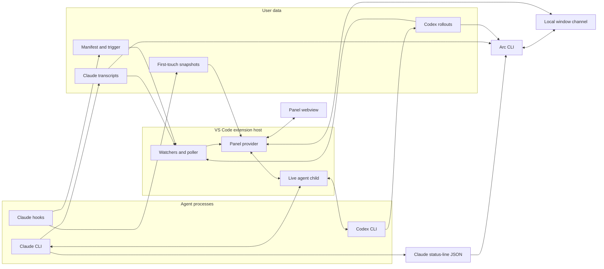

# Architecture

Use this map to find the owner of a change. The topic guides hold behavior, and [`design-goals.md`](design-goals.md) holds product intent.

## Reading guide

| Change | Guide |
| --- | --- |
| Panel visual treatments and interaction patterns | [`ui-design.md`](ui-design.md) |
| Source locations and provenance | [Source catalog](data-sources.md#source-catalog) |
| Local requests, terminal routing, read acknowledgment, and guarded writes | [Window channel](window-channel.md) |
| Transcripts, cards, diffs, context, cost, and refresh | [`timeline.md`](timeline.md) |
| Accepted outcomes, live subagents, and session-list status | [`timeline.md`](timeline.md#card-sources) and `timelinestate.ts` |
| Comments and text selection | [`comments.md`](comments.md) |
| Session list, search, menus, and editor navigation | [`rail-and-navigation.md`](rail-and-navigation.md) |
| Prompts, queue, controls, and account usage | [`composer.md`](composer.md) |
| Child processes, resume, and agent protocols | [`agent-protocols.md`](agent-protocols.md) |
| CLI commands and examples | [`cli.md`](cli.md) |
| CLI output contracts and limits | [`cli-reference.md`](cli-reference.md) |
| Agent session-management guidance and skill installation | [`arc-sessions.md`](arc-sessions.md) and [`arc-sessions` skill](../cli/skills/arc-sessions/SKILL.md) |
| Portable saved-session viewer and static assets | [`export-session.md`](export-session.md) |
| Setup, tests, and performance capture | [`development.md`](development.md) |

## System shape

Arc reads completed work from files, including sessions started in a terminal or another editor window. A child process carries live prompts, questions, and controls.

The extension never writes a file the agent changed. Hooks write only under the snapshot store. The panel opens files and diffs through VS Code. Video response links use the operating system's default application. The CLI reads Claude status-line JSON from stdin or one session's Claude or Codex records from disk. Window discovery asks running extension hosts through their local channels.

## Data sources

### Bundled tools

### Snapshot model

## Component map

The exhaustive [component table](components.md) names each extension source component and its job.

### Project cost integrity scheduling

## Module boundaries

The editor boundary is `extension.ts`, `panelhost.ts`, `uris.ts`, and `config.ts`. Other production modules avoid `vscode`, so tests can import their decisions directly. `extension/src/imports.test.ts` enforces package direction and runtime cycles.

`payload.ts` shapes host-to-panel render messages. The panel runs in another process, so a host import cannot supply browser code. Shared rules live in browser-safe `domain/` and `view/` modules. Host-only decisions travel as data over `webview/protocol.ts`.

The root `turn*.ts` modules own the host projections by subject. New imports name that owner rather than the compatibility re-export in `turnview.ts`. `turnfixtures.ts` is test support and cannot enter production imports.
