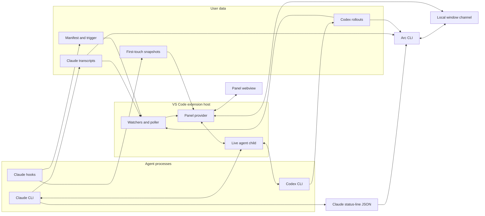

# Architecture

Use this map to find the owner of a change. The topic guides hold behavior, and [`design-goals.md`](design-goals.md) holds product intent.

## Reading guide

| Change | Guide |
| --- | --- |
| Panel visual treatments and interaction patterns | [`ui-design.md`](ui-design.md) |
| Transcripts, cards, diffs, context, cost, and refresh | [`timeline.md`](timeline.md) |
| Accepted outcomes, live subagents, and session-list status | [`timeline.md`](timeline.md#card-sources) and `timelinestate.ts` |
| Comments and text selection | [`comments.md`](comments.md) |
| Session list, search, menus, and editor navigation | [`rail-and-navigation.md`](rail-and-navigation.md) |
| Prompts, queue, controls, and account usage | [`composer.md`](composer.md) |
| Child processes, resume, and agent protocols | [`agent-protocols.md`](agent-protocols.md) |
| CLI commands and examples | [`cli.md`](cli.md) |
| CLI output contracts and limits | [`cli-reference.md`](cli-reference.md) |
| Agent session-management guidance and skill installation | [`arc-sessions.md`](arc-sessions.md) and [`arc-sessions` skill](../cli/skills/arc-sessions/SKILL.md) |
| Portable saved-session viewer and static assets | [`export-session.md`](export-session.md) |
| Setup, tests, and performance capture | [`development.md`](development.md) |

`scripts/isolated-editor.mjs` installs candidate and disposable probe VSIX files into its isolated profile through the selected editor CLI. It pins the selected scratch directory to its physical path before creating run paths and discovering abandoned runs. macOS profile sockets require short scratch paths and run identifiers. It retains isolated registration manifests, editor logs, and process receipts before removal. It reads the installed Windows `bin/code.cmd` as data to select its matching CLI. Windows `mkdtemp` calls use namespace paths for long run directories. [Isolated extension host](development.md#isolated-extension-host) owns supported layouts and launch directories.

`scripts/test-installer.mjs` stages installed workflow source outside the live checkout and allocates private editor, agent, Arc, build, and evidence directories. Its manifest records source digests, original commit and dirty state, bootstrap digest, downloaded revision, installed extension identity, and selected plugin bytes. Its private npm launcher supplies the staged commit and dirty state to the existing build identity helper. Session-only checkout loading reads the selected live checkout outside cleanup ownership and launches inside the private workspace. Each checkout launcher retains a private receipt and process creation identities through Claude exit and descendant settlement. Cleanup and launch admission share an exclusive directory claim. Interrupted launches retain unsettled receipts. Installed managed checks connect the installed Arc extension's bundled identity to the selected plugin payload. The driver reuses isolated editor executable and CLI resolution. It checks actual home and skill destination resolution before installation. Cleanup requires settled children, an unchanged root identity, and admitted contained links. The legacy operation stages a baseline and candidate at one fixed path, with an optional owned directory alias. [Installer testing](development.md#isolated-installer-tests) owns its commands and native acceptance limits.

Question recovery stores captured question payloads, dispositions, settled identity barriers, and immutable activation leases beneath the workspace partition. The webview retains its origin across restored tabs. Recovery reads only captured identities and uses separate transcript cursors. Each waiting publication checks ownership once, and each source scan indexes captured tool identities. One synchronous question publication reuses source lookups by provider and exact raw session identity, including missing sources. Later publications and answer-time checks resolve sources again. Store snapshots and ownership checks remain independent of source lookup reuse. Unknown attempts remain outstanding. Claims remain exclusive across windows, and unresolved questions never enter age or history eviction.

`cli/src/collect.ts` follows production listing pages and optionally reads turns through the selected window channel. It retains raw observations separately from usable row references and turn outcomes. [Collection output](cli-reference.md#collection) owns recovery, admission limits, and the absence of physical source continuity guarantees.

`scripts/test-default.mjs` runs static checks and direct units sequentially. `scripts/test-unit.mjs` partitions root, extension, and CLI units. `scripts/test-integration.mjs` runs the complete external-boundary categories. `scripts/test-subprocess.mjs` starts root subprocess tests directly and shares child signal cleanup with the browser launcher. `scripts/test-classification.js` identifies admitted expensive tests and their repetition budgets. [Verification](development.md#verification) owns test commands and category coverage.

`extension/test/observations.mjs` writes bounded JSONL timing files for test launchers and their existing resource boundaries. Parent run identities connect nested commands without combining their intervals. Lock and browser-slot observations retain the effective coordination paths and timestamped holders. Temporary-directory setup records environment changes. [Test timing](development.md#test-timing) owns the schema, commands, and observation limits.

## System shape

Arc reads completed work from files, including sessions started in a terminal or another editor window. A child process carries live prompts, questions, and controls.



The extension never writes a file the agent changed. Hooks write only under the snapshot store. The panel opens files and diffs through VS Code. Video response links use the operating system's default application. The CLI reads Claude status-line JSON from stdin or one session's Claude or Codex records from disk. Window discovery asks running extension hosts through their local channels.

Ordinary agent sends use `PanelProvider.sendAgentMessage` for guarded idle or live delivery. Explicit queue requests and temporary blockers enter `PanelProvider.queueAgentMessage`. A target reservation serializes admission through receipt across ordinary sends, observed follow-ups, and agent queue drains. Activation-local bindings retain one exact child. `flushQueue` sends queued entries through native guarded receipts before reader prompt assembly. Agent messages wait for temporary panel work before attempt persistence. Panel settlement and hosted-child state changes call `flushAgentQueue`, which drains only agent queue heads. Concurrent saves that contain a refused admission settle before an ordered deletion confirms refusal. Uncertain deletion retains the message in recovery. Saved agent entries normalize into recovery because their child authority never survives reload. `GuardedSends` retains unknown-delivery blocks across both agent input forms.

`codexwire.ts` tracks active compaction items separately from roots that contain compaction. Completed automatic compaction preserves root-ending attribution while ordinary work in that root accepts live input. Manual and unresolved compaction still block live input.

## Data sources

`terminalownership.ts` reads parent edges and creation identities through the shared Windows bridge, Linux `/proc/<pid>/stat`, or macOS `ps`. `extension.ts` supplies current public terminal membership, workspace trust, and local-host admission. `sessionrequests.ts` collects ancestry once for integrated callers without an explicit selector. Authenticated ownership inquiries require one conclusive matching window. Handler admission rechecks current membership and caller/root creation identities. Explicit selectors bypass automatic ownership. A scoped Windows bridge lease spans resolution and exchange. Pending process queries retain the bridge independently and settle on cancellation, timeout, or failure. For Windows MSYS callers, the running shell image locates its adjacent `ps.exe`. The MSYS parser accepts an optional I, O, or S state column before the PID. Two bounded MSYS snapshots supply consistent logical parent edges across missing native parents. The bridge checks mapped native creation identities and parent age. Other ancestry stops at missing older processes without crossing missing edges. Linux start ticks and macOS one-second start times cannot distinguish reuse within their timestamp precision. These observations establish routing origin, not authorization against other local processes.

Standalone native session publication reuses `dispatchreceipts.ts` accepted identity and replacement checks. `cli/src/standalone.ts` reads provider frames or the launch-bound Claude registry entry. Claude print also accepts a new native user record matching its session hint, physical directory, and submitted prompt. Private receipts retain the accepted source identity, pinned directory, physical working directory, opening length, and digest. Unknown source paths use a launch-private binary set of pathname digests and an immutable bounded manifest. Preparation failure retains unavailable relationship evidence and preserves the ordinary native launch. Recovery never reconstructs the prelaunch set. A separate immutable binding retains the root witness file identity. Source observation and continuity share one work allowance, cancellation state, and deadline. Unavailable preparation preserves ordinary output observation without replenishing source work. Codex and background Claude observations check each stable native identity once during framing. Publication repeats source validation. A foreground native ending publishes after one source check. Pending source checks then continue in the same supervisor within that deadline. Native completion sets `released: true` and `phase: "witness-pending"` on the same monitor owner. Acquisition refuses live or uncertain pending owners until settlement clears the phase. Dedicated unattended private supervisors leave their working directory before publishing native release. Manual, attended, and library observations retain their caller's working directory. Missing original receipt evidence cancels the remaining source work. A background Claude report with a ready baseline waits for source readiness. Accepted native identity remains separate from relationship readiness. Final stdout reports require accepted binding. Publication checks retained startup evidence against one coherent source revision. Source revision changes restart validation within the observation's original deadline and cumulative read allowance. Unsettled sources keep reports pending. Observed source replacement remains refused across observations. Preexisting, redirected, replaced, or conflicting sources cannot qualify new startup evidence. `cli/src/run.ts` prints the existing marker after JSON when requested. Existing transcript relationship discovery carries reader ownership and original-source cost attribution. A background job ID supplies management authority for that launch alone. It supplies no transcript identity or process termination authority. A separate launch-owned capture reads Claude native log snapshots under an exclusive output claim. Each drain reads bounded slices from its durable source position. Native terminal evidence ends capture after its remaining bytes drain. An exhausted drain leaves capture unavailable and retains its byte positions and private output for recovery. Registry disappearance supplies no exit evidence.

Standalone launches resolve explicit configuration selectors against the launch directory before admission. An absent Claude selector stays absent, while receipts retain absolute transcript roots. Claude background launches without selector evidence retain saved reports but refuse native management, registry recovery, and native capture. Post-start observation publication retries transient replacement errors within the finite observation deadline. Launch admission bounds the complete serialized receipt before reserving its directory. Native observations retain argument and command-line digests alongside the original process identity. Observation admission checks the complete saved bytes and status metadata before publication. Status projects launch identity without repeating configuration. Its metadata reserves space for one maximally admitted event and consumption digests.

Dispatch launches reserve private directories under `${ARC_HOME:-~/.arc}/dispatch` before starting workers. Each receipt retains its activation, requester, policy, prompt digest, and completion route. Accepted native turn identity binds the owning submission. Binding retains prepared file identity before publishing the accepted turn. A missing root witness recovers only matching binding bytes and identity. Immutable events retain private Markdown report paths and report digests. Output aliases copy reports and supply no authoritative bytes. Refresh reads the launch-private current report through its retained physical identity. Claims and dispositions bind one exact event. Receipts supply no usage or billing evidence. Standalone log capture retains private output and requested aliases separately from result observation. Capture checkpoints retain private byte positions and each requested log's physical file identity across resumed observations. Capture writes use a separate receipt lock and reload committed channel positions before appending. Recovery preserves another launch's alias. Captures without an alias witness resume private output only. Private stdout, stderr, combined diagnostics, native Claude logs, and frozen responses remain distinct. Saved response reads reuse the provider reducers and bounded forward recovery through the accepted scoped catalog. Raw JSON records retain complete text through 49 MiB before metadata reduction. Recovery caps each source's conservative retained-payload charge at 512 MiB and retains at most 32 source entries. Frozen UTF-8 reports have a separate eight MiB limit. Claude agreement compares the complete final response and its message identity. Codex agreement requires the exact native turn. Missing evidence remains pending. Receipt errors retain observations for retry without changing accepted prompt delivery. Hosted waits use the local channel and end at their deadline or disconnect without changing the worker. Event indexes retain bounded segments without a total launch or event count limit. Status pages omit disposition text and native ending evidence. Exact-event reads retain both. Immutable write-lock successors serialize ordinary writes and dead-owner recovery. Successor and release files retain ownership history. Live or uncertain owners retain their write lock. Filesystem identity checks detect observed replacement and redirection. They provide no protection against concurrent metadata-preserving rewrites.

`install.sh` detects complete source beside the script, then in the working directory, or resolves a GitHub ref and downloads its exact SHA. Remote source, dependencies, and the VSIX live in an installer-owned temporary directory that cleanup removes. Both source routes install dependencies with `npm install`. Both default source routes invoke the built `setup.cjs --snapshots` helper for matching immutable plugin storage. The helper runs from the caller's folder so project settings and scoped plugin ownership apply. An explicit `--marketplace-url` selects the plugin independently of `--repo` and `--ref`. `scripts/package-claude-plugin.js` produces the plugin ZIP, digest, and hosted catalog for the candidate workflow. [Development setup](development.md#dependencies) owns source setup options. [Installation](../README.md#install) owns hook options.

The startup panel shell supplies no saved-filter catalog. The session list retains restored view folds until the host supplies the saved-filter catalog and views.

The installer's current-editor detection reads `product.json` beside the bundled Git askpass script identified by `VSCODE_GIT_ASKPASS_MAIN`. Windows user and system installations also supply content-addressed askpass copies outside the installation. For those copies, readable `VSCODE_GIT_ASKPASS_NODE` anchors metadata lookup in its installation's flat resources or immediate ten-hexadecimal version folders. Matching product identities across those folders select the outer installation's CLI. Conflicting identities leave detection unavailable. Bundled askpass scripts in version folders use the executable path to resolve the outer installation. `TERM_PROGRAM=vscode` alone does not distinguish editor products. A supplied `VSCODE_GIT_ASKPASS_NODE` must identify a readable executable in the same installation and is never executed. Missing or unsupported identity data leaves current-editor detection unavailable. The selected CLI belongs to that installation, including macOS products whose launcher is named `code`.

`scripts/capture-panel-diagnostics.js` collects local performance evidence outside the extension data flow. Windows delegates to the PowerShell collector, while Linux and macOS read system process and memory sources. The platform boundary excludes Windows graphics and logon counters from Unix captures. [Performance capture](development.md#performance-capture) owns the capture order, output formats, and measurement limits.

`diagnosticslog.ts` writes content-free host health snapshots and recent lifecycle events under `${ARC_HOME:-~/.arc}/logs/health-<provider-id>.*`. `registerPanel` starts recording before provider construction. Provider disposal records clean termination after shutdown work returns. Each activation retains its own PID, provider identity, hashed workspace and embedded build identity. Five-second snapshots retain settled discovery charges, checkpoint position and sequence, generation status, and up to eight pending worker requests with their ages. `discoveryObservation` separately retains the latest accepted request's cumulative charges, host request sequence, generation, checkpoint sequence, and age since receipt. It survives request failure until another accepted charged reply replaces it. Its charges overlap settled totals after successful completion and must not be added to them. Obsolete or invalid acknowledgements replace neither the checkpoint nor this observation. The named session reader worker retains bounded error name, code, exit code, thread identity, and pending work through the always-on diagnostic log. Deliberate cancellation and disposal report no crash. RSS includes every extension and worker in the host process. Heap and external memory describe the extension-host thread. Discovery replies carry worker heap and external memory from completed quantum boundaries. Each memory observation retains thread and request identity and elapsed time since host receipt. A new worker starts without a memory observation. These snapshots do not identify allocation sites. Unknown termination covers interrupted processes and incomplete diagnostic writes. It does not establish a crash. [Host health evidence](development.md#host-health-evidence) owns capture steps, limits and interpretation.

Delegated Codex spend counters distinguish aggregate starts and completions, relationship invalidations, incompatible consumed-source invalidations, current-source revision restarts, parser advancements, and waits behind another root. Relationship changes take precedence when both invalidation causes apply. Parser advancements count generator steps, including source finalization. Current-source restarts also count revision rejection after finalization. Discovery observations retain request counters, and settled discovery totals sum them across replies.

Panel capture scripts reuse the state setup in `extension/scripts/panel-shots.ts`. Its default writer checks file admission before clearing the target or setting up the page, then writes lossless WebP. A supplied writer receives the target unchanged and controls file admission and replacement. The screenshot command selects the full fixture matrix or the checkout-local bounded capture adapter. [Panel screenshots](development.md#panel-screenshots) owns command syntax, destination admission, and adapter availability.

The portable review runner in `evals/agent-review/run.mjs` reads tracked case fixtures and current checkout instructions. It writes external workspaces, Codex execution records, adjudications, and reports for development comparisons. `portable/cohort.mjs` checks production exports, assigned inputs, qualification receipts, and final coverage separately. Its opt-in audited instruction bundle preserves default capture behavior. [The cohort guide](../evals/agent-review/cohorts/README.md) owns qualification and preparation commands. On Windows, `portable/live.mjs` selects the elevated native sandbox backend and checks read access and write denial before a paid launch. The frozen continuation command uses `portable/resume.mjs` to reconstruct unstarted cells from retained inputs and combine preserved adjudication with new decisions. Its Windows job host contains each paid attempt and terminates descendants when the host or its identified runner exits. Shared continuation ownership uses filesystem identity and prevents concurrent launches across output directories. Fatal condition stops persist beside that ownership and require matching completion evidence before another launch. Each derived execution must match its durable claim, terminal receipt, and final receipt. The historical importer in `evals/agent-review/cli.mjs` reads registered Arc commit objects into a separate bare cache. The developer recipe in `evals/agent-review/rebuild-corpus.mjs` rebuilds production exports from historical commits and a frozen instruction snapshot. These development tools sit outside the extension data flow. Their local workspaces do not certify semantic leakage or host access isolation.

| Source | Location | What it establishes |
| --- | --- | --- |
| Static Arc demo and main README image | `extension/scripts/readme-fixture.ts` through `web-demo.ts` | `view/static-shell.ts` and `webview/static-shell.css` own the decorative editor frame shared by the exported site and main README capture. The panel remains in the page document because its session list and popovers mount directly under the body and use viewport coordinates. Invented session records for a sample site that uses the panel bundle without starting the extension host or reading agent records. Production decoders read provider-response snapshots in `extension/scripts/demo-catalog/`. `demo-catalog-check.ts` compares installed CLI catalogs and base and model-specific defaults without sending prompts. Its `--refresh` option replaces those snapshots. Codex snapshots preserve omitted and null model and effort settings through `codexwire.ts`, so each model retains its configured default. Other configuration fields are excluded. Its `--cwd` option selects the launch folder, whose Claude project and local settings affect catalog aliases and applied defaults. The check launches Claude without the user settings file or model and effort variables, so those personal choices stay out of the snapshots. The check launches Codex in a private temporary home that holds only a copy of the signed-in account file. The account still selects the catalog, and personal settings stay out of the snapshots. The home has no trust entry, so Codex ignores the project settings of the launch folder. `ARC_CLAUDE_PATH` and `ARC_CODEX_PATH` select CLI executables. Offline export does not establish snapshot freshness. `web-demo-host.ts` classifies every panel request and normalizes sample context detail through production contracts. `web-demo-adapter.js` answers supported requests in page memory. `web-demo-export.ts` builds each invented outgoing session graph with the production export projection and renderer. The saved-session menu downloads its prebuilt HTML with the production stylesheet embedded. `exports.json` names the admitted downloads. The static-site checker checks their decoded data blocks and reachable session graphs. The adapter's comment store uses the production normalizer and mutation rules across session navigation. The adapter's navigation trail uses `turnplaces.ts` for session visits and Back and Forward. The demo admits response links only when `domain/session-link.ts` recognizes a sample session. File and external links remain inert. Demo and export keyboard shortcuts use `webview/navigation.ts`. `webview/static-menu.ts` stands in for the editor's context menu there and in the README captures |
| Offline review evidence | `evals/agent-review/cases/` and a separate bare evidence cache | Source commits, partial review keys, and exported review conditions for the development tool only |
| Saved session capture | Configured Claude project directories, Codex rollout directories, and caller-supplied reader-started links and saved reader-parent identities | Verified identities across working directories and the outgoing relationships of the selected saved session. Unreachable text bodies stay outside the capture |
| Portable review fixtures | `evals/agent-review/portable/cases/`, `evals/agent-review/fixtures/`, `evals/agent-review/cohorts/`, and captured checkout instructions | Candidate source, qualification checks, frozen keys, coverage targets, and instruction hashes for local exploratory comparisons |
| Codex account capability | Non-refreshing `account/read` on the selected app-server process | `account.type: amazonBedrock` excludes subscription usage. Missing accounts, unknown types, and discovery failures establish no exclusion |
| Claude context summary | `get_context_usage` with `detail: summary` on the selected connected child | Estimated content categories, optional message partitions, occupied tokens, accounting window, free space, and compaction reserve from one response |
| Codex retained context | The selected rollout's newest complete replacement history or opening, plus subsequent response items and request usage | Locally estimated text categories, retained checkpoint tool text, and an explicit unattributed remainder, without attaching to a saved session |
| Claude status-line JSON | CLI stdin | Current model, effort, context size and use, prompt-cache state and expiry, and session cost metadata |
| CLI transcript target | `arc cost` path or session id | Windowed request usage and list-price cost for one session and its children |
| Window registry | `${ARC_HOME:-~/.arc}/hosts/<host-id>.json` | Activation identity, process id, workspace folders, repository scope readiness, panel readiness and visibility, protocol version, accepted request capabilities, channel address, and authentication token |
| Claude snapshots | `~/.arc/snapshots/<session_id>/` | File content before the session first changed it, plus the files that still differ |
| Claude transcripts | `${CLAUDE_CONFIG_DIR:-~/.claude}/projects/<cwd-slug>/<session_id>.jsonl` | Prompts, responses, tool activity, usage, model attachments that name the context window, commits, subagent commits and subagent file changes, subagent results that entered context, including hand-back reports in queued `attachment` records and meta `user` records, recorded edits, shell-command file changes inside a git repository, paired Bash dispatch receipts, durable process-invocation ends, background command launches, their end records and their stop calls, and session names from `custom-title` and `ai-title` records |
| Claude child transcripts | `<transcript directory>/<parent_session_id>/subagents/agent-<agent_id>.jsonl`, and `agent-<agent_id>.jsonl` beside a child transcript for the subagents that child launched | A subagent's own usage and output speed, the commits it wrote, the files it changed with their line counts, its own tool and failed-call counts by name, when it started and ended, and whether its record reaches the end |
| Claude subagent meta files | `agent-<agent_id>.meta.json` beside each child transcript | Which subagent launched a nested subagent, through `parentAgentId`. The launch call in `toolUseId` locates a child's transcript for its row's cost and effort before child discovery lists that child |
| Claude saved title file | `<transcript directory>/<session_id>/custom-title.json` | Whether Claude Code saved a session rename. Only a rename reads it, at most 4 KiB |
| Claude `init` skill list | The `skills` array on the child's own `init` system message | Which of a Claude session's published slash commands the Prompt box highlights as an inspectable skill |
| Claude skill files | `<project>/.claude/skills/<name>/SKILL.md`, then `${CLAUDE_CONFIG_DIR:-~/.claude}/skills/<name>/SKILL.md` | The definition path a Claude skill mark and its popover show, the project folder winning over the reader's own |
| Codex live skill catalog | `skills/list` on a connected app-server child, refreshed after `skills/changed` | The complete Codex command and skill list the Prompt box offers for that child's working directory |
| Codex rollouts | `${CODEX_HOME:-~/.codex}/sessions/YYYY/MM/DD/*.jsonl` | The Codex form of the same turn record, including recent compaction request usage, subagent results from completed notifications and final answers, and shell-command dispatch receipts from each command's string `stdout`, or `aggregated_output` otherwise |
| Claude print results in Codex commands | The completed `CommandExecution` inside its parent Codex rollout | Shell-child ownership, recorded model usage, duration, session identity, and list-price cost |
| Agent child stdio | Process owned by the current extension host | Temporary live narration and activity before the disk record catches up, and the live session's busy state and turn endings |
| Claude main-response stream events | The connected child's identified `message_start`, terminal `message_delta`, and `message_stop` | Actual output tokens and observed response time for one unambiguous submitted prompt. Workspace state retains bounded measurements by session and response identity |
| Claude attribution selection | Editor environment or `.env` in the child's working directory | The local request attribution selection described in [Agent launch commands](agent-protocols.md#claude-attribution-selection) |
| Panel launch record | VS Code workspace state, beside the saved panel state | Which sessions the reader started from this panel |
| Codex session index | `~/.codex/session_index.jsonl` | Thread names, which may arrive after a rollout stops changing |
| Local git repository | The folder a command changed, and each open workspace folder | Registered worktree roots, commit details whose output printed none, and fast-forward landings from the head log |
| Browser saved panel state | VS Code webview state | The latest five exact workspace prompt submissions, saved synchronously before dispatch and reconciled with workspace recovery |
| VS Code workspace state | Extension-managed storage | Exact submitted prompt recovery, saved panel state, reader-started parent relationships and session list filters, queued submissions with delivery ownership and reset barriers, file descriptors, normalized account usage and live reset windows, and the last-reported Claude skill list for each working directory |
| Saved continuations | Workspace storage `continuations` | Exact agent-authored next-turn instructions, original source and assignment authority, native compaction generations, and separate delivery outcomes under one recovery lease |
| Hosted launch restrictions | `${ARC_HOME:-~/.arc}/launch-policies` | Immutable restrictions shared across windows, indexed by hashed session identity, plus one exclusive pending restricted clear or Codex fork |
| Bounded usage history | `~/.arc/usage/bounded-v1/` | Admitted Claude and Codex account limit readings in thirty fixed UTC-day slots |
| Legacy usage history | `~/.arc/usage/readings.jsonl` | Preserved experimental readings, outside the bounded store's quota |
| Applied CLI defaults | Prompt-free Claude `get_settings` and Codex `config/read`, `model/list`, and `configRequirements/read` | Applied model and effort for the launch folder and committed model. Arc reads Codex defaults from Codex 0.159.2 and later, outside the refused version ranges in `codexwire.ts`. The version comes from the first `product/version` token of the server user agent. A missing or unreadable version and a malformed configuration or policy reply report unavailable defaults. The host rejects obsolete configuration replies |
| Saved model readings (`arc.savedDefaults.v1:`, `arc.savedModelCatalog.v1:`) | VS Code global state | The last applied defaults answer for each agent, folder, and committed model value, one key per reading, keeping the 64 newest. Each agent's last model catalog with the CLI path that answered it. They draw the Model and Effort fields until a fresh read answers |
| Project setups (`arc.projectSetups.v1:`) | VS Code global state, keyed by canonical project identity | Reader-local pinned setups and accepted recent setups for one repository or non-Git folder |
| Legacy pinned setups (`arc.pinnedSetups`) | VS Code global state | Initial pins copied once into each new project entry, retaining their IDs and order |
| Project spend index | `~/.arc/cache/<workspace-key>/project-spend` | Recorded usage buckets, supplemental Claude accounting, resumable reconciliation, lifetime session-cost and primary-turn facts, and incremental parser state for one normalized workspace identity |
| Derived session cache | `~/.arc/cache/<workspace-key>/derived-session-cache-v1.json` | Rebuildable session titles, activity, run classification, outcome, and bounded context facts for one normalized workspace identity |
| Codex opening records | `~/.arc/cache/codex-openings.json` | The opening record of every Codex rollout on the machine, which places each rollout in a workspace. Every workspace and window reads and writes the one file |
| Prompt asset staging | Extension global storage | Generated-id copies of files attached to unsent, locally queued, or in-flight prompts |
| Local filesystem | The selected session's recorded working directory | Immediate path-completion candidates for the Prompt box, and the file or folder kind of each dropped or added item |
| Editor drag and Explorer menu | The `dataTransfer` of a drop on the Prompt box, and the resource arguments of `Add to Arc` | File URIs that become path text in the draft or image attachments staged from disk |

Restricted clear and Codex fork create `launch-policies/pending-clear.json` at the transport's pre-write boundary. Exclusive creation admits one restricted successor operation per Arc home. Positive refusal before attempted input cancels only that attempt's matching reservation while its child remains current and live. Attempted input with an unknown outcome retains the marker. A generic Codex RPC error retains refusal because it supplies no proof of noncreation. While the marker exists, continuation without saved permissions refuses across windows and restarts. Ordinary live events and permission inspection read saved policies without applying continuation admission. Held children retain their immutable policy. Saved-policy sessions and fresh launches retain their own permissions. Confirmation requires the owning child's token and instance, a successor distinct from the source, and identical saved policies. Claude's `init` confirms the successor. Codex's session event confirms after saving the successor policy. An intermediate Claude reset identity does not release admission. Policy-save or confirmation failure retains the marker without expiry. A later Claude `init` from the same child retries saving and confirmation. Successful Claude recovery replays that child's deferred ownership move through the panel's existing session transition. Child exit discards the deferred move and local confirmation authority while preserving durable refusal. Ended children cannot confirm through stale output or a replacement using the same host key.

After child loss, resume the saved source with its exact immutable policy through existing input behavior, or start a fresh session. Saving the source's exact policy under a successor's identity permits that successor's own continuation. It does not release refusal for unrelated identities without saved policies. The retained marker blocks those continuations and further restricted clears or Codex forks without a timeout takeover. Child exit removes the live token, so later identity or non-delivery evidence cannot confirm that operation. Transcript absence and file timestamps do not establish non-delivery. Ordinary saved-policy lookup reads one bounded file. Continuation admission checks the marker only when no saved policy exists, without scanning other sessions.

Hosts record bounded usage history asynchronously and preserve duplicate readings. Each slot permits 4 MiB of compressed payload and 8 KiB of metadata, temporary, and lock bytes. A fixed format file keeps protocol-created logical content below 128 MiB. This limit excludes filesystem allocation and files added by external actors. The raw allowance is 64 MiB per UTC day. Retained dates are today and the preceding twenty-nine UTC dates. Project cost uses local calendar dates.

Each host admits at most 256 KiB of queued and in-flight raw readings into one drain. Each gzip batch contains at most 64 KiB. One compressor and compressed result add bounded memory overhead. Busy, full, invalid, or failed recording leaves current account figures and their workspace persistence available.

Exclusive slot ownership spans payload writes, sync, close, and committed-prefix metadata publication. It requires a filesystem that honors exclusive creation. Unexplained payload tails, metadata temporaries, unsupported files, and failed publication or close preserve bytes and block admission. Locks receive no age takeover. Verified expired generations are replaced under ownership using the current UTC date. Closed editors and blocked slots retain physical expired bytes.

Terminal host shutdown closes recording admission synchronously and waits for active work to settle. Unowned preparation starts no further filesystem operation after closure, except closing acquired handles. Owned slot operations finish while retaining their lock. Closing a panel tab leaves recording active. Hosts running the legacy recorder append legacy history until they stop. The bounded recorder leaves that file unchanged. Historical analysis has no shipped command or panel surface.

Two windows that write setups in the same project at the same moment can lose one change. Separate projects use separate storage keys. Each host serializes pin and recent changes together. A window reads another window's pins on its next pin change or refresh. Browser setup actions carry displayed project ownership, so messages from an obsolete menu cannot use another project's row IDs. A pin request for a recent row carries its displayed values, so a shifted history position cannot pin another setup.

Project identity uses the canonical common Git directory, shared by a checkout, its registered worktrees, and opened subdirectories. A non-Git folder uses its canonical folder path. Identity failures retain a successful identity and otherwise leave setup storage unavailable. A folderless window has no reusable setup entry. Project initialization saves copied legacy pins and empty recent history together. Existing entries never import again, including empty or invalid entries. Browser readiness retries setup loading and combines concurrent reads for the same launch folder. A workspace change starts a separate read and rejects obsolete results. Legacy setup data stays unchanged.

The usage payloads name the plan but no account or organization. Readings from different accounts can therefore mix when those accounts use the same machine.

Claude's `rate_limits_available: false` becomes an unavailable result, separate from an empty or failed answer. Fresh and hosted children preserve this result through account-read completion.

### Bundled tools

`extension/esbuild.mjs` builds the CLI, source setup entry and extension from one source state. `extension/scripts/bundled-tools.mjs` copies the plugin, CLI, Windows pipe helper, canonical session skill directory and licenses. It generates private launcher templates into `dist/tools`. `dist/build-identity.json` retains the existing export-viewer hashes and adds every tool file's digest, source identity, runtime minimum and supported platforms. Canonical skill files also enter the build input digest. Content identity distinguishes packages with repeated version strings. Digests establish consistency, not publisher authentication.

`bundledtools.ts` admits the absolute software root and refuses redirected ancestors. Unix roots require the current user's ownership. The store claims its `tools` directory through `ownership.json`. Windows claim staging uses a namespace path for creation and retains canonical paths for ownership. Failed claim publication removes only its unchanged staging directory and matching ownership file. Unfamiliar contents remain. It validates complete immutable releases before publication and retains a `release.json` beside their files. `tools/active.json` selects only the source-installed standalone CLI release and absolute external Node runtime. Editor-private preparation selects no shared active release. The `arc` and `arc.cmd` launchers locate that selection independently of caller `ARC_HOME`. CLI data retains its normal environment. Previous releases remain on disk.

Command publication records prior and requested bytes before replacing launchers. A settled failure restores the prior selection when storage permits. Explicit retry reads retained operation evidence and refuses unfamiliar bytes. Configuration publication records ownership before creating its folder and registration before copying its release. Catalog and configuration-release writes reject redirected destination ancestors. Incomplete native selection requires user scope, the owned marketplace source, the recorded requested path and matching payload bytes. Snapshot runtime admission refuses a project executable that shadows external Node on PATH.

Each canonical Claude home has a separate `tools/claude/<configuration-id>/marketplace`. Its catalog selects a contained immutable plugin copy. `registration.json` retains user scope, requested content, observed source path, operation identity and completion state. Native path and byte checks precede completion. Failed settled updates restore the prior owned catalog while retaining incomplete operation evidence. Plugin operations never select the shared CLI release. Retained files do not establish running Claude session behavior.

`toolownership.ts` acquires the software lock before the Claude home lock. Plugin setup holds both through native mutations and completion. Wrapped errors retain both locks when descendant settlement remains uncertain. CLI-only setup acquires only software ownership. No timeout transfers a lock. These locks coordinate Arc writers and do not exclude unrelated filesystem editors.

`claudeplugin.ts` freezes the project, configuration home and launch environment for each consented operation. Passive offers suppress prompts for an enabled plugin. Explicit requests compare owned scope, path and bytes before the enabled-state exits. Optional hook setup retains its consent and dismissal identity. `extension.ts` refuses Claude hook setup on remote hosts. `TerminalTools` in `toolpath.ts` clears the whole nonpersistent terminal collection before admission and after disposal or preparation failure. Trusted admission freezes the execution host's software root and workspace identity. Generation checks reject obsolete preparation. Preparation waits for previous work to settle before taking software ownership again. Private preparation validates matching published releases without software write ownership. Publication waits for software ownership without blocking panel activation. Notifications and periodic condition checks detect completed publication or released ownership. A thirty-second deadline ends contention without taking over a retained lock. Disposal cancels the wait. Development hosts explicitly select the watch build's local commands. Production hosts require the complete package identity. New terminals receive appended PATH and the editor runtime, without `ARC_WINDOW`. Child selection checks current admission and supplies the current window separately. Reading selection never cancels preparation. Applied-defaults reads wait for current preparation without delaying panel activation. Admission recovery invalidates cached defaults. Stale or disposed requests start no child. Refused or failed defaults reads publish unavailable metadata. Pending preparation asks the reader to retry session launch. Admission failure reports the rejected path. Failed preparation reports its cause, including the retained software lock path when contention expires. Both failures ask the reader to resolve the problem and reload the window. [Installation](../README.md#install) owns prerequisites and removal.

### Snapshot model

The `arc-hooks` Claude Code plugin owns one PreToolUse and Stop pair. Both default source routes invoke bundled setup after editor installation. Its ownership, disabled-plugin refusal, runtime requirements, and immutable storage follow [Bundled tools](#bundled-tools). A checkout or temporary download never becomes a registered marketplace. Local setup supplies its canonical checkout for a dedicated legacy transition explanation without granting replacement authority. [Legacy recovery](development.md#legacy-checkout-plugin-recovery) owns migration choices. An explicit hosted catalog reads marketplace ownership before building and checks it again before changing plugins. That route installs, updates, and enables `arc-hooks@arc` at user scope and requires Claude Code 2.1.224 or later. Claude owns archive downloads and its installed plugin cache. Hook commands resolve through `${CLAUDE_PLUGIN_ROOT}`. Plugin failure preserves legacy hooks and leaves a successful editor installation usable, with a nonzero installer result. After plugin success, local installation removes direct Arc entries naming that checkout's legacy hook paths. Remote installation does not infer legacy paths from temporary source. `--no-hooks` skips plugin setup and legacy cleanup. Migration reads `${CLAUDE_CONFIG_DIR:-~/.claude}/settings.json` and `${CODEX_HOME:-~/.codex}/hooks.json`. It leaves unrelated, uncertain, malformed, or symlinked settings unchanged. The installer does not install a Codex plugin.

On Windows, a Codex CLI session on the shared background server keeps its loaded hook definitions after the hook file changes. Reopening the CLI on that session does not reload them. Exit the affected CLI and resume with `codex resume --no-daemon <session-id>`, or restart the background server after other sessions stop.

On activation, the extension removes snapshot session folders whose trigger is older than 30 days. If no trigger exists, it uses the folder timestamp.

The store contains:

```text
baseline/<sha1(abspath)>   first-touch content
index.json                 hash-to-path entries and the session cwd
manifest.json              files that currently differ from the baseline
trigger                    watcher signal
```

Identified Claude context replies have a 2 MiB frame limit and a five-second read deadline. Reordered envelopes receive a complete-frame check before parsing. The framing buffer and unrelated stdout accumulate without a bound.

## Component map

The exhaustive [component table](components.md) names each extension source component and its job.

`webview/rail.ts` retains each mounted session occurrence while its serialized row values, callback outputs, editor state, environment, and displayed clock values stay equal. Removed occurrences release their retained props. Each draw still compares every mounted row. Reuse reduces row construction without establishing lower CPU use or latency.

Rail metadata, local membership changes, and label-editor transitions update mounted headings without full timeline draws or card fingerprints. The session list owns the shared responsive boundary and reports filterability separately from payload-dependent visibility. Boundary changes update mounted heading Labels. Heading first paint reads filterability before session list payload adoption. Construction reports precede the heading owner. The heading's bulk turn press, its turn count, and its native context still scan card lists. Local heading changes preserve their keyboard stop and normalize the shared walk only when controls or their stop change. Removing a focused pin moves focus to a surviving control in that heading. Removing a focused label moves focus to that heading's Labels action. Full timeline draws own their final normalization. A held replacement retains its drawn figures until release, while native context and editor state remain current. History footers reuse nodes while their complete control state matches. Prefetch observes the drawn footer, so a held replacement does not move its request to a pending control.

Session headings subscribe to read changes, then reconcile their native context and Preact revision. Immediate reconciliation includes read marks that precede mounting. Read-key eviction preserves saved disclosures independently.

Single-card Activity delivery indexes the current cards and publishes through the affected keyed mount. Only that card receives a content fingerprint. Each mount compares full-render content with its last published fingerprint. Successful publication updates the mounted heading's card reference when body availability changes, keeping the bulk turn press, the session menu entries, and accessibility current. Selection holds its newest snapshot until release. A retry for held cards permits Activity publication to mounted, unheld cards. A replacement view supersedes queued updates for the outgoing view. Activity received for the replacement waits with it and updates its matching card on release. Full timeline draws retain ownership of structural and layout changes.

Turn cards install their read subscription before a layout effect marks an expanded card read. Restored open cards then update their styling, tooltip, and native menu context together.

### Project cost integrity scheduling

File citations use a typed literal destination through response links and native copy actions. Native absolute files open after a reader press, including outside workspace folders. Ordinary Markdown links use local path candidates and optional line selection. Citation filenames retain percent signs and location-like suffixes. The directive scanner shares a four-code-unit allowance per source code unit across candidates and quotation modes. A source-order walk uses Marked tokenizers and mapped container positions to consume existing protection before eligible directives. Closing delimiters inside protected candidate text retain their Markdown meaning. HTML tokenizer state survives paragraph and container boundaries. Eligible directives consume their complete enclosing extent before Markdown splits tables or matches emphasis. Each admitted candidate uses one scanner call under the shared allowance. Container traversal follows summed container lengths outside that allowance. Malformed and incomplete enclosing candidates keep nested citations literal. The inline tokenizer adds the mask delimiter to Marked's text boundaries, preserving its URL and email rules. This rule depends on Marked's exposed breaks grammar. The reference tokenizer accepts its runtime link registry despite an array declaration. Source ranges exclude protected code, links, images, definitions, tags, and comments from masking. Disclosure parsing uses its narrower block and code ranges. Nonactionable masks restore escaped original source after rendering. Inert export identifies citations with full paths and no local actions. Transcript text stays unchanged.

## Module boundaries

Preact removes the focused usage refresh button when busy status replaces it. The removal emits focusout with no destination during rendering. Redrawing inside that event can retain stale busy content. The usage popover ignores null focus destinations and redundant focus entry. An outside press clears both hovered and pinned state, independently of focus events.

The local window channel accepts session starts and curation from authenticated local clients. `panelhost.ts` resolves runtime setups through the existing launcher and starts an independent draft without selecting it. Successful prompt delivery identifies the session before metadata persistence. Initial-save failures retain that identity. Rejected delivery leaves the prompt available for recovery. Membership rollback follows session adoption and restores only targets without a newer membership action. Independent initial pins survive rejected saves. Explicit agent-run classification lives in bounded workspace state alongside reader-started ownership. A requested cache lifetime lives only on the start draft. Processes launched from that draft set it, and a later resume through the session plan does not. Preference saves and confirmed resets preserve both launch classifications. Curation uses the provider's label and membership owners and awaits saves. Initial pin persistence uses the same per-session pending-save owner as membership actions. An unchanged membership action awaits that owner without replacing it. Without a pending owner, it saves current membership and awaits persistence, including retries after rejected initial saves. Initial metadata failure retains live launch state and rejects waiting curation acknowledgments. Archive admission reads fresh scoped status at apply time. Running, needs-input, and completed unread sessions require force. So do sessions with hidden attention, stale or unparsed facts, or unknown run status. A run status of subagents or background refuses archive even with force. Archive membership keeps the current turn and open asks. [Child ownership and shutdown](agent-protocols.md#child-ownership-and-shutdown) owns when retirement ends the process. Unarchive changes membership alone. Existing host messages synchronize label editors and panel tabs.

`SessionReadObservations` signs completed identities only after final delivered projection pruning. The production panel provider checks fresh independent source facts before signing and before ordered mutation. Receipt preflight and ordered reduction each reuse source facts within their own phase. `WindowChannel` advertises `sessionRead` with its guarded read receiver. `HostReadPersistence` owns every panel-state write and serializes explicit reader actions, agent acknowledgments, preference saves, storage settlement, and publication. Ordinary reader events use its bounded barrier without lifetime result bindings. Each browser document creates its identity. The host challenges readiness against the current shell before admitting that document. Browser events arrive in consecutive sequence order. Gaps refuse without consuming a sequence, and queue overflow leaves the refused event eligible. Admission replies report event consumption, separate from storage outcomes. The browser retains at most 256 queued payloads and sends one event until admission. Refused events and lost replies retry the same frozen identity. Page disposal ends those retries. Consumed duplicates never mutate again. Replacement documents, replacement shells, and closed hosts reject previous page events. Already-admitted intent survives document replacement. Ordinary preference resets and source invalidations also use this admission route. Retained APIs keep their exact outcome bindings. Failed storage preserves accepted state. Unknown storage blocks later saves. Browser tabs receive the accepted read revision and validated agent keys after storage, including hidden ready tabs. Readiness supplies current state to restored and replacement documents. Cold restoration resolves one retained source per event-loop turn. Unchanged restoration reuses validated sources and avoids read mutations. Each aggregate projection checks a shared source once. Source projection updates retain the accepted read revision. Browser tabs accept those updates only when reader state stays equal. Automatic marks wait for accepted reader evidence or their pending submission. Explicit turn-read permits fresh intent after consumption without accepted evidence. Session-unread closes its cards and saves disclosure before dispatch. Complete exact identity mappings alone subtract agent acknowledgments from counts. Agent acknowledgments never establish reader boundaries or complete older history. Guarded-send observations and directing-reader revisions keep their separate owners.

`sessionwrites.ts` retains at most 256 shared write results per activation for starts, curation, and guarded sends. It separately admits at most 256 distinct guarded request IDs during that activation. Each guarded admission reserves lifetime capacity before its handler runs, including in-flight requests and accepted, unknown, or refused outcomes. No admission returns capacity. A guarded send that refuses before input moves to a separate refusal table, leaving the shared result allowance available for starts and curation. IDs include the window activation, and matching payload retries observe the retained outcome before either capacity check. Conflicting payloads refuse writes. Exhausted capacity rejects new IDs before their handlers run and retains no new binding. Neither table evicts admitted IDs. Disconnects leave accepted work running. A new activation refuses old IDs with an unknown outcome. The CLI never retries automatically. Write exchanges allow 120 seconds while partial input retains its one-second deadline. [Session write contracts](cli-reference.md#session-writes) define request IDs and outcomes.

Guarded follow-ups reach the panel host through three ports that `extension.ts` assigns from the activation's `GuardedSends`. A channel start passes its request ID and requester to `onSendDraftPrompt`, which records ownership with the started child. A session read passes its checked facts to `guardedObservation`, and the panel keeps them. Signing requires the exact started child in `AgentHost`, with the same session ID and no exit. Removal during retirement withholds observations before disposal completes. A replacement with the same session ID cannot sign for the started child. At admission, `guardedTargetFacts` reports the scope, the exact source revision, queues, pending submissions and controls, and rail status. Status derivation uses the target's outcome, live state, timestamps, commands, and matching Claude children through the shared timeline functions. Unrelated closed-child work reads stay outside admission. It reports the newest turn of the latest read only when that read saw the same source revision. `extension.ts` counts a deferred self-compaction that waits for the session as a pending control. The panel calls `onReaderInput` when directing input arrives before the panel knows whether it accepts it. A reader submission calls it before prompt retention, and a setting pick calls it before `onPicked`. The panel calls `onReaderDirected` after it accepts directing reader input and before it queues or delivers it. Both ports make observations stale. Only `onReaderDirected` clears the block that an unknown delivery left, so a rejected input or a setting pick never clears it. `interveneOnReaderInput` wraps the directing callbacks and only makes observations stale. A permission pick makes observations of every live session of its agent stale. A guarded write registers its submission with `CompactHost`, as ordinary delivery does. Its delivery port classifies the attempted child's receipt reason for recognized writer conflicts, including after retirement or reader input clears its error. That conflict permanently blocks guarded input to the worker during the activation without changing the receipt's unknown outcome.

`compactrequest.ts` keeps self-compaction outside ordinary queued prompts. `CompactHost` freezes the native session, turn, tool, child generation, source, window activation, and current reader revision at command observation. Native initiating evidence supplies intent independently of reader submissions, notification ancestry, and foreground execution. `CompactRequests.admit` and `admitSaved` enforce one pending request per exact turn and active resource capacity. Repeated requests consume no assignment allowance. Activation-wide native-call and request-ID tombstones prevent replay. Their memory grows with observed requests until window disposal. Terminal entries are evicted before active capacity refuses new work. Active operations have no execution deadline. Active native bindings remain available through later requests in the same child.

Delivery requires separate successful tool and exact-turn settlement, plus a retained final response. A still-running call can retain turn completion and response evidence before admission. Claude background Bash launch acknowledgments bind an exact task ID without settling the command. Only that task's terminal notice settles it. User-form notices use the strict task-tag parser shared with background lifecycle tracking. System-form notices use their structured task fields. `AgentSession` retains each root tool owner for background settlement across later turns. Synchronous tool endings follow the current shared response owner. Claude retains every direct Bash start because its result can establish background execution. The response card or recorded turn holds that response. Provider-originated turns have no reader card. `RecordedReplies` retains every wanted response and replaces superseded responses within the same owned turn. `PanelProvider.settleRecordedReplies` rotates waiting sessions through one resumable source job. Current provider, path, and physical identity determine scan ownership independently of callback lifetime. Recovery freezes each source extent and shares a one MiB read quantum across forward reads, anchors, and Claude duplicate lookups. A generator step adds at most two 64 KiB reads beyond that quantum. Each pass permits at most 512 generator steps. Claude duplicate lookup retains one target identity and a bounded streamed line instead of historical identity collections. Prefix searches trade repeated reads for bounded storage. Provider reducers preserve recorded response eligibility, including Claude handback and repeated-notice rules. Recovery retains an eight MiB parser-payload charge and a one MiB reduced-record limit. Framing buffers, the pending duplicate search, response-identity matches, and final parser copies add bounded storage. A completed catalog cycle waits for source revisions or new wanted responses before repeating unchanged evidence. New wanted responses leave active finite jobs running. Only jobs admitted under the current wanted generation and catalog revision count toward complete coverage. A source that exceeds a payload limit leaves callbacks pending through that same revision. Missing or stale reads remain retryable. Absent, replaced, or ineligible sources release recovery state. Disposal releases both recovery and callbacks. Explicit Codex response reads retain final-response text and assistant source IDs through the existing answer reducer. Response retention matches the exact native turn and source ID. Source and scope checks still guard delivery. A successful turn waits for its response while its retained child remains live.

The window channel routes requests to one `CompactHost` per activation. Stop, compact, answers, setting picks, and slash commands cancel unsubmitted work and suppress continuation. All except answers advance the reader revision. A reader send or a queued prompt delivery carries unsubmitted work instead. `drain()` holds carried work while its binding names an older reader revision. The first native tool or root event of a host turn that the prompt started or joined rebinds the work to that turn and the current revision, and the work then needs that turn's own success and saved final response. A queue change keeps the work on its turn under the new revision. Each Claude prompt write advances the native generation, so a prompt that joins a running Claude turn moves that turn's later events to a new binding. `readerPrompt()` ends reader text delivered during a carry with one line that names the request, and the panel's draft and queue keep the original text. A `compact-cancel` request cancels unsubmitted work only while a live root tool call of the requesting session runs the exact cancel command. An answer can approve the requesting tool before admission. Scope changes pause delivery until refreshed session rows establish membership. Confirmed scope loss cancels pending work. Provider submission retains an activity lease on the exact child and checks eligibility synchronously at the write boundary. Submitted unresolved work retires as uncertain when that child exits or is replaced. Retirement releases active capacity and ignores late evidence from the old child. Possible continuation input never retries automatically.

`compactstore.ts` keeps version-1 receipts. `assignmentId` is an opaque child-generation and native-turn identifier, with no reader permission meaning. Serialized filesystem and activation-lease checks protect admission and updates. Record or byte pressure evicts the oldest eligible terminal receipts of the current or conclusively ended owner. Active receipts, possible writes, unfamiliar files, and live foreign owners remain protected. Terminal retention starts at settlement and defines a maximum lifetime. Reload recovery cancels unattempted continuation and preserves possible input as uncertain. It never resumes saved work.

`AgentSession` retains native response ownership independently of compaction admission. Codex initiating root evidence without a pending submission opens a provider-originated owner under its exact thread and native turn. Early events during a pending start retain arrival order and command context until that start succeeds or fails. Accepted starts retain their reader owner. Unrelated native turns retain their original reader revision and child generation. Claude events use the first live model submission as their shared turn owner when no prompt is in preparation. Confirmed slash input takes precedence over pending local input. Command controls retain submission order. When no live Arc turn is open or in preparation, the first root tool event, launch or `result` after a `result` opens an owner for a turn Claude starts by itself. Its next `result`, accepted Stop or child exit closes it. An earlier idle report preserves this newer agent-started owner. Ordinary reader input retires it, so later events follow the reader turn. Pending slash inputs leave that model owner available to native events and fresh response IDs. A matching replay acknowledges the input independently of model ownership. Genuine root model output that names the acknowledged input UUID transfers ownership to its live reader group. A participating result requires positive model turns. When participant UUIDs resolve to usable retained input receipt generations, a zero-model result settles only those submissions. In this correlated path, unnamed inputs retain their model cohort across idle. Input writes bind their submission generation directly, including before a session identity or prompt result exists. A negative result also settles an input still in preparation and suppresses its later reader authority callbacks. Native local results settle only their matching inputs and never restore a completed model owner. Model completion, accepted Stop, and child exit retire the agent-started identity. Subagent text never opens it. An accepted Stop retains the submission and its native generation for qualified interrupted dispatch endings. Dispatch ownership stays separate from panel response ownership. Idle or Stop-ending expiry clears that retained identity.

Subagent row names contain absolutely positioned accessible text. The clipped name establishes its positioning box so hidden suffixes cannot widen the page.

`transcript.ts` supplies the host's unresolved-work reducer. Root Claude launch results and identified terminal task notifications update it through `claudewire.ts`. Accepted matching session metadata adds holds through `panelhost.ts` and `extension.ts`. [Child ownership and shutdown](agent-protocols.md#child-ownership-and-shutdown) owns background retention and retirement.

The editor boundary is `extension.ts`, `panelhost.ts`, `uris.ts`, and `config.ts`. Other production modules avoid `vscode`, so tests can import their decisions directly. `extension/src/imports.test.ts` enforces package direction and runtime cycles.

`cli/src/commands.ts` owns admitted command identities and required help data. `sessions.ts` renders readable listings and turns, and passes explicit JSON replies through. `cost.ts` renders readable cost summaries and omits invariant explanatory notes from CLI JSON. `main.ts` dispatches those identities and renders help before stdin or window access. Missing help data refuses command admission.

`cli/src/run.ts` admits explicit standalone launches and checks attended terminal support before reserving receipts or spawning. Attended Codex uses interactive arguments and inherited terminal input and output. Its exit supplies no final response evidence. Writable attended Claude opens native attach only after its background launch binding exists. Terminal failures retain that launch and its result. Terminal scripts carry the selected receipt root and non-secret launch selectors into existing terminal environments. `standalone.ts` owns provider framing, finite observation, background registry reads, terminal selection, and resumed observation. Foreground process identity uses Windows process creation and command data, Linux boot identity and process start ticks, or macOS process start and command data. Unavailable process identity remains null. Shell launchers and Codex runtime launchers retain separate observation identities and establish no native worker handoff. Background launcher identity supplies no worker ownership. The receipt owner binds successful Claude background acknowledgments separately from transcript session UUIDs. Native logs, attach, and stop consume that immutable launch binding through the original executable, working directory, and saved non-secret launch selectors. Detached processes write output through inherited files independently of the supervisor and editor. Requested print logs use a separate run-owned capture process. It starts the provider and forwards the native PID and close event to the finite supervisor. It drains output in bounded slices after native close. `output-owner.json` retains capture ownership, state, and source failures. Before native close, print capture contention uses time since the last successful flush and a finite wait allowance. After close, alias delivery and receipt lock contention share a fixed drain deadline and finite wait allowance. Final observation retries charge each channel's original read allowance before writing captured bytes. Source failure ends capture while the provider retains its inherited files. Log reads retain one bounded frame and read chunk without limiting aggregate output. Each foreground observation bounds scan bytes and yields between chunks within its deadline. Versioned scan checkpoints retain completed frames, bounded pending bytes, and file identity. Saved-position admission checks device, inode, and minimum size for recognized checkpoint versions before restoring frames. Missing, replaced, or truncated output supplies no new report. These checks establish no prefix integrity or historical truncate-and-regrow detection. Older checkpoint versions remain readable. Unknown versions restart scanning from the original output. Checkpoints encode at most one 49 MiB pending frame as base64. Their JSON allowance also covers an eight MiB report and retained native message identities. Checkpoint serialization and frame parsing have no hard latency bound. Ordinary appends continue within one cumulative read allowance and deadline. Snapshot EOF alone does not establish work exhaustion. Unavailable process lookup permits retry. A changed command does not establish a changed process lifetime. Private stdout and stderr files retain all producer output and have no total size limit. A Claude background launch refuses a working folder that Claude has not trusted, including a new folder inside a trusted one. Codex `exec` refuses an untrusted folder outside a Git repository. Arc publishes such a refusal as a `failed` outcome only after a nonzero exit, no signal, blank standard output, and complete reads of both logs. A log that grows during its read is incomplete. Resumed observation keeps a recognized refusal without reading the logs again, and keeps a saved provider message when the logs become unreadable. Another launch that ends without an acknowledgment or a native turn keeps its outcome and adds the first stderr line to its reason. Observation deadlines preserve captured exit evidence and otherwise retain unknown worker exit. Registry disappearance supplies no native success evidence. Standalone callbacks require proven daemon parent authority and remain unavailable.

`cli/src/skills.ts` owns explicit personal skill copying, replacement, removal, cancellation, and destination ownership. Its control folder sits beside the discovery root and binds physical directory identities, operation tokens, complete file digests, and settled seals. Uncertain operations retain matching locks for manual recovery. Resources finish before exclusive completed-file publication exposes `SKILL.md`. `skillfiles.ts` selects only the executing artifact's payload layout and resolves physical temporary roots without write admission. Installed release commands select `skills/arc-sessions` beside `release.json` after validating the release identity and files. The source installer invokes the matching compiled CLI after editor installation and awaits child exit before deleting downloaded source. [Skill installation](arc-sessions.md#install-the-parts-you-need) owns destination, conflict, and recovery behavior.

The extension build packages the CLI and both shell launchers. VSIX packaging marks the extensionless launcher executable on POSIX, including archives built on Windows. It patches the archive named by VSCE's successful packaging output.

`extension.ts` owns the window channel lifetime. Channel creation or publication failure leaves panel activation available. `panelhost.ts` publishes window state after restoring saved provider state, without parsing sessions for discovery. Repository scope initializes independently of panel visibility. Panel readiness means an attached browser has completed startup. Panel visibility separately identifies active watching. Independent windows on the same folders retain distinct activation identities. Folderless windows publish empty folder lists.

`sessionreads.ts` resolves restored agent acknowledgments independently of selected-session caches. Exact mappings bind provider, session, canonical physical path, device, inode, scope, size, modification time, and change time. Source changes invalidate mappings, including append growth. Unavailable sources and incomplete identity coverage supply no projected agent keys. Complete mappings require unique completed prompt identities and turn timestamps. A bounded delivered reply does not establish complete history. Source resolution reads at most 8 MiB in chunks of at most 256 KiB. It retains at most 32 sources and 2000 turn identities in total. Larger sources and excess identities retain uncertain coverage. Revision checks establish observed agreement, not an atomic filesystem snapshot. Metadata-preserving concurrent rewrites remain undetected.

Session requests use the provider's accepted catalog under the current repository scope. Requests never enumerate transcripts or advance panel discovery. Retained sources with a recorded working directory outside the scope are excluded. Missing catalogs return a first page with unavailable coverage and refuse cursors and detailed reads. Listing coverage requires accepted discovery of the same catalog members, every accepted source in scope, and no pending discovery. Members compare by file, device, and inode, so transcript appends keep coverage. Listing freshness requires active observation, no watcher events or refresh, and current revisions for the served rows. Hidden observations remain stale. Listing pages sort sources by a key hashed from provider, session ID, and file. Each cursor is signed with a secret that the provider instance creates, so a reload expires it. A cursor carries a digest of the device and inode of every source up to its last key, so the host keeps no state for each caller. The provider caches the sorted keys, their serialized prefix tuples, and the discovery comparison by catalog array identity and scope roots. Row projection and unread counts run only for sources that a page can serve. Query predicates check catalog identity and reader metadata before agent-run freshness. Only agent-run predicates stat surviving sources before paging. Served rows receive independent revision checks. The internal archive read filters by session ID before paging and matches its row by source key. Programmatic status uses accepted outcomes and native activity without starting child transcript scans. Hosted requests and running state remain available for known scoped IDs independently of metadata freshness and panel visibility. Claude, Claude child transcript, and Codex catalog stats retain exact decimal device and inode identifiers beside their revision. A source without both identifiers clears listing coverage on its own page when more pages follow. One bigint filesystem observation supplies identity, safe byte size, and fractional modification time. Worker messages and caches preserve those identifiers. Claude stored and parsed names use them to distinguish delayed reads from replacement. Hosted publication binds a scoped source to a busy AgentSession instance and preserves that ownership through idle. Matching supported identity admits nonshrinking growth before binding. Missing or unsupported identity requires the exact accepted revision. Supplied identity conflicts and failed stats refuse binding. Catalog revalidation preserves supplied accepted identity. Conflicting current identity refuses binding until authoritative discovery. The first exit freezes its source revision. A listing admits native closure only while the current catalog and file identity match that frozen revision. Available metadata must match the current source. Older reader windows retain independent freshness and must match physical identity. A rewrite preserving size, modification time, device, and inode remains undetected. A replacement instance revokes the prior witness, including when it starts idle. Authoritative catalog removal and provider disposal remove process-local witnesses. Missing or changed sources withhold that closure. Admitted native or recorded process closure preserves completion despite retained child and background history. Hidden attention remains unknown. An unfinished turn without live running evidence or a process end reports unknown until one hour after its last assistant activity, and then it reports stopped. A turn without a readable end time stays unknown. Programmatic status never reads child transcripts, so it cannot see a closed child resume. [CLI run status](cli-reference.md#run-status-and-attention) defines the status that retained child and background records produce. Terminal status establishes neither reader review nor archive eligibility. Requester names supply attribution alone. `sessionreads.ts` qualifies only the selected accepted source before parsing. Descriptor and pathname revisions must agree on its current opening. Matching physical identity permits nonshrinking growth. The opening must retain its session identity and recorded working directory within scope. Unknown membership and retained same-ID competition refuse delivery and acknowledgment. Qualification reads at most one opening within the existing byte allowance and refuses completion past one second. Synchronous filesystem operations have no hard latency bound. The qualified revision binds parsing, observations, and acknowledgments. Scope and exact revision checks run before parsing and afterward. Qualification changes no catalog or discovery state. Its separate read windows never replace selected-session caches or update reader watermarks, selection, drafts, tab ownership, or runtime capabilities. The channel checks the complete serialized reply, including window metadata, and explicitly refuses responses exceeding its allowance. [CLI session output](cli-reference.md#sessions) owns limits and response fields.

`sessionrequests.ts` uses Windows named pipes and Unix sockets on macOS and Linux. Socket paths of 104 bytes or more use a short private directory under the host's temporary root, then `/tmp` if necessary. Its directory name derives from the Arc home, and its socket filename contains the host identity. Clients validate this published address independently of their temporary environment. Registry directories use mode 0700 and entries use mode 0600 on POSIX. Clients challenge server knowledge of the registry token before sending a request. Every request carries that token, including ping. Replies must match the registered host identity and process id. Refusal, timeout, and uncertain process state retain registration and socket ownership. Discovery removes a registration only after confirmed process death, address validation, and an unchanged-byte check. Only the owning host removes its socket and fallback directory. Invalid registrations supply no cleanup targets. Filesystem path replacement during cleanup remains outside these pathname checks. Panel filter requests reveal the existing editor panel and replace its query through the session list owner. Correlated browser saves await serialized preference persistence. Each queued save retains its browser query and copies current host-owned fields when storage starts. Later host pin actions preserve their group expansion while later browser fold choices remain effective. Confirmed resets admit their preference snapshot to storage at confirmation, replace older queued snapshots, and reserve their position before later filter applications. Reset storage and browser publication finish before those applications begin. Reset cancels earlier admitted requests without releasing started storage barriers. Browser reset saves update their local copy without echoing cleared preferences to the host. Correlated saves check cancellation and the application-based deadline immediately before storage starts. An expired started save retains its ordering barrier until storage settles. The request parser refuses unknown keys, so the CLI sends `requesterProvider` only to a window whose registration lists that capability.

Node transport failures and channel cleanup write bounded `windowTransport` warnings through the panel provider's diagnostics log, including when detailed logging is disabled. Events retain fixed reasons, numeric stream and ownership state, exit code, signal, and classified error codes. Registration removal reports its ownership outcome and failed operation. Records exclude stream contents, request payloads, credentials, paths, and raw errors. Diagnostic failure leaves transport behavior unchanged.

`windowpipe.ts` runs the packaged Windows bridge beside the extension and CLI bundles. Source tests compile it with the Windows Framework compiler in an owner-only temporary directory. `scripts/windowpipe-build.mjs --refresh` updates the executable and its source and binary hashes on Windows. Source hashes normalize CRLF to LF. Both builds check those hashes before copying the executable. One bridge process serves the Node host and exits when its stdin closes. The channel replaces failed transports within the same activation and retains accepted writes and their results. Replacement retires the failed listener and its connections while preserving other bridge owners. An unused helper closes before replacement starts. Listener disposal cancels public startup immediately and waits for the native listen outcome before retirement. Shared-helper retirement orders close commands before a rejected-connect acknowledgement. First-instance admission prevents listening while an old pipe instance survives cancellation. Recovery makes three replacement attempts after delays of 100, 500, and 2000 milliseconds. Thirty continuously listening seconds reset that allowance. Disposal and exhaustion cancel recovery and remove only the owned registration. Windows registrations publish `transportPid` after the matching listen acknowledgement. Every pipe instance rejects remote clients and denies Network access. The pipe grants its owner and SYSTEM full access. Local `CodexSandboxOffline` and `CodexSandboxOnline` accounts receive duplex access without pipe-instance creation rights. On the connected handle, clients check the server process id, its host parent, and the pipe owner before sending anything. Discovery requires that owner to match the registration file owner. Direct ping checks use the registered host process owner. Overlapped reads and writes preserve duplex operation. Operations retain native handles and buffers until completion after cancellation. Busy client opens retry within the request deadline. A client disconnect before acceptance closes its instance while the listener continues. Native admission, per-connection output, and bridge stdio have fixed limits.

For Windows launcher paths of 260 characters or more, `toolpath.ts` asks the packaged bridge for an existing short path. It checks the directory's physical identity and canonical path before publishing that spelling in terminal PATH and Arc-child environments. Ownership, release metadata, and locks retain canonical paths. An unavailable or excessive short path refuses command preparation. This avoids PowerShell adding a long launcher path before its command arguments.

Discovery iterates at most 1,024 directory entries plus one coverage check, admits 256 valid hosts, and pings eight hosts concurrently. Invalid entries consume directory work, without consuming the host allowance. Unvisited entries or uncertain host responses mark discovery incomplete. Publication replaces one registration without scanning the shared directory for leftover atomic temporaries. Its current temporary closes with the write. An identical state publication restores a missing registration.

`extension/scripts/check-timeline.ts` reads project Claude transcripts and child file timestamps on request. `timelinecheck.ts` drops later timestamped records and supplies clamped write times to the production derivation. The production work reader excludes work after the observation time. Independent raw evidence supplies only the checks. Current filesystem timestamps cannot reconstruct historical write times. Unknown background identity, missing work timestamps, and incomplete evidence produce unknown results. An incomplete admitted source remains counted when no applicable turn was readable. Raw parent process ends exempt preceding child work from the resumed-running check. Later child work retains that check. The figure and session-list checks compare outputs of one derivation. They do not establish independent truth. Codex, dispatched rows, and commit counts are outside the sweep.

`payload.ts` shapes host-to-panel render messages. The panel runs in another process, so a host import cannot supply browser code. Shared rules live in browser-safe `domain/` and `view/` modules. Host-only decisions travel as data over `webview/protocol.ts`.

`recordedChoice` in `view/model-picks.ts` resolves a model id to one catalog row. It serves the applied default before the first turn. It also serves the model a finished turn recorded, for the prompt box controls, the next-turn price, and a new session's inherited setup. A row with a resolved model matches on model identity, which ignores the window and a Bedrock prefix. An undated id matches any snapshot of its model. A model attachment and an applied default name their window. The resolver prefers the row with the same window, then accepts a row with the same identity in any window. A reply's API id names no window, so it resolves only when one model answers. Several rows with one identity resolve to the row the model menu shows. Without an identity match, a `claude-` alias matches on identity before a short alias such as `opus` matches as a substring. A short alias on a row with a resolved model matches only when that model adds a deployment suffix, such as `-v1:0`, to the id. No rule depends on a model version.

`defaultIdentity` first checks the applied default for an exact catalog identity. Otherwise it projects the default onto the row `recordedChoice` finds, so a model reads the same label before and after its first turn. Omitted choices use that row's label and efforts. A value that adds a window to a listed value, such as `opus[1m]`, reads as that row in the prompt box, the launcher, and setup checks. A new session inherits such a value when its recorded window differs from the matched row's window. Per-model defaults and switch values keep exact resolution.

`exportdata.ts` captures completed and unfinished semantic pages at one graph revision. The host snapshots archive and retained launch membership before native export choices. Capture maps admitted provider and parent identities to artifact keys and keeps that snapshot through retries. Provider classifiers consume the numeric read to classify agent runs and reader participation. Retained launch ownership and provider evidence pass through reader overrides. A dispatch relationship supplies no run evidence. Claude classification uses production metadata rules for short sources and whole-file scan rules for larger sources. Both static render phases retain archive membership, including the selected root. Capture leaves out the byte ranges of Claude repeated records. Explicit relationship capture hashes the bytes supplied to parsing and keeps admitted fragments in capture-owned cursors. Capture history reuses validated byte ranges within its raw page allowance and reuses structural child lifecycle readings within the frozen graph. Source digests, opening identities, child metadata, and directory listings establish the final publication revision. Inventory metadata reads use bounded concurrency. Only admitted Claude sessions read working-directory text. The Codex thread-name index supplies saved names beside rollout-derived fallback titles. Participating name sources remain frozen until publication. Structural Codex parent metadata includes background reviews in the capture. The production parser places a child on its parent turn when the opening time identifies one. Unrelated body appends preserve inventory identity. Incomplete Codex terminal framing stops capture without publication. A changed graph restarts capture and projection once. Claude prompt capture removes known provider scaffolding and preserves the admitted body's markup and whitespace. `exportsite.ts` projects each spooled page through production card and compaction builders. Its explicit allowlist carries inert message HTML, normal Activity commands and structured figure records. A separate pass over spooled pages retains child figures without message bodies. Linked child rows use captured recorded usage and shared child-row builders. Recorded error and interruption retain terminal precedence. Lifetime cost-state supplements stay in session headings. A dispatched contribution belongs to its first chronological launch across spooled pages. Opaque normalized file identities distinguish files during cross-session aggregation and child record selection. Display paths retain project-relative spelling. Omitted file identities qualify child artifacts separately from missing line counts. Activity partitions ordered commands with advancing cursors. The export session list omits quick filters through the read-only capability. Session cost detail projects captured usage parts through the shared cost builder, retaining coverage and compaction estimates. Capture splits validated request-band totals into separate cost parts within the existing format. Captured total and role amounts supply both structured and plain-text detail. Unavailable category prices retain their qualifications without changing captured amounts. Missing prices retain their pricing qualification. Captured usage and relationship coverage qualify affected delegated scopes. Native tool-launch scopes need no captured child session. Existing child sessions supply their own usage coverage. Unattributed missing usage qualifies every retained scope it can affect. The writer saves encoded card blocks incrementally inside HTML. `webview/export-host.ts` decodes a bounded selected page range and supplies the production panel with a shared catalog. Browser history retains session, page range and contextual turn identity. Parent-heading requests identify contextual navigation separately from session-list selection. The panel's interaction owners disable source changes, comments, prompt submission, attachments, saved-view editing and recursive export. Its clock stays at capture time. [`export-session.md`](export-session.md) owns admission and decoded-page limits.

Export cost parts retain linked command attribution in their existing invocation scope. Session and turn projections restore that attribution independently of request-count uncertainty. The optional `compactionUsage` field identifies recorded compaction usage separately from `estimated` compaction usage. Its absence preserves ordinary usage classification.

`exportwriter.ts` keeps generated assets in an exclusive staging directory beside the destination. Private page spools use a separate system temporary directory and are removed before publication. Publication renames staging into an exclusive reservation's `site` directory. Cleanup checks owned filesystem identities and never follows directory links. Temporary filesystem locks receive bounded retries.

The root `turn*.ts` modules own the host projections by subject. New imports name that owner rather than the compatibility re-export in `turnview.ts`. `turnfixtures.ts` is test support and cannot enter production imports.

`panelbundle.ts` builds the browser program from `webview/main.ts`. `webview/bootstrap.ts` mounts page-lifetime owners and acquires the VS Code API once. The package build and browser fixture use the same panel script. The packaged panel script and stylesheet are inline. The build also writes the static viewer script and stylesheet under `dist`. Installed exports read those packaged assets without loading source or esbuild. Their source inputs and output digests participate in build identity. [`development.md`](development.md#live-panel-development) describes the separate Vite path.

Render and session list messages carry session rows as deltas, so one session's update posts that session's rows and not every listed session. The host still builds and prints every row for each message. Its `RowDeltaSender` for each panel keeps a 64-bit print of each posted row in `sessions` and `rail` and of each `stats` entry. A delta carries the rows and `stats` entries whose print changed, an order edit when an order moved, and the ids that left `stats`. Fields outside those three lists, such as `hidden`, `pinnedTop`, `labels`, `views` and `railFilters`, travel complete in every message. A delta names its revision and the revision it extends. A snapshot names its revision, extends none, and carries complete lists. A render also names the revision its `sessions` extend, because session list messages leave `sessions` out. Revisions come from one counter in the extension host, so a panel never receives one revision twice. The panel's `RowDeltaReceiver` rebuilds the complete lists before any handler reads the message. The panel drops a delta in four cases. Its base differs from the held revision. Its `sessions` extend a revision other than the one that left the held session rows. An order edit keeps more ids from the start and end than the held order holds. An id in the rebuilt order has neither a changed row nor a held row. The rebuilt list omits a changed row whose id is not in the rebuilt order. The panel then posts one `rowsGap`, keeps its drawn rows, and drops later deltas until a snapshot arrives. The host forgets that panel's rows and posts a render again from the catalog it holds. The host sends a snapshot as its first message to a loaded page and after `rowsGap`. It also sends one after a post that VS Code does not deliver, or that finds the panel not ready. A change in the local day, the repository scope roots or the catalog folders also sends a snapshot. A list that repeats an id sends a snapshot, and so does the message after it. A message posts complete when its `sessions` or `rail` are not rows keyed by a string id, or its `stats` is not a record. The next message is then a snapshot. A row's age text changes when its count of minutes, hours, days, weeks, months or years moves. A message therefore resends the rows whose count moved since the previous message. Selection messages are not deltas. They replace rows in the panel's drawn lists only. The next render replaces all three drawn lists, and the next session list message replaces the drawn `rail` and `stats`.

Named response links use `arc-session:` and navigate inside the invoking panel. Resolution uses the current scoped authoritative catalog and hosted pending starts. Provider collisions refuse navigation. Missing catalog publication reports loading unless a unique scoped pending start resolves. Successful navigation releases only that panel's clear redirect for the destination. Invalid links leave selection and redirects unchanged. Pending starts remain hosted until the current scoped authoritative catalog admits their provider and raw session ID. Exported response links render inert labels.

Each ready panel receives revisioned visibility messages, including its current visibility at readiness. A hidden retained page stays transparent until current viewport observation and the existing paint callback complete. Actual geometry changes invalidate older observations and callbacks. Release requires full intersection and an observed rectangle matching the current rectangle, without a minimum viewport size. A fresh observer owns each observation generation. The page stays blank during this boundary and preserves its document, reading state, and original inline opacity. It restores eligible retained focus only while the document has focus and its active element remains the body or document root. Newer focus, pointer, click, and keyboard actions cancel pending restoration. Activity within the focused control retains that control for the next host blur. Activity elsewhere clears remembered focus. Restoration preserves the current text-selection direction and input selection. Without IntersectionObserver, release uses the paint callback alone. Disposal disconnects the observer, removes its focus listeners, and removes its inert transparent viewport element. Session labels use an index over authoritative session list rows, rebuilt when those rows change.

Draft initialization registers a reader-started parent before its selected-only refresh. That refresh builds the first selected row synchronously from the held catalog. Later persistence and focus messages do not rebuild its parent projection.

The first visible, ready panel requests workspace model catalogs independently of history loading. A restored selection retains its owner request until its row arrives. An MCP-only owner request skips the catalog child. Pending catalogs leave stored setups startable. A catalog saved by an earlier run for the same CLI path draws the fields and offers its rows, but stays pending until this run's first catalog read answers. A loaded catalog restores missing-value checks. A failed read restores them only when no saved catalog stands in. A draft profile change retires each distinct provisional child unless that child accepted its first prompt. Acceptance uses the child's agent and draft key. The host keeps that acceptance through later save or adoption failures.

Applied defaults use one key for each agent, working directory, and committed model value. `defaultsKey` in `configwatch.ts` builds it for the saved readings, the panel lookup, publication, and request deduplication. Windows path rules compare the folder without case. Requests also carry the configuration revision. A key the panel does not hold draws its saved reading, when one exists, and starts one fresh read. A fresh answer replaces the drawn value and the saved reading, including an unavailable answer. An invalidation keeps every held value drawn. The next lookup of a held key starts one fresh read for it. A saved reading can be stale after a change that no watch sees, such as an environment variable. Until the fresh answer arrives, the `(default)` row marks the old default. Choosing that row stores an omitted override, and the CLI then applies its real default. `configwatch.ts` watches each queried folder and each of its ancestors for its `.claude` and `.codex` directories. Inside each of those directories that exists, an inner watch covers `settings*.json` or `config.toml`. A directory that appears later gets its inner watch from the create event on its folder, or from a change event when a new check finds the directory. On Windows and macOS, the editor matches these directory names without case, so an event spelled `.Claude` also adds the inner watch. The agent user directories have their own watches on the same files. VS Code watches the base of a pattern recursively when the pattern holds `/` or `**`. Each of these patterns names direct children of its base, so every watch covers one folder. On macOS, VS Code skips a non-recursive watch under `/Volumes/` and reports no failure. A working directory on a second volume outside every workspace folder therefore gets no configuration invalidation. Unused folder watches and their inner watches are disposed, and only Arc executable path settings invalidate defaults through editor configuration events. Claude metadata children omit effort overrides. Codex metadata reads use app-server defaults and do not apply TUI-only managed model defaults. A missing metadata answer keeps omitted launch values valid. Visible model rows combine aliases without changing the raw catalog used for pricing and model attachments.

Submitted prompt recovery joins browser and workspace copies by immutable attempt identity before retaining the newest five. Host receipts preserve submission order. Confirmed delivery destinations survive stale browser imports. Keyboard recall uses that destination, or the source before confirmation, and resolves provisional adoption within the page. Active walks retain submission identities for later ownership checks. Routing and agent acceptance remain separate. Panel restoration imports submitted text before replacement disposes a tab. Failed storage publishes the retained text and retains both incoming and previous tabs. Recovery never dispatches agent work.

Queue edits and live prompt recovery advance host draft ownership before replacing text. Live recovery advances beyond both current typing and any pending submission. Adoption carries that ownership to the accepted session. Suspended submissions reserve their text, comments, and files against queue swaps. Later drafts remain independent of those submissions. A host draft replacement also cancels pending rename restoration. Delayed rename registration respects current draft ownership. Submission continuations refresh running and live control state while keeping captured prompt inputs.

Explicit capture policies add bounded framing to both semantic history adapters and relationship scanners. Capture history retains recorded submissions, commentary bodies, and assistant text blocks, including the unfinished first turn. Text entries carry physical source order. Raw turn and page budgets include omitted tool records. Capture scanners reject record and relationship overflow. Codex capture scans use exact duplicate identities and report unresolved ownership separately from traversal. Codex capture policies do not enter the panel's saved relationship cache. The panel's saved cursors keep their independent copy and fragment limits. The Codex opening reader retains its independent metadata bound.

A selection received before the workspace catalog supplies only selected-session data. Its empty workspace fields leave quick-filter counts unavailable. The first full render establishes catalog availability for later selection and session-list updates. Forget State retains that availability because it retains the workspace catalog.

Detailed export diagnostics report physical bytes by phase, repeated positioned reads, cursor copies, source-change retries and elapsed time through the shared read meter. Reports omit source paths and recorded text.

Startup history lives under the Arc home directory's `startup` folder. Each host writes sparse summaries for panel opening, the pending deadline, selected text, background metadata completion, and closure while pending. Records include host and panel clocks, stage timestamps, cache reuse reasons and generations, build identity, accepted discovery read charges, and worker transport counters. Discovery read charges keep transcript and receipt relationship bytes in `readBytes`. Receipt entry, check and byte subtotals remain separate and do not increase that total again. Parent file checks have a check count and wall time. Subagent transcript head reads and dispatched spend rereads each have a file count, bytes, and wall time. Dispatched spend also counts the sessions visited and the sessions reread. JSON sizes are content proxies measured only with detailed logging enabled. Memory samples cover the extension-host process, including other extensions and workers. The sampled startup maximum and process-lifetime maximum remain separate. Startup stages and outcomes stop after background metadata completion. Missing selected text remains unavailable. Sampling stops at completion or sixty interval samples. History keeps twenty prior matching files and one current host file, subject to concurrent writers and deletion failures. Project cost hydration runs separately.

The production build writes `dist/build-identity.json` beside its bundle. It records the extension version, source commit, dirty state, input digest, and bundle digest. `scripts/source-identity.mjs` supplies one source identity snapshot to the standalone CLI and each production extension build. The extension reuses its snapshot for the host, bundled CLI, bundled tools, and identity file. Its physical source root must contain its own Git metadata. An enclosing repository supplies no source identity. `ARC_SOURCE_COMMIT` accepts a full forty-character hexadecimal archive revision with unknown dirty state. `ARC_SOURCE_DIRTY` supplies `true` or `false` for a staged source whose original state is known. A checkout remains authoritative and rejects conflicting commit or dirty-state overrides. Invalid overrides fail the build. The source installer passes its resolved archive revision to the downloaded build and clears inherited source identity overrides for local builds and inherited dirty state for downloads. Without Git or an archive revision, commit and dirty state remain null. The input digest covers host, browser, worker, and CLI sources, the package manifest, and build configuration, including the source identity helper. Watch startup removes the manifest. Startup reads it asynchronously and accepts identity only when its digest matches the bundle. Missing or mismatched manifests remain explicitly unavailable. The isolated measurement runner requires frozen source and cache roots, sanitizes copied reader state, and blocks agent connections before activation. Store seeding excludes diagnostics and startup history. The runner accepts diagnostics carrying its unique launch identity and pins the source revision before building. Its input hashes and measurement overlay identify comparisons independently of routine startup history.

The measurement cleanup in `extension/scripts/panel-startup-measure/cleanup.ts` admits only its registered, unlocked detached build checkout. It requires a regular `.git` marker and a registration backlink to that marker's literal path in the canonical checkout directory. It refuses nested checkouts and filesystem crossings. It unlinks symbolic links and Windows junctions without traversing their targets, then removes files and directories individually. It removes only that checkout's Git registration after removing the checkout. Directory identity checks do not provide a sandbox against concurrent filesystem replacement.

The isolated selection measurement overlay adds correlation identifiers to browser, host, and worker messages in its disposable build. Its filesystem wrappers affect only that editor and its worker. Node's file readers invoke wrapped descriptor operations, so nested traces must not be summed as independent bytes. CDP reads the owned profile's endpoint and drives the real webview. Shipping bundles contain no selection trace module. [Performance capture](development.md#performance-capture) owns this runner's evidence and limits.

Question Markdown preparation caps combined request text at 64 KiB before parsing. Larger requests retain complete escaped text. Its process-local cache retains at most 16 entries and 1 MiB of source keys and rendered content. Answer identity remains outside that cache.

Collapsed headlines opt into session anchors through the inline renderer. Ordinary links and disclosure headings retain only link text. Headline extraction uses the Markdown literal parser to retain code-block context inside lists and blockquotes. Code-block examples remain literal. Headline HTML uses the response enhancement lifecycle for session navigation and native context masking.

The panel shows a quiet session-list loading line. The line follows the session list alone. A selected session whose newest turn still loads shows that in its timeline, and the line ignores it. The line never shows a read failure. The session list is complete when its published catalog was built from a complete discovery reply under the current repository scope roots. A follow-up pass that a complete reply asks for, because a source changed during the read, does not keep the list loading. A complete reply that lands in a refresh that publishes no catalog completes the next catalog published under the same roots, when the reply answered every session in it. A catalog listed again with a session the reply never answered stays loading, and the host runs discovery again. A catalog reused after an incomplete pass keeps the completion it had. A repository scope change clears it, so roots that return to an earlier scope need a new complete reply. Names, metadata, turn starts, and recovery reads continue after completion and never keep the list loading, so a session that an agent keeps writing cannot hold the line up. A row still waiting for its name shows a short id and can move once its name arrives. A failed metadata, turn start, enrichment, or recovery read writes `sessionReadFailed` to the diagnostics log once for each file and kind of read, until a read of that kind succeeds or the workspace folders change. A read that its refresh cancelled writes nothing. The session keeps its prior facts. Project cost hydration and running agents remain separate. Render and progress messages share the lifecycle generation. Completion rejects delayed progress from its generation. Only a discovery failure or a failed catalog refresh is a work failure. A work failure hides the line for its generation, and before the first render it also clears the startup placeholder. The host marks every later status of a failed generation failed, so before the first completion the line returns with the next refresh generation. Progress uses the generation string as its lifecycle epoch, independently from the discovery checkpoint epoch. Every pending render and loading post repeats the source count of the latest accepted discovery checkpoint, including a checkpoint whose own progress post the throttle skipped, so the counter stays on screen between generations. A newer checkpoint replaces it, and a checkpoint counted under other repository scope roots is ignored. The session list status ends the count once for every panel, and a workspace folder change also drops it. One panel's pending newest turns never change it.

The first completion of the session list holds the loading line hidden for the repository scope roots that completed it. Only a list that is complete under the roots its authoritative catalog was listed under starts the hold, so a selection render that lists an earlier scope's catalog never starts it. Every refresh generation after that keeps the hold. While the line holds, the host posts no discovery progress. A pending render, selection, or loading post keeps its own state and carries `held`, and the panel hides the line for a held post. A held post never counts as completion, so the panel's `completeRender` acknowledgement and the startup history's `background-complete` wait for a complete post. Later live appends, new sessions, discovery continuations, work failures, and newest-turn reads keep running unchanged and never show the line. A workspace folder change releases the hold. A repository scope change releases it only when the new roots add one outside the held scope. Removing roots needs no new loading, so the reload under the smaller scope keeps the line hidden. A later completion under a smaller scope leaves the held roots unchanged, because every held root completed under the hold. A root that returns after its removal therefore stays held. A new extension host starts without a hold. Roots that change on another path hold nothing until a list listed under them completes. Before the first completion, every post reports its own pending state, so the line never claims completion early.

The loading line and the repository scope write to the diagnostics log whether or not `arc.diagnostics.log` is on. `sessionLoadingLine` records each change of the line between shown and hidden, with the generation, the post that changed it, and the source count. A shown line also names its blocking reason: `failure`, `catalog missing`, `discovery pending`, or `newest turn loading`. A post from a complete discovery reply that asks for no further pass names `discovery complete`. `sessionLoadingHeld` and `sessionLoadingReleased` record the hold and its release. `sessionLoadingKept` records a repository scope change that keeps the hold, with the held scope and the new one. `sessionLoadingWithheld` records background work that the hold keeps off the line. `sessionLoadingBlocked` records what keeps a shown line up. Both write once each time the blocking reason of one post path changes, and count that path's repeats in between. Every record carries the number of scope roots and a short hash of their key. `repositoryScopeDecision` records what the repository scope did with one Git answer: `accepted`, `held for confirmation`, `confirmed`, `discarded`, or `held after failed reads` for the answer that ends the quick rechecks. A removal of only nested roots that leaves the published roots unchanged keeps its hold and recheck and records no decision. It names the old, new, and answered root counts, where the answered roots leave out nested worktrees as the published roots do, at most five added and removed roots with their full counts, the held roots that a successful Git read lists again, the combined Git output length, and the old, new, and answered scope hashes. Its hashes use the same key as the loading line records. Changes of the line, holds, kept holds, and releases share one fixed line budget per host. Withheld lines, blocking reasons, and scope decisions each have their own budget, so none of them silences a later change of the line. The last line of each budget carries `limitReached`.

Continuation leases publish complete fsynced staging files through exclusive hard links. Unsupported hard links refuse writes. Unknown or malformed authoritative leases block ownership. Nonholders read receipts but execute no work. The holder cleans expired receipts under count and byte bounds. Unfinished or unfamiliar files refuse admission. Status exposes saved text only through current exact-source authority. Pathname identity checks supply no sandbox against external concurrent replacement.
