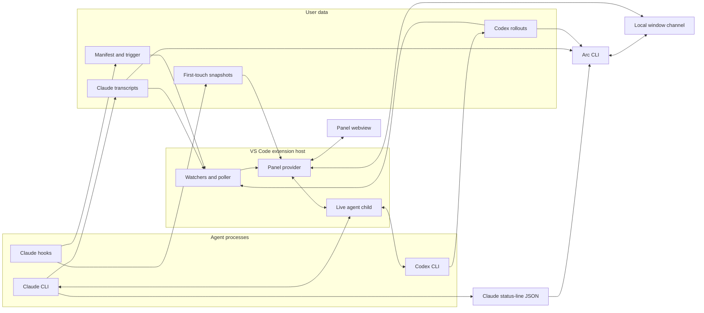

# Architecture

The topic guides hold behavior, and [`design-goals.md`](design-goals.md) holds product intent.

## Reading guide

Read the routes for every subsystem a change reaches. Source paths below are relative to `extension/src/`, except paths beginning with `cli/`, `scripts/`, `plugins/`, or `extension/`. [Components](components.md) lists each source component's responsibility. [Glossary](glossary.md) defines product and domain names.

| Change | Owning guide and source |
| --- | --- |
| Source locations, root overrides, storage provenance, or retention | [Data sources table](data-sources.md#source-catalog), [usage history](data-sources.md#bounded-usage-history), and [environment overrides](development.md#environment-overrides). `store.ts`, `transcript.ts`, `codex.ts` |
| Transcript admission, repository scope, source collisions, or relationship discovery | [Session discovery](session-discovery.md#session-discovery) and [relationship contracts](session-discovery.md#relationship-discovery-contracts). `transcript.ts`, `sessioncoverage.ts`, `repositoryscope.ts`, `progressiveworker.ts` |
| Selected history, append recovery, parser transport, or cache migration | [Selected history](session-history.md#selected-session-history) and [source contracts](session-history.md#source-and-cache-contracts). `selectedsource.ts`, `parserstate.ts`, `derivedcache.ts` |
| Content search, query qualification, or search corpus reuse | [Content search](session-history.md#search). `turnsearch.ts`, `domain/session-query.ts` |
| Saved panel state, metadata checkpoints, or refresh inputs | [Saved state and refresh](session-history.md#saved-state-and-refresh) and [prompt box state](composer.md#state-boundary). `turnview.ts`, `panelhost.ts`, `store.ts` |
| Turn cards, disclosures, recorded commands, or commit navigation | [Card projection](turn-cards.md#card-sources), [disclosures](turn-cards.md#markdown-disclosures), and [commit contracts](turn-cards.md#recorded-command-and-commit-contracts). `turncard.ts`, `turnformat.ts`, `commitrepositories.ts`, `gitcommits.ts` |
| Turn boundaries, outcomes, live subagents, or background activity | [Shared turn model](timeline.md#shared-turn-model), [card sources](timeline.md#card-sources), and [parsing constraints](timeline.md#parsing-and-attribution-constraints). `transcript.ts`, `codex.ts`, `timelinestate.ts` |
| Cost, context, pricing identity, or delegated attribution | [Usage and pricing](accounting.md#cost-and-context), [context evidence](accounting.md#context-evidence), [delegated attribution](accounting.md#delegated-attribution), and [model updates](development.md#model-pricing). `sessioncost.ts`, `projectspend.ts`, `pricing.ts` |
| Project cost refresh, integrity checks, or successful coverage age | [Integrity scheduling](accounting.md#project-cost-integrity-scheduling) and [Project cost](accounting.md#project-cost). `scheduler.ts`, `panelhost.ts`, `projectspend.ts` |
| Snapshot hooks, transactions, baseline diffs, or cleanup | [Snapshot and diff contracts](snapshots.md#snapshot-and-diff-contracts), [storage](data-sources.md#snapshot-storage), and [installation](installation.md#snapshot-installation). `plugins/arc-hooks/`, `store.ts`, `uris.ts` |
| Prompt editing, history, sizing, or requests | [Editing](composer.md#text-editing), [sizing](composer.md#box-height), and [requests](agent-requests.md). `webview/composer.ts`, `webview/requests.ts` |
| Prompt delivery, queueing, reset, or attachments | [Delivery](prompt-delivery.md) and [attachments](prompt-attachments.md). `composerview.ts`, `panelhost.ts` |
| Session setup, models, MCP, or account usage | [Drafts](session-setup.md#starting-the-first-session), [models](session-setup.md#session-controls), [MCP](session-setup.md#mcp-controls), [context](session-setup.md#context-detail), and [account usage](account-usage.md). `view/model-picks.ts`, `usageview.ts` |
| Executable selection, launch environment, or attribution | [Launch contracts](agent-launches.md). `agenthost.ts`, `composerview.ts` |
| Wire translation, session naming, or account reads | [Agent protocols](agent-protocols.md). `agentwire.ts`, `claudewire.ts`, `codexwire.ts` |
| Automatic native session skills and child-specific commands | [Native admission](native-skills.md#native-session-skill-admission), [Prompt entries](prompt-entries.md#prompt-entries), and [session guidance](arc-sessions.md). `sessionskills.ts`, `agenthost.ts`, `claudewire.ts`, `codexwire.ts`, `commandcatalog.ts` |
| Native turn ownership, compaction, restricted successors, or child retirement | [Native turn contracts](session-compaction.md#native-turn-and-compaction-contracts), [restricted successors](agent-protocols.md#restricted-successor-contracts), and [shutdown](agent-protocols.md#child-ownership-and-shutdown). `agenthost.ts`, `compactrequest.ts`, `launchpolicy.ts` |
| Recovered questions or standalone process observation | [Question recovery](question-recovery.md#question-recovery-contracts) and [standalone observation](standalone-sessions.md#standalone-observation-contracts). `questionrecovery.ts`, `questionrecords.ts`, `cli/src/standalone.ts`, `dispatchreceipts.ts` |
| Local authentication, terminal routing, transport recovery, or registry cleanup | [Terminal routing](window-channel.md#terminal-routing) and [transport ownership](window-channel.md#transport-and-registration). `sessionrequests.ts`, `terminalownership.ts`, `windowpipe.ts` |
| Session listing, source qualification, read acknowledgment, starts, or guarded writes | [Accepted reads](window-channel.md#accepted-catalog-reads), [write and acknowledgment contracts](window-channel.md#session-writes-and-read-acknowledgment), and [CLI limits](cli-reference.md#sessions). `sessionreads.ts`, `sessionwrites.ts`, `domain/read.ts` |
| Session list, labels, filters, views, or query syntax | [Rows](rail-and-navigation.md#session-list), [labels](rail-and-navigation.md#labels), [filters](rail-and-navigation.md#saved-filters), [views](rail-and-navigation.md#saved-views), and [queries](session-queries.md#session-query-syntax). `webview/rail.ts`, `turnrail.ts`, `domain/session-query.ts` |
| Panel retention, row deltas, or loading | [Rendering](panel-rendering.md#retained-rendering-contracts) and [loading](panel-rendering.md#session-list-loading-contracts). `webview/main.ts`, `webview/row-deltas.ts`, `panelhost.ts` |
| History navigation, menus, file opening, or response links | [History](panel-navigation.md#back-and-forward), [menus](panel-navigation.md#context-menus-and-copy), [file opening](panel-navigation.md#files-commits-and-editor-groups), and [response links](panel-navigation.md#response-link-and-citation-contracts). `turnplaces.ts`, `webview/summary.ts`, `extension.ts` |
| Comments, selection, or panel visual and keyboard patterns | [Comments](comments.md), [UI design](ui-design.md), and [keyboard contract](panel-accessibility.md#keyboard-and-screen-reader-contract). `webview/comments.ts`, `webview/navigation.ts`, `webview/panel.css` |
| CLI commands, collection, agent guidance, or skill installation | [CLI guide](cli.md), [command contracts](cli-reference.md#command-and-collection-implementation), and [session guidance](arc-sessions.md). `cli/src/commands.ts`, `cli/src/collect.ts`, `cli/src/skills.ts` |
| Portable saved-session capture, projection, or publication | [Export contracts](export-session.md#capture-and-projection-contracts). `exportdata.ts`, `exportsite.ts`, `exportwriter.ts`, `webview/export-host.ts` |
| Installation, immutable tools, packaging, build identity, or configuration watches | [Installer](installation.md#installer-implementation), [bundled tools](installation.md#bundled-tools), [build identity](installation.md#build-identity-and-packaging), and [configuration watches](development.md#configuration-watches). `bundledtools.ts`, `toolpath.ts`, `configwatch.ts` |
| Tests, diagnostics, startup measurement, demo assets, or platform limitations | [Verification](testing.md#verification), [isolated editor](isolated-editor.md#isolated-extension-host), [performance capture](performance.md#performance-capture), [startup measurement](performance.md#startup-measurement), [diagnostic implementation](performance.md#diagnostic-implementation), and [demo sources](demo-assets.md#demo-source-contracts). `diagnosticslog.ts`, `scripts/`, `extension/scripts/` |

Delivery changes cross prompt ownership, native child identity, source qualification, and channel receipts. Read those routes together. Discovery changes also reach query resolution, delegated accounting, cache generations, and export capture. Persistence changes require the owning state's recovery and storage contract.

Parsed facts travel through worker messages, forward checkpoints, derived metadata, spend ledgers, retained history, and export projection. [Source contracts](session-history.md#source-and-cache-contracts) identify their independent versions and acceptance rules. Changing a parser does not automatically invalidate every saved representation of its facts.

Treat source presence, repository membership, physical identity, and accepted revision as separate evidence. [Discovery contracts](session-discovery.md#relationship-discovery-contracts) distinguish absence from an incomplete or refused read. [Channel reads](window-channel.md#accepted-catalog-reads) define what listing coverage and freshness establish. A displayed row alone supplies no authority to acknowledge review or deliver input.

## System shape

Arc reads completed work from files, including sessions started in a terminal or another editor window. A child process carries live prompts, questions, and controls.

The extension never writes a file the agent changed. Hooks write only under the snapshot store. The panel opens files and diffs through VS Code. The CLI reads Claude status-line JSON from stdin or one session's Claude or Codex records from disk. Window discovery asks running extension hosts through their local channels.

Recorded work and host-owned live processes have separate authority. [Card sources](timeline.md#card-sources) defines their reconciliation. Reader-owned state survives independently of rebuildable parsing and spend caches. [Cache ownership](session-history.md#cache-ownership) defines those lifetimes. Receipt relationship scans supply neither billing evidence nor delivery authority. [Relationship discovery](session-discovery.md#relationship-discovery-contracts) defines their admission.

The local channel addresses one extension-host activation. Requester names supply attribution alone. [Window contracts](window-channel.md) define the distinct read, write, and observation capabilities. [Standalone observation](standalone-sessions.md#standalone-observation-contracts) defines launch management separately from transcript identity.

Filesystem validation establishes observed agreement within each reader's contract. It does not establish an atomic snapshot or protect against every concurrent replacement. Preserve the qualifications in [relationship validation](session-discovery.md#relationship-discovery-contracts), [catalog reads](window-channel.md#accepted-catalog-reads), and [export publication](export-session.md#capture-and-projection-contracts) when changing those paths.

## Module boundaries

`payload.ts` shapes host-to-panel render messages. The panel runs in another process, so a host import cannot supply browser code. Shared rules live in browser-safe `domain/` and `view/` modules. Host-only decisions travel as data over `webview/protocol.ts`.

Import host projections from their root `turn*.ts` owner rather than the compatibility re-export in `turnview.ts`.

Every extension source package permits imports within itself. The additional local directions below apply to runtime and type imports, except the stated protocol exception.

| Importing package | Additional allowed destinations |
| --- | --- |
| Root files, the explicit `legacy` package | Any package |
| `domain/` | None |
| `readers/shared/` | `domain/` |
| `readers/claude/`, `readers/codex/` | `domain/` and `readers/shared/`. Neither imports the other provider |
| `runtime/shared/` | `domain/` |
| `runtime/claude/`, `runtime/codex/` | `domain/` and `runtime/shared/`. Neither imports the other provider |
| `view/` | `domain/` and every `readers/` package |
| `webview/` | `domain/` and `view/` |
| `host/` | Every recognized package. Its only `webview/` destination is `webview/protocol.ts` |

`readers/`, `runtime/`, and `host/` are planned packages, and their folders do not exist yet. `domain/`, `view/`, and `webview/` cannot import Node built-ins. `webview/protocol.ts` has one permitted type-only edge into a root module. Its enforced ceiling equals its actual edge count. New source folders require an explicit package rule.

[`imports.test.ts`](../extension/src/imports.test.ts) checks package directions, exact editor API exemptions, production fixture exclusions, and runtime cycles. Decisions outside editor glue remain directly importable by Node tests. [`source-tree.test.ts`](../extension/src/source-tree.test.ts) checks the shared [dependency rules](../extension/test/source-tree.ts), recursive inventory, and protocol exception ceiling. [`architecture.test.ts`](../extension/src/architecture.test.ts) checks the [component table](components.md) against source paths and rejects duplicate entries.
