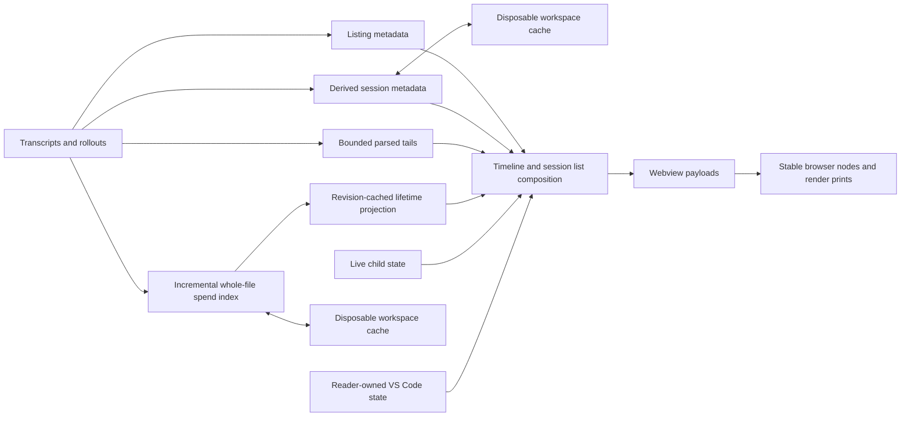

# Session history, caches, and refresh

## Cache ownership

Dispatched Codex figures use a worker-owned forward cursor with 256 KiB slices. An owned final completion or abort admits spend after complete EOF coverage at one file revision. Copied turns, mismatched identities, trailing activity, and incomplete records retain the one-hour quiet deadline. The deadline admits discovery even when catalog bytes stay unchanged. Changed figures independently admit card collection and posting, including retained launching turns. Cursor progress alone schedules discovery without posting cards. An accepted post consumes only its captured figure revision. Failed, canceled, and obsolete posts retain pending figures. These cursors, deadlines, and figure revisions remain process-local.

Claude windows recover preceding model attachments through revisioned backward cursors owned by their forward checkpoints. Each background slice stops between reads at a 1 MiB or 15 ms budget. Pending cursors resume until the newest applicable attachment or byte zero. Positive evidence and confirmed absence stay cached for that source revision and boundary. Contiguous appends preserve compatible pending cursors after forward validation binds them to the new revision. Recovery byte totals include initial reads, newest-turn follow-up reads, and abandoned discovery work. They remain separate from ordinary tail bytes. Cold reads and skipped append windows remain drawable within their configured tail bounds. Newest-turn discovery recovers at its follow-up boundary. Semantic pages recover preceding evidence at each older page boundary, with separate byte accounting. Replacement, truncation, rewrite, cancellation, and selection changes reject incompatible work. Recovered evidence changes prompt box identity alone and never sets the profile used for pricing.

The timeline uses separate transcript caches for separate scopes. Refreshing the session list does not require the same work as drawing a session. Every derived cache can be discarded and rebuilt from the agent records. Reader-owned state is stored separately because it cannot be reconstructed.

| Layer | Lifetime and key | What it prevents |
| --- | --- | --- |
| Discovery metadata | In memory for files still present in the latest walk. Claude cwd, Codex opening metadata, human-prompt cursors, and thread-name stamps each use the revision that can change their answer. | Re-reading immutable heads and rescanning quiet files during listing. |
| Codex opening records | Persisted once per machine in `codex-openings.json` and keyed by path. Rows carry `CODEX_META_VERSION` in `codexopenings.ts` and survive a `VERSION` bump. A save keeps a row for a rollout that still exists, or that both the file and the window's latest walk hold. | Re-reading the head of every rollout on the machine after a window reload or in a new workspace. |
| Derived session cache | Persisted in the workspace partition under `~/.arc/cache/`. Title, activity, run classification, outcome, bounded context facts, and turn starts use path, size, and mtime. Entries are trimmed against the current walk once the first Claude child discovery answers, because the walks before it hold no child transcript. Trimming against a refresh's session list waits for a complete catalog. Before the first complete catalog, and after a workspace folder change clears it, that list can hold only the selected sessions. The file `derived-session-cache-v1.json` separates the storage format, metadata generation, and relationship parser generation. An incompatible metadata generation retains names separately and preserves compatible relationships. Discovery continuation requires matching semantic dependencies and retained relationship progress. The legacy file supplies imports only when the current file is absent. | Repeating bounded metadata and turn-start reads after a window reload. |
| Progressive selected read | In memory by file revision, parser options, workspace folders, and associated child revisions. Accepted turns and source checkpoints share the `arc.sessionCacheMiB` budget, and every unselected session stays while the total fits. | Re-reading unchanged sessions and reparsing retained bytes after an append. |
| Newest-turn recovery | Cancellable worker reads against exact file identity and revision. The accepted forward checkpoint retains the recovered source boundary. | Losing a large newest turn when its start lies before the ordinary tail. |
| Child usage | Accepted parent reads carry child revision keys. The worker owns the bounded child-spend cache and resolves completed child usage by file revision and commit-placement scope. | Re-reading unchanged completed children when their parent grows, or reading active children for incomplete usage. |
| Claude child catalog | The cancellable worker caches parent references and child working directories by transcript revision. One traversal follows verified descendants and keeps direct parent edges. Repository scope filters navigation targets without discarding verified parent and child pairs used for spend. | Blocking the extension host on complete parent scans, re-reading immutable child heads, or losing an older, selected, or pinned child after navigation, eviction, or host restart. |
| Project spend index | Persisted in the workspace partition under `~/.arc/cache/`. Its sources cover the open folders and their registered worktrees. Each source keeps an incremental cursor, parser generation, raw usage buckets, lifetime buckets, primary turn count, compaction count, and the span from the first turn's start to the last turn's end. A last-complete display ledger is kept apart from resumable scan progress. | Rescanning whole transcript history for project or session lifetime cost. |
| Lifetime projection | In memory by spend-ledger revision. It projects complete source records into per-session cost and turn chips shared by the session list and open timeline heading. | Re-normalizing paths and aggregating the whole spend ledger for every session list post. |
| Search corpus | In memory by transcript path, size, and mtime, and populated only by an explicit content search. It keeps compact prompt and response entries from the fixed search tail. | Rebuilding the bounded search corpus for every query change. |
| Delivery and browser state | The host retains the last session list print, and the webview retains stable nodes and content prints. | Posting or rebuilding unchanged session list and card content. |

Reader-owned read watermarks, pins, archive state, drafts, comments, open controls, and session selection are not derived caches. They live in normalized VS Code state and participate in the final composition without being written into either disposable cache file.

On startup, the browser mounts the shell with `Reading sessions…` in a polite status region. A usage message with no live or queued submission leaves the shell in place until the first authoritative payload replaces it. Live or queued work can replace the status before that payload. The browser sends `ready` after its data-independent owners and message listener exist. The provider installs its listener before assigning HTML and tracks readiness for each host. Reads, polling, and optional usage work wait for a visible ready host. Closing a host before readiness starts no work. The first authoritative payload carries the complete stable session order, restored selection, and available selected session data. The provider then restores or prices the Project spend index. Project cost and ledger-derived lifetime figures show a calculating state. A later Project cost and session list update publishes the restored figures from the held catalog.

The metadata worker prepares selection-independent session list facts before the host requests selected turns. The first session list payload replaces the startup status with the shared selected-session loading diagnosis. The first card removes that diagnosis. A selected recorded session with no drawable turn says that it has not produced a response. Later background reads keep the last usable session list, session, drafts, read state, labels, and controls visible.

The worker returns the source revision and request generation with each result. Refresh and selected-session work have separate generations and cancellation. Selection, workspace scope, source revision, and provider disposal invalidate replaced requests. A catalog refresh cannot cancel a selected read. A late completion cannot replace accepted content. Source checkpoints, older cursors, and pages keep their existing source adapters and share one retained-history budget.

An unchanged poll preserves an in-flight read. A changed source, scope, or selection replaces that work without clearing accepted content. Diagnostics report synchronous listing duration under `catalog-enumeration`.

Performance diagnostics record `shellReady`, `catalogReady`, `railReady`, `firstCard`, and `completeRender` against one startup operation id. The host records `catalogReady` when enumeration completes. The host records `shellReady` at visible browser readiness. Browser acknowledgements supply `railReady`, `firstCard`, and `completeRender` after DOM application and two animation frames. A held timeline update delays its card acknowledgement until the renderer applies that update. `completeRender` covers session rendering and does not wait for Project cost hydration. The host rejects acknowledgements from replaced refresh generations. These values use the host's monotonic clock.

Initial metadata admission shares a nominal 64 MiB allowance, including the separate Codex title head. Growth after catalog listing can increase actual reads beyond their admission charge. Post-render turn-start enrichment also uses a nominal 64 MiB allowance. Its first oversized classification request remains admissible. Unread counts remain unknown until metadata or complete lifetime facts establish an answer.

On refresh, file revision changes invalidate only the layers whose keys include that revision. An unchanged selected read reuses accepted turns. An expanded metadata read records its null result for that revision, so another refresh retries only after the source changes. Parsed session list-cache facts override metadata only while their source revision remains current. Appends resume the source checkpoint after validating its file identity and bounded content anchor. Lifetime cost remains the spend index's answer, and session list facts remain independent from selected turns. The settled session list input key suppresses an unchanged session list message before its payload is built.

## Selected session history

The selected session starts from a bounded tail. Its loading payload reaches the browser before metadata work for other sessions. The worker scans disjoint older chunks when the newest turn begins before that tail. Claude and Codex own their boundary rules, and the provider keeps their source state opaque. After discovery finds the boundary, the source adapter reduces 256 KiB chunks and observes cancellation between chunks. The completed reduction supplies the forward checkpoint. A read that starts from the requested revision can publish its completed prefix when the same file grows, then resume against the newest revision. Replacement, shrinkage, same-size rewrites, and file identity changes discard incompatible work. A read error shows a failed history status when cards remain or a diagnosis when none remain. A later refresh or selection retries the read.

Loading older turns reads one semantic page for the selected session. The page reader walks disjoint older ranges, and the provider keeps its cursor. The ordinary read window stays the same for every session. No press reparses a tail. One request runs at a time. The sentinel requests more history when it comes within one viewport. Its button also requests history on a press, supporting keyboard use. Loading status and accepted pages repaint the selected session directly, including while a catalog refresh runs. A request that finds only turns the tail already lists keeps reading, bounded by how many pages of turns are loaded. Pages merge by stable turn identity, and the display budget grows to admit them.

When an accepted append pushes a completed turn out of the selected read, the provider keeps that turn in one bounded recent page. The page holds at most the ordinary turn limit minus the turns still in the tail. Its content stays within the selected session cache budget except for one newest turn. Explicitly loaded older pages remain separate. A fresh panel reads the bounded tail and offers older turns through the sentinel.

Switching to another session keeps its pages under a retained budget, so returning to it restores them without a read. Retention prioritizes selection, then the budget, then recency. Empty-state wording describes the selected session and never reports the size of the background parse set.

Session figures cover the tail and the loaded pages together, and their caveat names that count. Search keeps its own read window, so a scoped search can cover less than the reader can see. A scoped answer says whether the read reached the first turn.

The retained budget covers accepted turns, source checkpoints, and older pages together. Selection protects the current session, and every unselected session stays while the total fits the `arc.sessionCacheMiB` budget. Past that, the least recently viewed unselected session is released first. A selected value larger than the budget stays retained and evicts every optional session. Unread state continues to use metadata and completed lifetime facts after parsed state is evicted.

## Session name

A saved session is renamed from two places: the context menu of its session heading, and the context menu of its session list card. [Context menus](rail-and-navigation.md#context-menus-and-copy) lists the routes that open the heading's menu. Both entries open one editor, described with the [session list](rail-and-navigation.md#session-list). A provisional new session offers neither entry. A confirmed rename redraws the heading and the session list card in the same render. [Agent protocols](agent-protocols.md#session-rename) owns how each agent saves the name.

## Saved state and refresh

`turnview.ts` normalizes all saved webview state before use. Stored collections are bounded, session keys are validated, and unknown fields are ignored. The extension side is the shared authority so editor tabs and restored panels reopen on the same session and read state.

Rebuildable session metadata is checkpointed after the first render has been handed to the webview. New entries checkpoint immediately, later revisions are rate-limited, and an orderly shutdown writes any state still waiting. The first checkpoint cannot depend on provider disposal. A window reload can end the extension host before disposal persists the rebuilt cache.

Metadata recovery runs one eligible session at a time and persists recovered facts. Selected newest-turn backward discovery runs separately in the progressive worker.

Refresh inputs include transcript metadata, the snapshot trigger, the Codex session index, and active child state. They also include other facts that change independently of the parent transcript. A cache key must include every external fact that changes its answer.

Directory-watcher events collect into a trailing quiet-period scheduler with a maximum wait. Change events for files already mapped by the held catalog revalidate and refresh only those files. A rename, missing filename, unknown path, file with a new device or inode, watcher error, or periodic integrity poll keeps the broad catalog path. The poll remains the recovery path for events the operating system or a sync client does not deliver. Only a broad walk adds new Codex child rollouts to discovery and new Claude subagent transcripts to Project cost. The poll owns that discovery when no other trigger walks. Live activity for a session with no drawn card joins the pending watcher wake and names that session's listed transcripts. Those files revalidate like change events. A session with no listed transcript keeps the broad path. The wake draws under the rule of every catalog refresh: `refreshWanted` in `turnview.ts` reports a change, or the refresh sweeps an expired live press. A shown session also draws without a change, because that draw carries its first live card.

One catalog refresh runs at a time. A trigger that arrives during it waits, and all waiting triggers merge into one refresh that starts when the current one ends. The merged refresh repaints if any trigger forced a repaint. It walks broadly if any trigger asked for a broad walk. It revalidates the union of the named files when every walking trigger named files. A refresh that runs past a 30 s deadline gives way: the next waiting trigger abandons it and runs. Disposing the last visible host or changing workspace folders abandons the running refresh and drops waiting triggers. A repository scope lookup does the same when it first answers, moves the roots, or fails. A host that becomes hidden stops the poll and leaves the refresh running. A selected-session update does not wait behind a catalog refresh. It carries the selected cards and replacements for the previous and current session rows, including their session list wording and heading figures. It also carries prompt box state, history control, diagnosis, and startup stamp. A missing replacement removes an abandoned provisional row. The browser keeps workspace-owned state from the last render. It uses empty workspace-owned state when New arrives before the first render.

Project-spend checkpoints use a bounded trailing scheduler. Completing an index run schedules a save. Provider disposal flushes a pending save. In-progress reducer state remains separate from the last complete display ledger, so a scheduled checkpoint cannot replace a complete figure with a partial one.

**Arc: Save Performance Diagnostics** writes a versioned, redacted JSON snapshot of state and monotonic counters already held by the provider. It does not refresh, parse, discover, hash, or checkpoint a data source. Content from transcripts and reader-owned text is excluded. The snapshot gives its provider an opaque source id and lists every open panel by its panel id. Each panel records host posts and webview performance replies, including empty counts. Refresh stage counters record catalog refreshes that started, waited behind another refresh, found nothing to repaint, posted a render, or were abandoned past their deadline. A started refresh that neither found nothing to repaint nor posted a render ended before its render decision. Many such refreshes mean that refreshes do not finish.

Activity received from a child is a bounded overlay on the newest turn in that session. Starts and completions replace one another by source id, nearby fragments share one refresh, and the transcript copy replaces the live copy when it arrives. The overlay changes neither the persisted turn nor its tool counts.

The extension computes a list delta when existing headings and surviving cards keep their relative order. The browser applies removals before anchored inserts. A structural change falls back to rebuilding the affected list. Any rebuild must preserve the reader's focus, selection, open comment editor, Prompt box, and every disclosure they opened.

Relative time and running duration are updated by a browser ticker because transcripts do not move every second. The shared relative-time tables are sent to the panel. The browser implementation of duration formatting is checked against `turnformat.ts` across its supported range.

## Search

`turnsearch.ts` owns query parsing and matching. The session list box normally filters session titles. A content query searches the parsed prompt and response text and returns turn-level results with a snippet and match positions.

Each search term must match within the same searchable half of a turn. Query axes select the half to read or switch from title filtering to transcript content. `search.ts` receives the parsed results and does not reinterpret the query language.

Search has its own cache because it can read sessions outside the current card list. A late Codex thread name can update a cached search entry without reparsing an unchanged rollout. When a search runs, the host adds each session's labels, archived state, and agent-run state to its entry. Those terms narrow content searches without retaining stale facts in the cache. Entries carry no cost, turn state, or cache span. Numeric cost and cache-expiry filters do not narrow content results. Unsupported state predicates have no supporting entry facts.

## Parsing and attribution constraints

- Claude Code writes `ai-title` and `custom-title` records again every few turns, usually with the same value. The newest of each sits near the end of the file. A session can carry no `ai-title` at all. A headless Claude launch under an SDK entrypoint can write one. Without a title record, the first eligible typed prompt names the session. That prompt is read from the head of the file because a tail window moves as the file grows.

- A Claude reply's `message.model` is the API id, such as `claude-opus-5-5`, and never names the context window. The newest valid `model` attachment names it, as in `claude-opus-5-5[1m]`. `Turn.modelAttachment` preserves that spelling when the reply names the same model after window and Bedrock prefix normalization. Two dated identities require the same snapshot date. An undated identity permits date tolerance. Another reply model or an invalid attachment clears later prompt box evidence. Completed turns retain their own evidence. `Turn.model` stays the API id for display and pricing.

- Session roots and the performance-capture output directory use the editor process environment. An editor started outside a shell does not see variables exported only by that shell.

- Transcript retention controls timeline retention. The extension does not copy historical turns into another store.

- Newest-turn discovery runs inside the progressive worker through the shared backward scanner. The existing source adapter creates the accepted forward checkpoint after discovery. Later appends resume that checkpoint and validate its bounded content anchor instead of fingerprinting the complete retained range.

- Worker transport copies forward checkpoints through structured clone, which preserves only enumerable string-keyed properties. Parser snapshots expose open-turn byte ranges and hidden card fields as plain state. Reducer restoration reinstates those fields. Losing the byte range produces a zero range, so the tail boundary discards the card.

- Older history keeps one cursor per session. One request runs at a time and skips pages already represented by accepted turns. Pages merge by stable turn identity. The source adapter must prove both semantic edges before a page reaches the list. A refresh retains loaded pages only at the accepted revision or when revision-bound append provenance names that accepted revision. Catalog metadata never rebases or discards loaded pages during rendering. A truncation, replacement, or bounded-anchor mismatch resets that session's pages after a stable retry.

- Semantic pages and append checkpoints share source reducers, but backward edge state stays separate from forward state. The tail floor beyond byte zero excludes any record that touches it. Turn membership follows the prompt or task start even when ownership reaches earlier associations. Crossing one of those dependencies rebuilds the bounded tail. Generated titles survive trimming, while implicit compaction values expire with their source. An active turn can cross the byte window. Each turn's tool pairing keeps a fixed newest window that includes every visible step, so older unresolved results can become unpaired. Backward cursors carry unmatched metadata and child completions only to bounded owners. Codex replay evidence is offset-bounded. Ambiguous pages use an identity-only scan. Evidence that reaches byte zero is final for that page. Page reads filter unusable records and support cancellation.

- A semantic page retains its target turns, an older guard, and required boundary records. A relevant turn can exceed a chunk, but irrelevant sparse lines do not accumulate.

- Refresh builds separate repaint and Project cost source signatures. Only repaint includes the selected session and Codex names. Selection promotes its session sources for checks. Rename leaves source revisions unchanged. See [Project cost integrity scheduling](accounting.md#project-cost-integrity-scheduling).

- A targeted refresh promotes its named files and catalog sources whose revisions changed for integrity checks. [Project cost integrity scheduling](accounting.md#project-cost-integrity-scheduling) owns deadlines and source admission.

- Selection reuses the latest catalog and stats only the selected source. Polls and transcript watchers update that catalog through ordinary refreshes.

- A click on a session the panel already holds runs one selected-only refresh. That refresh reuses the held catalog and draws the held window synchronously. The selected read that follows runs a second selected-only refresh only after a worker round trip for the tail agent facts or the older pages, whether or not the worker answers. A read that a catalog refresh or a retry starts also refreshes when it clears a read failure. State that the selected read changes without a round trip must reach the render some other way.

- A catalog refresh waits on the worker for Claude children and metadata. The watcher delivers a batch at most 1 s after a transcript write while writes continue, and the poll runs every 5 s. A new trigger must therefore wait behind the refresh in flight and must not abort it. When each trigger aborts the refresh and triggers arrive faster than the refresh ends, no refresh reaches its render, and a sent prompt or a finished turn does not appear.

- A catalog walk keeps three listing caches. A Claude `subagents` directory is listed again only when its modification time moves, and a time inside the settle window is listed again on the next walk. While the panel is on screen, a Codex rollout idle beyond the active window reuses its last stat until the watcher reports its file or directory, or until the held stat reaches the revalidation age. A walk while the panel is hidden stats every rollout. Closing or losing any watcher clears the rollout stats. Session spend sources are built again only when a listed file, a Claude source, a parent link, or the subagent listing of a Claude child changes. Input order does not count as a change. A walk forgets every `subagents` directory it did not list, and a failed listing is read again on the next walk.

- Initial catalog metadata reads stay bounded per transcript. Complete transcript recovery never runs synchronously on the extension-host startup path.

- The derived session cache and the Codex opening records are optional. Missing, invalid, or incomplete data only makes the next listing read its transcripts again.

- A populated derived session cache checkpoints after the first render is posted. Provider disposal is not a reliable persistence boundary during a window reload.

- A change to how cached metadata is derived must bump `VERSION` in `derivedcache.ts`. Without that, a session that stopped growing keeps the old answer. A load at another metadata version drops title entries and keeps each session's `label` and `fullLabel` as a carried name. Compatible relationship entries remain available. The first metadata pass reads at most `INITIAL_RAIL_READ_BYTES`, so a large workspace rebuilds over many refreshes. Until a metadata read stores a new entry for a session, the session list card, the session heading and search draw its carried name. A carried name never enters `titles` or the held Claude names. The saved file keeps every carried name that no read has replaced, so a restart between passes still draws it. A rule change affecting a few recognizable entries can discard only those entries at load without a version bump.

- Codex opening records carry `CODEX_META_VERSION` from `codexopenings.ts`, and a `VERSION` bump keeps them. A change to `CodexSessionMeta`, or to how `codex.ts` derives a stored field, must bump `CODEX_META_VERSION`. The bump makes the next startup read the head of every rollout on the machine. A file with no `codexMetaVersion` at derived cache version 27, 28, or 29 holds version 1 rows.

- The first catalog refresh of a provider walks the rollout tree and reads every opening record the stored rows lack before it lists sessions. `CodexMetaCache.prime` reads them with asynchronous file calls, `COLD_OPENING_READS` at a time, so the extension host stays responsive during a cold pass. A catalog refresh that cannot reuse its held catalog walks the rollout directories through `enumerateRolloutFilesAsync`. The cold pass walks through it too. The walk checks the time before each directory read and before each entry of a directory. It yields to the event loop once `WALK_SLICE_MS` has passed, so selection and other messages run during the walk. A synchronous directory read itself cannot be interrupted, so one slow read holds the event loop until it returns. A walk whose refresh was canceled, superseded, hidden, or moved to another rollout root answers no catalog, and a later refresh walks again. Synchronous callers keep `enumerateRolloutFiles`, and both drivers share one traversal policy. The refresh marks the derived cache checkpoint for the rows the pass read, because the walk never sees them move the revision. Refresh triggers that arrive during the pass wait in `pendingRefresh`, and the first catalog is still one complete listing. A search that arrives during the pass waits for it, and only the latest query is answered. A load of older history that arrives during the pass also waits for it before it walks the catalog. Closing the last panel, or any change that abandons the catalog refresh, cancels the pass. A canceled pass starts no further directory read or opening read, and the next refresh starts a new pass instead of waiting behind it. A search or a load of older history that waited on the canceled pass waits on the new pass. Three paths still read opening records synchronously. A later walk reads a rollout that appeared after the pass walked the tree. A later walk reads a rollout whose last read the file system refused, during the pass or on the main thread, because that failure says nothing about the file. Walks wait `REFUSED_OPENING_FIRST_RETRY_MS` after its first refused read and `REFUSED_OPENING_RETRY_MS` after each later one, so a walk does not open every rollout the file system keeps refusing. A later walk reads a rollout again once it grows, when a read found no record in it.

- Every window saves `codex-openings.json`. A save creates `codex-openings.json.lock` exclusively with a token of its own, then reads the file, merges, and writes. It replaces the file and removes the lock only while the lock still holds its token. A busy lock skips the save, and the window tries again on a short timer, because a quiet window can go without another checkpoint. Without the lock, two windows that read the file before either writes lose one window's rows.

- A save takes over a lock older than 30 seconds. Its holder is a window that died, or a live window that paused past 30 seconds. A save removes the stale lock under a guard file named for that lock's text and modification time, and reads the lock again before it removes it. Two windows that both judge one lock stale therefore leave one holder. A paused holder that resumes finds another token in the lock, so it replaces nothing and removes nothing. A window that dies inside a takeover blocks saves only until its guard is 30 seconds old. The window that holds the lock removes every takeover guard older than 30 seconds, so a guard beside a lock that is already gone does not stay. One gap remains. A holder that pauses between its token check and its rename still replaces the file, and the rows another window saved in the meantime are lost. A later startup reads those rows again from the rollouts, so no session is lost.

- A save of `codex-openings.json` keeps a row for a rollout that still exists, and for a rollout that both the file and the window's latest walk hold. A deleted rollout therefore never returns from another window's older file or older walk. Missing, unreadable, or malformed shared storage uses workspace opening seeds. A valid empty shared file does not use them.

- `expandedStatsRead` records successful complete expanded metadata coverage, including empty answers. `metadataWindow` records a successful expanded window at the entry's source revision. A partial window suppresses identical tail reads while unresolved context or outcomes remain eligible for forward source recovery. Failed and short reads record no coverage.

- Metadata recovery retains one live source reducer and segmented record fragments in the worker. Waiting sessions retain only their identities. Each admitted slice reads at most 16 MiB from byte zero or its validated continuation. Recovery materializes facts only at stable EOF. Compatible appends preserve progress through file identity and a bounded content anchor.

- Recovery reduces a record larger than 1 MiB while it reads the record, so the whole record is never held. A string longer than 64 KiB keeps at most its first 64 KiB and its last 64 KiB, so a parser that reads the end of a long text still finds it. A `data:` string longer than 64 KiB keeps only its media header through the first comma. A `replacement_history` array becomes `[]`. Structure stays unchanged. A record whose reduced form is incomplete JSON is dropped, as an unparseable line is.

- Recovery limits one unfinished record to 16 MiB, after any reduction, and retained payload to 64 MiB. Conservative reservations cover new records. Reservation pressure starts a live payload count that yields after 512 values and releases trimmed state without snapshots. Ignored chunks do not recount retained state. Exhaustion preserves accepted facts and incomplete coverage, stops identical attempts, and persists through restart. Each exhausted entry records its recovery rule, and an entry exhausted under an earlier rule reads again once. A source change or accepted reader selection or older-history request reopens that attempt once. Automatic selected-window refresh and attachment continuation preserve exhaustion. Older pages never supply current metadata facts.

- Successful partial coverage survives restart while runtime progress rebuilds under admission. Complete negative coverage survives restart without another expanded read. Failed metadata and recovery attempts retry on ordinary visible refreshes, including refreshes that skip rendering. Runtime progress schedules continuation separately from changed facts.

- A metadata tail can omit a running turn's prompt or precede its first usage record. The card draws earlier context facts from `heldStats` across those gaps. A context figure, successful complete negative coverage, shrinkage, or detected file replacement releases the hold.

- The read state a selection saves moves the watermark of the card the reader opened. The selection update words the session list from that same state. A save that moved nothing else posts no session list of its own. The end of that refresh posts the skipped session list when no selection update arrived. A read mark made once the refresh settled posts its own.

- A cold derived session cache rebuilds through the progressive worker while the shell remains visible. A changed metadata result replaces its last accepted entry only after the source revision and request generation still match.

## Source and cache contracts

Codex retained-context reads admit copied metadata only through the opening's declared fork ancestry. Tool pairs retain separate function, custom-tool, and client-search identities. Local-shell calls use function outputs. Server search outputs require no local call.

Stopped Codex display-model recovery scans backward from the accepted forward boundary in cancellable slices. Recovery retains at most 256 KiB per record and skips oversized non-model bodies. Opening-matched settings establish identity before the first task. Unproved model identity or ownership leaves the display identity absent. Exact native ownership confirmation admits a retained context model in source order. Completed recovery, including absence, is cached for that file revision. Replacement, truncation, and rewrites restart recovery. Worker replies carry recovery bytes and continuation state. The selected-window continuation resumes pending recovery even when its accepted content remains current. Optional Codex display recovery does not delay attachment handoffs. Display identity stays separate from parser billing state and retained-context facts.

A folderless window allocates a unique cache identity without creating a directory. Its first cache write publishes ownership before data. Ownership spans panel tab closure and reopening. Terminal provider disposal closes write admission, flushes synchronous cache writers, then publishes release. Resumed partition writes allocate a fresh generation and path.

Every folderless write checks that the current ownership bytes match its registered owner. Missing, unreadable, oversized, or replaced ownership blocks admission and release publication. These synchronous path checks do not prevent external path replacement during a write.

Written folderless partitions remain on Windows, macOS, and Linux. Node exposes pathname deletion without an operation that binds every ancestor and removed directory to validated identities. Linux boot differences remain uncertain without independent same-machine evidence. Windows also lacks complete reparse-tag inspection, and Windows and macOS lack precise process-lifetime inspection here. Folderless reclamation therefore performs zero filesystem operations and no process inspection. Unwritten activations leave no partition on every platform. Prompt drafts and assets retain their separate storage lifetimes.

Closed Claude subagents reopen only when a user or assistant timestamp exceeds their close by more than one second. File writes and system bookkeeping never establish resumed work. On a changed version, the host scans disjoint 256 KiB chunks backward and reconstructs split records to find the maximum work timestamp. Read buffers hold a chunk and its unfinished record. The host caches absent timestamps too. An unchanged closed child costs no transcript read.

The line filter in `transcript.ts` that keeps ordinary tool results out of JSON parsing must admit a result marked `toolEndsTurn`. A dropped result leaves a subagent session running, then stopped, and never done.

Direct child activity is only a temporary overlay on the newest turn. Stable protocol ids let the transcript copy replace it. Work started in another window or terminal still comes from the transcript because this host does not own that process.

Accepted selected windows publish current turn facts before commit repository discovery waits. Repository hydration rechecks the selected source. A changed source resumes selected reading without another refresh trigger. Incomplete repository evidence clears commit navigation before publication. The owning panel's transport state retains the successfully accepted window and commit rows. Completion retries an undelivered current window even when commit rows stay unchanged. Enrichment compares indexed visible cards with those rows through the shared commit-only projection. A failed independent post leaves enrichment pending.

Rendering updates retained history recency in place. Child-spend reapplication to retained pages accepts replies only while the same history state remains current. Page replacement and eviction change that identity. `refreshAgentFacts` accepts cached-window replies only while the same cache entry remains current.

`panelhost.ts` supplies accepted reads, child write times, process exits, and the observation clock to `timelinestate.ts`. Dispatched rows and Git commit recovery stay in the host. `turncard.ts` owns the carried-subagent count that `timelinestate.ts` exports, keeping card rendering independent of session-list assembly.

`progressiveworker.ts` carries cancellable parsing and discovery requests. `panelhost.ts` accepts their revisioned answers, admits handoff reads through retained-history ownership, and composes session list and timeline payloads. It retains accepted metadata name changes until VS Code delivers a render to every ready visible host. Later read failures and cancellations preserve that demand. Hidden hosts receive a forced refresh when they become visible. The browser keeps stable session and turn nodes while their content changes. [`timeline.md`](session-history.md#cache-ownership) owns read budgets, checkpoints, and refresh rules.

Worker replies carry exact Activity detail and call associations beside structured-cloned turns. Retained-page requests carry the same fields into the worker before child refresh. `parserstate.ts` captures step `fullDetail`, step `id`, and agent `toolUseId` without changing parser-owned turns. Both transport receivers restore non-enumerable fields. Codex detail remains writable and configurable. Claude detail and both providers' identifiers remain read-only and non-configurable. Parser checkpoints retain byte ranges separately.

A selected session opens once the published catalog lists it. A session absent from that catalog waits for ordinary discovery. Locally started drafts and accepted sessions retain their host-owned state until their records appear. Imported children receive no local awaiting-session ownership. `selectedsource.ts` filters descendant dependencies for selected windows. The host checks the originating selection and repository scope again before accepting a window. Selection changes cancel obsolete reads. Source changes retry through ordinary revision and append recovery. Completed response blocks carry native message identity and replace their streamed copy on the temporary turn card. Accepted submission identity binds response text and terminal outcomes to their prompts. Pending prompt delivery retains events for its native destination until the receipt establishes adoption or continuation. Failed delivery and provider disposal clear those events. Unresolved ownership expires after five minutes. Codex native turn IDs map to those accepted submissions. Completed, interrupted, and failed responses remain readable until recorded replacement. Clearing a session keeps terminal responses and their replacement ownership in the source session.

Pending initial-name subscriptions share one Codex name index per path and file revision. The last subscription releases the index. Filename-free events rescan only retained admitted directories for the accepted session.

`codex.ts` owns `CODEX_TITLE_BYTES`, the 1 MiB rollout head bound for fallback names. The reader excludes an incomplete trailing record. A first prompt whose complete record exceeds that window supplies no fallback name. Injected context and image blocks supply no title text. `progressiveworker.ts` uses the same bound to charge title reads alongside metadata tail reads. `derivedcache.ts` versions saved title entries, so a title-reading rule change invalidates unchanged entries through its cache generation. Codex opening records retain their independent generation.

A cold refresh owns its Codex enumeration and passes it explicitly to that call's initial walked catalog assembly. Unresolved scope and held-catalog returns discard that enumeration. The refresh also discards it if no visible, ready panel remains after the cold pass. Later calls obtain their own traversal evidence.

Catalog refresh checks held source identities with at most 32 asynchronous stats at once. Targeted refresh validates reported paths, and catalog reuse validates the selected source. The asynchronous check covers remaining held parents, held Claude children, and Codex sources. Full walks supply current parent identities and check held Claude children and Codex sources asynchronously. Missing or replaced sources trigger another walk and relationship discovery before publication. Session listing requests use accepted identities and check served-row size and modification time for freshness. A carried discovery reply proves listing coverage only for matching source membership and physical identities. Workspace folder changes release the retained session page index. Scope membership of each recorded working directory outlives each catalog, so a new catalog array tests only working directories it has not seen. A scope roots change or a workspace folder change releases that membership.

Metadata cache reuse compares source size and modification time before requesting worker reads. A replacement preserving both values remains undetected there. The standalone starts reader returns empty incomplete answers for both failure and window exhaustion. Neither answer establishes metadata coverage. Claude starts requests include classification work and preserve oversized first admission. The nominal pass allowance does not bound all existing classification reads.

The workspace derived store separates metadata and relationships. Its metadata generation and per-entry relationship parser generation are independent. The loader imports parser-26 relationships from known legacy versions 63 and 64 only after current-path absence. Legacy metadata must match the current metadata generation. Bounded verified repository evidence retains its independent observation format. Other current-file failures never fall back. Legacy discovery scheduling restarts. A shared discovery stamp versions its envelope, relationship interpretation, admission rules, and Codex openings. The host rejects incompatible scope or dependencies before capturing spend associations. Loading and saving discard orchestration when dependent rows or unfinished cursors are removed. Migration requests a checkpoint without source growth and retries failed publication twice through the checkpoint timer. Imported opening seeds must reach atomic shared storage after an admitted walk before current-format publication, including shutdown. The openings writer wakes pending migration after seed publication.

`repositoryscope.ts` reads the registered worktrees of each open folder with `git worktree list --porcelain -z`. A scope read starts a Git read when 15 seconds have passed since the last one. A failed Git read keeps that folder's prior roots. The first answer for the open folders applies at once. After it, an answer that adds roots applies at once. Git can briefly list fewer worktrees than the repository has, so an answer that removes roots keeps them and asks Git again after 5 seconds. A later answer applies the removal of each held root that it also removes. It holds each root that it newly removes until the next answer. An answer that lists held roots again discards their removal. A failed read of one folder neither applies nor discards the held roots that folder stores. Each folder keeps its raw Git answer. Removal confirmation and failed-read retention read those answers and the scope's unfiltered roots, so a nested root also needs two answers that omit it. The published roots then leave out a registered worktree that lies inside another published root, because session membership already admits its sessions. Open folders always stay. Containment runs from a root toward its ancestors only, so an opened subfolder keeps its enclosing repository root. Containment uses `isInside`, which compares drive paths and every path on Windows without case. A nested worktree therefore moves no scope revision, releases no loading hold, and cancels no selection. A nested root becomes a published root once the root that contains it leaves the scope. The answers of the other folders still decide the rest. While a failed read keeps roots held, the scope asks Git again after 5 seconds, at most three times in a row, and after that waits for the 15-second interval. A held removal itself announces no scope change. An addition in the same answer still announces one.
