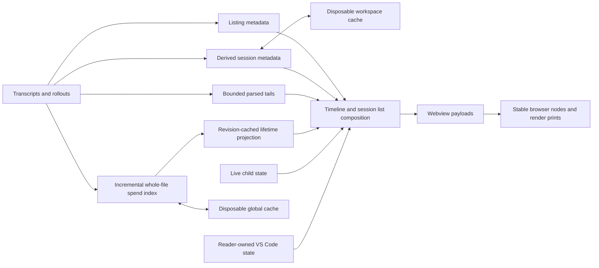

# Timeline data and rendering

Use this guide when changing transcript discovery, turn boundaries, cards, diffs, cost, context, refresh, or search. [`architecture.md`](architecture.md) maps the components.

## Session discovery

`allSessions` merges Claude transcripts and Codex rollouts into a chronological list. Each `SessionFile` carries its source agent, recorded cwd when readable, stable id, activity time, and metadata for deciding open-project membership.

The recorded cwd decides membership. The open folders belong immediately. Git supplies the worktrees registered with their repositories in the background, after which their directory trees belong too. A worktree inside an open folder already belongs through that folder, so registration admits only worktrees outside every open folder. Claude's directory slug can collide across paths, and Codex directories are organized by start date rather than project. Discovery can use a directory name to avoid unnecessary reads. When the record supplies a cwd, the name alone cannot establish membership. A transcript without a readable cwd keeps the exact-folder fallback only for an open folder, never for an added worktree root.

The first listing waits for Git's answer before it changes reader state. Later topology reads keep each open folder's last successful roots through a temporary failure and invalidate the catalog when those roots move. Git worktree registration is the available proof of the relationship. After a worktree and its registration are both removed, an old transcript cwd cannot establish which repository owned it.

Prompt delivery, compaction, response-link handoff, and selected-text handoff use the discovered session's recorded cwd. New sessions started from the ordinary launcher continue to use the editor's open folder.

Listing and parsing are separate work. Listing admits Claude transcripts with a typed human prompt and Codex rollouts in the repository scope. The progressive worker reads selected sessions into turns. Persisted bounded turn starts and metadata supply unread, status, and context facts independently from selection. Completed primary spend sources supply the newest start and outcome when the bounded read cannot reach them. Session list and open-heading cost come from the incremental spend index because a tail cannot establish a whole-session total. Pins control session list placement alone.

Refresh admission shares read and filesystem-check allowances across Claude sources and yields between batches. Admission completes before catalog publication. Cancelled and superseded scans retain complete lines and unfinished UTF-8 bytes. Compatible appends preserve scan progress and confirmed human evidence. Without confirmed human evidence, unscanned appended bytes retain unknown membership until admission resumes. Changed physical identity, shrinkage, or a changed same-size revision restarts admission. Unavailable evidence retains unknown membership.

Sessions started as child-agent work remain available but are folded away from the ordinary list unless the reader pins or selects them. Classification must not hide a session that edited workspace files or whose opening turn is still active.

A typed command that the CLI answers by itself supplies no admission evidence, even when model work follows its answer. Model work after a manual compaction makes `/compact` admission evidence again. A transcript containing only such commands stays off the session list. Fallback naming uses command withdrawal evidence from the first 128 KiB. A withdrawn command gives way to the next typed or reader-queued prompt. Whole-file metadata reads can name prompts beyond that window. A command without a recorded CLI answer remains eligible. Catalog refreshes recheck pending command admission and preserve reader-owned state when a session leaves and returns.

## Cache ownership

Dispatched Codex figures use a worker-owned forward cursor with 256 KiB slices. An owned final completion or abort admits spend after complete EOF coverage at one file revision. Copied turns, mismatched identities, trailing activity, and incomplete records retain the one-hour quiet deadline. The deadline admits discovery even when catalog bytes stay unchanged. Changed figures independently admit card collection and posting, including retained launching turns. Cursor progress alone schedules discovery without posting cards. An accepted post consumes only its captured figure revision. Failed, canceled, and obsolete posts retain pending figures. These cursors, deadlines, and figure revisions remain process-local.

Claude windows recover preceding model attachments through revisioned backward cursors owned by their forward checkpoints. Each background slice stops between reads at a 1 MiB or 15 ms budget. Pending cursors resume until the newest applicable attachment or byte zero. Positive evidence and confirmed absence stay cached for that source revision and boundary. Contiguous appends preserve compatible pending cursors after forward validation binds them to the new revision. Recovery byte totals include initial reads, newest-turn follow-up reads, and abandoned discovery work. They remain separate from ordinary tail bytes. Cold reads and skipped append windows remain drawable within their configured tail bounds. Newest-turn discovery recovers at its follow-up boundary. Semantic pages recover preceding evidence at each older page boundary, with separate byte accounting. Replacement, truncation, rewrite, cancellation, and selection changes reject incompatible work. Recovered evidence changes prompt box identity alone and never sets the profile used for pricing.

The timeline uses separate transcript caches for separate scopes. Refreshing the session list does not require the same work as drawing a session. Every derived cache can be discarded and rebuilt from the agent records. Reader-owned state is stored separately because it cannot be reconstructed.

| Layer | Lifetime and key | What it prevents |
| --- | --- | --- |
| Discovery metadata | In memory for files still present in the latest walk. Claude cwd, Codex opening metadata, human-prompt cursors, and thread-name stamps each use the revision that can change their answer. | Re-reading immutable heads and rescanning quiet files during listing. |
| Codex opening records | Persisted once per machine in `codex-openings.json` and keyed by path. Rows carry `CODEX_META_VERSION` in `codexopenings.ts` and survive a `VERSION` bump. A save keeps a row for a rollout that still exists, or that both the file and the window's latest walk hold. | Re-reading the head of every rollout on the machine after a window reload or in a new workspace. |
| Derived session cache | Persisted in the workspace partition under `~/.arc/cache/`. Title, activity, run classification, outcome, bounded context facts, and turn starts use path, size, and mtime. Entries are trimmed against the current walk once the first Claude child discovery answers, because the walks before it hold no child transcript. Trimming against a refresh's session list waits for a complete catalog. Before the first complete catalog, and after a workspace folder change clears it, that list can hold only the selected sessions. A file whose stored version differs from `VERSION` in `derivedcache.ts` keeps no child reference. It retains each title only as a carried name. Its Codex opening rows use `CODEX_META_VERSION` instead. | Repeating bounded metadata and turn-start reads after a window reload. |
| Progressive selected read | In memory by file revision, parser options, workspace folders, and associated child revisions. Accepted turns and source checkpoints share the `arc.sessionCacheMiB` budget, and every unselected session stays while the total fits. | Re-reading unchanged sessions and reparsing retained bytes after an append. |
| Newest-turn recovery | Cancellable worker reads against exact file identity and revision. The accepted forward checkpoint retains the recovered source boundary. | Losing a large newest turn when its start lies before the ordinary tail. |
| Child usage | Accepted parent reads carry child revision keys. The worker owns the bounded child-spend cache and resolves completed child usage by file revision and commit-placement scope. | Re-reading unchanged completed children when their parent grows, or reading active children for incomplete usage. |
| Claude child catalog | The cancellable worker caches parent references and child working directories by transcript revision. One traversal follows verified descendants and keeps direct parent edges. Repository scope filters navigation targets without discarding verified parent and child pairs used for spend. | Blocking the extension host on complete parent scans, re-reading immutable child heads, or losing an older, selected, or pinned child after navigation, eviction, or host restart. |
| Project spend index | Persisted in the workspace partition under `~/.arc/cache/`. Its sources cover the open folders and their registered worktrees. Each source keeps an incremental cursor, parser generation, raw usage buckets, lifetime buckets, primary turn count, compaction count, and the span from the first turn's start to the last turn's end. A last-complete display ledger is kept apart from resumable scan progress. | Rescanning whole transcript history for project or session lifetime cost. |
| Lifetime projection | In memory by spend-ledger revision. It projects complete source records into per-session cost and turn chips shared by the session list and open timeline heading. | Re-normalizing paths and aggregating the whole spend ledger for every session list post. |
| Search corpus | In memory by transcript path, size, and mtime, and populated only by an explicit content search. It keeps compact prompt and response entries from the fixed search tail. | Rebuilding the bounded search corpus for every query change. |
| Delivery and browser state | The host retains the last session list print, and the webview retains stable nodes and content prints. | Posting or rebuilding unchanged session list and card content. |

Reader-owned read watermarks, pins, archive state, drafts, comments, open controls, and session selection are not derived caches. They live in normalized VS Code state and participate in the final composition without being written into either disposable cache file.

On startup, the browser mounts the shell with `Reading sessions…` in a polite status region. A usage message with no live or queued submission leaves the shell in place until the first authoritative payload replaces it. Live or queued work can replace the status before that payload. The browser sends `ready` after its data-independent owners and message listener exist. The provider installs its listener before assigning HTML and tracks readiness for each host. Reads, polling, and optional usage work wait for a visible ready host. Closing a host before readiness starts no work. The first authoritative payload carries the complete stable session order, restored selection, and available selected session data. The provider then restores or prices the Project spend index. Project cost and ledger-derived lifetime figures show a calculating state. A later Project cost and session list update publishes the restored figures from the held catalog.

The metadata worker prepares selection-independent session list facts before the host requests selected turns. The first session list payload replaces the startup status with the shared selected-session loading diagnosis. The first card removes that diagnosis. A selected recorded session with no drawable turn says that it has not produced a response. Later background reads keep the last usable session list, session, drafts, read state, labels, and controls visible.

The worker returns the source revision and request generation with each result. Refresh and selected-session work have separate generations and cancellation. Selection, workspace scope, source revision, and provider disposal invalidate replaced requests. A catalog refresh cannot cancel a selected read. A late completion cannot replace accepted content. Source checkpoints, older cursors, and pages keep their existing source adapters and share one retained-history budget.

An unchanged poll preserves an in-flight read. A changed source, scope, or selection replaces that work without clearing accepted content. Diagnostics report synchronous listing duration under `catalog-enumeration`.

Performance diagnostics record `shellReady`, `catalogReady`, `railReady`, `firstCard`, and `completeRender` against one startup operation id. The host records `catalogReady` when enumeration completes. The other timestamps follow browser acknowledgements after DOM application and two animation frames. A held timeline update delays its card acknowledgement until the renderer applies that update. `completeRender` covers session rendering and does not wait for Project cost hydration. The host rejects acknowledgements from replaced refresh generations. These values use the host's monotonic clock.

Initial metadata reads share a 64 MiB budget, including the separate Codex title head. Turn-start enrichment follows the first session list post in batches that read at most 64 MiB. Unread counts remain unknown until metadata or complete lifetime facts establish an answer.

On refresh, file revision changes invalidate only the layers whose keys include that revision. An unchanged selected read reuses accepted turns. An expanded metadata read records its null result for that revision, so another refresh retries only after the source changes. Parsed session list-cache facts override metadata only while their source revision remains current. Appends resume the source checkpoint after validating its file identity and bounded content anchor. Lifetime cost remains the spend index's answer, and session list facts remain independent from selected turns. The settled session list input key suppresses an unchanged session list message before its payload is built.

## Selected session history

The selected session starts from a bounded tail. Its loading payload reaches the browser before metadata work for other sessions. The worker scans disjoint older chunks when the newest turn begins before that tail. Claude and Codex own their boundary rules, and the provider keeps their source state opaque. After discovery finds the boundary, the source adapter reduces 256 KiB chunks and observes cancellation between chunks. The completed reduction supplies the forward checkpoint. A read that starts from the requested revision can publish its completed prefix when the same file grows, then resume against the newest revision. Replacement, shrinkage, same-size rewrites, and file identity changes discard incompatible work. A read error shows a failed history status when cards remain or a diagnosis when none remain. A later refresh or selection retries the read.

Loading older turns reads one semantic page for the selected session. The page reader walks disjoint older ranges, and the provider keeps its cursor. The ordinary read window stays the same for every session. No press reparses a tail. One request runs at a time. The sentinel requests more history when it comes within one viewport. Its button also requests history on a press, supporting keyboard use. Loading status and accepted pages repaint the selected session directly, including while a catalog refresh runs. A request that finds only turns the tail already lists keeps reading, bounded by how many pages of turns are loaded. Pages merge by stable turn identity, and the display budget grows to admit them.

When an accepted append pushes a completed turn out of the selected read, the provider keeps that turn in one bounded recent page. The page holds at most the ordinary turn limit minus the turns still in the tail. Its content stays within the selected session cache budget except for one newest turn. Explicitly loaded older pages remain separate. A fresh panel reads the bounded tail and offers older turns through the sentinel.

Switching to another session keeps its pages under a retained budget, so returning to it restores them without a read. Retention prioritizes selection, then the budget, then recency. Empty-state wording describes the selected session and never reports the size of the background parse set.

Session figures cover the tail and the loaded pages together, and their caveat names that count. Search keeps its own read window, so a scoped search can cover less than the reader can see. A scoped answer says whether the read reached the first turn.

The retained budget covers accepted turns, source checkpoints, and older pages together. Selection protects the current session, and every unselected session stays while the total fits the `arc.sessionCacheMiB` budget. Past that, the least recently viewed unselected session is released first. A selected value larger than the budget stays retained and evicts every optional session. Unread state continues to use metadata and completed lifetime facts after parsed state is evicted.

## Shared turn model

`transcript.ts` and `codex.ts` produce the same values:

- `SessionFile` identifies a session and its source.
- `Turn` contains the prompt, later prompts, responses, activity, edits, usage, timestamps, and source agent.
- `Compaction` records a context rewrite. It is not a `Turn` and carries no response.

Code after the readers must use those values. Source-specific branches belong at discovery, parsing, pricing fallback, or a clearly named limitation.

Claude turn boundaries are inferred from the transcript records. A tool-use response does not close a turn. A manual `compact_boundary` completes a plain `/compact` command when it records positive numeric input and summary sizes. The command draws no turn without model work or a later queued prompt. The preceding turn keeps its outcome. Model work after the boundary makes the command a turn again. The CLI's recorded answer to a command it runs by itself, such as `/mcp` or `/rename`, withdraws the turn that command opened. The CLI records that answer as a `local_command` system record or as a user record that holds only the command's stdout or stderr element. The command draws no card and counts as no turn, and the turn before it is the newest turn again. A process end after the answer stops that turn. Model work after the answer never makes the command a turn. The work joins the turn before the command, as a reply to a subagent hand-back joins the turn it wakes. With no turn before the command, the work belongs to no turn. A prompt queued after the command with no model work is its own unanswered turn. This applies before or after the command's answer. A process end stops that turn, and later queued prompts join it. Model work after them joins that turn, and any process end stays on its card. A validated `cost-state` record marks the current process invocation as ended, so an unfinished turn becomes stopped immediately. It does not mark the turn done or interrupted. A later prompt starts a new turn and supersedes that boundary for current status. Codex records task start and completion directly. A queued prompt with neither a response nor a process boundary carries into the next turn. The open tail remains visible as the running turn. When the next turn is a local command that the CLI answers, the queued prompt keeps an unanswered turn of its own instead. Arc takes the answer as a sign that the CLI is idle, so that turn reads stopped. Its duration still ends at its own last record. Model work after the answer withdraws that inference. The work joins the queued prompt's turn, which becomes the running turn.

A Claude subagent transcript records no stop reason on its assistant records. The harness marks the tool result that ends a turn with `toolEndsTurn: true`, and a `SubagentHandback` result carries that mark. Every Claude reader treats a marked result as the end of its turn, in a main transcript and in a child transcript. When the tail read of a child transcript holds no prompt, the marked result still gives the newest turn an outcome. A coordinator or peer message after the marked result resumes the turn, and the turn's activity time moves to that message. Later model work resumes it too, unless its own stop reason ends the turn again.

Each source reader is a forward state machine. One-shot reads, append checkpoints, and semantic page adapters reduce records through the same path. A forward checkpoint owns the open-turn associations through its last applied byte. A backward page cursor separately owns records at an incomplete older edge, one newer boundary record, and source metadata needed by an older page. Cold checkpoint rebuilds cover only the configured source tail. Page scans retain only records the source reducer can use, and their asynchronous form yields between disjoint reads and stops on cancellation or file-revision changes. Claude carries its final title and unmatched compaction figures this way. Codex retains delayed copied-turn classifications because a `turn_context` written after `task_complete` can retract a turn that otherwise looked complete.

Compactions stay in the same session order as turns. Claude can provide a saved summary and a trigger. A readable summary stays collapsed until the reader opens its compaction boundary. The `What carried over` section then shows source-backed retained summary content after the parser removes the continuation preamble. Codex classifies a compaction as automatic when its active non-replayed turn already contains normal work. It classifies a known empty dedicated turn as manual. A missing turn start or replay keeps the reason unknown. Context size does not classify the reason. When the replacement is encrypted and its size was not recorded, the headline states that the result is unreadable and the size is unknown. A card with no body remains a visible boundary but is not an expandable disclosure.

Skill use belongs to a turn and has no tool category. `Turn.skillUses` holds one record for each time the turn loaded a skill, and `Turn.skillUseCount` holds the true total. Both sit outside the bounded step window, so a long turn still reports its skills after the calls that loaded them leave the Activity list. A record carries the skill name, recorded `SKILL.md` path, and catalog description when available. It also carries the source call identity, its clock, and the strength of its evidence.

The two agents record different evidence of skill use. Claude emits a native `Skill` call naming the skill it loaded, which is recorded evidence. Codex publishes a skill catalog and reads the selected `SKILL.md` with an ordinary shell command. This best-effort evidence establishes that Codex read the instructions, but not why it selected them. Neither source records whether the reader or the model chose the skill. The skills popover names this once, in a note under `About these figures` that appears only when the list holds a best-effort skill.

A Claude `Skill` call has no tool category and keeps its chronological Activity row. Its raw tally row stays, so the recorded invocation count is unchanged. A Codex skill read keeps its own run category and its own row, because one command is both a run and a skill use.

Visible narration and clear reasoning summaries are ordered activity, separate from tool steps. They do not increase tool totals. Claude contributes assistant text that stopped for a tool call. Codex contributes commentary-phase messages and clear reasoning summaries. Final-answer messages remain responses.

A Codex rollout records commentary through `event_msg` and `response_item` envelopes. An event holds an `AgentMessage` item with `Text` content or a root `agent_message` with a `message` string. A response item holds a `message` with `output_text` content. Both carry `phase: "commentary"`, but their ids can differ. The reader joins matching ids or matching timestamps and text. It also pairs an idless root event with an identified response item when their normalized text matches within two seconds. This fallback pairs the latest unmatched commentary once, within one turn and without an intervening prompt, tool step, or other Activity message. The first row retains its position and timestamp and takes the response identity. Its byte prefilter accepts commentary on either envelope type.

## Card sources

A Codex dispatch opened through `exec` keeps Run by agents filing across continuation prompts. Later `cli` or `vscode` metadata ends that exemption when it names the opening session, has a newer envelope, and excludes foreign or copied history. Multiple genuine prompts then establish reader ownership. Interactive and unknown-source openings use that prompt rule from the start. Saved reader-started sessions and reader-owned dispatch receipts retain their ownership. Native subagent transcripts retain agent-run classification.

An identified Subagents row opens the child session through the same navigation used by the session list. Its accessible name includes the visible child name, state, model, duration, tool count, and token detail when present. A row without a verified child identity stays plain text and includes the unavailable explanation in its accessible text.

A parent turn lists a resolved shell-launched Claude or Codex session under Dispatched. Its figure opens the same rows, and the name opens the full child session id. The child's own record supplies cost, duration, changed paths, and commits. A dispatched Codex row includes its native descendants and refreshes when their records change. The catalog status decides whether its row reads running or finished. A child whose main agent closed its turn while its background subagents or commands still run reads running. A child waiting for input also reads running. The Dispatched figure counts its running rows in the busy tone, and its popover heading says the same count. The parent turn's cost figure adds each dispatched session's whole lifetime cost. This includes later typed turns and sessions that it dispatched. A session that one of the turn's subagents dispatched counts too, and it draws no Dispatched row. Only the card that holds the session's first launch receipt adds it, so a session on two cards of one parent counts once. Each counted session has its own entry in the cost popover, labelled with its row name and holding an amount alone. A card that counts a dispatched session shows the cost figure even when the turn prices nothing of its own. The figure reads only spend ledger records. It carries `+` while a counted session's sources wait under the session total's rule. It also carries that mark while a counted part is unpriced or incomplete, the ledger has not loaded, or dispatch discovery runs. A Claude print row of the same session in a Codex turn keeps its own amount, and the session's entry subtracts it. The entry leaves the session's own transcript out and carries `+` until three things hold. That transcript no longer waits under the session total's rule. Its newest turn started inside the parent turn. Its priced amount covers the print rows. The turns-read session heading figure sums the parsed turns alone, so it reads less than the sum of the card faces it covers.

A dispatched session or a subagent session ends its heading figures with `from` and the name of the session that started it. The hint reads `Dispatched from` or `Subagent from` before that name. A press on it, or Enter from the heading walk, opens that session, archived or not.

A direct Claude launch that starts a new session links from Claude's background line or foreground JSON result. The dispatch rules below identify eligible Claude commands. A wrapper links when its Bash command contains a standalone `--arc-dispatch` argument. Its paired result must print one `ARC_DISPATCH_SESSION` JSON line for each session it starts. The receipt names its agent, session ID, optional name, and whether the reader asked for the session. Codex IDs resolve exactly as full UUIDs. An eight-character ID links only when it matches one existing Claude session in the current project. The dispatch rules below identify rejected receipts.

A Codex `CommandExecution` also links a Claude or Codex session. Its parsed shell command must opt in with `--arc-dispatch`, and its own stdout must hold a valid receipt. The launch call id remains on the turn when Activity trims older steps. Copied Codex history does not create a launch edge. Discovery reads rollout bytes in 8 MiB worker requests and resumes a parent with unread bytes from its saved cursor. A partial terminal record stays incomplete without another read until its revision changes. A changed file of the same size starts again, and an append resumes from its cursor when retained. A partial scan supplies no negative answer for its unread suffix. The derived cache retains a deterministic subset when its file cap is reached and limits retained Codex cursors to 64 MiB.

Claude child navigation requires one parent launch tool id paired with the result's child agent id. The nested transcript must exist, and its recorded working directory must belong to the open repository or a registered worktree. The exact paired transcript can still supply parent-card spend when its working directory prevents navigation. Codex child navigation requires a direct structural child whose rollout records the selected parent thread id. Background reviews do not become navigation targets. Names, clocks, branches, worktrees, prompts, headless runs, guardian records, and unknown metadata never establish a child target.

`turncard.ts` prepares the complete browser-facing card. `card.ts` draws that value and must not repeat decisions about wording, status, marks, cost, context, or file meaning.

The chip row reads cost, context, files, tokens, commits, subagents, then dispatched. The subagents figure says `1 subagent` or `3 subagents`. `chipsOf` in `turncard.ts` builds every figure except the dispatched one. The extension host resolves the dispatched rows and appends their figure last, because only the host holds the catalog that resolves a dispatched child.

One column and Two columns list Subagents, Dispatched work when present, Commits, then Files. Cost stays in the card's figures above the body.

A long prompt is clamped when its turn first opens. With Prompt position at Above the response, the prompt leads the body clamped to two lines. `Show the whole prompt` reveals the complete text, including what the reader asked while the turn ran. A saved comment on one of those asks shows them until the reader presses. With the Prompt position setting at Below the response, the prompt follows the body under its heading. Reader prompts use `You asked`. Codex subagent assignments use `Assigned task`, and an assignment whose readable record contains no payload says that its full instructions are unavailable. Both Prompt positions use the same heading and availability notice.

| Card field | Primary source |
| --- | --- |
| Prompt and response | Transcript or rollout |
| Tool activity and failures | Transcript or rollout |
| Skills loaded | A Claude `Skill` call, a Claude typed command proven by its base-directory successor, or a Codex catalog entry matched to a command that completed |
| Narration and clear reasoning summaries | Transcript or rollout, with a temporary live child overlay |
| Files touched | Recorded edit events |
| Current-file diff | First-touch snapshot against the live file, when still applicable |
| Per-turn diff | Recorded whole-file text or changed regions |
| Cost | Recorded usage passed through `pricing.ts` |
| Context | Value recorded for the turn, with model metadata as fallback |
| Child-agent cost | Child transcript read by `agentspend.ts`, or a completed Claude print result recorded by the parent Codex command |
| Commit rows | Git output accepted only from activity capable of running Git, and the repository itself for a call that printed none |
| Landing rows | A successful fast-forward merge call and its repository head-log entry, separate from the turn's commit total |

A current Codex collaboration spawn names its child with the recorded thread id and nickname. Its machine-marked terminal notification supplies the preferred terminal state. When that notification is absent, a terminal boundary in the direct child rollout can settle an open parent row as completed, failed, or interrupted. Once terminal, the child transcript can supply usage to that parent card exactly once. Project and lifetime spend continue to discover child rollouts structurally.

A background Codex review can have no spawn record in the parent. The direct parent edge and child header's opening time place a `Background review` row on the unique parent turn containing that time. The newest child-turn outcome supplies its current state, and the child transcript supplies model and usage. An exact child-id match keeps a legacy or current parent-recorded row instead. Descendant rollouts are not flattened onto the root turn.

A missing figure remains missing. A partial cost is marked as a lower bound. A turn that ran commands without a recorded patch can report potentially unrecorded changes, but it cannot say that nothing changed.

Session context detail shows the latest indexed compaction trigger as `Manual`, `Automatic`, or `After a refusal`. Any other recorded trigger word shows capitalized, and an empty trigger shows `Unknown`. The trigger row uses the turns detail only when current context is unavailable. A session with no indexed compaction evidence gets no trigger row. A compaction card names the trigger in its headline.

A recent Codex compaction card prices its exact request usage when the rollout carries it. The card retains the recorded model, provider, request band, inference class, and service tier. An older Codex card stays unpriced when that request usage is absent. A Claude card estimates its compaction request, because Claude Code writes no usage for it. The last main request before the compaction sizes the input. The recorded context before the compaction stands in only when the session holds no earlier request. A warm estimate prices the request's cache reads at the cache-read rate and its cache writes at the five-minute rate. It prices the compaction instruction as uncached input. When that request's cache lifetime expired before compaction started, the estimate sends the history as uncached input and writes the shared prefix. A positive cache read on the first following request sizes that prefix. A zero read establishes an empty prefix only before five minutes pass, with a recorded preceding cache lifetime. Later zero reads leave the prefix unknown. Before the following request exists, or after a later zero read, the estimate uses the transcript's first cache read plus cache write. It caps that prefix at the previous request's input side. The prefix write price follows the previous main request's cache lifetime as an estimate. The compaction request has its own cache lifetime, separate from the main request's. Saved usage does not record that cache lifetime or its overrides. The cold input calculation defaults to the one-hour write price when no lifetime is available. Missing lifetime alone never establishes a cold cache. A cold compaction avoids the history cache-write charge included in a cold next turn. Summary output still costs money. With no first request known, the whole input is uncached. The card names the tokens of each part it priced. The output is the length of the stored summary text, preamble included, at a fixed number of characters per token. The recorded summary size stands in when no summary text is paired with the boundary. An older Claude model gets no Claude request shape, so its card prices the recorded context as a cache read. A compaction gets an estimate only when its boundary records a summary size and a main request with a model comes before it. The session total adds each such estimate, and its detail names how much of the total is a compaction estimate. A subagent's cost figure adds the estimates from its own transcript in the same words, so it matches its part of the session total. In the turn cost popover, each estimate note sits in the visible footer and starts with the block of the model that ran the compaction. A subagent's cost figure keeps the same note under `About these figures`. A dispatched session's figure adds the estimates from its transcript the same way. It sizes each estimate from the last main request, as the dispatched session's own total does. It never uses a subagent request written into that transcript. The cached-input share and the cache-write warning leave compaction requests out. Project cost windows leave Claude estimates out. Codex recorded compaction requests enter dated and lifetime totals once. Arc joins their response IDs across native usage, token snapshots, compaction boundaries, and saved parser checkpoints. Native `token_usage_record` and `latest_token_usage_record` can identify compaction usage without a matching `token_count`. Missing response identity adds no separate priced request. Unresolved billing identity or missing response identity leaves the total incomplete.

The session cost detail names two overheads the total already counts under `Included above`: a compactions row and a cache expiries row. Each row puts its count in the label and only money in the value column. The compaction count is the exact lifetime count from the turns detail. Its cost adds the main session's Claude compaction estimates and identified Codex compaction usage. It carries `+` when fewer compactions are priced than counted. The cache expiries row reads the same cost added as the session heading's cache-expiry figure. When any main-session compaction cost is a Claude estimate, a visible footer line says so. Delegated compaction estimates keep their own footer line with their amount and count. A Claude compaction between two responses under one prompt belongs to that turn. The timeline adds its estimate to the turn's cost when the turn's next response arrives, and the turn cost detail names it the same way. A Claude compaction whose summary size is still unknown at that response adds nothing to the turn. A Claude compaction before a turn's first response or after its last response belongs to no turn. Identified Codex usage belongs to its recorded turn when that turn already holds ordinary request usage.

A turn's cost detail names its main cache-expiry request and affected native subagent requests separately. Each scope shows its warning sentence when its known priced addition reaches $1, including lower bounds at that amount. Subagent additions sum within the parent turn's recorded time span before the threshold applies. Its cost figure carries a warning sign when either scope qualifies. Main and subagent amounts never combine to meet the threshold. The accessible name includes only the visible warning sentences. Main Claude returns match the opening response id, which survives the bounded response id list. Main Codex returns match the turn id. Each source retains at most `RETAINED_CACHE_EXPIRY_RETURNS` for amounts and warnings. Full source counts remain available when retention drops earlier returns. Missing or incomplete child sources leave the session count and amount as lower bounds. Session figures never carry this warning.

A session cost adds every bucket with a supported provider and model rate. If another bucket records usage but has no supported rate, the chip appends `+`: the estimate is a lower bound. The figure also carries `+` while a dispatched session's cost has not joined the total, until the dispatched source is complete, as [attribution constraints](#parsing-and-attribution-constraints) explain. Its detail always calls the figure an estimated total and carries the same `+`. A cost-unavailable line uses readable agent, model, and provider names without diagnostic field labels or quotation marks, then says why the estimate omits that usage. The cost chip hover carries the full detail. For one unavailable identity, the session button's accessible name carries that explanation. For several, it carries the first explanation and a count. An identity can have a published rate and remain unavailable when the fields available to the session list do not identify the applicable tier. Missing or incomplete main and native child sources retain safely attributable lifetime usage, including earlier pages and compactions. The figure carries `+` until coverage resolves. Its detail marks main-agent and delegated-work coverage separately. Ownership-uncertain usage contributes no dollars. Missing-only usage leaves the dollar figure unavailable. Recorded zero retains its zero value.

A completed turn or session warns when one agent scope meets three conditions. It records at least five requests, cache writes exceed half its input-side tokens, and priced cache writes exceed $5. Main and delegated scopes qualify separately. Delegated scopes keep their source or invocation identity and never pool. The denominator contains uncached input, cache writes, and cached input reads. Missing request bands, incomplete usage, unclassified cache-write duration, and unavailable prices suppress the warning for that scope. The turn cost chip, session heading cost chip, and Session list cost chip carry the same warning. Cost detail nests each warning beneath its main-agent or subagent cost entry. The warning shows cache-write cost, scope cost, and cached-input share. Session totals distinguish indexed subagents by number and model when their names are unavailable.

The Activity disclosure opens by default on every turn. A done turn initially shows only the agent messages it recorded, including earlier replies. Other statuses initially show narration, earlier replies, later prompts, reasoning, and tool-call runs in recorded order. The reader can switch between messages and the full chronology, and that choice survives repainting. A completion waits to hide a focused non-message row until focus leaves Activity. The step cap drops calls only. An emptied run keeps its total and tool mix. A partially retained run names its missing calls above those that remain. A run folds when its calls finish. A reader's explicit choice survives repainting, and focus inside a run delays its fold until focus leaves.

The Activity head keeps total message and reply counts before the tool mix, and a skill count after it. Each message count filters the log until pressed again, while each tool-category count opens the same compact raw-invocation detail. The skill count opens the skills this turn loaded, and a skill load is never a tool category. The message filter keeps agent messages only. The reply filter keeps replies alone. A count also opens a shut log. Filters last until reload. A done turn with other Activity but no agent message states that no messages were recorded and keeps the full-activity action available.

Messages keep their rendered text within a bound and offer Show all for the rest. Shift on the Activity word opens every visible message whole or restores their bounds. Shortened command rows open their complete text on a press. Arrow keys move among run and command controls within the log, and Escape shuts an open row. Message rows carry their timestamp in a native tooltip.

Marks summarize fields already present on the turn or its closing summary. A mark is a navigation aid, not an independent source of state. Failed calls remain in Activity and do not create turn-header marks or chips.

A settled tool-call group uses a neutral disclosure marker. Failed child calls keep their failure markers and the group keeps its failed-call count, separated from the tool-call count by literal text. The transcript does not establish recovery or a failed outcome for the group.

## Markdown disclosures

Responses and Activity messages render balanced `
` sections with one nonempty `
` as the first child. Bare tags accept case differences and whitespace. Source attributes stay escaped, including `open`, `name`, styles, and event handlers. Summaries render inline Markdown without interactive descendants. Bodies render block Markdown, including tables, lists, fences, and routed links. Tight bodies and blank lines both work. Nested sections support up to 32 levels.

Code, escaped tags, and HTML comments never supply disclosure boundaries. Incomplete, orphaned, duplicate-summary, malformed, and deeper sections stay escaped without truncating their text. Other raw HTML stays escaped.

Native summaries retain Tab, Enter, and Space behavior. An unchanged heading and ancestry preserve open state and focus within each mounted response. Changed headings and ambiguous repeated headings receive no inherited state. Activity removes clipped summaries from the tab order and measures clipping after expansion. Disclosure headings accept comments, and closing a section preserves stored text offsets. Selected Markdown retains disclosure structure, lists, fences, and tables. Full response copy retains the original source.

## Diff selection

The snapshot baseline represents the file before the session's first edit. It can cover work from later turns in the same session, so it is suitable for a current-file view but not for turn attribution.

`patchview.ts` builds a per-turn diff only from text the transcript recorded. Whole-file before and after values are preferred. When the source recorded only changed regions, the diff title states that limit. The live file is never used as the after side of a per-turn diff.

Snapshot and transcript paths pass through the shared normalization rule before comparison. Scratch roots are also defined on the hook side and reader side. The shared fixture keeps their path handling aligned.

## Cost and context

Usage is grouped by provider and model before pricing. Claude usage repeats on each content block for the same response, so the reader counts a response once. Codex input usage includes cache reads and cache writes. The reader splits all three categories before they reach the shared estimator. `Cached input reads` means input tokens served from the provider's prompt cache and priced at the cache-read rate. [`agent-cost-guide.md`](agent-cost-guide.md) owns the reasoning.

Each exact model definition carries shared rates and explicit provider support. Qualified Bedrock IDs resolve only when that definition names Bedrock support. Unsupported identities have no estimated cost. The internal `codex-auto-review` identifier aliases the GPT-5.4 row only for a missing provider or `openai`.

Public service-tier names are interpreted by provider. OpenAI and Bedrock `default` and Claude `standard` use their standard public rates. A missing tier also uses the standard rate. Other tiers remain unavailable unless an exact model row or a recorded price supplies the answer. Direct OpenAI GPT-6.1 Sol prices `fast` and `priority` at twice Standard. It prices `flex` and `batch` at half Standard. Its request-wide long-context rates apply before the service-tier multiplier. Bedrock support does not inherit these direct OpenAI tiers. A Claude turn billed at fast speed reaches this same field as the tier `fast`. It uses the model's published fast-mode rate, when `pricing.ts` has an exact fast-mode row. A Claude fast turn stays unavailable on a model without a published fast rate and on a turn that names a provider. A configured rate that names no service tier prices the standard speed alone, so a fast turn under it stays unavailable.

Supported OpenAI models and Claude Haiku 5.5 retain their published request-wide long-context rates. The readers preserve short and long request totals before turn or daily aggregation. One aggregated token count cannot reconstruct which requests crossed that boundary. Old cached aggregates without those request bands remain unpriced when the distinction matters. Explicit provider metadata selects supported Bedrock prefixes, regional multipliers, effective dates, and fallback context windows. Bedrock GPT-6.1 Sol supports bare, `us.`, and `global.` IDs with a one-million-token fallback window. Its [AWS model card](https://docs.aws.amazon.com/bedrock/latest/userguide/model-card-openai-gpt-6-1-sol.html) establishes global rate equivalence and a 10% premium for bare and US routes. Earlier supported Bedrock models retain their 272,000-token fallback windows and two-letter geographic prefixes.

Each Claude executor pass in `usage.iterations` selects its pricing band from its own input, including cache reads and writes. Pass input exactly at the threshold keeps the base band. Response cost sums the pass costs, while a recorded `usage.cost_usd` or `usage.cost` counts once. Each response remains one executor request. Claude Code can price summed executor usage at the long-context band, so Arc can differ from its `total_cost_usd`. Linked Claude print results retain their recorded costs because they carry no pass breakdown.

Turn, compaction, and lifetime session dollar values are estimates against published model rates. A subscription-backed Codex session can show a published-rate estimate, but the figure is not a personal subscription charge or plan-limit reading. Project cost instead prefers a provider-reported amount and retains that source when one exists.

A completed Claude print-mode result can supply a recorded list-price amount for each model. That amount takes precedence over recalculating from aggregate usage. Cache creation remains visible as token volume when the result does not assign it to a cache lifetime. Category subtotals omit that amount instead of assigning a rate without evidence.

Whole-session cost detail rolls up the priced usage categories already retained by the spend index. Without delegated usage it shows one usage-category breakdown that names every main-agent model. Ordinary delegated usage stays under one delegated-work subtotal and names every main-agent model on its main subtotal. When Auto Review is present, each main-agent or delegated model identity gets its own entry. Each priced entry keeps its cost-category sub-bullets. A cache warning keeps usage grouped by its main-session or identified-subagent scope and names every model in that scope. Turn and whole-session aggregate cost entries use the same model-label rule, including exact request-level usage. Turn and whole-session cost detail call one Auto Review entry formatter for its identity and priced categories. Codex Auto Review uses the GPT-5.4 input, cached-input, output, and long-context rates. Cache writes add no charge on this route. Reasoning remains part of output and does not add to the total. A primary source supplies main-agent usage. Child sources and shell-launched linked results supply delegated usage. Each retained bucket is priced in its own model and request context band before dollars are added. The revision-cached projection sends the finished breakdown to the heading and session list. Opening its detail performs no transcript read or pricing work.

[OpenAI's USD rate card](https://help.openai.com/en/articles/20001415-chatgpt-rate-card-enterprise-token-based-pricing) applies to token-based Enterprise agreements and supplies the Auto Review mapping and dollar rates. [OpenAI's credit rate card](https://help.openai.com/en/articles/11481834-chatgpt-rate-card-business-enterpriseedu/) applies to eligible ChatGPT workspace and purchased usage. Arc does not show those credits or apply them to Bedrock. The shared GPT-5.4 row prevents internal rate drift, but external source changes still require a source review.

Tool fees remain outside the estimate without a provider-recorded billable request count. A generic `WebSearch` or `WebFetch` call does not prove that the provider billed a web search run.

The turn's Subagents chip reports execution facts instead of billing state. Each entry shows the model, duration, tools, requests, input, and output that the record supplies. The cost chip owns billed usage, unavailable pricing, and price-category detail.

The Activity heading counts tool calls. The token detail names the separate request count `Model requests`.

A pinned cost chip keeps selected detail text while running activity updates its turn. Equivalent detail leaves the popover unchanged. Changed detail appears after the selection leaves the popover, while the chip button and pinned anchor stay in place.

A cached-input-read money line keeps every qualifying fact on one row: dollars, cached-input share, requests, and average input. It omits cached-read token volume. Turn and session cost details use the same formatter. Exact request counts appear as `requests`, while incomplete counts stay absent. The structured detail carries compact numeric facts through one shared formatter, so plain text and browser rendering cannot word them differently.

Cached-input shares stay visible beside cost. Amber requires less than 80% cached input, at least five model requests, and at least $0.50 of estimated input cost. Only the percentage turns amber. Its parentheses, request count, and average input stay muted. Input cost includes uncached input, cache reads, and every cache-write tier. Output cost does not count. Each displayed scope uses its own priced usage buckets, including their provider, model, context band, and service tier. Incomplete or unpriced usage and recorded totals without an input breakdown keep the percentage muted. A delegated model subtotal turns amber only when an identified subagent meets all three criteria on its own. Unidentified delegated scopes stay muted. The separate low-cache-reuse warning keeps its own trigger and never moves to this 80% bar.

The cost minimum limits amber cache percentages to material input spend. A low cached-input share alone does not establish waste. The threshold has no calibration evidence covering every provider route.

When a turn or lifetime detail contains a priced cached-input-read category, it shows one shared explanation for the whole detail. It does not repeat the explanation for each main-agent or delegated-work line. Cache lifetimes vary, and a cache hit can refresh a cache. The current transcript does not always identify the TTL or prefix behind a later read, so the panel does not infer an expiry deadline.

The next-turn starting price estimates the input cost of retained context before new prompt text or output. `contextRequest` retains the request that established the current context level, its timestamp, cache lifetime, and pricing identity. For Claude, its input and output come from the final executor pass. Earlier output already belongs to that pass's input. A turn's summed usage and final timestamp do not identify that request.

`nextTurnFloor` prices retained context as cached input and as input sent again. Both calculations apply long-context bands, regional multipliers, and provider cache rates. An unsupported service tier yields no estimate. A missing recorded lifetime uses the model's documented lifetime. Without either lifetime, the Prompt box displays the cold estimate and retains any warm estimate in its detail.

Warm and cold estimates use the last request's age and cache lifetime. Eligible reuse refreshes that lifetime. The line shows remaining or elapsed lifetime in whole minutes. The panel switches to the cold estimate 90 seconds before inferred expiry. The warm estimate says `under 2m` near that switch. Detail shows the alternate price when it differs. The record does not establish cache identity. Editing earlier context can prevent reuse despite recent request timing.

The turn's recorded context window takes precedence. Model metadata supplies a fallback only when the source omitted the window. Session context comes from the newest turn or compaction that can establish it. An unknown post-compaction value removes the current context figure from the session heading and prompt box instead of reusing an older level. A later recorded context measurement establishes the current level again. The prompt box keeps that recorded context as evidence when the reader selects another model. It prices the selected model against that model's advertised window and starts it uncached. A selected choice without an exact public price removes the estimate. The next recorded turn restores runtime window and cache facts for the model that ran.

With positive used context and reconciled categories, Claude's Messages opens when its native message estimates sum to that category. The child bars include tool calls, tool results, attachments, assistant messages, user messages, redirected context, and unattributed tokens. Every share uses all used context as its denominator. Children remain included in Messages. Missing, malformed, or mismatched message detail leaves the category bars available without a disclosure. Native last-request corrections can cap Messages below its estimated children. Recorded zero children remain visible in a valid partition.

The prompt box Context detail estimates retained Codex plaintext as Instructions, Messages, Tool calls, and Tool results. Text uses approximately four UTF-8 bytes per token. Unattributed context includes original tool results, hidden inputs, media, opaque summaries, and differences between estimated and recorded tokens. The Tool results category counts plaintext in complete compaction replacement histories. Ordinary tool results remain unattributed because rollouts preserve their text before live-context truncation. Categories use the newest request's input and output total. A post-compaction snapshot instead supplies Codex's estimate of retained context, with its own note. Measurement details starts collapsed and holds the explanations beneath available categories. Compaction reserve and unavailable or mismatch feedback stay outside that disclosure. Cached input already belongs to input. Lifetime usage supplies no context category. Estimates exceeding that total remain visibly mismatched.

Codex reads stop at the latest complete compaction replacement or the rollout's opening. Copied fork history remains context. A compaction discards earlier categories and requires a newer context snapshot. Later unmeasured input, unsupported rollback, incomplete call pairs, malformed history, and changed source revisions leave categories unavailable. The unavailable note identifies pending tool calls or new input awaiting measurement when the history establishes that reason. An aborted turn with unanswered calls keeps categories unavailable without reporting tools as pending. Recorded aggregate context and Compact remain available. An open detail requests categories again when its session's context generation, used tokens, or capacity changes. A newer complete measurement restores categories when the source revision still matches. Repeated usage notifications cannot refresh later input. A newer complete replacement removes earlier rollback ambiguity. Saved-session inspection starts no agent. Reads run in the progressive worker with byte, record, item, and deadline limits. Codex reports no compaction reserve. Native retained-context totals also restore the Context figure after compaction. They remain separate from billed requests and summary output.

## Project cost

Opening Project cost focuses its selected period, another usable control, or the named dialog when no controls remain. Its dismissal follows [Transient popovers](ui-design.md#transient-popovers).

The Project cost button summarizes locally recorded model requests for the open workspace. Its popover holds a table with a row for `Claude`, a row for `Codex` and a `Total` row. The button outside the popover reads the total. Each figure is the known local usage priced at the agent's published model rate, or replaced by a provider-reported cost when one exists. List-price values are not subscription charges. Provider and billing-route names stay in Pricing details.

Today starts at local midnight. The longer values use rolling local calendar days, so a daylight-saving transition does not move a request into the wrong day. An all-unknown window says `Cost unknown` on the button, and its table cell reads `Unknown`. A mixed window says `At least` before its known amount on the button, and its table cell carries a dotted underline instead. Both cells keep the full words in a tooltip and in an accessible name. Background indexing keeps the last complete value steady. One row under the table says how far back the records go and how current they are. The row ends with a compact relative update age, and it carries the full local timestamp in its tooltip and accessible name. While an index run is under way, a short word takes the place of that age on the same line. Usage without a supported price makes the relevant agent value partial. Pricing details names the agent and says that the totals leave that usage out. Pricing details also names the rates the pricing used, in the order it applies them, one to a line. A rate carries an effective date when it has one. A workspace priced from a single rate reads one sentence instead of a list. The collapsed Project cost button follows the period most recently selected in the popover.

`projectspend.ts` stores source cursors, parser state, and raw daily usage buckets in the Arc cache partition for the normalized workspace. The index is partitioned by normalized workspace and prices buckets when it prepares the view. It trims buckets that can no longer contribute to a visible cost window while retaining source cursors for incremental reads. Provider-reported cost takes precedence over a public rate. Public rates remain estimates. Each source record carries the parser generation that produced it. A generation change rebuilds unchanged sources through the same bounded background queue while the last complete figures remain visible.

Every workspace transcript is a direct source, including records outside the timeline display limits. Claude child transcripts inherit membership from their parent. Each child transcript supplies primary lifetime figures for its own session and delegated lifetime figures for its ancestors. Project spend indexes its path once. Codex child and background rollouts use their recorded cwd. Ordinary parent-card child cost is not added because the child transcript already contributes its requests. A Claude print result recorded inside a Codex command contributes through that parent when its transcript is outside the workspace. If the same Claude session is indexed directly, Project cost keeps the direct transcript. It removes the linked result only after that source is complete and contains usable usage, independent of indexing order. Session lifetime cost keeps the link because the completed command establishes which Codex session caused the work. A recognizable incomplete result keeps both totals marked as lower bounds until a complete record for that command replaces it.

Direct Codex sessions use the valid payload creation clock for their saved start time and replay boundary. This applies to `vscode`, `cli`, and `exec` sources with an absent or `user` thread source, no parent id, and no `forked_from_id`. The opening envelope remains the write time. A missing or invalid creation clock falls back to the envelope. The replay allowance remains five seconds.

Codex child rollouts can carry an inherited copy of their parent's earlier turns. The copy keeps each turn's original start clock even though its envelope is written at the fork. The Codex reducer and card reader discard those inherited turns, then count the child's own work normally. Older records without a turn clock use the recorded date and replayed session identity, followed by repeated turn identity when neither clock can decide.

Background reviews are structural children but are not sessions in the Session list. Current records name `guardian_review` as their thread source. Older records use the ordinary `subagent` thread source and name `guardian` inside the structured subagent source. These records remain available as spend sources and parent-owned child rows. For both guardian shapes, the payload opening time sets the replay boundary because the envelope can follow the first genuine task. A guardian turn that starts more than one second before that time is inherited. The envelope time still determines which parent turn owns the review. Other children use the envelope for ownership and replay decisions.

The first timeline render shows Project cost and ledger-derived lifetime figures as calculating. The provider restores the last complete index and publishes those figures without changing session order or selection. Newly discovered or changed files enter a background queue, one bounded source slice per task. Appends resume at the saved byte position, while truncation or same-size replacement rebuilds only that source. Checkpoints retain the last complete-line offset rather than a partial JSONL record, so one large tool result cannot make the ledger checkpoint large. The Project cost display keeps using the previous complete workspace ledger until the queue finishes. Session list cost uses each session's completed source records as they become available and omits only a session that still has an incomplete source. A selected value is not replaced until the selection is released. A disappeared source remains in the derived ledger while it can still contribute to the retained window.

The `arc.projectCost.historyDays` setting limits indexing to sources whose file changed within that many days. The default 0 reads all history. Indexing skips an older source by its own modification time, including a Claude subagent or Codex child transcript. A skipped source keeps its saved record, which still counts toward every figure. Each Project cost window that starts before the limit shows `At least`, and a window inside the limit stays exact. Session list cost keeps its rule. A session with a skipped source that has no complete record shows no lifetime cost. A settings change clears the queue and offers every source again under the new limit.

Claude session totals and Project cost also include supported usage from cumulative `cost-state` records that assistant records do not explain. The comparison includes the parent and its verified native descendants. Lifetime cost subtracts the compaction estimates that the session already includes. Project cost subtracts recorded usage only, so it includes the real compaction residual. Turn cards, dispatched turn figures, request counts, cache-expiry evidence, and `arc cost` retain recorded usage.

A supplemental allocation uses the last valid transcript timestamp before its accounting record. These dates approximate when background requests ran. A record without that timestamp contributes to lifetime cost only when no child comparison needs a clock. A decreasing cumulative gap removes earlier allocations, newest first, at their original dates. Missing counters retain the preceding eligible gap. A changed counter lineage ends eligibility for subsequent records.

Supplemental cache writes use the model's latest surviving recorded write tier across the parent and native children at each accounting cut. Valid clocks establish the order. Tied conflicting tiers and unknown ordering leave their price unavailable. The five-minute tier applies when no write evidence exists. Supplemental usage stays unpriced when its model requires unknown request-size pricing. Unproved model aliases, unknown child clocks, incomplete dependencies, and differences between replayed and displayed child totals withhold the affected supplemental usage. Recorded baseline figures remain available. Supplemental parts do not affect recorded cache-write warnings or their cost denominators.

## Session name

A saved session is renamed from two places: the context menu of its session heading, and the context menu of its session list card. [Context menus](rail-and-navigation.md#context-menus-and-copy) lists the routes that open the heading's menu. Both entries open one editor, described with the [session list](rail-and-navigation.md#session-list). A provisional new session offers neither entry. A confirmed rename redraws the heading and the session list card in the same render. [Agent protocols](agent-protocols.md#session-rename) owns how each agent saves the name.

## Saved state and refresh

`turnview.ts` normalizes all saved webview state before use. Stored collections are bounded, session keys are validated, and unknown fields are ignored. The extension side is the shared authority so editor tabs and restored panels reopen on the same session and read state.

Rebuildable session metadata is checkpointed after the first render has been handed to the webview. New entries checkpoint immediately, later revisions are rate-limited, and an orderly shutdown writes any state still waiting. The first checkpoint cannot depend on provider disposal. A window reload can end the extension host before disposal persists the rebuilt cache.

When a pinned session's ordinary tail begins inside its newest turn, backward discovery runs for one pinned session at a time. Facts recovered by the parser are added to the derived metadata cache, so later reloads do not repeat that discovery for an unchanged file.

Refresh inputs include transcript metadata, the snapshot trigger, the Codex session index, and active child state. They also include other facts that change independently of the parent transcript. A cache key must include every external fact that changes its answer.

Directory-watcher events collect into a trailing quiet-period scheduler with a maximum wait. Change events for files already mapped by the held catalog revalidate and refresh only those files. A rename, missing filename, unknown path, file with a new device or inode, watcher error, or periodic integrity poll keeps the broad catalog path. The poll remains the recovery path for events the operating system or a sync client does not deliver. Only a broad walk adds new Codex child rollouts to discovery and new Claude subagent transcripts to Project cost. The poll owns that discovery when no other trigger walks. Live activity for a session with no drawn card joins the pending watcher wake and names that session's listed transcripts. Those files revalidate like change events. A session with no listed transcript keeps the broad path. The wake draws under the rule of every catalog refresh: `refreshWanted` in `turnview.ts` reports a change, or the refresh sweeps an expired live press. A shown session also draws without a change, because that draw carries its first live card.

One catalog refresh runs at a time. A trigger that arrives during it waits, and all waiting triggers merge into one refresh that starts when the current one ends. The merged refresh repaints if any trigger forced a repaint. It walks broadly if any trigger asked for a broad walk. It revalidates the union of the named files when every walking trigger named files. A refresh that runs past a 30 s deadline gives way: the next waiting trigger abandons it and runs. Disposing the last visible host or changing workspace folders abandons the running refresh and drops waiting triggers. A repository scope lookup does the same when it first answers, moves the roots, or fails. A host that becomes hidden stops the poll and leaves the refresh running. A selected-session update does not wait behind a catalog refresh. It carries the selected cards and replacements for the previous and current session rows, including their session list wording and heading figures. It also carries prompt box state, history control, diagnosis, and startup stamp. A missing replacement removes an abandoned provisional row. The browser keeps workspace-owned state from the last render. It uses empty workspace-owned state when New arrives before the first render.

Project-spend checkpoints use a bounded trailing scheduler. Completing an index run schedules a save. Provider disposal flushes a pending save. In-progress reducer state remains separate from the last complete display ledger, so a scheduled checkpoint cannot replace a complete figure with a partial one.

**Arc: Save Performance Diagnostics** writes a versioned, redacted JSON snapshot of state and monotonic counters already held by the provider. It does not refresh, parse, discover, hash, or checkpoint a data source. Content from transcripts and reader-owned text is excluded. The snapshot gives its provider an opaque source id and lists every open panel by its panel id. Each panel records host posts and webview performance replies, including empty counts. Refresh stage counters record catalog refreshes that started, waited behind another refresh, found nothing to repaint, posted a render, or were abandoned past their deadline. A started refresh that neither found nothing to repaint nor posted a render ended before its render decision. Many such refreshes mean that refreshes do not finish.

Activity received from a child is a bounded overlay on the newest turn in that session. Starts and completions replace one another by source id, nearby fragments share one refresh, and the transcript copy replaces the live copy when it arrives. The overlay changes neither the persisted turn nor its tool counts.

The extension computes a list delta when existing headings and surviving cards keep their relative order. The browser applies removals before anchored inserts. A structural change falls back to rebuilding the affected list. Any rebuild must preserve the reader's focus, selection, open comment editor, Prompt box, and every disclosure they opened.

Relative time and running duration are updated by a browser ticker because transcripts do not move every second. The shared relative-time tables are sent to the panel. The browser implementation of duration formatting is checked against `turnformat.ts` across its supported range.

## Search

`turnsearch.ts` owns query parsing and matching. The session list box normally filters session titles. A content query searches the parsed prompt and response text and returns turn-level results with a snippet and match positions.

Each search term must match within the same searchable half of a turn. Query axes select the half to read or switch from title filtering to transcript content. `search.ts` receives the parsed results and does not reinterpret the query language.

Search has its own cache because it can read sessions outside the current card list. A late Codex thread name can update a cached search entry without reparsing an unchanged rollout. When a search runs, the host adds each session's labels, archived state, and agent-run state to its entry. Those terms narrow content searches without retaining stale facts in the cache. An entry carries no cost, no turn state, and no cache span, so a term over one of those keeps no result.

## Transcript interpretation

`transcript.ts` reads Claude records and `codex.ts` reads Codex records. Both return `SessionFile`, `Turn`, and `Compaction` values. Everything after that boundary works with the shared values and dispatches by the recorded `agent` only when it must read source-specific data.

Each call carries its turn-local `ordinal`. Narration, answers, and later prompts carry `stepsBefore`, the call count when the reader records them. `Turn.stepKinds` retains every call's category, and `Turn.failedOrdinals` retains failed call positions. These values survive the step cap, so a run keeps its complete count and mix after its oldest calls leave the card.

A Claude `Bash` result can carry its own record of the files a shell command changed inside a git repository, alongside an edit tool's `structuredPatch`. Both read into the same `Turn.files` row for a file either one names. The record details at most five files with hunks. A wider change still names every changed path. A path without hunks produces a row without line counts, not a claim that nothing changed. A path under a scratch root is dropped from both lists, the same rule an edit tool's file follows. Each command writes Windows paths using its working directory's drive-letter case. Rows compare paths without case or separator differences. A record naming a path without hunks never removes line counts established by another record. That record can belong to the turn or a child. The row keeps those lines and the cause of the missing ones. The record opened by the files figure identifies its line totals as a floor.

A Claude `cost-state` record marks the end of a process invocation when present. The readers retain its validated `startTime + totalDuration` as `processEndedAt` on the current turn. This fact ends an unfinished turn without claiming completion or interruption. A later prompt starts a new turn without inheriting the earlier boundary. The record has no activity timestamp, so it does not move session recency.

Activity headings and runs count the same retained call categories. Codex wrapper totals remain separate because completed commands can expand a wrapper into separate steps. Live call ordinals extend the displayed Activity total without changing the transcript's call count. A pending prompt retains its turn boundary and call position from submission, including unrecorded live activity. Until a successor turn is parsed, its pending prompt counts only successor activity and cannot attach to the previous turn.

A Codex child rollout can begin with a replay of its parent's records. The replay gives each envelope a new write time but keeps the original turn clock and parent session identity. Codex readers compare those facts with the child rollout's opening record so inherited turns do not become new cards, turns, or billed requests. The child's own requests still roll up to the parent session.

Each turn retains the request that established its context level separately from aggregate usage and turn timestamps. The derived cache preserves its timestamp, lifetime, pricing class, service tier, and cached-read flag. The session list uses bounded metadata before a session is parsed. Deferred enrichment retries missing turn facts within 16 MiB. Accepted parsed windows replace metadata answers, including unavailable context after compaction.

Cache state compares compaction time with the context request's time. Tool results and synthetic responses can advance the turn's end without another model request. Context level, window, and model still follow the turn's end.

A session belongs to the current window when its recorded cwd is inside an open workspace folder. It also belongs when that cwd is inside a worktree registered with the folder's repository. Git supplies worktree roots asynchronously. A directory name remains only a hint because slug and path-prefix collisions make directory-only membership unsafe. Continuing a discovered session uses its recorded cwd. A queued submission waits when its session leaves this scope. It resumes if the workspace returns. Pending session rows follow the same scope. Workspace changes revoke the old scope even while every panel is closed.

Child-agent usage lives in child transcripts. The parent supplies the child identity, then `agentspend.ts` reads the child record and keeps usage grouped by model. A child row uses resolved collaboration effort, then explicit launch effort, then the child transcript's last recorded effort. A running Claude child's read returns that effort with its usage so far. A current Codex child can use resolved collaboration effort while it runs. No source infers effort from model, parent effort, or token volume. Missing or incomplete child data stays marked as partial. The same read reduces the child's own turns to its distinct files and commits. Almost no Claude child record carries a structured tool result. Those results contain neither command output nor a patch. The child read takes those two figures from the call and its printed result text. The same output reader extracts commits from that text and from a parent's recorded output. File figures come from an Edit, Write, or NotebookEdit call's own input. Line counts exclude matching leading and trailing lines from its two sides. An input that does not establish how many lines moved carries no line count. This includes a `replace_all` edit, a replaced or deleted notebook cell, and a Write. Write content establishes no previous lines. A path read that way by every input naming it becomes a row with no line counts. A path also edited with hunks keeps those counted lines and marks them a floor. It uses the same rule as the card's own rows. A Write never calls the file new either, for the same reason. A row read this way carries no patch, so the diff view falls back for it. The ordinary tool-result filter would drop these results too. A child read supplies the filter with ids for the child's own edit calls and every call that ran git. A child's own card then shows those edit steps as done, where the dropped result left them unresolved. Only the child's own record counts, so a path or commit id also recorded by the parent counts once. The child's figures exclude the parent's own work. A commit that a repository read recovers for the child joins those figures. A child transcript whose last line does not parse yields incomplete figures.

A Codex subagent row includes usage from every verified descendant rollout. The catalog indexes direct parent edges and source paths by semantic listing revision, including serialized worker requests. Each aggregate counts a source once, and cycles or conflicting ownership leave its cost partial. Missing, unreadable, truncated, incomplete, or unfinished child and descendant records keep the lower-bound state. Copied parent history contributes no usage. Equal pricing identities share one cost entry with their exact request parts. Distinct linked invocations stay separate. Effort, artifacts, commit rows, and commit recovery intents remain the direct child's own. A fully read native Codex child source supplies recorded hashes and subjects to the child, turn, and loaded-session commit figures. Repeated reads copy commit and recovery intent objects independently. A refresh clears details absent from the latest child read. Readable descendants contribute below missing or unreadable ancestors, while the aggregate stays partial. A unique explicit thread id resolves absent parent metadata, counts that source once, and leaves ancestry partial. Task-name associations retain their inferred origin across worker requests and resolve again when the catalog changes. Completion requires a genuine own task start and its latest matching completed or failed terminal. Final replay classification excludes copied completion, including delayed context. Interrupted turns remain unfinished. Parent-recorded status and duration survive structural enrichment and retained-page worker cloning.

Current Codex collaboration records identify a child by its thread id in the spawn result, completed collaboration item, or started `SubAgentActivity` item. A `SubAgentActivity` item binds to an existing launch through its spawn call id before structural child discovery and spend attachment. Its child thread id and agent path then supply the row identity and name. Completed activity items use unrelated generated ids and cannot identify a launch. A terminal notification sets the parent-card state before child usage is read. The collaboration namespace describes a transcript shape. Child headers can omit an agent path, so parent-card lookup must retain the recorded thread id.

A Codex child can receive its assignment as a readable `NEW_TASK` envelope followed by encrypted content. The child rollout can then establish the task path but not the full instructions, and the parent rollout can keep the spawn message encrypted too. The parser reports that limit instead of presenting the task path as the instructions.

A Codex background review can record no collaboration item in the parent. The child opening record establishes ownership. Its direct parent id and opening clock attach it to the unique parent turn active at that clock. The child tail supplies its current outcome, and its usage still comes from the child rollout. A parent-recorded row with the same child thread id takes precedence because it carries the more specific name and status. Child identity and file revision are refresh inputs even while the parent rollout does not move.

Background review metadata has current and legacy forms. Current rollouts use `thread_source: guardian_review`. Older rollouts use `thread_source: subagent` and identify the guardian in `source.subagent.other`. The Codex metadata reader retains that structured subtype so supported guardian records stay out of the Session list without hiding dispatched children. Prompt text is never used to classify internal automation.

The opening envelope remains the ownership clock, but it is not always the replay boundary. A guardian record with a valid payload timestamp uses that creation clock for replay filtering. Guardian starts allow one second of rounding. Earlier starts remain copied parent history. A native `source.subagent.thread_spawn` uses its creation clock when explicit child and parent identities agree and creation does not follow the envelope. A native start after creation establishes own work. A start at creation or within its preceding second requires a bill whose `thread_id` names that exact child. Older starts, repeated turns, and dates identifying copied history remain excluded. Foreign bills and missing confirmation leave ownership unresolved and full cost unknown. Unsupported child sources and guardians without a valid payload timestamp retain the envelope boundary.

A structural row's duration runs from the child's start clock to the end of its last turn. Guardians and verified native spawns use their valid creation clock. Other children use the opening envelope. A guardian's duration record uses that same start clock. Other children's duration records use their recorded turn starts and ends.

A Claude print-mode process launched by a Codex shell command is the exception. Its completed command already contains the provider result and is the ownership record, even when the Claude transcript sits outside the open workspace. The Codex reader turns that result into a child row. The spend index attributes the same usage to the parent session without searching for another file. A recognizable failed or incomplete result persists an unpriced marker so turn, session, and project totals keep their lower-bound state.

A Claude child transcript is not shaped like a parent one, and the shared usage reducer takes options for the difference. Every child record is marked as a sidechain, which a parent read skips and a child read must count. A child response is also written again as it grows. The child read keeps the last record for each request, and a parent read keeps the first. The catalog follows verified child relationships recursively and visits each transcript once. Each relationship keeps its direct parent. A relationship change makes current and retained parent rows stale even when the parent transcript does not move. A child's own appends never make a parent read stale, so the turn card stays and no loading row appears. When a child's spend key moves, the host reapplies child spend to the cached tail and to retained older pages without reading the parent again. A finished child keys on its exact revision. A running child keys on `openSpendBand` in `agentspend.ts`. That band covers the newest write across its file and nested subagents. Its appends move the parent's key at most once per band. A band lasts five seconds and doubles until it lasts one millisecond per thousand bytes of those files, because each read parses them whole. The reads of one band therefore average at most about 1 MB a second, however large the child grows. The worker's `readChildSpend` uses the same `AgentSpendCache` for running and finished children. It keys running entries by that band, limiting each child to one read per band. A Codex aggregate shares the same band between its cache read and every dependency key while its descendants write. A completed direct child keeps its status, artifacts, and timings during that band. The quiet transition reads the exact final revision. Relationship changes invalidate the aggregate immediately. Sources with absent parent metadata contribute conservative dependency revisions because an explicit launch can name them. A running child that has written nothing for a whole band keys on its exact revision instead, so its last writes reach the card once. A background child needs this, because it keeps its launch status until the parent records its completion notice. The quiet check reads the clock. The host passes the clock reading used for its stored key to the worker request that reads the spend.

A fresh `codex exec --json` command links from one top-level `thread.started` event in its paired stdout. Both parent agents reject resumes, quoted or nested events, ambiguous starts, mixed opted-in launches, and stderr-only evidence. A Claude Bash result can identify a dispatched session when its recorded command invokes Claude or passes `--arc-dispatch` as a standalone wrapper argument. Direct Claude launches supply a background line or foreground JSON result. A Claude command that resumes or continues a session with `--resume`, `-r`, `--continue` or `-c` dispatches nothing, because its result names the resumed session. The whole Bash call then dispatches nothing, even when it also starts a fresh session, because the reader cannot tell which launch printed a result. The same command with `--fork-session` runs in a new session, so it dispatches that one. The reader stops parsing Claude command arguments at a heredoc body or PowerShell here-string. A prompt passed on standard input never reads as a flag. A heredoc inside a double-quoted command substitution, as in `"$(cat <<'EOF' ... EOF)"`, stays inside that one argument, even when its body holds a double quote. An opted-in wrapper supplies one exact `ARC_DISPATCH_SESSION` JSON line in its paired result for each session it starts. A command that chains opted-in launches links each session its receipts name. An opted-in launch beside a direct Claude launch links nothing. The line carries `"owned":true` when the reader asked for the session, and any other value of `owned` rejects the receipt. A direct launch is never owned. A wrapper can relay another command's receipts. The reader rejects every receipt when a result contains a malformed or oversized receipt, or more receipts than its command has opted-in launches. It also rejects a result whose receipts pass a small fixed limit, whatever its launch count. It rejects Claude receipt IDs that share their first eight characters. It rejects repeated full Codex IDs. Different agents keep separate identities. It rejects matching output from another command. A short id resolves only when one existing catalog Claude session in the current project has that prefix. The derived session cache keeps the parent-owned edge. A changed parser generation rebuilds unchanged positive and negative entries and incompatible Codex cursors. One parent file links children, subagents, and dispatched sessions up to the derived session cache's per-file reference limit. Links follow the file's first occurrence of each reference. The cache retains a deterministic bounded subset of parents, and a parent that grows keeps the children it already linked. The parent turn retains launch call ids beyond its bounded Activity steps, so a long turn keeps its dispatched rows.

A completed Claude child read carries its commits and quiet-commit intents to the subagent row that the parent's tool use id identifies. The child reducer receives the open folders, so printed commits retain the directory evidence that repository correction needs. Turn and loaded-session figures include distinct parent and child shas. A child-owned commit row names the subagent that made it, and different abbreviations of one sha produce one row.

Skill use is read from each source's own evidence and never inferred from prose. Claude emits a native `Skill` call, and a later meta record carries the skill directory. Pair that record to its call by `sourceToolUseID`, never by adjacency. A successful `Skill` result never reaches the reducer. A re-invocation note can sit between the call and instructions. Codex emits no skill call and no read tool. Its rollout publishes a catalog of names, descriptions, and paths. Instructions arrive through an ordinary shell command, so a Codex use requires a catalog path inside a completed command. The record classifies a segment as a read or leaves it unknown. It never identifies searches, so structure alone cannot reject one. The parser evaluates each mention in place. A path the client resolved as a read is a load. An unknown segment counts only when led by a program that prints a file. The parser rejects unrecognized programs. A command that only hashed or searched the file cannot establish that the instructions were read. A catalog entry, a prompt naming a skill, a path in a search result, or a failed command establishes no skill use. The catalog is session state, so it is retained on the parser state and survives an incremental reread.

The Codex catalog has two published shapes. The current one lists short `rN/...` paths against a root table, and the older one lists absolute paths with no table. A catalog name can itself contain a colon, so a line's description starts at its first colon followed by a space.

A Codex final answer can arrive in both an `item_completed` event and the matching `response_item`. The two carry different ids and timestamps a few milliseconds apart. `codex.ts` checks the id first. It falls back to a text match against the turn's last recorded answer inside a short window only when the ids differ. A later prompt between the two keeps them as separate answers even when the text matches. Some rollouts write a final answer only as a phased `response_item` message or `event_msg` `agent_message`, without an `item_completed` event. The line prefilter admits that shape too. A turn that `turn_aborted` closes after writing a final answer takes that answer as its summary, because no `task_complete` record arrives to supply one. A `final_answer` item that carries `delivery: "async"` is not an answer, as the `delivery: async` paragraphs in `docs/agent-protocols.md` describe.

Source-format compatibility belongs in `transcript.ts` and `codex.ts`, before readers return the shared model. Classify a new vendor record shape from structured fields and cover it with a synthetic fixture. Invalidate caches when it changes stored metadata or usage derivation.

Recent Codex `compacted` records can carry exact request usage in `latest_token_usage_record.usage`. The record omits its model, so `codex.ts` uses the nearest earlier structured turn or thread setting. Cumulative usage fields cannot price that request.

A Codex compaction can write a `token_usage_record` followed by `compacted` and an explicit zero-token `token_count` snapshot. The session-cost report counts each unique response id as a billed request and drops the zero-token snapshot. Other `token_count` records have no response id. The report retains them as separate evidence. The [CLI reference](cli-reference.md#quantities-and-missing-coverage) defines recorded usage reconciliation and unknown coverage. A rollout without bills uses snapshots as a legacy fallback. `pricedCostUsd` excludes legacy fallback estimates, which appear in `estimatedCostUsd`. Request-derived metrics stay unknown when request coverage is unknown. The following thread setting updates only the response id named by the compaction. A bill missing required usage counters retains its known counters and remains unpriced until a complete record for the same response arrives.

Codex can repeat a `token_count` snapshot without running another request. The usage reducer suppresses a record only when both its request usage and cumulative usage equal the preceding complete snapshot in the same turn. Missing cumulative counters, cumulative advances, and new turns remain distinct requests. The bounded previous snapshot persists with incremental project-spend state.

Main and delegated turns retain usage grouped by each request's pricing identity. Cost warnings stay hidden when legacy or incomplete data cannot supply those exact identities.

### Claude repeated records

At a later compaction in one process, Claude Code can append records it already wrote to the same transcript. A repeated record is a record whose top-level `uuid` and `timestamp` both match an earlier record in the same file. The first record with that pair is genuine, and every later one is a repeated record. A record whose `uuid` repeats with a new `timestamp` is genuine. A `uuid` or `timestamp` key inside nested content, such as a tool input, is not the record's own. A record whose `uuid` or `timestamp` string is longer than 1,024 bytes as written has no identity.

A repeated record keeps its `uuid`, `timestamp`, `type`, and `sessionId`. It carries the writing process's `version`, `cwd`, `gitBranch`, and `slug`. Some repeated records also differ in `promptId`, `toolUseResult`, `parentUuid`, or `message`. A run of repeated records usually starts with a record whose `parentUuid` is null, such as a repeated compaction boundary, and ends a few records before a fresh `compact_boundary`. A run can repeat every record type, including prompts, answers, tool results, attachments, `stop_hook_summary` records, compaction boundaries, and compaction summaries. A run can repeat records written many compactions earlier. Subagent transcripts are read the same way.

A repeated record adds nothing. It adds no turn, prompt, request, compaction, summary, attachment, model change, tool list change, or cost. The project cost index, own-spend reads, `arc cost`, the timeline check, and the supplemental cost reader skip it before the usage reducer reads it. The session reader, the timeline's forward reads and history pages, newest-turn discovery, turn starts, session metadata, activity and work reads, and search skip it before they read the line. The Claude session reducer skips a line whose identity matches a line it already read, so a reader that passes no map still never counts the second line. The person scan neither counts nor decides on it. Those readers take no field from it, including `version`. A resume and a rewind write new uuids. A fork copies the parent's records, uuids included, into a new file, so the rule compares records within one file only.

A repeated record is always older than the newest record before it, but genuine records can be older too. A timestamp alone does not identify a repeated record. `clauderepeated.ts` looks up the identity of each record at or behind the newest timestamp read so far. A reader that reads a file forward from byte 0 keeps every identity in memory. The project cost index saves a checkpoint about once per MiB. Each checkpoint holds a line start, the newest timestamp before that line, and the oldest timestamp of a genuine record in the interval it opens. The original of a repeated record lies at or after the last checkpoint older than the record, in an interval whose oldest genuine record is not newer than it. A run of repeated records repeats an earlier run in the same order. The index saves the byte offset after the original of the last repeated record it found. A later slice first reads the next few records from that offset, so a slice inside a run reads each original once. Otherwise it reads only the candidate intervals, through the file it already holds open. Those reads count against the slice's byte and time budgets. When a lookup spends either budget, the slice stops before that record, and the next slice resumes the lookup where it stopped. The identities those intervals hold stay in memory for later slices of the same file revision, up to a fixed total across files. A rebuild of the file starts without them. When those bytes are gone, the slice reports the file revision as lost, and the next slice rebuilds the file. The index saves samples of the bytes before the detector's offset with the detector. A slice checks them before it classifies a line, and a changed sample also reports the revision as lost. The index saves the byte ranges of repeated records with its other per-file state, and the supplemental cost reader skips those ranges.

A reader that reads a window of the file cannot see the originals before its window. It classifies each line through the map of the whole file. The project cost index publishes each saved map when its ledger loads and its map after each slice, and the process keeps the maps in memory. Each request to the progressive worker for a Claude transcript carries the map the extension host holds for that file, and the worker keeps it as one more candidate map. A held map records the file's identity, size, and modification time. It also holds samples of the bytes before the end of the map: the first bytes, the last bytes, and bytes at seven evenly spaced points between them. A reader uses the first candidate that passes the revision check. A candidate held at the file's current identity, size, and modification time comes first, then the one that reaches furthest. A file with the identity and size the map recorded passes without a read. A new identity, a shorter file, a file of the same size with a new modification time, or a changed sample drops the map with the file's lookups and paused steps. A read that finds the file gone drops them too. The read that extends a map checks the file again before it holds the result. The next read of a dropped map starts from byte 0. Each revision check reads a few hundred bytes, and they count against the byte budget of the read that runs it. The session reader, the timeline's forward reads, history pages, attachment recovery, and newest-turn discovery wait: before they read a window, they extend the map over the complete lines it does not cover yet, and look up the originals the same way the index does. With no held map, that read starts at byte 0. Session metadata, turn starts, activity and work reads, search, and the bounded session read do not wait. Each extends the map with at most its own window of bytes and 50 ms. Its lookups count against the same bytes and never read past them. Such a reader skips each record with an identity that the map does not reach yet, so it never counts a repeated record. It asks its process, the extension host or the progressive worker, to finish the map in steps of 4 MiB and 25 ms. A step that stops inside a record keeps its place and the identity fields read so far, so the next step reads on from there. The step also keeps samples of that line: its first bytes, the bytes before its place, and the identity values it read, or evenly spaced bytes of a line shorter than 1 MiB. The next step reads on only while those samples hold. Otherwise it reads the line again from its start. A record of any size therefore crosses in bounded memory. When a budget runs out, the lookup for the first line of a step reads one more 64 KiB chunk, so a step reads at most its budget and one chunk. A lookup that stops inside a line keeps its place, the identity fields read so far, and the same samples of the line, so every step makes progress. When the map reaches the end of the file, the panel drops its cached search entries and session list facts for that file, reads them again, and draws once. The held facts stay on screen until the new read replaces them. A line past a covering map is the unfinished last line. The reader skips it only when it is not newer than every record before it and a lookup does not show that it is the first record with its identity. A lookup that runs out of bytes also skips it until the map reaches it. The reader replaces each skipped line with blank space of the same length, so the byte offsets of later lines stay true.

Arc assumes that Claude Code only appends to a transcript. The revision check reads samples, not every byte. It cannot detect a rewrite that keeps the file's identity, size, and modification time. It also cannot detect a rewrite that grows the file and leaves every sampled byte as it was, such as an edit of the same length between samples. After such a rewrite, a held map, a lookup, or a paused step still describes the earlier bytes.

The fresh record right after a run can name the last repeated record as its `parentUuid`. That link is wrong. The real parent is the last genuine record before the run. No reader follows that link.

### Claude preserved segments

The first prompt after a kept compaction can descend from the boundary's `compactMetadata.preservedSegment.tailUuid`, a record written before the boundary, rather than from the summary. That is the kept shape on older Claude Code builds, not a rewind. The abandoned-compaction check ignores the boundary's `preservedSegment.headUuid` and `preservedSegment.tailUuid` once the boundary is read. The first typed prompt or the first new billed request decides the check. A deciding record that names either id keeps its compaction counted. A deciding record read before the boundary still revokes the compaction when it names the tail.

## Parsing and attribution constraints

- `manifest.json` cannot attribute a file to a turn. It is overwritten cumulative state.
- Claude Code writes `ai-title` and `custom-title` records again every few turns, usually with the same value. The newest of each sits near the end of the file. A session can carry no `ai-title` at all. A headless Claude launch under an SDK entrypoint can write one. Without a title record, the first eligible typed prompt names the session. That prompt is read from the head of the file because a tail window moves as the file grows.
- A Claude response can occupy several transcript lines that repeat the same usage object. Usage is counted per response message, not per line.
- A Claude advisor consultation is its own request of the advisor model. Its request key names its response and its position in `usage.iterations`. It belongs to the agent that called it, so a subagent's consultation is that subagent's work. It counts in cost, request totals, and per-model subtotals. An advisor consultation can record cache reads and writes. It stays outside executor context, cache-expiry adjacency, and compaction figures. Cache-write warnings exclude advisor consultations. A response's context is its last executor pass. A subagent's model is the heaviest model of its executor requests. An iteration of an unknown type leaves that response's cost partial.
- A Claude reply's `message.model` is the API id, such as `claude-opus-5-5`, and never names the context window. The newest valid `model` attachment names it, as in `claude-opus-5-5[1m]`. `Turn.modelAttachment` preserves that spelling when the reply names the same model after window and Bedrock prefix normalization. Two dated identities require the same snapshot date. An undated identity permits date tolerance. Another reply model or an invalid attachment clears later prompt box evidence. Completed turns retain their own evidence. `Turn.model` stays the API id for display and pricing.
- A Claude request on Amazon Bedrock names the first-party model, an empty `inference_geo`, and no `requestId`. Only its `msg_bdrk_` message id marks it as Bedrock. The inference profile sits in the newest `model` attachment, at `attachment.identity.modelId`, and each `/model` switch writes a new one. The usage reducer keeps that profile in its saved state, so a resumed read prices an appended request by it. A Codex-launched Claude child names the profile in the `modelUsage` key of its result instead. Claude Code records list price there, and `codex.ts` scales that cost by the profile. A scaled cost carries the `bedrock-list` basis, so the cost detail and the project spend source name the Bedrock charge.
- `usage.server_tool_use` never increments for Claude Code's own `WebSearch` and `WebFetch` tool calls. Each carries a plain `toolu_` id, not the `srvtoolu_` id a billed Messages API server-tool call gets, and its result is an ordinary `tool_result`, not a `web_search_tool_result` or `web_fetch_tool_result` block. A transcript therefore carries no signal for Anthropic's web-search fee, and none is needed for web-fetch, which carries no fee at all.
- A Codex pricing identity includes `model_provider` and the model id. Bedrock cache-write tokens sit inside `input_tokens` and use a separate 30-minute rate.
- How long a provider keeps a prompt cache belongs to the model's price row. OpenAI documents thirty minutes for GPT-5.6 and later, so an older row names none and the panel shows both bounds for it. Claude records the lifetime on the request, and a reader uses the row only where the record is silent.
- Request-level pricing bands must survive turn, child-agent, derived-cache, and project-spend aggregation. An aggregate input total cannot show which individual requests crossed a pricing threshold.
- A cache-expiry return is derived while the scan still holds requests in order. A daily or lifetime bucket has already merged them, so adjacency cannot be recovered from one. `UsageEvent` therefore carries a visible-turn identity, the recorded lifetime, and the compaction count that stood when the request ran. None of the three selects a bucket.
- A main return counts only for the first request under a new visible user prompt, after the previous request's full nominal lifetime. Native child sources also count source-local returns under one prompt or without a visible prompt identity. `CONSERVATIVE_CACHE_BOUNDARY_MS` must not select these returns. It shortens a forward estimate against an imperfect clock, and applied backwards it reports an expiry the provider never had.
- A model change, a provider change, a service-tier change, or an inference-geo change between the two requests excludes the event. An unknown lifetime, a missing or backwards clock, or an incomplete request makes it unavailable. Missing visible-turn identity also makes a main-source pair unavailable. Neither state establishes zero.
- A compaction between the two requests moves the comparison to the compaction. The gap runs from the compaction's recorded time. A compaction with no usable time, or one dated before the request it follows, makes the pair unavailable and keeps its compaction fact. A record that revokes the compaction measures the pair from the request again, and a later compaction that reuses the revoked ordinal replaces it. A compaction that ran after the cache lapsed re-read the old context itself, so that cold pass is the compaction's cost. The request after it is measured from the compaction and is not counted as an expiry as well. A compaction that reaches the scan only as a changed compaction count, such as a Claude compaction the reducer cannot estimate, still makes the pair excluded. A Codex request that the reducer holds until its owner or model is known can reach the scan after a compaction that followed it. The scan then reads that compaction as revoked, so the pair after the held request is excluded too.
- The ledger prices cost added: the part of the return's uncached input and cache writes that resent context a warm cache would have read, above the cache-read price for the same tokens. The uncached input and cache writes across all returning executor passes form the input cost after expiry, which only `arc cost` reports. Fresh prompt text and unrecorded cache-key changes both move that input cost. The reusable size is the previous final pass's input side less the returning first pass's cache read. The resent tokens come from the 1-hour, 30-minute, and 5-minute writes in that order, then from uncached input. Tokens above the reusable size are new text and are not counted.
- After a compaction, the reusable size is the cached prefix the compaction left, not the old context. Claude uses the first executor pass after compaction's cache read to size that prefix. Before that request, it uses the first request's cache read plus cache write, capped at the previous input side. Codex leaves the prefix unknown, so its return counts without dollars.
- A row the provider priced as a whole cannot be split, so it leaves cost added a lower bound instead of being re-estimated at a list rate. A missing price, an incomplete return, an unknown reusable size, or a return dropped past `RETAINED_CACHE_EXPIRY_RETURNS` also leaves a lower bound. An amount with no priced return is unavailable.
- Each retained return keeps its request timestamp, source-local visible turn, request key, and reusable size. Its cache read stays on its request row. Missing historical fields remain null. Without a reusable size its cost added is unavailable. Without a request key no main Claude card matches it. Native child attribution requires a finite request clock and verified native source ownership. Dispatched sources stay outside this panel expansion.
- Claude records a cache lifetime only when the response wrote one ephemeral tier. A response that wrote both tiers, wrote nothing, or wrote an unsplit total names none, and no Claude price row carries one either. Codex records none at all, so its model row answers instead.
- A Claude visible turn is counted from its typed prompts, and a Codex one is its `task_started` turn id. A sidechain response belongs to a child agent's own prompt, so it reports no visible turn rather than the parent turn that was open.
- The derived ledger is bounded. `RETAINED_CACHE_EXPIRY_RETURNS` caps the returns kept in full and `RETAINED_COMPACTIONS` caps the compaction facts and the reducer's compaction window alike. The counts beside them stay exact, so a dollar figure past the cap is a lower bound while the count is still the whole answer.
- Claude Code writes no usage for a compaction request. The Claude usage reducer emits one estimated request for each compaction it can estimate, so the lifetime total never reads the `RETAINED_COMPACTIONS` window. The reducer pairs a boundary and a summary written within `COMPACT_META_WINDOW_MS` of each other, in either order, as the session parser does. A boundary that no summary claims prices nothing. That request reaches the lifetime buckets only, marked as an estimate, and the ordered request pass skips it.
- A cold Claude compaction estimate reads back the cache read of its transcript's first request. The spend index sees that request because it reads the file from byte zero. A timeline read covers only the tail, so it reads the head of the file up to the first request, and the card and the session total price the same prefix. The head read stops at that request and runs only for a read that holds a compaction with a request before it. The first request of a transcript never changes, so `claudeFirstRequestCacheRead` holds each answer by path and reads the head again only when the file changes identity or shrinks. A read that keeps only turns, such as the search corpus read, skips the head read.
- The first request after a compaction opens its indexed fact. A compaction at the session's end also gets a fact, with zero later requests.
- Each entry in the reducer's compaction window names its own ordinal, and a compaction whose record carries no usable clock still takes an entry with a null time. Skipping it and pairing the window against the total by position dates a different compaction.
- The session detail selects the latest indexed compaction by ordinal. Timestamps can be missing or move backwards, and array order is not provenance.
- Context before and after a compaction are the input-side token totals of the last request before it and the first request after it. A usage record establishes no other context size.
- A Codex compacted record carries the compaction request's own usage but not its billing identity, which current rollouts supply in the settings record after it. The usage reducer fills the model, provider, and service tier from that record when it arrives before the compaction's turn closes, which is the rule the session reader applies. A settings record after that turn closed describes a different request, so an unanswered field stays null.
- Codex holds a request whose model is not yet named and releases it when a later record names one, so a release can reach the ordered pass after requests that ran later. The pass keeps the newest-clocked request as the one the next comparison measures from. Taking the released request instead measures a later gap from the wrong predecessor and reports an expiry that never happened.
- A request's context-token figure stops before its answer. A forward estimate adds the output from that same request. The turn's output total spans every request and would count earlier answers twice.
- A forward estimate appears only after a request closes the turn or a later compaction records the replacement context. Tool results after an open request have no exact token figure.
- A prompt queued while a turn runs can be recorded without a response of its own. The reader attaches it to the following turn. The final open turn remains visible because its running state is unresolved.
- Claude Code writes a queued prompt to the transcript when the agent picks it up, not when the panel sends it. Anything that must answer for a prompt at once holds its own copy until the record arrives.
- A subagent writes its work and usage into its own transcript. The parent transcript contains only the launch and result. [Architecture](architecture.md#data-sources) owns closed-child work reads and reopening.
- Claude child discovery scans parent transcripts in the cancellable worker. The derived cache keeps complete parent-reference facts and separate pending checkpoints across host restarts. Each reuse validates the normalized source path, parser generation, file identity, size, modification time, current catalog membership, and child working directory. An append resumes a fixed byte target with retained launches and record fragments. Detected replacement, shrinkage, or changed evidence rebuilds that source. A deleted or replaced child fails its own stat and repository-scope check. The verified parent and child path remains available for parent-card spend. Navigation also requires the child working directory to belong to the open repository or a registered worktree.
- A Claude child transcript is a primary lifetime source for its own session and a delegated source for its ancestors. A dispatched session's sources are delegated sources for the session that dispatched it, and for each session above that one in turn. The chain climbs through dispatch edges and through the Claude child list, so a session a subagent dispatched also counts for the subagent's own parent. Each source a dispatched session adds also names the topmost dispatched session on the chain below the receiving session, and a subagent on the chain never becomes that name. A turn card groups the sources by that name to find what each session the turn started adds. A child that two tool results name adds its sources once. A session's figure waits until its own sources, subagents included, are whole. A dispatched session can run long after its parent stopped, so its sources never hold back the parent's own figure. They join the parent's figure once none of them waits. A dispatched source waits while the spend ledger has not read it whole and holds it in its queue. It also waits while its last line is unfinished or its newest turn is open, and its last write falls inside the history limit. A running session can end a write on a whole line, and nothing reads a source past the history limit again. A turn closes with a final reply, an interruption, an error, or a recorded process end. Until the sources join, the parent's cost is a lower bound and carries the `+`. Every popover layout then draws the line that holds that work with the `+`, even with no delegated usage yet. That line is Delegated work, or Other delegated work in the layouts that draw a line per subagent or per model. The popover also carries the note that a total with unpriced usage carries. A dispatched session counts in its parent's figure only while both sessions are in the catalog, because only a catalog session resolves a dispatch to a file. A child that leaves the catalog takes its usage out of the parent's figure and leaves no mark there. A source that the ledger has not read whole and no longer queues was skipped by the history limit, or its file is gone. A source with an unfinished last line or an open turn stops waiting once its last write falls before the history limit. Either source adds the usage the ledger did read from it, and marks nothing. The session list and the heading draw again when the ledger queues a source it has not read whole or lets it go, and when the history limit passes a source with an unfinished last line or an open turn. Project spend reads its own source list, not the lifetime one, so it still indexes each transcript path once.
- Claude Code writes a background agent's completion notice in two shapes. A notice delivered while the main agent works is a queued attachment with no origin, and its text sits in `attachment.prompt`. A notice delivered while the main agent waits is a `user` record with a `task-notification` origin, and its text sits in `message.content`. One rule in `transcript.ts` recognizes both, because the notice is the only place the child id arrives and a missed notice leaves the row running and its cost out of the turn total.
- A subagent's own transcript records a nested `Agent` result as text alone, with no `toolUseResult`. A background launch returns at once with text that opens "Async agent launched", and its row closes through its completion notice. A background launch often omits `run_in_background`, so the reader tells the two launches apart by that text. Any other result that is not an error closes the row as completed. Both kinds of result name the child on an `agentId:` line, and the reader and the child reference scan take the child id from it. A foreground result closes with that line and a `<usage>` block, and the reader fills the tokens, tool uses and duration from the block. The reader takes a foreground id only when the `<usage>` block follows it, because the report above can end on an `agentId:` line of its own. A foreground result can carry neither line. Its row then closes with no id and no figures, and discovery cannot reach its child.
- A subagent's handback wakes its parent agent. The handback is a `peer` origin whose `handback` is true. It sits on a meta `user` record when the agent waits, and on a queued attachment with `commandMode` `prompt` when the agent works. Its `from` equals the `<task-id>` of the subagent's completion notice, and the reader keeps that id for the whole session, not only the turn that closed the reply, so the same id still repeats after a typed prompt opens a later turn. The notice arrives in one of two orders. When it arrives after a reply to the handback with no tool call since that reply closed, it wakes the agent a second time. A reply to that wake becomes the turn's response only when the turn closed no earlier response reply. A "No response requested." reply does not count as a response reply. When it arrives while the agent still works on the handback, or after a tool call that followed the reply to the handback, it wakes nothing new, and the reply that follows answers that work and stays the response. Claude Code writes the thinking and the text of one reply as separate lines that share a message id, so the parser treats those lines as one reply, and a line with no reply text closes nothing. A reply whose whole text is "No response requested." is never the response, even when it is the turn's only reply. `transcript.ts` marks such a reply `notResponse`, and the card draws it in Activity. A marked reply renumbers the replies on its card, so a saved comment on a reply also looks for its quote in the response and the other replies.
- A subagent in auto mode delivers its report through a `SubagentHandback` call in its own transcript, and that call's `message` is the peer handback its parent receives. The reader makes the call's message the child turn's response, and a later call in the same turn makes its own message the response. The reader compares the call's message with the newest closing reply that is a response since the newest prompt, peer message, coordinator message or earlier call. A reply that is not a response, such as "No response requested.", never counts as that reply. When the two are the same text, or one contains the other, the turn keeps one answer with the longer text, and the call's message wins a tie. Whitespace at either end does not count. Two texts that differ in any other way stay two answers. A call whose `message` is empty or not text sets no response. `transcript.ts` marks every reply after the call `notResponse` `after-handback` until a prompt, a peer message or a coordinator message wakes the child. A coordinator message is a meta `user` record with a `coordinator` origin, and it carries the parent's follow-up to a running child. A completion notice for the child's own background work keeps the mark, and so does the harness nudge that follows a reply with no visible text. In a child read, a peer message or completion notice that arrives as a queued attachment carries `isSidechain`, and the reader skips it. The card draws a marked reply in Activity. The call counts as `coordination` in the tool mix. The parent's completion notice and its `Agent` result still carry the status, tokens, tool uses and duration that the parent's subagent row draws.
- The same task can report back more than once, and a later report can carry the id of the message that woke the agent rather than the id of its launch. A report that names no launched row changes nothing, or a resumed agent draws a second row and its cost is counted twice.
- A typed skill invocation is a second Claude source for a skill use, beside a `Skill` tool call. The command record names the skill. The skill check reaches the next record after earlier filters drop attachments, cost-state lines, ordinary tool results, and sidechain lines. Only a meta user record on an open turn can settle it. Such a record that also carries a base-directory line supplies the `SKILL.md` path and records a skill use. Any other next record, meta user or not, records no skill use. A command with no next record, because the file ends first, also records no skill use. A `HARNESS_COMMANDS` entry never sets a pending skill in the first place, so it has nothing to resolve. A `Skill` tool call for a name a typed invocation already recorded on the same turn records no second use. The two paths share no call id, so the name is what a typed skill dedupes on. A `Skill` tool call for a name an earlier `Skill` call already recorded still records its own use: only a typed-path use is skipped.
- Shell redirection, formatters, and code generators do not create edit-tool records. The panel reports potentially unrecorded changes instead of claiming that the turn changed nothing.
- A commit made with `-q` prints no line to read. The transcript supplies the attribution and the repository supplies the identity. Claude uses a tool-call window, and Codex uses a completed command's recorded execution window. A turn-wide window catches a parallel session's commit.
- A window names commits only when it holds exactly as many as the command said `git commit`. Git stores a commit time to the second, so a window is widened to whole seconds before it is applied. The count rejects a window containing a parallel session's commit.
- A quiet commit behind a trailing pipe can be recovered. The repository count and head log establish its attribution.
- A conditional, a generic or-else and a semicolon can leave the call successful with no commit made, so they remain refused. A guarded or-else qualifies only when one commit leads directly to `git log --oneline -1`, the final output supplies that log's sha, and a fixed `echo` fallback cannot print a log-shaped line. The repository candidate must match the witnessed sha.
- A path test cannot tell a linked worktree of this repository from another repository. Only `git rev-parse --git-common-dir` can. A commit starts as another repository's and is corrected when that read returns, which is after the first render.
- A known sha whose command directory stops answering can be read from an open folder with `git log --no-walk`. Every open folder that resolves an abbreviated sha must name the same full sha. The answer cache follows the open-folder set. An unknown commit is never searched by its time window in the open folder.
- A fast-forward landing comes from a `merge <ref>: Fast-forward` head-log entry inside the merge call's window. Later checkout entries identify the branch that moved. The commit's time never selects a landing. Each merge invocation remains a separate fact, including repeated landings on one sha. A landing stays outside `turn.commits`, so it never enters the commit figure. It rides the card's commit list and the commits chip beside the commits, in the order it happened, and the chip names it as a figure of its own, `1 commit · 1 merged`. A turn that only landed says `1 merged`. The branch a landing merged is read when the landing is recorded: the ref the merge named, or for a hash the first branch `git for-each-ref --points-at` names other than the branch that moved. It is kept on the landing, because a later read answers wrong once branches move on or are deleted.
- A child's commits roll into the turn's own commit list, and a sha counts once. `attributedCommits` in `turncard.ts` matches the two sides through `sameCommitSha`, and the child's row wins, so a sha the parent also printed keeps the child's `made by` name instead of reading as the parent's work. The turn's commit figure, its accessible name and the session total all read that merged list, so delegated work raises the turn's total without being counted twice.
- The repository identity for a directory is retained. The branch is read beside the commits and kept with them, so a card names the branch that held the commit when it was read.
- Worktree registration can change while the panel is open. Session discovery keeps the last successful Git answer for each open folder during a failed refresh and invalidates its catalog when the registered roots move. A removed worktree leaves no repository identity in an old transcript. Only a sha already recorded for its commit can recover from an open folder.
- Claude transcript paths and snapshot paths can differ in separator and drive-letter case. Compare normalized paths.
- Session roots and the performance-capture output directory use the editor process environment. An editor started outside a shell does not see variables exported only by that shell.
- Transcript retention controls timeline retention. The extension does not copy historical turns into another store.
- Newest-turn discovery runs inside the progressive worker through the shared backward scanner. The existing source adapter creates the accepted forward checkpoint after discovery. Later appends resume that checkpoint and validate its bounded content anchor instead of fingerprinting the complete retained range.
- Worker transport copies forward checkpoints through structured clone, which preserves only enumerable string-keyed properties. Parser snapshots expose open-turn byte ranges and hidden card fields as plain state. Reducer restoration reinstates those fields. Losing the byte range produces a zero range, so the tail boundary discards the card.
- Older history keeps one cursor per session. One request runs at a time and skips pages already represented by accepted turns. Pages merge by stable turn identity. The source adapter must prove both semantic edges before a page reaches the list. A refresh retains loaded pages only at the accepted revision or when revision-bound append provenance names that accepted revision. Catalog metadata never rebases or discards loaded pages during rendering. A truncation, replacement, or bounded-anchor mismatch resets that session's pages after a stable retry.
- Semantic pages and append checkpoints share source reducers, but backward edge state stays separate from forward state. The tail floor beyond byte zero excludes any record that touches it. Turn membership follows the prompt or task start even when ownership reaches earlier associations. Crossing one of those dependencies rebuilds the bounded tail. Generated titles survive trimming, while implicit compaction values expire with their source. An active turn can cross the byte window. Each turn's tool pairing keeps a fixed newest window that includes every visible step, so older unresolved results can become unpaired. Backward cursors carry unmatched metadata and child completions only to bounded owners. Codex replay evidence is offset-bounded. Ambiguous pages use an identity-only scan. Evidence that reaches byte zero is final for that page. Page reads filter unusable records and support cancellation.
- A semantic page retains its target turns, an older guard, and required boundary records. A relevant turn can exceed a chunk, but irrelevant sparse lines do not accumulate.
- Refresh builds separate repaint and Project cost source signatures. Only repaint includes the selected session and Codex names. Selection and rename therefore do not reoffer unchanged spend sources.
- A targeted refresh offers Project cost its named files and every other listed source whose revision moved since the last source signature. Child discovery in that refresh can advance a child transcript the wake did not name, and no later signature sees that child move again.
- Selection reuses the latest catalog and stats only the selected source. Polls and transcript watchers update that catalog through ordinary refreshes.
- A click on a session the panel already holds runs one selected-only refresh. That refresh reuses the held catalog and draws the held window synchronously. The selected read that follows runs a second selected-only refresh only after a worker round trip for the tail agent facts or the older pages, whether or not the worker answers. A read that a catalog refresh or a retry starts also refreshes when it clears a read failure. State that the selected read changes without a round trip must reach the render some other way.
- A catalog refresh waits on the worker for Claude children and metadata. The watcher delivers a batch at most 1 s after a transcript write while writes continue, and the poll runs every 5 s. A new trigger must therefore wait behind the refresh in flight and must not abort it. When each trigger aborts the refresh and triggers arrive faster than the refresh ends, no refresh reaches its render, and a sent prompt or a finished turn does not appear.
- A catalog walk keeps three listing caches. A Claude `subagents` directory is listed again only when its modification time moves, and a time inside the settle window is listed again on the next walk. While the panel is on screen, a Codex rollout idle beyond the active window reuses its last stat until the watcher reports its file or directory, or until the held stat reaches the revalidation age. A walk while the panel is hidden stats every rollout. Closing or losing any watcher clears the rollout stats. Session spend sources are built again only when a listed file, a Claude source, a parent link, or the subagent listing of a Claude child changes. Input order does not count as a change. A walk forgets every `subagents` directory it did not list, and a failed listing is read again on the next walk.
- Initial catalog metadata reads stay bounded per transcript. Complete transcript recovery never runs synchronously on the extension-host startup path.
- The project spend index retains raw usage rather than dollar totals. Pricing changes can update the display without rescanning transcript history.
- Project spend state is derived data. A stored record with an invalid workspace, bucket, cursor, usage count, date, or current parser checkpoint is discarded and rebuilt from its source. A display-ledger index that names a discarded record invalidates the saved ledger rather than presenting a partial total. Source paths and bucket identities are canonical and unique. A current checkpoint names the Claude or Codex reducer that wrote it. An older checkpoint without that identity keeps its totals but rebuilds before it can resume.
- A change to the derived cache-expiry ledger's saved shape bumps the project-spend parser generation, because a source that stopped growing never runs its reducer again.
- A Codex project-spend checkpoint keeps a fixed newest horizon for turn, request, command, and invocation associations while lifetime counters remain separate. Usage still awaiting a model after that horizon is retained without a model and stays unpriced. An incomplete linked Claude result whose replacement arrives after the horizon stays partial. A change to this saved contract bumps the project-spend parser generation and rebuilds older sources.
- The saved spend ledger holds two lists: resumable scan progress, and the display ledger the session list reads. They differ only for a file part-way through a rescan, so the saved form writes a shared record once and names it by position from the other list. Rebuilding the display ledger by filtering scan progress drops the last whole record of a rescanning file, and the session list then shows a half-scanned answer.
- A saved child spend record keeps a request event for every request its counted-request queue still holds. The later record for a request must replace what the earlier one reported. One constant bounds that queue and the event map together, so no revision the queue still recognizes is ever refused. A record saved under a smaller window keeps the figure its first record reported, because the event a revision removes is already gone. A parent read keeps no events and bounds nothing. A Claude transcript repeats one response's usage once for every content block that response holds. Any window over a parent read's counted requests therefore bills that response again.
- A spend record re-offered from the saved ledger carries no parent or child role, so the re-offer takes that role from the path. A Claude subagent transcript read as a parent counts none of its records and saves the file as complete and empty.
- Claude Code writes every subagent transcript of a session flat into `<session>/subagents/`, whatever its depth. Only `parentAgentId` in the sibling `agent-<id>.meta.json` gives the tree, and a subagent the session launched itself has none. A subagent row adds the spend of every subagent below it, so its version key covers those files too. The worker stores that key with each window, and the host builds it again to decide whether the cost figures are stale. Both build it through `agentSpendDependencyKey`. A key built another way differs from the stored one, so each check costs an extra worker round trip and a nested write goes unseen. The row stays a lower bound while a launch has no meta file or a nested subagent's last turn is open. A subagent's transcript records no result for a background launch, so only the nested transcript can show that it finished.
- Project spend indexing scans in slices of at most 15 milliseconds or 1 MiB and starts the next slice on the next timer turn. A cold rebuild keeps the extension host busy until the queue drains.
- Startup Project cost hydration carries the refresh generation and workspace that scheduled it. It restores the saved ledger only after the first session render and publishes lifetime figures from the held catalog without replacing catalog-derived order, selection, or status. A stale generation, replaced workspace, or disposed provider drops the hydration. The following source offer carries the revisions, targeted paths, and source list that refresh held, so another workspace cannot reach its ledger. An offer that queues nothing posts the settled Project cost face itself.
- A Project cost pass ends by posting the Project cost face. It posts the session list too when a record it read changes the session list or when the displayed files moved. A pass never ends in a full refresh. A refresh offers the listed sources again when a listed transcript changed size or modification time, was added, or was removed. It also offers again when the child listing changed, or when `PROJECT_SPEND_INTEGRITY_MILLISECONDS` passed since the last offer. A pass that ended in a refresh would start the next pass for as long as an agent writes.
- A Project cost pass offers its ledger save to the save scheduler. The scheduler writes after `PROJECT_SPEND_SAVE_MS` of quiet, and at most `PROJECT_SPEND_SAVE_MAX_MS` after the first unsaved change. The two waits are equal, so each save comes `PROJECT_SPEND_SAVE_MAX_MS` after the first unsaved change, and the scheduler starts at most one save in that time. While agents write, a pass ends on every append, so a save at each end would write the whole ledger for each append. A pass that moves the displayed files offers the save again, because a save during the pass wrote the list the pass end replaces. Provider disposal and a workspace change write an owed save at once. A failed save stays owed and writes a `projectSpendSaveFailed` line to the diagnostics log. It tries again after `PROJECT_SPEND_SAVE_RETRY_MS`, and each later wait doubles. After `PROJECT_SPEND_SAVE_RETRIES` tries, the save waits for the next ledger change or flush. A save that fails at disposal or at a workspace change is not tried again. The workspace change drops it so that the cleared lists never reach the new workspace's ledger file. A crash loses every read since the last successful save, and after a failed save that save can be older than `PROJECT_SPEND_SAVE_MAX_MS`. Disposal does not run reliably during a window reload, so a reload can lose the same reads. The next startup reads those sources again from the saved offsets. A transcript that was first read and then deleted before a successful save is gone, and so are its figures.
- The Project cost history limit skips a source by file modification time. A file that last changed before the cutoff holds no later request, so a window that starts after the cutoff stays exact. A window that starts before it is a lower bound even when every source was read, because the skip leaves no per-window record.
- A completed line followed by NUL-only bytes leaves no unfinished tail. A later line after those bytes is still read. An unfinished tail affects a Project cost period when the file's local modification date is on or after the period start. A Claude tail affects Claude cost. A Codex or unidentified tail affects both agent costs because a Codex rollout can include linked Claude usage. The project total stays uncertain when either agent cost is uncertain.
- The derived session cache and the Codex opening records are optional. Missing, invalid, or incomplete data only makes the next listing read its transcripts again.
- A populated derived session cache checkpoints after the first render is posted. Provider disposal is not a reliable persistence boundary during a window reload.
- A change to how a cached fact is derived must bump `VERSION` in `derivedcache.ts`. Without that, a session that stopped growing keeps the old answer. A load at another version drops every stored fact and keeps only each session's `label` and `fullLabel` as a carried name. The first metadata pass reads at most `INITIAL_RAIL_READ_BYTES`, so a large workspace rebuilds over many refreshes. Until a metadata read stores a new entry for a session, the session list card, the session heading and search draw its carried name. A carried name never enters `titles` or the held Claude names. The saved file keeps every carried name that no read has replaced, so a restart between passes still draws it. A rule change affecting a few recognizable entries can discard only those entries at load without a version bump.
- Codex opening records carry `CODEX_META_VERSION` from `codexopenings.ts`, and a `VERSION` bump keeps them. A change to `CodexSessionMeta`, or to how `codex.ts` derives a stored field, must bump `CODEX_META_VERSION`. The bump makes the next startup read the head of every rollout on the machine. A file with no `codexMetaVersion` at derived cache version 27, 28, or 29 holds version 1 rows.
- The first catalog refresh of a provider walks the rollout tree and reads every opening record the stored rows lack before it lists sessions. `CodexMetaCache.prime` reads them with asynchronous file calls, `COLD_OPENING_READS` at a time, so the extension host stays responsive during a cold pass. The refresh marks the derived cache checkpoint for the rows the pass read, because the walk never sees them move the revision. Refresh triggers that arrive during the pass wait in `pendingRefresh`, and the first catalog is still one complete listing. A search that arrives during the pass waits for it, and only the latest query is answered. A load of older history that arrives during the pass also waits for it before it walks the catalog. Three paths still read opening records synchronously. A later walk reads a rollout that appeared after the pass walked the tree. A later walk reads a rollout whose last read the file system refused, during the pass or on the main thread, because that failure says nothing about the file. Walks wait `REFUSED_OPENING_FIRST_RETRY_MS` after its first refused read and `REFUSED_OPENING_RETRY_MS` after each later one, so a walk does not open every rollout the file system keeps refusing. A later walk reads a rollout again once it grows, when a read found no record in it.
- Every window saves `codex-openings.json`. A save creates `codex-openings.json.lock` exclusively with a token of its own, then reads the file, merges, and writes. It replaces the file and removes the lock only while the lock still holds its token. A busy lock skips the save, and the window tries again on a short timer, because a quiet window can go without another checkpoint. Without the lock, two windows that read the file before either writes lose one window's rows.
- A save takes over a lock older than 30 seconds. Its holder is a window that died, or a live window that paused past 30 seconds. A save removes the stale lock under a guard file named for that lock's text and modification time, and reads the lock again before it removes it. Two windows that both judge one lock stale therefore leave one holder. A paused holder that resumes finds another token in the lock, so it replaces nothing and removes nothing. A window that dies inside a takeover blocks saves only until its guard is 30 seconds old. The window that holds the lock removes every takeover guard older than 30 seconds, so a guard beside a lock that is already gone does not stay. One gap remains. A holder that pauses between its token check and its rename still replaces the file, and the rows another window saved in the meantime are lost. A later startup reads those rows again from the rollouts, so no session is lost.
- A save of `codex-openings.json` keeps a row for a rollout that still exists, and for a rollout that both the file and the window's latest walk hold. A deleted rollout therefore never returns from another window's older file or older walk. A missing file takes its first rows from the Codex rows an older workspace cache file holds.
- `expandedStatsRead` records successful complete expanded metadata coverage, including empty answers. `metadataWindow` records a successful expanded window at the entry's source revision. A partial window suppresses identical tail reads while unresolved context or outcomes remain eligible for forward source recovery. Failed and short reads record no coverage.
- Metadata recovery retains one live source reducer and segmented record fragments in the worker. Waiting sessions retain only their identities. Each admitted slice reads at most 16 MiB from byte zero or its validated continuation. Recovery materializes facts only at stable EOF. Compatible appends preserve progress through file identity and a bounded content anchor.
- Recovery reduces a record larger than 1 MiB while it reads the record, so the whole record is never held. A string longer than 64 KiB keeps at most its first 64 KiB and its last 64 KiB, so a parser that reads the end of a long text still finds it. A `data:` string longer than 64 KiB keeps only its media header through the first comma. A `replacement_history` array becomes `[]`. Structure stays unchanged. A record whose reduced form is incomplete JSON is dropped, as an unparseable line is.
- Recovery limits one unfinished record to 16 MiB, after any reduction, and retained payload to 64 MiB. Conservative reservations cover new records. Reservation pressure starts a live payload count that yields after 512 values and releases trimmed state without snapshots. Ignored chunks do not recount retained state. Exhaustion preserves accepted facts and incomplete coverage, stops identical attempts, and persists through restart. Each exhausted entry records its recovery rule, and an entry exhausted under an earlier rule reads again once. A source change or accepted reader selection or older-history request reopens that attempt once. Automatic selected-window refresh and attachment continuation preserve exhaustion. Older pages never supply current metadata facts.
- Successful partial coverage survives restart while runtime progress rebuilds under admission. Complete negative coverage survives restart without another expanded read. Failed metadata and recovery attempts retry on ordinary visible refreshes, including refreshes that skip rendering. Runtime progress schedules continuation separately from changed facts.
- A metadata tail can omit a running turn's prompt or precede its first usage record. The card draws earlier context facts from `heldStats` across those gaps. A context figure, successful complete negative coverage, shrinkage, or detected file replacement releases the hold.
- The read state a selection saves moves the watermark of the card the reader opened. The selection update words the session list from that same state. A save that moved nothing else posts no session list of its own. The end of that refresh posts the skipped session list when no selection update arrived. A read mark made once the refresh settled posts its own.
- A cold derived session cache rebuilds through the progressive worker while the shell remains visible. A changed metadata result replaces its last accepted entry only after the source revision and request generation still match.
- Session list cache marks use the latest priced request and its recorded lifetime, or the model's documented lifetime when the record is silent. A new turn keeps the mark of the previous request until its first response records a request. The mark holds until expiry, a newer failure, or a newer compaction. No mark shows when no request records its context or when the model has no price. A warm mark is a stroked bolt. The final-quarter mark is filled and uses the need tone. The mark omits that face when its final quarter is shorter than `RAIL_CACHE_NEARLY_GONE_MIN_MS`. The browser owns both clock crossings, so a row changes without a host refresh. The mark's hover text gives the time left and, in parentheses, the cache lifetime, as in `Cache warm for another 3m (1-hour cache)`. A row's accessible name gives the cache state and the same lifetime, as in `cache warm, 1-hour cache`, because the mark is hidden from assistive technology.
- Project spend reads ordinary child transcripts as direct sources. A Claude print result recorded by a parent Codex command contributes when its transcript is outside the open workspace. If the same Claude session is also indexed directly, Project cost uses that transcript only after its source is complete and contains usable usage. Until then, it keeps the linked result. The parent link continues to establish session ownership in either case.

The stat-detail popover mounts on the document body. Its anchor's keys enter the popover, and arrow keys move between its controls. Tab includes controls belonging to record rows, such as subagent figures. Tab therefore follows a different sequence from arrows. Leaving the final stop closes the popover and resumes navigation from its anchor. A figure with a record uses the button role and handles Enter and Space to pin it. A figure without a record handles neither key.

A chip popover keeps the lines that change how its figure reads, such as unpriced usage, incomplete usage, file-count caveats, and the sentence that calls a Claude compaction cost an estimate, in its visible footer. Standing explanations go under an `About these figures` disclosure at its foot. The disclosure starts closed, and the panel keeps one open state for every chip popover in memory. A hover shows the closed summary. The summary takes the pointer after a press pins the popover, and Tab reaches it from the pinned figure. A popover with notes takes the dialog role and is named by its heading or its figure. The figure's description names the breakdown above the disclosure, not the notes. A redraw keeps focus on the summary.

## Webview rendering constraints

- A render posts the payload the panel paints from before it writes down the session list that payload carried. A session list post carries the one string it built, which answers the wording comparison, the byte count and the panel together. Posting a different string records a session list the panel did not receive. A message with no text of its own is counted after it is posted.
- The session list row and selected turn card use two caches with different freshness rules. The row reads session metadata and the card reads the retained window, so a change to one must keep the other in step.
- A turn's file, subagent and commit rows are drawn by the Files, Subagents and Commits chip popovers, and by the card body when the Card layout setting is One column or Two columns. Both surfaces draw the same `DetailRowList`. The extension names the record on the chip's detail list, and `webview/card.ts` puts the card's own array of that name on the list before the chip is drawn, so the record crosses to the panel once. The panel hands `stat-detail.ts` a drawing function, so the popover never imports the row components itself.
- The card body's Files section passes `DetailRowList` a row cap, `FILES_SECTION_CAP` in `webview/card-rows.ts`. Past the cap, the section draws a button naming the next batch. Its accessible name adds the count still hidden. Each press reveals one more `FILES_SECTION_CAP`-sized batch. A turn with thousands of files never mounts every row on a single press. The button stays mounted through every press, including the one that reaches the end of the list, so a later press collapses back to the first batch without losing keyboard focus. Its `aria-expanded` turns true as soon as any batch past the first is on screen, ahead of the label's own switch to "Show fewer files". The button's `aria-controls` names the id of the element the batch renders into, one id per card, shared with `card.ts`'s own section ids through `cardPartId`. The chip popover passes no cap, because it floats over the page and scrolls inside its own bound. The button's own revealed-batch count lives in the component the cap sits in, so a live card's redraw while its turn keeps running leaves an already-expanded list expanded, and a redraw that grows the list past a batch boundary it had already reached keeps it fully revealed rather than falling back to a partial batch. A list that falls to or under the cap resets that state, so a later regrowth starts the reader back at the first batch.
- A parent Bash call that identifies a dispatched session draws the shared child row in the Dispatched section and its figure popover. The catalog worker reads bounded metadata while the child's transcript is active, then reads its figures when the catalog's quiet window closes or the file revision changes. An unfinished stopped child marks its figures as lower bounds. A stopped child's row carries its own file and commit rows, including paths and repository directories for editor actions. Repository correction covers both printed commits and commits recovered from the child's commit intents. The parent card keeps its own files, commits, and ordinary subagent attribution. The card uses the catalog session status for its running word and posts the child's full session id when its name is pressed.
- A reader-started child carries its parent's id and current catalog label on the selected row, with relation `reader`. Its heading uses the same `from` button as delegated sessions. The button opens that exact parent in the invoking panel, resolving adoption aliases without following `/clear` successors. A missing parent hides the button until discovery supplies its row. Archive and rename preserve the relationship. The host stores these relationships separately from delegated edges, so they change neither filing nor cost. Draft adoption moves both ends. Abandonment removes the draft's relationship and incoming references. Startup removes provisional identities even when labels are invalid. Normalization rejects malformed entries, self-links and cycles in linear time without imposing a relationship ceiling. Browser saves cannot replace the map, and served state omits it.
- When the shown session is a dispatched child or a subagent, its row carries the id and label of the session that started it, and the relation, `dispatched` or `subagent`. No other row carries a parent, so the render payload stays flat in the number of children. The host builds one child-to-parent index from the dispatch references, the resolved Claude subagent files and the Codex subagent listing each time one of them is replaced. A Claude subagent takes its parent from its resolved file and never from a reference, because a forked parent transcript repeats the `Agent` result and its reference never resolves. A Codex background review has no session row, so it gets no parent. A child that two sessions claim, or one session claims by two relations, gets no parent. A parent with no session row gets none either, because `show()` falls back to the newest session for an id it does not hold. The panel reads the parent off the row and does no lookup of its own. The listing signature carries the index, so a reference the worker resolves on a later walk than the one that saw its parent transcript grow still passes the refresh gate. The heading and the signature read one edge set: the pairs whose child and parent both have a session row. A pair with either end missing changes neither, so it never moves the signature. The host keeps that set and its key until the index or the set of catalog ids moves. The render, the spend sources and the search list the catalog in different orders, and none of them rebuilds the set for its order alone, so a selection rebuilds neither. The Run by agents filing and the parent's lifetime cost read the dispatched pairs of that set alone. The lifetime cost climbs from a subagent to its parent through the Claude child list instead. A dispatched edge is owned when any reference from its parent to that child is owned, and the key carries the owned mark, so a change of ownership refreshes the session list. A subagent's own transcript already files it as a run, and its file already counts in its parent's delegated work.
- The session heading gear opens Timeline layout.
- The initial render carries both `arc.timeline` settings. A press in the Timeline layout dialog posts `setLayout`, and the host writes the user setting. The configuration listener sends a layout-only message to each panel, including changes made in the Settings editor. The panel updates the dialog and redraws open card bodies from its held cards without discovering sessions or sending a full render. Closed card prints remain unchanged. When the editor refuses the write, the host shows an error naming the setting and requested value, and the layout stays as it was.
- A chip popover that draws the record takes the pointer while it is shown, and waits through a grace period after the pointer leaves the chip or popover. Without the grace period, the popover closes before the pointer crosses the gap, preventing presses on its rows. Every other popover keeps ignoring the pointer until a press pins it, so it never covers what it is drawn over.
- A record row is the only route from the chips to a file, subagent session, or commit, so the popover's keyboard walk holds the rows beside the actions a list declares. Focus standing on a row returns to the chip when the popover closes.
- Markdown reaches the renderer without pre-escaping. [Markdown disclosures](#markdown-disclosures) owns the raw HTML boundary.
- Saved line breaks are significant. Prompt cleaning and markdown rendering preserve them.
- Summary links post a request to the extension because the webview content policy blocks direct navigation.
- Chromium activates a focused link on Ctrl and Enter. It does not activate a focused button or a focused element with a tab stop of its own. A page-level chord listener must therefore answer the press only when it acted. A listener handling every press would cancel a focused summary link's own activation and prevent it from opening.
- A page-level send announces nothing to a screen reader, and the panel keeps no live region for it. Plain Enter in the prompt text field behaves the same way. The panel keeps three live regions and adds no fourth for this.
- The window capture phase records whether Escape began with a transient popover open. Transient owners close and consume the key before the window Stop fallback, which refuses every recorded key even when the owner removed its popover during dispatch.
- The request live region keeps announced texts for `ASK_ANNOUNCE_HOLD_MS` and rewrites them together with any text that arrives inside that window, so a screen reader reads the held texts again.
- A prompt text field the extension host builds is one message behind a local write. `view.annotations` alone would refuse the send chord pressed straight after a comment is saved. The send guard therefore also reads the browser's own comment store. That store over-counts a comment already claimed by a queued submission. The host refuses that send, so an already empty prompt text field is cleared and nothing goes out.
- The first prompt changes a provisional draft id before its transcript is discoverable. Incremental updates cannot remove or rename the last complete selected-session shell. The complete render carries the exact provisional-to-durable mapping that permits browser-state transfer. The browser records that mapping even when another session is selected. It transfers provisional state only when no active or newer durable state would be overwritten. Bounded provider and browser aliases route delayed actions and refusal replies. The browser applies a refusal only when its revision is still current. A queued edit reserves its waiting record after every host check passes. The browser changes the prompt text field only for that success and acknowledges whether its revision remained current.
- [Files, commits, and editor groups](rail-and-navigation.md#files-commits-and-editor-groups) owns clicked ordinary Markdown links, literal file citations, file routes, and requested editor placement.
- Image links use the editor's image viewer. The text editor rejects images with the same exception it uses for missing files. Image suffix detection must precede the text-editor call.
- The integrated browser owns its tab placement through `workbench.browser.newTabPlacement`. VS Code also enforces workspace trust for local HTML navigation.
- HTTP and HTTPS summary links use the configured external browser.
- The renderer escapes alt text and link titles before the panel sees them, and leaves the address raw. Escaping either a second time draws the escape.
- Webview resource addresses are host-specific. Theme icons and response images must use addresses built for their receiving host. Reusing another host's card can break its images.
- A response draws a picture only from a path that resolves inside an open folder. The test is on the written path, so a link inside a folder still reaches what it points at, which is what a summary link does.
- A picture reference is decoded on the way in and never on the way back. The path returned on a press is a file name, where a per-cent sign is part of the name.
- Panel options belong to the tab that created them. A restored tab keeps its stored options, so `revivePanel` replaces a tab whose options do not match `PANEL_OPTIONS`. Webview options are different: an assignment to `webview.options` reaches a tab that already exists.
- One clock updates every age and duration on the page in place, only when its text changes. Replacing text each second would disrupt the reader's selection. The session list keeps a tick of its own because a reworded age there can also move the card's cache band, which the shared sweep cannot decide.
- The session list tick compares its retained drawn rows with current clock-dependent wording without querying the DOM. Folded rows are absent from that list. Add clock-dependent fields to `railTickWork`. Cache tooltips update their existing marks without remounting an open tooltip.
- A session list section draws its rows in whole steps of `RAIL_ROW_STEP`, and `railDrawnRows` in `view/rail.ts` applies that ceiling. The tick reads the same `drawnRows` list, so it never compares a row the ceiling left out. A fold heading's `aria-controls` names only the drawn rows, because an id with no element on the page points a screen reader at nothing.
- Clock-dependent card fields stay outside the content fingerprint. The clock updates mounted fields in place to preserve selected text. Add new clock fields to that writer.
- Each keyed Activity summary part owns its optional keyed separator. Count controls retain their keys during reconciliation, so prefix changes remove stale separators.
- The browser accepts a search reply only for its current pending query. Transcript reads can finish after the reader changes the query or selects another session.
- Capturing scroll listeners run on every scroll event. Anything they reach must return before it queries the document, or an idle page pays a whole-page query per event.
- A nested scroll position belongs to the request identity it locates. The request owner keeps its root across unrelated updates and resets the offset only when the selected session or ordered pending request ids change.
- Prompt asset staging is a webview resource root. Image previews use webview URIs to staged copies. The thumbnail is decorative and the chip words carry the file name.
- Claude can accept another submission before an earlier result arrives. Staged-file cleanup follows the accepted-turn identity assigned by `agenthost.ts`, not session-level result order.
- Codex can report a completed turn before its prompt-acceptance promise returns. Attachment cleanup records that completion against the active handoff, including a fresh draft whose final session id is learned afterward.
- A local queue record remains the staged-file owner until the agent accepts its exact submission. Edit swaps ownership with the active draft, including persisted comment claims, and Drop releases only unreferenced staged copies. A restored unattempted queue gets a bounded drain attempt after its transcript row and send callback exist. An attempt is persisted before the agent handoff, and an interrupted attempt requires an explicit retry rather than risking duplicate delivery.
- Claude prepares attachment content before writing its user message. Stop invalidates any preparation still open, so its eventual file read cannot write a canceled prompt after the interrupt.
- Every popover shares one float layer, where the later element in the body paints on top. `#hintpop` takes the layer above it, so a control hint draws over every popover whatever their order. The hint stays a direct child of the body, because its layer ranks only there. A popover in the browser's top layer, or one given a z-index that reaches the hint's, would draw over it again, and a Node test in `panel.webview.test.ts` refuses both. `#chippopnested` follows `#chippop`, so a subagent row's figure draws its record over the popover the figure sits in. One instance is one element with one anchor, so a figure inside `#chippop` opens the second instance rather than the first, which would take away the row the figure belongs to. Both instances carry the `chippop` class and the stylesheet formats them through it.
- The two popover instances are tied in one direction. `#chippop` treats `#chippopnested` as part of itself: the pointer crossing into it holds `#chippop` open, a press inside it is not an outside press, focus moving into it is not a reader walking out, and `#chippop` hiding takes it with it. The nested instance registers no document key and no document press of its own, so Escape reaches the nested record first and `#chippop` second. A press on a figure pins the record and the popover that holds the figure, so a figure the card body draws pins nothing but its own record, and the outer instance drops its focus-return target when it is pinned that way, because focus must never land on a figure inside a hidden popover. Each instance's forward tab walk skips both elements and keeps its own anchor whatever tab index that anchor carries, so Tab from the last row of a nested record lands on the next stop inside `#chippop` and Tab out of `#chippop` never lands inside the record over it. One observer on the body serves every instance, because the panel draws up to a thousand sessions and each instance would otherwise walk the body again on every draw.
- Popover redraw replaces its rows and temporarily suspends its focus listener. Removing a focused row must not dismiss the popover during a redraw.
- `placeFloat` in `webview/dom.ts` preserves placement when an anchor element is detached or hidden. Callers passing measured rectangles receive no element check. Popover owners resolve anchors by session id and control name after identity changes.
- Browser-side wording comes from tested action tables and typed presentation owners.
- The browser entry exposes no test functions. The renderer receives narrow DOM, event, saved-state, and host-message ports. It never receives the object returned by `acquireVsCodeApi`.
- Host-injected saved state takes precedence over browser `getState` restoration. Every save writes the same state to browser `setState` and the host memento. Comments are carried in that shape for browser restoration even though host data replaces them after a render. Drafts, labels, reader-started parent relationships, assets, and saved session list filter lists stay host-owned. Saved filter selection and the live query, match and sort remain panel state. Hidden and pinned sessions are replaced from the host payload.
- Playwright's `addInitScript` does not run for a page loaded with `setContent`. A hook that must run before the panel's script goes into the page text, before its first script tag.
- Every message between the extension and the panel is parsed before it is answered. A message kind the union in `webview/protocol.ts` does not name is refused at the boundary and logged, so a new message needs its variant, its parser branch and its handler, and the typecheck fails until it has all three.
- A path-completion request carries its session, token, caret, and request identifier. The browser rejects a reply after any of those facts changes.
- A visible ready host retains one initial catalog demand until `extension.ts` registers its refresh handler. Hidden hosts wait for visibility, restored hosts share that request, and final host disposal clears an undelivered demand.
- `webview/protocol.ts` names payload types from root modules through type-only imports, which the package rule accepts for that one file. `source-tree.test.ts` holds the count to a ceiling so a new dependency cannot enter unnoticed.
- The render and selection payloads carry their sessions as separate lists. `sessions` holds the session rows the heading's title and full local time come from, and `rail` holds the cards. A render carries both complete lists. A selection carries replacements for the previous and current rows, and the browser replaces them by session id. Anything the extension adds to a session for the session list, the reader's labels and its unread state among them, reaches the panel on `rail` alone. The session heading draws no unread count and carries none.
- A session row carries `fullLabel` only for the selected session and only when it differs from `label`. Heading hints and Session details otherwise use `label`. Rows carry no resume command. `webview/timeline-renderer.ts` builds commands through `domain/resume.ts` from each row's agent and id. Sessions without saved records receive no resume command.
- A session list card carries its accessible name as two halves, `nameBeforeAge` and `nameAfterAge`, and no joined string. `railCardName` in `view/rail.ts` owns the wording. `webview/rail.ts` hands it the two clauses that sit between the halves, the prompt-cache state and how long a running session has run, because both move with the browser's own clock. A caller holding no clock hands it neither, and the session list wording rules are read through the same function. `railCardName` also prepends the card's own `name` (or `label` where absent) and appends its `unsentName` around `nameBeforeAge`, rather than reading either from that string, because both fields already ride the wire on their own: a card's name supplies the session list row's text, and `unsentName` words the card's hint, so folding either back into `nameBeforeAge` would send the same text twice.
- `is:warm`, `is:active` and `is:needsyou` are the query terms a session record cannot answer for itself. A prompt cache runs out on a clock, and `domain/session-query.ts` holds none, so `is:warm` reads a `cacheWarm` field off the session it is handed, and `is:active` reads an `active` field the same way, off the session's own recency window. `is:needsyou` reads the same `active` field beside the turn state and the unread fact. `webview/rail.ts` stamps both fields on its cards from each card's cache span and its own age against the browser's clock whenever the session list's own query or one of its saved views holds any of the three terms, so a draw that never asks about a clock fact copies nothing. The saved views match over the same pool the session list's query does, so a view holding either term reads the fact the session list stamped for it. A caller that hands the matcher neither field keeps no session under `is:warm`, `is:active` or `is:needsyou`. `is:agentrun` and `is:archived` read the two facts the Active words exclude with `-is:archived -is:agentrun`, and each reads the plain fact rather than the bucket: archiving turns the card's own `agentRun` flag off while `runByAgent` stays set for the same card.
- The session list rows and the lens figures on its head row read one answer about which buckets are drawn. `webview/rail.ts` holds `railShowArchived` and `railShowRuns`, and hands the same pair to `railSections`, to `railCounts`, and to `railShownLabelCounts`, so a bucket the reader turns off leaves the list, every figure, and the View menu's label chip counts on the one press. A saved view that keeps archived sessions keeps none while the Archived bucket is off. Both default on, and only a stored `false` turns one off, so a panel saved before the toggles existed opens drawing everything it drew before. `railCounts` also skips a card an agent runs and a card the reader archived, for every figure, whether or not the Show-runs or Show-archived switch draws it. `railLensHolds` applies the same exclusion to the Active lens.
- One session can draw more than one session list row. A second saved view, a second label group, or a pinned session's copy under its group each draw another row. `railRepeatRows` in `view/rail.ts` gives the first row the session's own element id, and every later row adds its section id, so no `aria-controls` id repeats. `railRowKey` keys every row by its session and its section. A row that changes section by a regroup or a pin is therefore a new element, and no focus or open label editor passes from one section's row to another's. `focusAfterList` in `webview/rail.ts` returns focus to the session's row in the section it sat in, or to its first row when that section is gone. Every copy reads the same card, so all copies show the current background and unread mark.
- The session list words a running turn's duration on its own minute tick. The head row's lens figures redraw on that same tick whenever they move, because a session leaves the Active window on the clock and a stale figure would count a session that its filter no longer includes. A session starts or stops running only on a host payload, and the panel redraws the head when one arrives. The Running figure still moves on the tick when the query holds a clock term such as `is:warm`, because the figure counts inside the rest of the query. The tick therefore compares the Running figure with the other figures. A query or a saved view that holds a clock term reads the same clock, so the tick also redraws the list when a drawn session crosses the Active window or its cache's end, even while the reader names a view and the counts keep the figures they last drew. The Active count's bolt reads the warm and expiring caches the same pass counts, so it changes or leaves on the tick a cache turns nearly gone or expires, whether or not the Active figure moves. The per-card running-duration figure must not carry `data-since`, because the shared clock rewrites that attribute every second.
- A subagent row is a grid. Its state mark holds the first column, and its name and its figures share the second, so both lines start on one left edge without an indent to keep in step. The row sets its own row gap to zero, because `.row` sets a half-em gap on both axes and a grid honours the vertical one. The literal spaces between the mark, the head and the facts are still written, because they are the row's only separators when the stylesheet is unavailable, and a grid container leaves a text node of pure white space unrendered.
- A subagent row's hover carries the child's tool uses, which word the row's own state. A child still running draws its cost so far, or its tokens so far where no price covers its spend, marked as a lower bound with a `+` and `At least`. Its record says the child is still running. A child the parent turn has left behind, with no live evidence that the child is alive, draws its mark in the idle tone instead. Its record and the turn's own cost list both say that no ending was recorded. It draws no commits, files or duration figure until it ends, so its hover carries how long it has run as well. How long a finished child ran, its cost, its commits and its paths ride on the figures that total them. The duration figure's record splits the child's tool calls by tool name and draws no total, because the hover holds the only count of them. A Claude child's hover takes its count from the Agent result. A Claude child that ran in the background takes its count from the completion notice's `<tool_uses>` tag instead, because its own lines never reach the parent transcript. A finished Claude child whose Agent result and completion notice both carry no count totals its own calls instead. A dispatched session's row counts every turn's own step count once the session goes quiet, because it is then read as its own transcript rather than a child's. A dispatched session still reported active has no step total yet. A Codex parent records no count, so a Codex child's hover totals the child's own calls. It counts the failed calls and splits them by tool name too. A failure whose tool Arc never saw counts toward the failed calls but draws no tool line. A Claude CLI row under a Codex parent draws no count at all, because its `invocationId` marks it as already resolved and the Codex spend attacher skips every row that carries one. The Turns line leads the time part of the record, ahead of Started and Ended, where the child ran more than one turn: a Codex child the parent prompted again, or a dispatched session someone resumed and typed into again. A Claude subagent always holds one turn and never draws that line. The record closes on the local times the child started and ended. A child with no failed call draws no failure line. One record belongs to one figure, so no fact has two homes. A priced child's token totals close its cost record, led by a line naming any part that carried no price. A child whose row draws no cost keeps its usage on a figure of its own instead. A record names every commit and every path it holds, because the popover behind a figure takes the pointer and scrolls. A figure holding a record carries an empty `data-hint`, which keeps the row's own hint box off that record, because one pointer opens one box. A row asks for its line breaks with `data-hint-lines`, which puts `white-space: pre-line` on the hint detail. Every other hint detail is one run of text, and some of them carry a reader's own words.
- The commits and the files records behind a subagent figure draw the card's own commit and file rows. The extension sends the shas and the paths the child touched, and `webview/card-rows.ts` filters the card's own arrays by them, matching a sha by prefix because one side can hold an abbreviation. A child's edits are recorded in the child's own transcript, and the parent reducer drops every record a child wrote, so the turn's own file list holds none of them. `turncard.ts` merges each child's file records into the card's rows the way it merges a child's commits, keying both sides through `normalizeFsPath` and sending the card's own spelling, which the browser matches exactly. A path more than one record names is one row whose counts hold every recorded edit of it, and a row says who changed it only where one child changed it and the turn's own record holds none of it. The card's Files figure counts those rows and its spoken name says how many of them a child changed. The commits record reads the written commits alone, because the Commits list holds the turn's landings beside them and a landing is not a commit a child wrote. Every commits record groups its rows by branch within a repository through `groupCommitRows`, and draws a group heading only when the rows span more than one group. The card's `commits` array stays one flat list on the wire, and the grouping is a view the host and the panel each compute from it. The panel groups one rows array once, through `commitGrouping` in `webview/card-rows.ts`, which keeps the grouping by the array itself, so the card body, the popover and the clock share one. The host's popover heading names the branch and carries no merge time, because a time there would change the card's content print at midnight. The panel adds the merged word's hover and hidden words from the rows, and `writeCardClock` writes them again with each group heading's name. One array supplies the card body, the card's own record popovers, and a figure's record, so a press in any of the three opens the same editor tab. A child's files record offers no whole-turn diff, because it holds one child's share of the turn. A record that draws rows draws its heading and its footer beside them, and never the heading's lines or its entries, which reach only the plain-text detail. The footer explains why a files figure's total is a known floor, since the figure's own face and spoken name say nothing about it.
- A subagent row is one keyboard stop for its figures. The first figure holding a record takes the stop, and the arrow keys cross from it to the rest, closing the record it leaves and opening the next one unpinned. Eight children therefore come to at most one stop a row plus each row's link, rather than one stop per recorded figure.
- Every subagent row carries the `subagentRecord` heading, whether or not Arc can open the child's session. A row with a session puts the run line on the name link as well, so one stop provides navigation and the record together, and the row itself takes no stop. A row with no session keeps the stop on the row, because nothing else on it carries the run line. The row's own record lives in a hint rather than in a native tooltip, which opens only on hover. A figure holding a record opens that record in `#chippopnested` instead, on hover, on focus and on a press alike.
- Every figure carries a role beside its name. ARIA reads no name off a generic element, so `aria-label` on a bare `span` is dropped and the compact face is announced instead. `StaticStatChip` in `webview/stat-chip.ts` writes the role and the name together. A figure holding a record takes the `button` role whatever name it was handed, falls back to the words on its own face for that name, and says whether it is pressed, because a press opens and shuts that record. A figure with nothing behind it takes `group`, which names the label and the pair it wraps as one run. The element stays a `span` either way, so a figure sits inside the compound text of a row.
- Added and removed line figures omit zero-valued halves. `diffHalves` in `view/stat-detail.ts` supplies this rule. `DiffPair` and `hasDiff` in `webview/stat-chip.ts` use its result. When both halves are zero, callers also omit wrappers and separators. File, commit, turn, subagent, and record-heading figures use the same visible and spoken values.
- A running subagent row's time carries `data-running-since`. The shared clock words that attribute with `runningFor`, which puts a space before the session list's running word, so the row reads as the session list does and says nothing under a minute. A compact session list row hover card also marks its running duration with `data-running-since` and its lead words with `data-running-lead`. The clock adds those words when the duration appears.
- A background subagent row counts up while its session is live, even after the parent turn finishes. A session is live while the child process reports it busy. A row also counts up while the session list counts its own child as a live open child, and the turn card's subagents figure counts the same children. The newest turn card also counts its carried subagents. Its figure then counts every live open child the session list counts. Its Subagents popover heading counts the same children, so the running figure never reads above the count beside it. A card with rows of its own names its carried subagents on a line under them. The session list, the agents figure and the popover heading count children only while the newest turn is done, failed or interrupted, and `childrenOutliveTurn` in `view/rail.ts` holds that rule. A running or stopped newest turn counts none. When that process exits, the row says that no ending was recorded, draws no duration, and draws its mark in the idle tone. A synchronous subagent cannot outlive the turn that waited for it, so an unfinished record on a finished turn uses the same idle presentation.
- A Claude session whose newest turn closed with live background subagents has the `subagents` session list status. `sessionStatusOf` in `turnrail.ts` applies it, and `liveOpenChildren` supplies the children. One clock reading gives the status and the count, so a card in this state always draws its count. Needs input and running take precedence. It sorts and filters with running sessions, and `stableRailOrder` keeps it in the running group.
- An open child is a background launch that no completion notice names. It stays open after a typed prompt. A recorded process end closes every child launched before it, so a resume starts with none open. It counts as live while no process end is recorded and a host process Arc started has not exited. Its own transcript must also have a write inside the one-hour quiet window of `TURN_QUIET_MS`.
- The `subagents` state reads child transcript write times, not a process. An open child that dies without a notice therefore reads as live for up to one hour after its last write. Open-child freshness uses write times from discovery and the revisions each refresh already reads, adding no file read. [Architecture](architecture.md#data-sources) owns closed-child work reads and reopening. The refresh compares the live open children with the ones the cards were built against, so a child that goes quiet leaves the state on the next poll with no file change.
- A Claude session whose newest turn closed while a command it started in the background still runs has the `background` session list status. The launch is a `Bash` tool call whose input holds `run_in_background: true`. The end is a completion notice whose `<tool-use-id>` names that call, whatever `<status>` it reports. A `TaskStop` or `KillShell` call also ends the command whose task id it names, because a stop writes no notice. The launch result's `backgroundTaskId` gives that task id. A launch whose tool result is an error never started, and it ends there. A background `Agent` launch writes the same notice and is left to the `subagents` state. `liveBackgroundCommands` in `turnrail.ts` counts a command for `BACKGROUND_COMMAND_CAP_MS`, one hour from its launch, at most, because a closed terminal kills its command and writes no end record. A recorded process end or a host exit ends every command. `sessionStatusOf` applies the state after `subagents`, so a session with both shows `subagents`. Needs input and running take precedence. The refresh key built by `openChildrenKey` holds the live command counts, so a command that reaches the cap leaves the state on the next poll with no file change. Only the metadata tail read records the commands, so a launch older than that window is not counted. A long turn that end records keep waking can have its typed prompt before the tail. The tail read then reports its commands without an outcome, and `outcomeWithWiderChildren` adds them to the lifetime outcome of the same turn.
- The metadata tail read covers the last 256 KB of a transcript. The lifetime session list facts and the parsed window each add the open children they hold when they describe the same newest turn to the same last record as the tail read. A child that any of the three reads closed stays closed, because the reads match a completion notice to its child in different ways. Where the tail read is the only source, an open launch older than that window is not counted, and the session reads as finished.
- A session's figures cross the wire once, keyed by session id under `stats`. The render and session list messages both carry the record's changed entries. The panel rebuilds the complete record from each one, and both the session heading and the session list read it. `railStatChips` in `view/rail.ts` takes the three figures a session list card draws. `turnrail.ts` runs that projection per session while it words the card's accessible name. `webview/rail.ts` runs it once per message over the whole keyed record before it draws the session list's rows. The session list holds the three figures beside the rows it drew, so a row and its figures advance together. A session list figure retains plain tooltip text and omits structured popover rows, because `payload.ts` sends structured heading details only for the selected session and `webview/stat-chip.ts` opens a record only where its caller hands it both a record and a popover to draw it in. The timeline renderer defers heading refreshes with a pending replacement view, preserving the retained session until selection or comment editing releases it.
- Session rows carry a short display label. Rows with a drawn heading also carry its full normalized source value. Both come from the same Claude session name, Codex opening prompt, or Codex index name before the short value is capped. The derived cache stores both values, while Codex index invalidation remains independent from rollout revisions. A session row also carries a `railName`, the same source cut to 200 characters rather than to the short label's length, present only where it differs from the label. The session list has no maximum width, and 200 characters fills a session list of about 1,300px at the panel's own type size, far wider than a normal session list. `railSessions` in `turnrail.ts` reads it for a session list card's own drawn `name`, so only the session list card's text carries the wider cut. The card's action buttons, the popover heading, the prompt box target, and the loading message all keep reading the short label, because none of them is the session list's own name column.
- A Claude session has one held name in `sessionnames.ts`. The session list card, the session heading, compaction cards, the live card, and search all read it. Its sources rank the newest `custom-title`, then the newest `ai-title`, then the first typed prompt in the head of the file. The metadata read and the parsed turns each report once, when their read arrives, and each reads through a window of its own size. No surface reports while it draws. The held name never moves down the ranking. A withdrawn command releases its held prompt name in both metadata and shared naming state. Other prompt names stay fixed. Within one rank the record further into the file wins, whatever order the reads arrive in. A refresh whose window missed a title therefore draws the same name as the refresh before it. A confirmed rename reports its name at one byte before the transcript's end. The rename's own record sits before that offset, and a later record sits after it, so a later native rename still wins. Both reads treat an empty `custom-title` as no custom name. A custom name the panel already holds stays until another name outranks it. The derived cache stores the held name with its source and record offset, including a name the parsed turns raised before or after the metadata read, so a restart draws the name the panel last drew. Every report names the transcript it was read from, the metadata read and the parsed turns alike. The catalog row carries the file system's number for the file, so a report requires no extra read. A metadata read adds the size it measured, and the fingerprint of the first record where it held the head. Parsed turns add neither, because a parse reads a window of records and measures neither the end of the file nor its head. Two reports that name different numbers hold different transcripts, and a changed first record says the same where both reports carry one. A smaller size says it only where the two reports name no number, because one file measured at two moments can report the earlier measurement last. When the reports hold different transcripts, both the held name and the stored name are dropped. A size the catalog listed never stands in for a measured one.
- The session heading's menu button opens the native context menu by dispatching a synthetic `contextmenu` event. Selected-text handoff depends on the host reading a dynamic selection value from the turn context. Browser tests cannot prove that VS Code honors either path. They do not see the editor's native menu. Check both paths in the running panel after changing the heading's menu button or the turn context it reads.
- Rendered links use a placeholder browser address because the extension opens their recorded destination. An HTTP or HTTPS link inside a Markdown table carries the `arcTableLink` section and explicit Copy Link context. This keeps file-only path actions off its native menu. The command copies the recorded destination instead of the placeholder, visible label, or table text.
- Session Details is mounted under `body` so heading redraws do not destroy it. Opening the native session menu arms its session and originating host in the provider. The selected command returns only to that host, which prevents a stale menu in another panel from opening the same dialog. The dialog keeps its copy actions through redraws, closes when that identity disappears, and repositions against the complete session row.
- `parseSessionQuery` preserves label values and lowercases other terms. `labelKey` applies locale-aware case folding once during matching. This preserves dotted-I label matching on Turkish hosts.
- A bounded Activity message measures the last complete line box, table row, or image within its height limit. It stores that height in the custom property read by `max-height`. The limit comes from the block's font size. Reading it from the resized box would create a ResizeObserver feedback loop. `-webkit-line-clamp` does not clip blocks containing `pre`.
- A native `title` answers a hover anywhere inside the element that carries it. A row that holds rendered markdown must never carry one, because the row's own text then replaces the address of every link inside it. A message keeps its time on its bubble, and the screen reader reads it from a separate line.
- An open hint reads its required title and optional detail once, when it is drawn. A control whose own state moves under it can rewrite `data-hint`, `data-hint-detail`, `data-hint-lines` or `data-hint-description`. The popover and any `aria-describedby` link then go stale. The panel watches all four attributes and draws the hint again. A missing title closes it. A missing detail leaves one line, and removes the description link when the control sets no `data-hint-description`. A bulk action that has run out of work removes its title and takes the hint away.
- The `aria-describedby` link names the visible detail, so a screen reader reads exactly what the hover shows. A control can set `data-hint-description` when its detail repeats its accessible name. `hints.ts` then links a hidden node with that text instead of the visible detail, so the hover still shows the repeated words while the description does not. An empty `data-hint-description` links nothing at all.
- Two checks cover status tones: text contrast against a background and separation between tones. One holds every tone that carries a word to 4.5 against its worst ground. The other holds every pair of status tones to the CIEDE2000 distance that pair already ships at. The allowed loss is a share of the existing distance, with a fixed minimum step. Close pairs therefore retain a measurable allowance. An absolute floor for the whole table catches collisions even after baseline regeneration. Each word is measured over every background and over its own background. The cards containing them have different states.
- The pair check also measures the five tones as a set. A palette can cluster without any pair colliding. It finds the two widest pairs that share no tone and holds the narrower of them to a fixed figure. This check uses no baseline and remains effective after baseline regeneration. Do not replace it with a share of a recorded total. One tone moving a long way and every tone moving a little land on the same number. Two disjoint pairs measure the palette's spread. Four clustered tones and one distant tone cannot provide a second wide pair.
- A background exclusive to one row, such as a hovered row or a selected unfocused row, never applies to both words of a pair. Two cards can share the panel but cannot share those states. The role is a position in the theme's ground list and never a colour value, because the same value is an ordinary panel in one theme and a hovered row in another. A theme that supplies its own grounds names its own sole ones or has none.
- The tone module reads `panel.css` the way the browser does. Comments are blanked before any rule is found, so a rule or a declaration inside one is not read and a brace inside one does not end a rule early. Every rule with a selector is read, not the first. An important declaration wins wherever it stands, and among equals the last one does. Taking only the first match can report a colour absent from the screen. Every calculation using that colour is then incorrect.
- Give a session list status word its tone directly. The check finds which tones to compare by reading which rules paint a session list status. A rule assigning one tone property from another obscures the rendered tone. The comparison then uses a colour absent from the screen.
- CSS classes share a global namespace. State names use an `is-` prefix and element names identify the element they style.
- A status tone that carries text is a literal value in `panel.css`, once per theme kind. `charts.*` and `testing.icon*` tokens can carry alpha or stay one hex across both theme kinds, so a status word must never read one directly.
- The editor writes every theme colour onto the panel's `body` as a `--vscode-*` CSS variable, and puts a class on that body naming the theme kind: `vscode-dark`, `vscode-light`, `vscode-high-contrast` or `vscode-high-contrast-light`. `panel.css` reads most of those variables directly with `var(--vscode-*)`, and gives only some a fallback. VS Code writes its full default colour set onto every theme, so a use with no fallback still draws the theme's colour. A theme that omitted a variable would instead leave such a use at that property's inherited or initial value. `panel.css` also derives its own tints with `color-mix`. It builds `--chipbg` from `--vscode-foreground` directly, and builds `--unread-wash` from its own `--unread` variable, which reads `--vscode-charts-blue` and falls back to `#4fc1ff`. The body class also sets `color-scheme` on `#composer`: dark for `vscode-dark` and `vscode-high-contrast`, light for `vscode-light` and `vscode-high-contrast-light`, so the prompt box's native form controls draw the chrome that scheme gives them.
- Browser tests use `themed` from `panelfixture.ts` to apply a fixture's theme table and body class. The tables are `DARK_MODERN_THEME`, `LIGHT_MODERN_THEME`, `ONE_DARK_PRO_DARKER_THEME`, `HIGH_CONTRAST_DARK_THEME`, and `HIGH_CONTRAST_LIGHT_THEME`. Session list filter tests exercise Dark Modern, Light Modern, and One Dark Pro Darker. These fixed tables do not represent every installed theme. A custom dim `focusBorder` can produce a faint highlight without failing those fixture checks.
- VS Code sets `--vscode-font-size` on the webview body, and the body type scale follows it. The unset `html` font size leaves `rem` at the browser default of 16px. The text scan restricts `font`, `font-size`, and `line-height` to units that follow the editor setting. Other lengths depend on the element's sizing rule.
- Every figure on a turn card draws at one size. The chips take it from `--t-body`, and a figure on a record row takes the row's own text size, which is that same step. One rule reads `--t-figure` for the rest. It covers the Activity head's figures, a run row's tool mix and failed count, and the counted total on a Files, Subagents or Commits head. `--t-figure` holds that step against the editor's own size rather than against the box that reads it. A run row draws its own text smaller than the card, so a figure inside it would take the step twice. The duration and the time on the card header are not figures and draw at the card's own size. The counted total sits inside the section heading. The heading scale applies to `.sec-word` around the word alone. The tracking and gap under the heading use that same scale. A text scan of `panel.css` holds to one list every `font`, `font-size` and `all` declaration of a rule that names a class or id from the builders, or whose subject is a bare tag or `*`. The class set is every word in the strings and template pieces of the sources that `FIGURE_BUILDERS` in `panelfixture.ts` names, and a word that runs into a substitution stands for every name it starts. A value those sources substitute into a class adds every string its type holds. The webview reads the turn status and the Activity row status and kind as plain strings, so `FigureClassValues` in `panelfixture.ts` names their host types. The set also holds the classes the editor puts on the body, `EDITOR_BODY_CLASSES`. The scan rejects such a declaration inside an at-rule, under a theme selector or with `!important`. The same scan finds each custom property those declarations read, and each one those properties read in turn, and holds it to one declaration in the whole stylesheet.
- The Activity head is a wrapping flex row, and the mix of figures is one item on it. A flex line breaks on an item's own content width, so a narrow panel takes the whole mix onto the line under the word rather than wrapping the figures beside it.
- The prompt box writes the reader's floor through `min-height` while automatic growth stays under a viewport-aware `max-height`. CSS lets the minimum win, so one saved value can raise the box beyond its automatic ceiling.
- Session list-owned state advances a source revision before it asks for a session list post. A state save compares its unread counts first. Read details that do not change a session list count do not advance the revision. The post compares that revision and the local day before it gathers the remaining payload inputs. `railInputKey` in `payload.ts` then compares the gathered inputs before it words the session list. It compares session rows and stat records by identity. `panelhost.ts` gives those fields read-only types. An edit in place fails the type check instead of leaving a stale session list. `SessionFiguresCache` in `projectspend.ts` holds the lifetime figures and the lifetime session list facts for each session. It returns the held value when the record list and the source list are the same objects as on the last read. A changed list or an invalidated path makes it resolve every source again. It then recalculates only the sessions that moved. A session moves when one of its sources differs by session id, file, primary flag or dispatching session. It also moves when one of its sources resolves to another record object. A session's calculation must read nothing outside that session's records and sources. The spend ledger replaces a changed record. The day check rewords a running start that becomes yesterday at midnight.
- `SessionFactFigures` in `derivedcache.ts` holds each session's metadata figures and session list cache marks against the stat facts object they came from. `derivedTitleStats` picks that object for the figures and `derivedTitleCacheStats` picks it for the marks, either the entry's `stats` or its `heldStats`. A refresh derives a figure again only for a session whose object changed. It also derives a held cache mark again once the mark expires, because the clock alone clears it. A metadata read must replace changed facts with a new object. A read that edits the facts in place leaves a stale figure on the session list. `derivedTitleCacheRevision` returns the transcript revision of the read that found the cache facts. The entry's own revision counts when its newest turn has context or an error. It also counts for any compaction when no facts are held, and for a compaction after the held request. `heldRevision` counts when `heldStats` supply the mark. `carryDerivedTitleFacts` records it with the held facts. In every other case the function returns null. That includes an own read whose newest turn has no context, no error and no compaction, and held facts without `heldRevision`. A selected session also has a mark from its timeline window. `railCachesOf` keeps that timeline mark unless `derivedTitleCacheRevision` names a strictly newer revision than the timeline read. Revisions order by mtime and then by size, because a replaced transcript can be shorter than the one it replaced.
- The panel writes its browser state copy on every save and sends the extension copy once the current task ends. One render that marks several cards read sends one `saveState`, and the extension words the session list for it once.

## Verification

The subject modules hold their unit tests. `panel.webview.test.ts` checks host-to-browser seams and browser functions lifted from `panelhost.ts`. The `panel.layout*.test.ts` files build the real page and measure browser layout. A layout change is not verified when one of those tests reports a browser skip.

Claude relationship discovery uses 256 KiB chunks, 1 MiB source quanta, a 15 ms cooperative deadline, and an 8 MiB request allowance. Validation reads count against that allowance. Sources rotate between requests, and the worker yields between chunks. Each Claude quantum returns an acknowledgment while its request continues. Cancellation preserves every acknowledgment the host accepted. A deleted or unreachable protected source releases waiting sources. A completed source cut remains usable when compatible bytes arrive beyond its frozen target. New roots enter the next captured catalog epoch. Codex roots remain visible while their existing bounded dispatch enrichment continues. Codex delegated spend uses 64 KiB chunks, an 8 MiB request allowance, and a 15 ms cooperative deadline. A request admits one advancement after its deadline. The final chunk can exceed the remaining byte allowance. Source finalization and result reduction run synchronously. Qualified relationships publish while those figures remain partial. Completed source parses require matching file identity, size, modification time, and change time. Growing unfinished descendants reuse their parsed figures within the same refresh band. One unfinished aggregate retains its traversal and contributions independently of reusable source-cache eviction.

Incomplete terminal bytes remain outside applied relationship state. A valid terminal JSON record applies once and requires a newline before append reuse. Pending rebuilding retains the last complete display, its selection, and its spend-source membership. Complete publication applies the human-prompt filter to discovery roots. Detected source generations reset dispatched person, activity, completion, and spend dependencies together. Unreadable sources retain failed progress without asserting absence. Repeated replacements, permanent unreadability, or cancellation before an acknowledged quantum can prevent completion.
